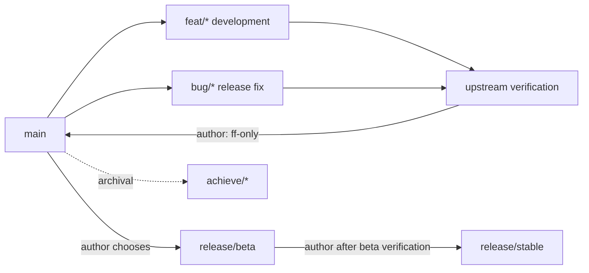

# Contributing

This guide is for developers preparing changes to this repository. It covers environment setup, building, testing, and the branch/commit/PR conventions. Development happens on an internal USTC Git instance (`https://git.ustc.edu.cn/kaiyu/nebflow`) — external pull requests are not accepted. The GitHub repository (`github.com/MashiroKai/Nebflow`) stays frozen read-only as the historical archive; it no longer receives pushes, issues, or pull requests.

## Prerequisites

| Requirement | Version | Notes |
|---|---|---|
| JDK | 23 for local development | GitHub build/test jobs use Temurin 23; the runtime floor remains 21 and artifact bytecode targets 17 |
| sbt | 1.10.10 | Pinned in `project/build.properties` |
| Node.js | 20 | Web bundle, locked tooling, script tests, and checkout-only static checks |

No `.jvmopts` or `.sdkmanrc` is used; toolchain versions live in `project/build.properties` and the CI workflow.

**Two constants, not one number — the build JDK and the artifact's bytecode target are deliberately different.** `-release:17` in `build.sbt` sets the *artifact* target (class-file major 61), while the *runtime floor* stays 21. Do not "fix" `-release:17` back to `-release:21`:

- A major-65 artifact cannot even be loaded by a 17 JVM, so the human-readable `requires Java 21` refusal (`src/main/scala/nebflow/core/JvmRequirement.scala`) becomes unreachable — the start gate never runs — and `stand update | doctor | version`, the self-repair path a user needs *on the machine being upgraded*, are welded shut.
- It does not loosen the API surface: `-release` pins both the API surface and the bytecode target, and release 17's API surface is a subset of 21's. The 21 floor is enforced at runtime by the `GatewayMain` start gate, `doctor`, the installers, the Dockerfile, and `scripts/check-jdk-baseline.sh`.
- Scala 3.5.2 cannot split "API surface 21 / bytecode 17" (`-release` and `-java-output-version` are the same setting; supplying both yields `Flag -java-output-version set repeatedly`, and `-java-output-version:17` alone lowers the API surface too).

Consequently `scripts/check-jdk-baseline.sh` asserts `-release == JDK_BYTECODE_TARGET` (A-5), that the target is strictly below the floor (A-7a), and that the built jar's `nebflow/Main.class` is major 61 (A-7b) with the 17-side behaviour checked at runtime (A-6) — see the script header.

## Build and run locally

```bash
sbt compile        # compile
sbt assembly       # fat JAR -> target/scala-3.5.2/
sbt run            # start the web server at http://localhost:6138
```

To isolate a dev server from the running gateway (default port 6138), give it its own home and port (`--home` / `--port` are global flags):

```bash
sbt "run --home /tmp/nb-dev --port 8090"
```

The web frontend is vanilla JS served from `src/main/resources/web` — a plain `sbt run` serves live sources with no npm step. The production bundle is built separately:

```bash
npm ci
node scripts/build-web.mjs    # esbuild bundle -> build/web-dist
```

The `Makefile` wraps the common invocations: `make compile`, `make run`, `make assembly`, `make install` (JAR to `~/.local/bin`), and `make check` (compile + format/lint checks, see [Code style](#code-style)).

## Testing

### Backend (Scala, munit)

```bash
sbt test                                  # full suite: ~2000+ cases, expect roughly 35–40 minutes
sbt "testOnly nebflow.core.BrandingSpec"  # directed run — fast inner loop
```

Tests execute sequentially (`Test / parallelExecution := false`) because suites share some global state — don't re-enable parallelism casually. Scope with `testOnly <package>.<SpecName>` for iteration; run the full suite before opening a PR.

### Frontend (Playwright)

Browser specs live in `tests/*.spec.mjs` and come in two kinds:

- **Self-contained specs** stub their own backend on an ephemeral port (e.g. `tests/orbit-anim.spec.mjs`) — no running instance needed.
- **Instance-backed specs** (e.g. `tests/smoke.spec.mjs`) drive a real server: point them at it with `BASE_URL` and authenticate with `NEBFLOW_TOKEN` (falls back to the instance's `~/.nebflow/auth.json`).

```bash
# one-time setup (Playwright is not a package.json dependency; CI installs it the same way)
npm install --no-save --no-package-lock @playwright/test@1.62.0
npx playwright install chromium        # only if no browser is cached yet

npx playwright test tests/orbit-anim.spec.mjs
BASE_URL=http://localhost:8090 NEBFLOW_TOKEN=... npx playwright test tests/smoke.spec.mjs
```

CI runs the smoke suite against a freshly built JAR, so a green local run plus green CI is the bar for frontend changes.

## Branches and commits

The six branch classes are:

| Branch | Purpose |
|---|---|
| `main` | Integration baseline; only the author lands verified changes. |
| `feat/*` | Ordinary development, scoped to one change. |
| `bug/*` | Fixes, including release issues, branched from `main`. |
| `achieve/*` | Archives, for example a JeV preservation branch; not an MR source. |
| `release/beta` | Author-controlled beta release line. |
| `release/stable` | Author-controlled stable release line. |

The author's `release:beta` / `release:stable` terminology maps to `release/beta` / `release/stable`: Git branch names cannot contain a colon. Existing `fix/*` branches are grandfathered, not renamed; the guard deliberately rejects them for new branch and MR checks. Batch branches use `feat/*` or `bug/*`.



For a release problem, branch `bug/*` from `main`, fix and verify it, then the author lands it on `main` and chooses whether and where to propagate it. Only the author pushes release lines. Local checks are not authorization to push USTC.

- Stage files explicitly (`git add <file>`); avoid `git add -A`.
- Commit subjects use an optional `type(scope):` prefix; write an English subject describing the intent.

### Release flow

After the author approves and lands verified changes on `main`, the author manually merges `main` into `release/beta`; its pipeline publishes the beta channel. After verifying the beta, the author merges `release/beta` into `release/stable`; its pipeline publishes the stable channel. Release lines are downstream only: never merge or write them back to `main`. Release fixes start on `main` and follow the same promotion path.

### Local guard

`tools/stand-branch-guard --help` documents exit codes and invocation. Check names with `--check-branch NAME` and MR sources with `--check-pr-source NAME`. To opt into pre-push checks, install a hook in the active worktree's hooks path (do not overwrite an existing hook); its body can call `exec /absolute/path/to/tools/stand-branch-guard --check-push "$@"`. Git supplies destination records on stdin. `--allow` is a deliberate local override, not permission to push or bypass server rules; the author alone may authorize protected pushes. Tags are not branch destinations. The guard does not enforce the separate prohibition on direct USTC pushes; server permissions and operator discipline must do so.

### USTC server protection checklist (author only)

1. In the project, inspect **Settings → Repository → Protected branches** (or the equivalent for the installed GitLab version); record existing rules and overlapping wildcard effects before changing them.
2. Protect `main`, `release/beta`, and `release/stable`. Set push/merge permissions to the named author only where the installed edition supports per-user rules; otherwise use the narrowest role available and restrict membership accordingly. Disable force pushes and deletion for these branches. Configure required review and successful pipelines where supported. Verify the effective permissions, including broader wildcard rules and administrative bypasses.
3. Restrict USTC write access so non-authors cannot push directly, and have the author alone open MRs from `feat/*` or `bug/*` to `main`, merge after upstream verification using fast-forward only, and push the chosen release line. GitLab branch protection by itself may not enforce source-name restrictions or distinguish one user from others with the same role; use an instance-supported server-side push/MR rule or author-controlled permissions, and document any edition limitation rather than claiming enforcement.
4. Set the project merge method to **Fast-forward merge** if available. Test with a non-author account and disposable branches: forbidden direct pushes and unauthorized merges must fail; allowed author workflow and source-name checks must behave as intended. Do not force-update protected refs during testing.
5. On USTC, archive the legacy branches as `achieve/beta-20261116` and `achieve/release-20261116`, verify the archive refs point to the original tips, then delete the legacy branches. Adjust protection only as necessary under author control; do not delete before verification. Confirm the new release-line protections and pipelines before publication.

## Pull requests

- USTC PRs (merge requests) target `main`, use only `feat/*` or `bug/*` sources, and are opened by the author only. Keep the diff minimal and scoped to one change. Only the author merges after upstream verification, with fast-forward only; contributors and agents do not push directly to USTC.
- Before opening: run the gates appropriate to the change and affected tests. For Scala changes run `sbt compile` and `make check` (scalafmt + scalafix); for frontend changes run the type/cycle gates and the affected Playwright specs (see below).
- The static quality job is blocking in both `.github/workflows/ci.yml` and `.gitlab-ci.yml`; the latter includes merge requests and every branch. `.github/workflows/auto-release.yml` also requires this same entrypoint before building. Existing advisory browser jobs remain advisory. Configuration describes intended execution, not evidence that a remote CI run has passed.

## Code style

- **Scala 3** (3.5.2, significant indentation). Formatting is enforced by scalafmt and scalafix — `make check` runs `sbt scalafmtCheckAll "scalafix --check"`. The compiler runs with `-Xfatal-warnings`: fix the warning, don't suppress it.
- **Frontend** is vanilla JS with no TypeScript build step. The shared registry in `scripts/run-checks.mjs` owns checkout-only check membership. Install pinned tools with `npm ci`; no check downloads a compiler or linter implicitly.

### Checkout-only quality gates

```bash
npm ci
npm run check:static                       # shared blocking static profile
npm run test:scripts                       # node --test scripts/tests/*.test.mjs
npm run lint:tools                         # new/modified engineering tools only
npm run check:sdd                          # all current/change/archive artifacts, no diff coverage claim
npm run check:sdd-changed -- --base main    # explicit base, additional changed-path coverage
npm run check:openspec -- --download        # pinned upstream validator; requires network
node scripts/run-checks.mjs --profile static --list
make frontend-gates                       # dependency-free Node source sentinels only
make check-static                         # same as npm run check:static
```

`make check-sdd`, `make test-scripts`, and `make lint-tools` wrap the corresponding npm scripts. These Node-only targets do not probe Maven mirrors or start services. `make check` additionally runs Scala compilation/format/lint. Installed-plugin parity remains an explicit `make plugin-seed-parity` check; it is not a checkout-only success signal. JVM, browser, runtime, and live-plugin checks remain separate and need their own prerequisites and evidence.

The static profile reuses the existing frontend/CI source checks plus tooling lint, script tests, and SDD validation. It reports each named command's elapsed time and exit status, with bounded execution and heartbeat output; spawn failures, signals, and timeouts fail the profile. `--list`/`--dry-run` prints commands without running them. The optional `sdd-changed` profile requires `--base` and rejects invalid Git refs; the default static profile always validates full SDD artifacts without a base. Structural trace validation does not execute referenced tests or establish semantic correctness.

`check-js-types.mjs` uses locked local TypeScript and compares recognized source diagnostics against `tests/type-baseline.json`. Configuration errors, unknown output (including unexplained indented output), empty failed output, process errors, signals, and timeouts fail closed. `--update` writes a baseline only after valid compiler output; use it only to reduce reviewed type debt, never to hide a regression. Static import cycles fail the cycle gate; dynamic `import()` is the existing escape hatch where appropriate.

### Visual regression baseline

`tests/visual/` + `scripts/visual-baseline.mjs` (adopted 2026-11-01) render six scenarios (`--list`) in dark and light through a **zero-port** harness — `page.route` serves `src/main/resources/web` from disk with a MockWS injection, so it structurally cannot reach a running instance (or the host gateway port) — and pixel-compare each shot against a committed baseline PNG.

```bash
make check-visual              # = node scripts/visual-baseline.mjs --check --max-ratio 0.0005 (gate)
make check-visual VISUAL_MAX_RATIO=0   # strict zero-diff run
make visual-baseline          # = --update → writes a DRAFT into the review area only (never the committed baseline)
make visual-baseline-promote  # = --promote --i-reviewed → pushes that reviewed draft into tests/visual/baseline/
node scripts/visual-baseline.mjs --check --filter canvas --determinism
```

Baselines are stored **per host platform key**: `tests/visual/baseline/<process.platform>-<browserLabel>/` (e.g. `win32-msedge-156`, `darwin-chromium-151`). Pixels are not comparable across OS/browser builds, so a host without its own baseline directory reports `MISS` on every shot — a red, never a silent pass. `win32-msedge-156/` was recorded on the author's Windows + Edge host and belongs to the **Windows runner leg**; on another host record your own set with `make visual-baseline` (draft → `.nebflow/visual-baseline/<platform>/baseline-draft/`), eyeball it, then land it with `make visual-baseline-promote` and commit `tests/visual/baseline/<platform>/`. **Recording is two-stage on purpose**: `--update` used to write straight into the committed baseline directory while the docs claimed a review area existed, so a routine re-record silently replaced the reference frames the gate compares against — the review step was unimplementable. Now `--update` cannot touch `tests/visual/baseline/` at all; only `--promote --i-reviewed` can, and a bare CLI `--promote` without the acknowledgement flag is refused with the draft inventory printed. Tolerances are strict zero by default in the script (`--tolerance` / `--max-ratio` widen them explicitly — loosening a baseline is not a fix for a real pixel change); `make check-visual` passes `--max-ratio 0.0005` because both recorded hosts showed 12–16 px of random antialiasing drift on the 1 px pane border of the two monaco scenarios (0.002–0.003%, deterministic within a run, so it is host rendering noise rather than product jitter). Use `make check-visual VISUAL_MAX_RATIO=0` for a strict zero-diff run — recommended on the Windows runner leg, whose baselines were captured noise-free. Run it after frontend changes that can move layout; the GitHub CI legs do not carry it yet (no matching platform baselines there).
