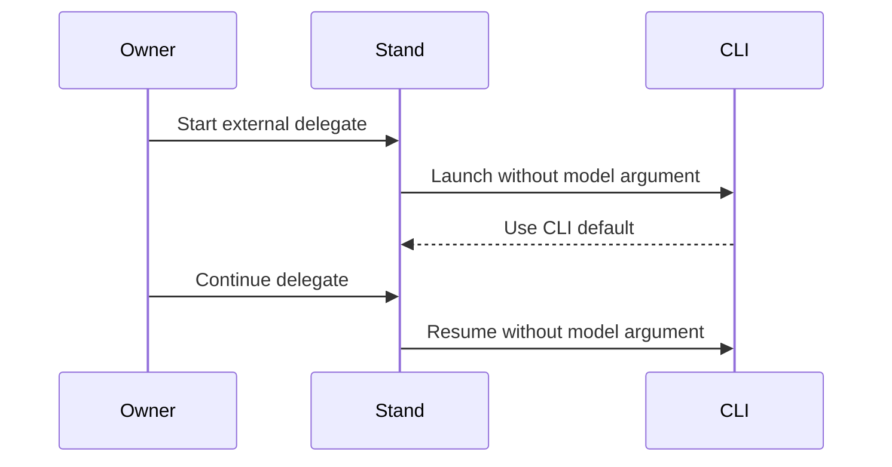
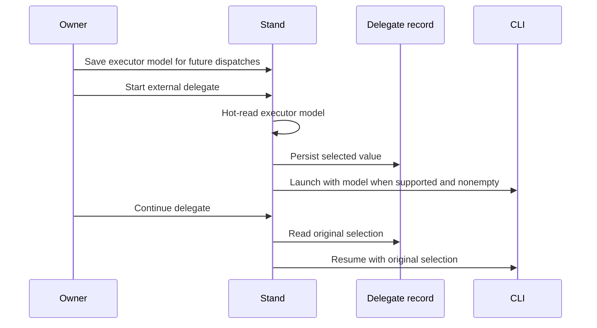

# Dispatch behavior

## Before

## After

For an empty selection Stand sends no model argument, so the CLI itself resolves its current default. ZCode has no verified headless model argument and is presented as unsupported.
