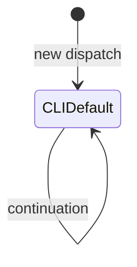
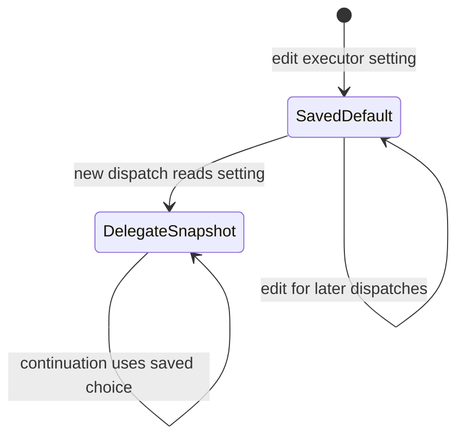

# State machine

The executor process lifecycle is unchanged. The following diagrams show the model-selection data lifecycle, including the distinction between a global default and a persisted delegate value.

## Before

## After

An empty snapshot means no model flag; the CLI resolves its own default on each invocation. The diagrams do not imply a new runtime process state machine.
