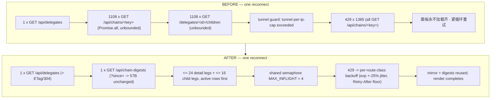

# Behaviour — client read round and the engine's answer

Both halves are shown as before/after because the defect was a *shape*, not a
constant.

## Before/after at a glance (Mermaid comparison)



The two rounds carry the same data and the same engine; only the load shape and
the budget differ. Numbers below are measured, not estimated.

## Client round (`delegateChainProvider.js`)

**Before** — the round was a full fan-out with no bound:

```
rows = GET /api/delegates
await Promise.all([
  ...rows.map(r => GET /api/chains/<key>),      // 1108 in production
  ...rows.map(r => GET /delegates/<id>/children) // 1108 in production
])
dispatch(mirror-updated)
```

Every reconnect re-ran the whole thing from an empty mirror; the `429` path kept
the *previous* answer's entry (read before written) and was keyed per URL, so the
backoff table grew with the key set and the tight loop survived it.

**After** — the round is a bounded sequence, and the reconnect reuses state:

```
rows     = GET /api/delegates            (1, 304-capable)
digests  = GET /api/chain-digests        (1, ?since= -> body-less)
candidates = { k | uncached ∨ digest[k] changed ∨ (active(k) ∧ age > 5s) }
batch    = activeFirst(candidates) |> take(24)
children = dueChildren |> take(16)
for each in batch ∪ children under a 4-way semaphore:
   detail/child read
  (a 429 stands the rest of the round down)
dispatch(mirror-updated)  only if rows changed ∨ digest set non-empty ∨ a read wrote
```

**Before/after, measured** (production row/key counts, deterministic replay; and
the real browser on an isolated instance seeded from the production data):

| Round | Before | After |
| --- | --- | --- |
| cold (real browser, isolated instance on the production data) | 604 requests, unbounded concurrency (282 details + 282 child legs) | 125 requests (2 row + 2 digest + 48 details + 32 child legs + 41 seed reads) |
| reconnect (same two hops) | 603 requests again, same fan-out | 125 requests; **0** detail replays once warm and unchanged |
| cold (production row/key counts, deterministic replay) | 2217 requests (1108 details + 1108 child legs) | 42 requests (1 row + 1 digest + 24 details + 16 child legs) |
| detail attempts inside one 60 s 429 window | 1108, no spacing | 52 in the deterministic replay (`storm60sDetail`), 8 in the registered gate — spacing enforced by the backoff window |

## Engine tunnel guard (`connguard.scala`)

**Before** — a single per-envelope-IP budget of 1024/60 s, calibrated from
"two static asset trees plus bootstrap", silently shared by every route class,
and **not printed anywhere** at startup:

```
conn-guard enabled=true wsPerIpCap=64 wsTotalCap=1024 warnPct=80 snapshotSec=60 trusted=[...]
```

**After** — a data-plane budget, per-class buckets, and the caps on every reading
surface:

```
conn-guard enabled=true ... trusted=[...] tunnelPerIpCap=4096 tunnelTotalCap=40960
  tunnelWindowSec=60 tunnelChainsPerIpCap=2048 tunnelFilesPerIpCap=4096 tunnelOtherPerIpCap=4096

snapshot ... tunnelReq=<n> tunnelRejected=<n> tunnelCaps=4096/2048/4096/4096
health   ... {"tunnel":{"reqTotal","rejectedTotal","perIpCap":4096,"totalCap":40960,
                      "chainsPerIpCap":2048,"filesPerIpCap":4096,"otherPerIpCap":4096}}
```

Unchanged, deliberately: no loopback exemption on this face, "strictly above the
cap" admission (exactly the cap is admitted), the per-rejection WARN line, and
the `429` answer with its `Retry-After` header.

## Read face (`GET /api/chain-digests`)

**Before** — no bulk summary existed; a client that wanted to know "did anything
move" had to read every key (`N` requests, the storm's second half).

**After** — one request:

```
GET /api/chain-digests
  -> 200 {v:1, fingerprint:"e9e250513cd3dc09", count:2328, digests:{"900":"0b402fed…", …}}   64519 B / 0.12 s
GET /api/chain-digests?since=e9e250513cd3dc09
  -> 200 {v:1, fingerprint:"e9e250513cd3dc09", unchanged:true}                                    57 B / 0.19 s
GET /api/chain-digests   (If-None-Match: "<etag>")
  -> 304                                                                                          0 B
```

Appending one row changes that key's digest (and the fingerprint) and leaves
every other key's digest byte-identical — so a client re-reads one detail, not
the tree.
