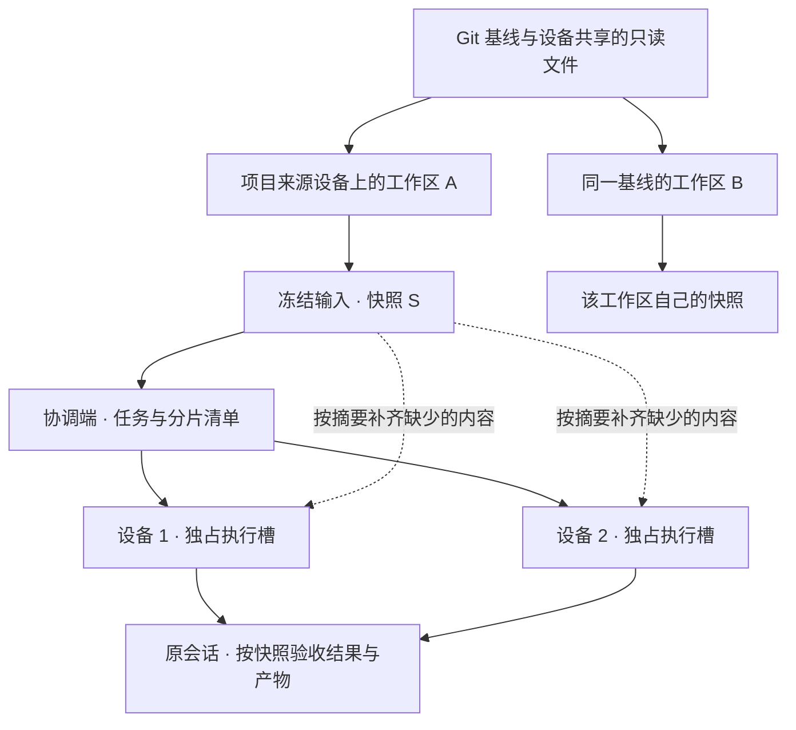

# Stand 多设备测试与虚拟工作区 SPEC

**评审稿 · 2026-11-19 · 工程基线 `feat/base@317e6b1cf`**

首个使用者是正在开发 Stand 的人。目标是一次解决两个具体问题：同一个版本开出多个工作区时，磁盘主要为各自的改动付费；验证一个工作区时，已授权的空闲设备能替开发机跑测试，并把结果送回原会话。

## 1. 第一版交付什么

开发者在 Mac 上照常通过 `scripts/stand-wt.py new` 打开两个基于同一版本的分支。两边都有普通目录、自己的 Git index 和 HEAD，编辑器、终端和 Agent 均可直接访问。相同文件在支持的卷上共享数据块。一边改文件、删目录、切换分支或提交，另一边继续看到自己的内容。

开发者接着说「验证我现在的改动」。Agent 从项目预设中选取自足 Playwright 套件。Stand 固定**这一刻的工作区版本**，将测试交给一台已授权设备，或拆给两台环境相容的设备。开发者可以立即继续编辑。完成卡给出对应的输入版本、执行设备、通过与失败清单、失败截图和复跑入口。点“重跑原版本”使用原输入，点“验证当前改动”才重新取快照。

**R1 的发布条件同时包含本机写时复制工作区和真机远程测试。** 能远程执行一条命令、只在一台电脑上模拟两台、或只显示去重率，都不足以启用默认路径。先用一台借出的设备释放开发机，再用两台合格执行设备证明整轮等待时间缩短。第二阶段 R2 再把普通工具看到的目录变成真正按读加载的文件系统。

## 2. 依据与取舍

| 已核对的事实 | 对首版的约束 |
|---|---|
| 正式抽样时，Git 在本机登记 251 个工作区（含主检出和本方案分支），其中 112 处有独立的 `target/`。当前开发基线跟踪内容约 96.5 MiB。三个已编译工作区的 `target/` 目录读数分别为 383、394、474 MiB。 | 各自衡量源码和构建输出。即使源码全部共享，每树一个可写的编译目录仍然昂贵。目录统计不能换算为全盘可回收容量。 |
| 开发脚本用普通 `git worktree add` 创建工作区。引擎的 `GitWorktrees` 负责读取事实，delegate 可从 shell 建树；部分路径查找仍优先使用旧的 `.nebflow` 布局。 | 从已有建树入口接入优化，让 delegate 走同一入口，按注册路径解析新旧工作区。手动创建的普通 Git 树继续可读。 |
| Stand 已有设备名册、六类工具的显式设备路由、认证配对、文件分块校验与传输、远端结果补投。项目工作区在 origin 设备，另一台可以持有引擎账本。设备画像主要描述平台和工具。 | 保留项目归属和工具路由。新增可冻结的作业输入、资源预留、执行记录和产物验收。旧稿的整树打包可作冷启动参照；热路径只传目标缺少的对象。 |
| Scala 构建设置 `Test / parallelExecution := false`，Playwright 因固定端口设置 `workers: 1`。 | R1 每台设备同时只跑一组这类浏览器测试。按文件分到不同设备，在提交前枚举一次完整测试集合。 |

11 月 19 日 18:23 的 APFS 只读抽样还发现，六种较大静态资源在源码路径上已有 4.35 GiB 私有块，其编译副本另有 1.83 GiB，两组原始字节合计约 6.19 GiB。此处已按文件身份去重，跨版本内容并未逐件比对，数值不能当作可立即释放的空间。抽样脚本和原始字节留在本批 evidence。Git 对象库本来就在 linked worktree 之间共享；重复成本主要来自检出的文件、工具产生的副本及可写输出。报告中的样本并非全机磁盘归因。定位入口见仓库的 `scripts/stand-wt.py`、`src/main/scala/nebflow/core/GitWorktrees.scala`、`src/main/scala/nebflow/shared/paths.scala`、`src/main/scala/nebflow/core/project/DeviceProjectMount.scala`、`build.sbt` 与 `playwright.config.mjs`。[Git worktree 文档](https://git-scm.com/docs/git-worktree)

架构沿用 10 月 22 日《多设备算力分摊》关于设备授权、作业输入回执、产物验收和租约的设计。你在《解释Scion原理》和《分支 · 解释Scion原理》里提出的两个目标是**跨设备透明文件访问**和**多 Agent 独立可写工作区**。两者在这里使用同一个不可变目录快照。Scion 的内容寻址和稀疏、按需检出是参考，Git 继续管理 Stand 的分支和合并。EdenFS 提供源码工作区设计参考，Sapling 官方的普通 `.git` 模式目前不支持直接启用 EdenFS。[Anthropic 的 Scion 设计](https://www.anthropic.com/research/redesigning-source-control) · [Sapling 兼容矩阵](https://sapling-scm.com/docs/git/git_support_modes/)

## 3. 两条路径，共用一个版本

| 对象 | 谁能写 | 持久标识与用途 |
|---|---|---|
| 项目及开发工作区 | 工作区所有者、其正常 Git 工具 | 项目 ID、来源设备、工作区 ID。路径由设备解析。分支和提交职责仍归 Git。 |
| 输入快照 | 发布时生成一次 | 规范目录树的摘要和格式版本。记录 base commit、输入策略版本和来源作为溯源。同一份快照可以供多个分片读取。 |
| 设备上的只读内容 | 存储服务验证后原子写入 | 租户与项目范围内按摘要寻址。Git 对象可充当已知内容的来源，同一设备多个工作区复用。 |
| 开发改动与执行临时写入 | 各自的开发工作区或独占执行槽 | 源码改动归工作区；测试临时文件、编译输出和日志归尝试。只有声明的结果进入回传清单。 |
| 作业、分片、尝试 | 项目协调端持有权威状态；执行设备提交回执 | 作业 ID 固定输入，分片 ID 固定用例集合；每次重派生成单调递增的尝试代号。 |

R1 的协调端是发起任务且持有项目账本的 Stand 实例。来源设备也可以是远端挂载项目的 origin。取快照在 origin 发生，协调端和执行设备均不能把同名本机路径当作项目来源。普通 Bash、终端、编辑和连续调试保持工作区亲和。控制消息只携带标识、条件、状态及摘要。普通文件读取走运行设备的本地文件系统。

## 4. R1 工作区与空间预算

**新建开发工作区。** 扩展 `stand-wt.py new` 的后端选择，保留原分支基线、merge-base 核验、路径、临时交付和台账契约。优先从同卷的已验证种子为每个文件创建 APFS clone。种子按 Git tree、检出属性、过滤器及平台转换规则索引，仅包含允许的跟踪内容。相邻提交可按文件内容和转换规则复用种子，避免为每个 commit 长期保存整棵新的完整副本。首次种子构建有完整写入成本，计入冷启动和配额。[Apple 对 APFS 克隆的说明](https://developer.apple.com/library/archive/documentation/FileManagement/Conceptual/APFS_Guide/Features/Features.html)

1. 通过 Git 注册 linked worktree（`worktree add --no-checkout`），由 Git 创建各自的元数据。仅从验证过的种子生成检出文件，使用 Git 命令初始化该树的 index 到目标 tree，保留 Git 创建的 `.git` 指针。普通文件、可执行位、符号链接、删除和大小写规则逐项与同配置的原生检出对照。
2. 在未发布状态完成内容、HEAD、index、工作区干净度以及策略所需 hook 的等价性检查后，才把目录交给调用方。活跃主工作区、用户 home、嵌套 worktree 和可变构建输出均不可作为种子。可写文件之间禁止使用共享 inode 的硬链接。
3. 实际建一个小克隆并写后读回对照物，以探测卷能力。跨卷、无法复现过滤器/LFS/子模块/检出钩子、文件名冲突或预检不通过时，按原因退回原生 Git 路径，公开实际后端。中断恢复只接管本次创建且仍属该请求的未交付目录或元数据；发现用户改动即保留并报告。普通工作树和旧目录按原 ID/路径继续工作。
4. 开发区在 `.stand/worktrees/<wtname>/`。项目临时证据与交付继续使用 `.stand/tmp/<wtname>/{evidence,delivery/<batch>}/` 及仓库审计命令。已有工作区可在完成当前任务后自然退出，迁移只对用户选定并核验干净的工作区单独进行。首次启用时不做全盘迁移。

**编译、依赖和测试数据。** 每台贡献设备先给 Stand 一个独占执行槽，队列中十个作业不会新建十份长驻 `target/`。按设备/项目/环境键复用已验证的依赖下载和浏览器安装；每次尝试拥有隔离的可写工作目录、临时 home、报告和输出。R1 浏览器测试可使用按锁文件及工具版本准备的只读种子或独占安装。可执行内容的缓存绑定项目授权，禁止跨不信任项目共用可写依赖。Scala 接入后先独占使用工具链验证过的稳定槽路径，源码移除、工具链变化或增量状态不可判定时用干净构建。Zinc 的分析缓存、`target/`、可写 `node_modules` 均不在并发任务间共享。

**磁盘上界。** 每台机器配置可用名额、最低空余空间和缓存上限。入场先预估本轮新增对象、输出和预留空间，无法容纳时拒领。对象采用引用固定、校验临时文件和原子发布。活跃工作区、待回传结果、可复跑保留期内的快照，各自持有引用。先回收已验收尝试的临时目录，再按最近使用清理没有引用的缓存。磁盘告警时可暂停派活。作业级回收仅触及 Stand 创建并标记归属的执行数据；开发工作区、未入库交付和历史工作区继续走项目原有清理流程。

## 5. 同一快照怎样到达另一台设备

**输入契约。** 读取当前工作目录里的实际内容，包括已暂存后又编辑的文件、未暂存修改、删除、重命名和预设明确纳入的新增文件。Git index 用于识别路径和溯源，测试读取的字节以工作区为准。首次提交前展示新增候选与排除项，并允许项目配置测试所需的未跟踪 fixture。`.git`、Stand 数据根、凭据、嵌套工作区和通用构建缓存不能进入传输。某项测试确实依赖一个默认忽略的生成输入时，须由预设按具体路径产生或声明；缺失时报告原因。

**快照发布。** 目录条目按确定顺序编码路径、类型、执行位、内容或链接文本的 SHA-256；格式带版本号。拒绝绝对路径、目录逃逸、外部符号链接解引用及目标平台不可表示的路径。对象按测试进程实际看到的文件字节计算，记录 Git 属性与平台约束。捕获前后校验文件清单、文件标识及变更代数，读取时复核内容；检测到外部写入则重取。若后端无法证明输入在同一稳定边界，通过文件系统快照或短暂停写取得一致视图；仍无法得到稳定输入就明确返回“工作区正在变化”，不向设备发布混合版本。发布后继续编辑产生下一个快照。

**传输与落盘。** 对端先收目录清单并返回项目作用域内的缺失摘要；协调端或已授权来源设备经 NebLink 成批发送缺少的字节，复用 Stand 的分块校验与断点续传。大批小文件可聚合到包传输，每个条目仍按摘要验收。大文件可续传。快照清单本身就定义本次预设的输入范围，R1 将这份清单完整落地并核验根摘要后开跑。预设尚不能可靠描述较小的范围时，在取快照前选用整个允许的源码树。缓存丢失时重新补齐。输入被冻结后，传输中断可以从同一版本恢复。

**撤权与隔离。** 同账号用于发现设备。设备所有者另外开启「贡献给我的项目」，限定项目、可运行的测试预设、槽位和空间。接单和取对象都要校验当前授权及设备身份。执行使用独立低权限账户或经验证的隔离环境、空白 HOME、最小环境变量和独立数据根；现有宿主直跑后端本身没有提供这个隔离保证。R1 接受自有、受信项目中的测试代码。设备撤权后拒绝新作业和对象请求，已有尝试进入取消/失联处置。发布、签名、推送和依赖个人密钥的动作不进入测试预设。

## 6. 作业提交、放置与回传

以下接口均为拟议契约。CLI、Agent 工具和 Flow Map 节点消费同一服务；R1 优先交付 CLI 和 Agent 工具。CLI 示例为 `stand test --profile playwright-self-contained --placement auto`，执行目录决定工作区。调用者可选 `local`、`auto` 或某个设备 ID。指定设备不可用时如实返回；自动模式可选择符合条件且允许接活的本机。用户选择“仅远端”时，系统排队或提示当前无合格设备。

| 交互 | 至少记录的字段 | 确认条件 |
|---|---|---|
| 提交与冻结 | projectId、workspaceId、snapshotId、profile 版本、分片清单摘要、平台约束、placement、请求幂等键 | 相同请求的重发返回原 jobId。用户主动复跑获得新 jobId 并可引用原快照。 |
| 预留与启动 | jobId、shardId、attempt、deviceId、工具链指纹、槽位、租约期限 | 设备原子占槽并持久登记尝试。重复启动消息只返回已有状态。心跳续租，设备可因人开始使用、空间紧张或电量策略拒领新任务。 |
| 收集与验收 | snapshotId、attempt、退出状态、预期和实际用例 ID、结果、跳过原因、日志/截图摘要与字节数 | 在接收端逐件验收后发布一次终态。测试断言失败是有效测试结果；断电、用例缺失、报告损坏是基础设施故障。 |
| 取消与恢复 | 取消标志、最后确认的尝试、进程归属、回传确认 | 协调端重启从持久记录恢复；设备重连可查询或补投。只取消本次尝试拥有的进程，回收前核验进程和端口。 |

调度先按授权、协议、OS/架构、工具版本、用例约束、可用槽位和空间筛选。R1 可用“合格且能立即预留、已缓存的缺失字节较少”排序，平手按设备 ID 稳定选择。记录跳过设备的原因。后续利用实测的吞吐和用例历史耗时，估算排队、传输及执行的完成时间。无需让 Agent 轮询设备负载。

每个分片经过「等待 → 已预留 → 运行 → 回传 → 已验收」。租约失效先记录失联，有条件时向原设备查询。只对支持安全重试的分片在新尝试号下换机。旧设备可能仍在跑；协调端仅接纳当前有效尝试的终态，迟到结果留作诊断。真实断言失败按失败结案，重派不能抹去失败。总作业只在预期用例覆盖完整、跳过项符合预设且各报告验收通过后标绿；断连空报告或少跑一个文件都不能冒充成功。

## 7. R1 工作负载和验收

选 Stand 自足 Playwright 文件。用仓库锁定的 Node、Playwright、浏览器版本和 `PW_SELFCONTAINED_ONLY=1` 枚举用例，剔除独立 Node runner、真实实例测试以及跨文件有依赖的集合，记下理由。先冻结测试清单再分片，保留文件内顺序与 `workers: 1`。为等价执行分片使用同一目标环境；特意验证不同 OS 时分开出具平台结果。每个分片生成 blob 报告和诊断附件，在协调端按同一版本合并。[Playwright 分片与报告合并](https://playwright.dev/docs/test-sharding)

以下数值是**首版建议验收线**，用于决定是否开放默认使用。它们不是已测收益。

| 验收项 | 实验与判定 |
|---|---|
| 工作区等价和隔离 | 同一 Git tree 建普通和 CoW 工作区。逐项核对初始内容及 `git status/diff`；在 A 原地写、原子替换、改权限、删、重命名、add/commit、切分支，B 和种子均应保持原内容。覆盖并发新建、半途失败、同名分支、低空间、非克隆卷回退和旧工作区解析。 |
| 增量占盘 | 在安静的专用 APFS 测试卷上，分别从等价环境建立 1、5、10 棵同版本检出，再在每棵写入可复现的 1 MiB。单列 Git 库、首次种子、工作区元数据、私有块、输出和缓存。以卷可用块差为主，以 APFS 私有块抽样交叉验证。建议门槛：从第 2 至第 10 棵的合计物理增量 ≤ 原生 Git 对照的 30%；同时披露含首棵和种子的 10 棵总成本、建树耗时及异基线结果。 |
| 正确版本和最小传输 | 只在未提交改动里引入一个必失败断言，同时新增 fixture、删除旧文件。远端必须复现失败，修复后原快照仍失败、新快照通过。第二次同版本热跑，已有源码对象传输量为 0（清单、协议与结果另记）；改一个文件时只补新增对象。 |
| 两项独立的收益 | 同一清单做三组：开发机单跑、一台闲机整组卸载、两台合格设备分片。固定设备配置，每组至少 5 次，冷/热分开。比较从提交到报告可读的中位数、范围、开发机 CPU 秒和峰值内存；分列冻结、排队、传输、执行及回传。建议门槛：远端整组热跑的开发机测试相关 CPU 秒 ≤ 本机的 50%；双机热跑中位耗时 ≤ 开发机单跑的 80%。另报双机对最快单设备的比值以识别硬件差异。缺第二台相容设备时，分片提速保持待验。 |
| 累积输出和结果完整性 | 同一设备连续执行至少 10 次，回收已确认的执行临时目录。缓存满足配置配额，活跃可写输出目录数受槽位数约束；单列开发机及所有 worker 的磁盘高水位和收尾占用。两台合并的用例 ID 与基准相同，覆盖重复、遗漏、预期跳过、断言失败及报告传输失败。 |
| 故障与运维 | 在运行中让测试设备断联、重连；模拟协调端重启、磁盘满、权限撤回、结果迟到和取消。验证只有有效尝试入账，无误绿、无来源工作区写入、无重复领取同一槽。涉及隔离 JVM 时保存准确的 PID、数据根、端口及退出核验；既有开发实例不参与演练。 |

未达速度线时仍可保留显式远端卸载供选择，收集是排队、网络、冷缓存还是分片失衡造成的差距。未达正确性或隔离要求的后端不能投产。现有工作区的清理收益另作授权、另行实测，不计入新建路径的指标。

## 8. R2 真正按需的虚拟工作区

R1 的 CoW 会创建目录项并提供完整文件视图，节约的是重复数据块；读过什么文件不会改变首棵种子的大小。R2 在同一快照协议上引入系统可挂载后端。Shell、IDE、Git、sbt 和浏览器打开普通路径；列目录只需元数据，首次读冷文件才取内容，设备缓存命中就本地读取。多个 workspace 引用相同的只读快照，各自有可写 overlay。删除基线文件写删除标记，重命名及跨目录替换原子记录；测试写入单独的执行层。checkpoint 将源码改动和删除标记冻结成新目录根，显式导出为 Git 变更，由既有评审与合并流程接收。

Scala 中的 workspace、device、job 由逻辑 ID 寻址，使用现有引擎消息和 NebLink 运送控制命令。每个文件的 open/read 不经过远端 Actor 邮箱。原生文件系统适配器可单独用 Rust 实现，以稳定的本机 IPC 交互；R1 可直接调用平台克隆原语。Linux 优先验证 FUSE；已有只读 lower 时可用 OverlayFS 合并私有 upper。macOS 评估系统支持的挂载接口和安装条件，Windows 评估 ProjFS。每个平台通过相同的文件语义矩阵后再开放对应后端。普通检出和 CoW 始终是按设备报告的可用模式。[Linux OverlayFS](https://docs.kernel.org/filesystems/overlayfs.html) · [EdenFS 设计](https://github.com/meta/sapling/blob/main/eden/fs/docs/Overview.md)

R2 验收包含目录遍历、只读一个冷文件的实际取件数、跨工作区缓存命中、删除后重建、原子保存、mmap、文件监听、锁、进程崩溃后的 checkpoint 恢复，以及离线时缓存命中和缺失各自的行为。全量测试读取全树时，允许预取或批量落盘，分别记录首次加载和热跑。跨设备继续编辑采用“冻结旧 overlay → 在新设备准备 → 持久转移单写者租约 → 激活新写者”；旧代写入不能发布，分叉修改从共同快照另建工作区，通过 Git 显式合并。

## 9. 实施顺序与退出条件

| 批次 | 可演示的交付 | 进入下一批的条件 |
|---|---|---|
| R1a · 本机 | 建树入口支持 CoW/原生双后端；Agent 建树复用入口；冻结工作区可得到可重放的带未提交改动快照。 | Git 对照、双工作区隔离和磁盘增量过线。 |
| R1b · 一台闲机 | 一条命令或一次 Agent 工具调用完成授权、快照同步、独占槽运行、断言失败回传与原版本复跑。 | 真机看到未提交的故意失败，热同步不重传，主机减负及单槽空间回收过线。 |
| R1c · 两台执行设备 | 同一作业自动分片，合并报告；租约重派、迟到验收、取消与恢复可观察。 | 真机等价性、速度和故障演练通过。R1 至此具备两项完整收益。 |
| R2 · 懒加载与更多任务 | 先做一个平台的按需挂载；扩展到 Scala `testOnly` 套件，保留特殊 JVM 分组。再按兼容验收扩展平台。 | 普通工具语义、跨设备 checkpoint 及按需读量有证据，再扩大默认适用面。 |

默认模式按项目和设备分批开启。回退时停止该后端接收新作业，已开始任务按尝试 ID 收尾；仍有源码改动的工作区先导出并校验快照，再按需恢复普通 Git 检出。测试借出的算力不会获得合并、发布或推送权限。本次交付为设计评审，实机速度、节省容量和各平台挂载兼容性待上述试验给出。
