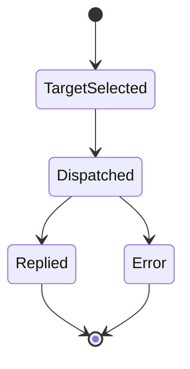
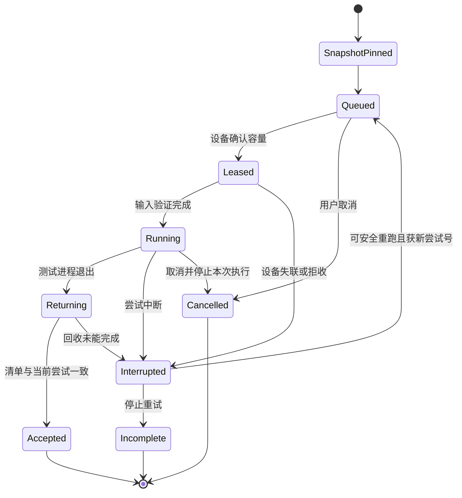

# 测试任务状态

## Before

现有定向调用追踪目标设备上的命令或委派。以下简图以普通远程工具调用为例。

## After

下图表示设计中的单个测试分片。父任务须核对计划中的全部分片、用例和当前有效尝试。测试失败可以是有效结果，失联、缺片和产物校验错误必须单独显示。

快照和本地暂存各自按引用管理。设备完成、取消或重启后须对账，清理仅限当前尝试所属目录和进程。迟到回执可保留作诊断，父任务只采纳仍有效的尝试。
