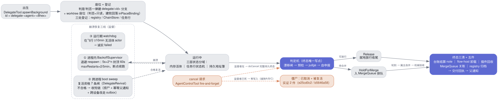
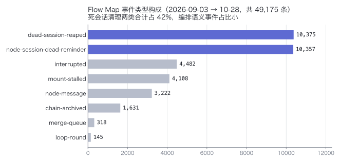

# 审计报告二：delegate／插件分配／AgentFlow／合并队列／门户数据面（权威版）

> **取代关系**　本文取代过程件 `reports/20261028_104800_report2-delegate-plugin-agentflow-mergequeue-portal__flow-4a0918e2/REPORT.md`（五腿并行侦查 chain flow-4a0918e2 收口报告；作者令 2026-10-28 17:1x 用 visual-report 插件重写）。原稿保留在 reports/ 不动；事实与证据锚（文件:行号）全保留，重写的只有**文档性**：原稿是结论倾倒，本文按「先讲机制 → 再给评估 → 风险建议集中成表」重排。落位 docs/ 知识图谱可索引位（图谱视图 [[glossary#^graph-view]]）——落位本身是对 KG 审计「收录率 0%」发现的纠正（库外过程件，路径见附录 B）。
>
> 侦查性质：五腿并行只读，零代码/配置/引擎改动（唯一写动作 = 按 merge-quarantine PROVENANCE 的 restoreHint 移回三腿产物，见 §4.4）。

**图预算声明**　命中图类 6（4 流程/链路 + 1 组事件构成 + 1 状态机），超 ≤3 图硬预算：按结论权重画 **delegate 生命周期（图 1）、AgentFlow 事件构成（图 2）、portal 链路（图 3）**；插件分配链、合并队列三闸与状态机降级为列表/表格。

目录：

- [执行摘要](#执行摘要)
- [1. delegate 机制](#1-delegate-机制)
- [2. 插件分配](#2-插件分配)
- [3. AgentFlow 与 Flow Map](#3-agentflow-与-flow-map)
- [4. 合并队列](#4-合并队列)
- [5. 官网入口与数据同步](#5-官网入口与数据同步)
- [6. 风险与建议总表](#6-风险与建议总表)
- [附录](#附录)

## 执行摘要

**一句话总评**：五套机制主链路全部健康在位，缺陷集中在**持久性缝隙**（cancel 不落盘、合并通道不落盘）与**利用率/数据面浪费**（插件注入弱、门户数据面冗余）。

| 板块 | 机制一句话 | 健康度 | 最大风险 |
|---|---|---|---|
| delegate | spawn 建分支+worktree 座位 → 三处登记 → 监督三线护航 → 判定机收口，终态唯一写点 | 主链路健康：生命周期单点、终态唯一写点、三层状态分域干净 | cancel 意图持久性全押任务行一行：已实证 2 件「已取消×被复活」僵尸（R1） |
| 插件分配 | 目录即声明面；分配走「目录渲染→点名→许可→装载注入→会话内过滤」五步 | 机制健康、利用率低：21 装 7 trusted，revoked/dispatch 零使用，MCP 型零个 | delegate 腿注入弱：外部执行器零注入、内置腿常 fail-open 空集——能力静默缺失（R2） |
| AgentFlow / Flow Map | 一次性 AgentFlow 与持久 Flow Map 共用同一 NodeEngine 底座（legacy 引擎不承现役流量）；delegate 管单任务，Flow Map 管多节点编排 | 运行正常但近休眠：当前 0 活跃节点，近 3 个日历日合计 13 条事件 | 事件构成 42% 是死会话清理；账本 4 条 active 与 0 节点不一致；压缩轮转 GB 级膨胀（R3/R4） |
| 合并队列 | 纯排队+通知的「交通引导员」：引擎永不代并，放行=提醒属主自并，机械验收关账 | 运转良好：24 merged / 1 owner-gone / 0 failed，中位排队 ~49s | 重启丢队：投递通道不落盘，每次引擎重启把未关账成员打成人工处置（R5） |
| 门户与数据面 | 浏览器→OIDC→relay WS→本机隧道→一次性 ticket 兑换 cookie，入口单源 brand.conf | 链路通、安全面在位（一次性 ticket+token hash 校验） | 数据面浪费：头像内联 ~267KB/帧为最大单帧；WS v1.3 压缩已落 main 但结构性未部署、单边上线零收益（R6） |

## 1. delegate 机制

**delegate（委托出去跑单个任务的后台子会话**：有自己的分支、独立工作区和完整生命周期，跑完把结果交回父会话——本报告就是在一把 delegate 座位椅上写完的**）**。

### 1.1 机制：生命周期单点

整条生命周期只有一个入口和一个出口。**出生**：`DelegateTool.spawnBackground`（`DelegateTool.scala:654-680`）分配 id=`delegate-<agent>-<8hex>`（:683），随后 `DelegateWorkspace.prepare` 判定机裁决——**判是/判否一律建** `delegate/<id>` 分支加 worktree 座位（`DelegateWorkspace.scala:89-146`）。worktree 座位 = 给 delegate 的独立检出目录 `<ws>/.nebflow/worktrees/delegate-<id>`（改动落自己的分支，不碰主干；判否=只读座位，建败回落 inPlaceBinding——无座位时直接在原目录运行）。**登记**：DelegateRegistry 持久地址簿（`<dataRoot>/delegates/<id>.json`，零删除纪律）+ ChainStore/TaskLedger/任务行三处。**收口**：终态唯一写点 = `BackoffSupervisor.notifyParentAndStop`——判定机（漂移闸→预检→judge→自申报）→ Release（就地放行）或 HoldForMerge（入 MergeQueue 排队等合并）→ 终态三清+五件（台账结算 note、flow-host 卸载、插件回收、MergeQueue 关账、registry 归档）→ 交付回执 → 父通知。

三层状态分域干净：内存活体（agentRegistry）／任务行状态机（SubAgentTaskStore）／持久地址簿（DelegateRegistry，状态不落本表）。

### 1.2 机制：崩溃恢复三线

- **进程内**：BackoffSupervisor 退避 respawn（崩溃后按 5s×2^n 间隔重拉、封顶 60s，5 分钟内最多 2 次，断点续跑；respawnSafely 兜底壳封死「restarting 行无人终态化」）。
- **跨进程**：boot sweep（引擎启动清扫）→ 复活资格 7 条闸（DelegateRevival：kill-switch 开、source=delegate、registry 在、座位在、父在、revivalCount<2、年龄<7d；boot cap=8，enabled 缺省 true）→ 不合格走收殓链（捞尸部分结果 + F2 幂等父通知 + 跨设备改走 outbox——outbox=跨设备结果的 write-ahead 外推队列，先记账再投递、丢了可重放）。「queued for revival」出处 = `agent/SubAgentStartupRecovery.scala:180`。
- **运行期**：watchdog（看门狗巡检）——在飞行 ≥10min 无活体 actor ⇒ 诚实 failed。

监督链设计全文见 [[design/delegate-supervision-revival-design.zh-CN]]。

### 1.3 已知缺陷：cancel 语义的三条缝隙（28 僵尸事故的机制解释）

正路 cancel（doCancel，监督者在场）写完整持久终态：任务行 cancelled + 回执 + 判词行 + registry 归档旗。但三条缝隙让「取消」可能什么都没留下：**缝隙 A**——`AgentControlTool.scala:877` 对监督者是 fire-and-forget tell（发完不等结果），监督者已死 ⇒ 零写入零报错、工具却回成功文案；**缝隙 B**——SubAgentTaskStore.updateStatus 在父文件/行不匹配时静默 no-op；**缝隙 C**——DelegateRegistry 无 cancelled 墓碑（记录「已取消」的持久痕迹字段）、复活资格不复查取消指纹。三者叠加 = **取消意图的持久性全押在任务行一行上**。

盘面指纹：2 件「已取消 × 被复活过」（e25cd0c2 revival#1、b5646a58 revival#2）；「28」单次直证未复得（日志滚动，单次最高 15），登记为未证。DelegateLedgerReconcile 修的是台账↔面板对账，与该缺口正交。

### 1.4 现状评估（台账与座位）

派发登记 TaskLedger（`~/.stand/tasks-v2.json`，现读 **966 条**）；终态经 DelegateLedgerReconcile 腿 2 append 结算 note、腿 1 台账终态回收面板行（日志实证多批归档）。项目侧 task-board.json（178 项）是派发者工作单，非运行状态机。worktree 座位（项目仓现 **153 项**）；flow-map 座位 = `.nebflow/flow-maps/<delegateId>/`。

## 2. 插件分配

**插件（plugin，把成包能力装进会话的分发单位**：一个目录，内含 skills 说明文、可选的 MCP 工具（Model Context Protocol——把外部工具以标准协议接给 agent 的机制）声明与内建工具授予**）**。

### 2.1 机制：声明面是文件组，分配走五步

**声明面 = 插件目录文件组，不是 nebflow.json**。能力本体在 `<数据根>/plugins/<name>/`（本机 `~/.stand/plugins/`，21 个）：`plugin.json`（$schema 必须 canonical `https://agent-plugins.org/schemas/1.0.0/plugin.schema.json`，非 canonical 拒载；skills 与 mcp 至少其一否则拒载，`PluginRegistry.scala:815-818`）+ `skills/*/SKILL.md` + `mcp.json` + `org.nebflow/tools.json`。nebflow.json 只有控制面五键族：`plugins.enabled`／`autoAllocate`（热读缺省 true，fail-safe 向开启）／`trust`／`dispatch`／`revoked`（`PluginsConfig.scala:27-45`）。

**分配链五步**（此链原文可读性好，按图预算声明降级为列表，不画图）：

1. **目录渲染**：Catalog 进分发器首条 prompt（`PluginRegistry.renderCatalog:1513-1539`，三级过滤 enabled→trusted→dispatchable）。
2. **节点点名**：分发器经 NodeEdit `plugins` 参数声明；新建漏传即拒（`NODE_PLUGINS_UNDECLARED`）；闸 A 在落库时刻判 `contentTrusted ∧ PluginDispatchPolicy.effective`，只判新增分配。
3. **派发许可**：单点 `PluginDispatchPolicy.effective(name,trusted)`（`PluginDispatchPolicy.scala:127-128`，读 dispatch 热表，缺省放行；作者关闭只拒新分配）。
4. **spawn 装载**（`NodeStarter.scala:331-367`）：prepareNodePlugins 失败→failNode；成功→首条消息注入 `<injected-plugins>` 块（Plugin.md 全文）+ `pluginMcp.acquire`（MCP 引用计数、15s 超时、任一失败回滚整批=failNode），运行结束 release。
5. **会话内授权**：`mcp__plugin_
_<s>__` 前缀 + builtin 工具白名单再过滤（`AgentSessionExecution.scala:2272-2334`）。

**deny-list 五点阻断**：独立命名空间 `plugins.revoked`（先 deny 后 allow；放 trust 段会被自动 approve 抹掉，所以必须独立），五点 = 装载后不进目录／resolve Left／闸 A 新分配拒／运行期 revalidate 停飞 MCP+系统提醒（30s 拍）／viewer 内联 fail-closed。

### 2.2 delegate 边界（一处精确化）

Delegate 工具三参（task/project/executor）**无 plugins 键**——派发方无法点名、模型无热挂载权（mounting authority stays with the dispatch side）。但 #1226/#523 批后**内置执行器腿**有引擎按 brief 文本自动分配的注入（`DelegateTool.scala:686-707`，PluginInjection.allocatePreparation，Jev→LLM 兜底→fail-open 空集——fail-open=失败时默认放行/返回空集继续）；**外部执行器腿零注入**（`ExternalSessionRunner.scala:198` 原文）。本链即活例：5 条 step-plugins 台账行，4 腿 fail-open 空集、plugin-alloc 腿 llm-fallback 分得 explorer-toolkit（`~/.stand/chains/delegate-nebflow-c93d27ad.json`）。

### 2.3 现状评估

21 装 / **7 trusted**（= 种子默认集：visual-report、computer-use、browser-use、slideblocks、web-search-toolkit、document-production、nebflow-plugin-creator）；revoked/dispatch 两表零使用、项目级按项目挂载零实例、MCP 型插件零个（全部 skills 型，仅 web-search-toolkit 带 tools.json）。空缺：按项目挂配置两处均不存在；`.nebflow/plugins-ux` 不存在（report-plugface/merge-plugface 是 2026-09-12 历史证据非配置）。协议逐字段深表见插件系统审计（附录 B，与本文板块 2 分工）。

## 3. AgentFlow 与 Flow Map

**AgentFlow（一次性步骤图**：提交一组 steps，各步在全新子会话并发跑，上游结果喂下游，末端结果回投创建者，图即弃**）；**Flow Map（持久节点图**：节点长在项目上，可依赖排布、可验证、可失败重入**）**。

### 3.1 机制：三线一底座

腿文档核心修正：**现役一次性 AgentFlow 不走 core/flow 的 legacy 引擎**。三线关系：

| 线 | 形态与位置 | 关键语义（证据锚保留） |
|---|---|---|
| 持久 Flow Map（现役） | `core/project/`（47 文件）；flow-map.json 活动区 + flow-map-archive/<batchId> 归档区；result/task 全文拆 `results/<id>.md`/`tasks/<id>.md`，JSON 只留 ≤500 字符摘要（`FlowMapStore.scala:22-24`） | 启动收口 NodeStarter.startNode：deps 闸→in-barrier 归零→链控→verdict→互斥三闸链（`NodeStarter.scala:80-183`）；barrier=下游等齐全部上游结果才启动的闸。整链归档 sweepCompletedChainsDetailed，blocked 永不自动归档（`FlowMapStore.scala:1559-1566`）；验证器四态判定表，无 `VERDICT: PASS` 锚定→降级 Pass 直通（`VerdictReader.scala:15-30`）；loop 双会话 + LoopBudget 双维熔断（rounds/maxWallMs）；merge=true 节点互斥 SEM-1/2/5（同键单飞行、FIFO rank=(readyAt,createdAt,id)、键=realpath git common dir，`MergeMutexPolicy.scala:22-92`）并经同一 MergeQueue 排队闸（`NodeGating.scala:262-304`） |
| 一次性 AgentFlow（现役） | 同一 NodeEngine 底座 | AgentFlowTool 校验（steps 非空/上限/id 唯一/Kahn 判环，有环整单拒收零执行，`AgentFlowTool.scala:94-148`）→ ChainWrite.registerChain 单事务落图 + deps 反推 out 边（`ChainWriteTool.scala:274-364`）→ 入口节点 runDetached 后台 fork 并发，下游 in-barrier 归零启动（:445-459）→ 每步全新一次性子会话 node-<8hex>（leaf 无记忆，`NodeStarter.scala:354`）→ 上游结果按 `=== Node <name> ===` 头注入（:308-318）→ 末端沿根边 ImmediateInput 回投创建者（每末端一条，`NodeEngine.scala:29-32`）；merge 禁令明文（分支/合并归 delegate 层仲裁，`AgentFlowTool.scala:51`） |
| legacy 两线（留存未拆） | `core/flow/`（13 文件 2,241 行） | FlowDagRunner/FlowDagExecutor：旧式 flow.json 引擎，FlowTrigger/FlowExecute 工具面 2026-09-06 裁撤后无活跃 spawn 点（`core/tools/registry.scala:82-86`）；FlowTree：会话级 Team 挂载编排（`FlowTreeActor.scala:14-26`）；EphemeralAgentRunner 只服务 MailTool 寄给未挂载 standalone agent 的临时会话（`EphemeralAgentRunner.scala:14-21`）。可清理 dead weight |

**消息路由与 ask 审计**：单点 `NodeDelivery.sendNodeMessage`（`NodeDelivery.scala:229-269`；终态拒收 NODE_TERMINAL_NO_MESSAGE）；三态路由：running→sessionRef→ImmediateInput（`[NODE-MESSAGE]` 头）、全 miss→「注入未达」追加进 task、wiring/pending→持久 append 进节点 task；每条（成功/未达/追加）必写 `node-message` 事件（:172-174, :326-332）。ask 审计：仅项目节点会话写 `node-ask` 事件（best-effort，`AgentProcessing.scala:1389-1408`）——实测 55 天仅 **32 条**，ask 通道几乎未被使用（注：事件类型名是 `node-ask`，grep `"type":"ask"` 为 0 是模式错误，不是零事件）。

### 3.2 链账本

chain-ledger.json 热态 {entries, aliases, rounds, pausedChains…}（`ChainLedger.scala:251-273`）；压缩轮转：热账超 MaxHotRows/MaxHotBytes → 载荷下沉 chain-ledger-archive/round-<n>.json（只归档不删除，checkpoint+journal 崩溃安全，`ChainLedgerStore.scala:18-33`）。实测：**20,151,535 B**，entries 1,664（archived 1,660 / **active 4**）、aliases 17、rounds 54,309 = archive 目录恰 54,309 个 round-*.json（各 ~44.6KB）。

### 3.3 使用现状量化

主项目 flow-map-events.jsonl 共 **49,175 行**（2026-09-03→10-28）：9 月 19,515 / 10 月 29,658；峰值日 10-15/16/17/18 = 6,863/**11,954**/5,258/1,994；近 3 个日历日合计 13 条（10-26:2 / 10-27:5 / 10-28:6，近心跳——原稿作「仅 9 条」，与其括注 2+5+6 不符，按括注为准）。类型构成偏运维面（图 2）：dead-session-reaped 10,375 + node-session-dead-reminder 10,357（合计 42%）+ interrupted 4,482 + mount-stalled 4,108；编排语义事件小：node-message 3,222、chain-archived 1,631、merge-queue 318、loop-round 145。flow-map.json 当前 **0 活跃节点**（64B）；flow-maps/ 284 个 delegate 作用域内嵌目录；flow-map-archive/ 1,838 批；`~/.stand/flows/` 预置挂载 flow 8 个。10-28 当天唯一 chain-registered = 本链 flow-4a0918e2。

### 3.4 遗留风险三件（腿文档指出，评估采纳）

① `TurnStateStore.save` 在 main 已无生产调用点（全仓仅测试直写），FlowTree 崩溃恢复链实际靠文件残留触发；② ledger 4 条 active 与 flow-map.json 0 节点不一致（疑似取消链未走归档清扫）；③ 压缩轮转极高频（28 天 54,309 轮 ≈ 日均 1,900 轮 × 44KB manifest，归档 GB 量级），轮转触发条件值得复查。

### 3.5 分工结论

delegate = 单任务粒度全生命周期（分支+worktree+属主自并+MergeQueue 交通引导）；Flow Map = 多节点排布/依赖/并发/验证/失败重入，合并收口为显式 merge 节点并共用同一排队闸。监督分层：L1 agentflow 节点（NodeEngine watchdog）→ L3 delegate（BackoffSupervisor）。两者在 MergeQueue 与 verdict 闸交汇，职责不重叠。持久 Flow Map 重度使用期（10-14~10-18）已过，当前**近休眠、通道仍活**。

## 4. 合并队列

**MergeQueue（合并队列，把「谁先合入主干」排成单队的交通引导员**：引擎永不自己跑 merge，轮到谁就提醒谁的属主自己合，属主合完由机械验收关账**）**。

### 4.1 机制：纯排队 + 通知

**裁定谱系**：#896 作者裁定「纯排队+通知的交通引导员制——引擎永不自己跑 merge，放行=提醒属主」，并整体删除 DelegateAutoMerge/MergeStallCare/MergeWindowCare/MergeRefusalCare 四件（`reports/20261026_021500_merge-queue-traffic-controller/REPORT.md`）；#943 诊断坐实 #896 把 fail-soft 工件卫生走样成 fail-closed 阻拦闸且零通知，修复三件 = 拆闸（余脏 WARN 放行）、自动判性、阻塞必通知（`reports/20261026_161900_merge-queue-pure-queueing-notify/REPORT.md`）。

**队列本体**（`core/delegate/MergeQueue.scala`，935 行）：状态机 waiting→turn-granted→merged/owner-gone/failed；排序 readyAt FIFO；持久账本 `~/.stand/merge-ledger.json`（逐迁移写穿+tmp+move 原子）；**per projectKey 单飞行**（同一项目同时只放行一个迁移）。放行三闸按序：

1. **账实核对先行**：is-ancestor（git 祖先关系检查，「已包含」即已并）⇒ 直接关账；
2. **净空闸 baseReady**：余脏只 WARN、方向闸保留、闸故障 fail-open（闸自己坏了就放行，不楔死队列）；
3. **通知即放行**：notifyTurn 内部腿向属主 actor 注入 UserInput(source="merge-queue")，外部腿走续聊闭包；通道失败 ⇒ owner-gone，绝不楔死。

合并指令 = 属主自己执行 `git merge --no-ff`（--no-ff=强制造合并提交、保留分支拓扑的合并方式），拒绝/冲突 = STOP 上报关账 failed、无自动重试；机械验收闸 MergeAcceptance（零 LLM 双路校验，fail-closed——失败时显式拒绝、不静默降级）。工件卫生 MergeArtifactCare：白名单 reports/evidence 走还原→判性→收编；白名单外移 `~/.stand/merge-quarantine/` + PROVENANCE 旁挂。合并后 PostMergeCleanup（零领先守卫，`-d` 不 force）+ WorktreeRescue（删前抢救 reports/evidence，只补缺不覆盖）。重启对账 MergeQueueBootSweep 三分类（已并／无可并物／可并但属主失联⇒owner-gone 需 dispatcher 处置），零复活。

### 4.2 现状评估：吞吐实测

merge-ledger.json 共 **25 条**：10-26 首日 5 → 10-27 峰值 16 条/天（3.2×）→ 10-28 半日 4；合计 merged 24 / owner-gone 1 / failed 0；排队时延中位 **~49s**（25-90s 密集），离群 #931=2644s（#896 旧闸卡 44 分钟，人工疏通）。**零引擎代并**，24 条全部 delegate 自并后机械验收关账。

### 4.3 已知缺陷：重启丢队（B2 归队实证）

状态持久、**通道不持久**（internal/external 投递通道是进程内闭包/actor ref，不落盘，`MergeQueue.scala:123-133`）⇒ 重启后开放成员必走 `channel lost across restart` ⇒ owner-gone；boot 对账零复活零重挂 ⇒ **每次引擎重启必然把未关账成员打成人工处置**。更早一层：ready-to-merge 之前被重启杀死 ⇒ 连账本条目都没有——B2（WS 分片腿 #978）即此形态：13:00 判 completed 未入队，20:55 引擎重启，23:07 人工 `--no-ff` 归队（main=c0329131c，提交消息原文 "(merge queue lost in 20:55 engine restart, re-landed)"）；对照 #987 重派批走正常队列流 52s 关账。10-26~27 至少重启 5 次，每次同一缺口。跨设备腿有 DeviceResultOutbox write-ahead（at-least-once，先记账再投递）兜底，本机 outbox 目录不存在=零积压。

### 4.4 现场实证（收口当日）

10:41:57 另一 delegate（delegate-nebflow-fec22d25）过合并闸，MergeArtifactCare 把本链 3 个未跟踪产物（根/design 下）判性后移隔离区 `/Users/kaiyu/.stand/merge-quarantine/Stand/20261028_104157/`，PROVENANCE.json 旁挂（来源工作区/原路径/delegate/分支/restoreHint），零删除、合并不被阻塞——**判性+隔离+必留痕机制按设计运转**；已按 restoreHint 于 10:45 全部移回原路径。

## 5. 官网入口与数据同步

### 5.1 机制：从浏览器到本机控制台的一条链

全链路（图 3）：浏览器 mystand.space（官网/门户）→ Logto OIDC AC+PKCE 登录（OIDC=开放登录标准协议；AC+PKCE=授权码流程+防截获的密钥校验；auth 租户；引擎内嵌默认仍指旧域 auth.nebflow.space，`NeblinkModel.scala:675,714-724`）→ portal 页经 link-server 发 ConsoleTicketMint 帧（铸造一次性控制台票据的指令帧）→ relay WS（`wss://link.mystand.space/api/device/relay-ws`）→ 本机常驻出站隧道 NeblinkRelayTunnel → PortalTunnelBridge（真 loopback `ws://127.0.0.1:6138`）→ `GET /?ticket=` 兑换一次性 console-ticket（relay-mint TTL 90s / local break-glass 120s，`ConsoleTicketStore.scala:168`）→ `stand_session` host-only cookie（30d 绝对/7d 滑动，进程内不持久化）→ 控制台全功能。**门户不持有引擎 cookie，ticket 是唯一桥。**

### 5.2 入口单源与配对

入口单源：brand.conf:12-18（domain/portalUrl/serverUrl 等）→ `gateway/PortalUrl.scala:31-57` 单点解析（env NEBFLOW_PORTAL_URL > config > brand；NEBFLOW_OPEN_UI=local 逃生口）。配对三路径（配对码/浏览器 PKCE/无头密码）收口同一 `NeblinkEnrollment.persist`；uplink 凭据单源 config.json `neblinkServer.deviceToken` + 每帧 token hash 校验；设备凭据 `neblink/device.json` 明文 JSON 靠 0600 ACL。

### 5.3 portal WS v1.3 分片+gzip：已落 main、结构性未部署

合并提交 c0329131c（10-27 23:07）已进 main（B0 b5e93cb2a / B1 1049153d8 / B2 ecadba91e；22 测 spec、224/224 回归），但 relay 侧 B3 批（link-server 仓）未做——没有对端 echo `neblink.portal.v2`，引擎先部署只会协商失败回落 v1 整帧、**零收益**；B4 灰度/allowlist/cap 同源也未做。痛点原值：4MiB 控制台大 JSON→base64（二进制转文本编码，体积 +1/3）≈5.6MB 单帧、跨境上行单帧写 10-45s；预期压缩 5-20×（简报口径），B2 实测 0.636×（伪随机文本）、高熵走 worth 门 wire 不增、64KiB 全零→96B（炸弹防线生效）。

### 5.4 数据面瘦身清单

按单帧/单事件量级排序；「前置依赖」= 动手前必须先在位的条件：

| 项 | 字节量级 | 成因 | 瘦身选项 | 预期收益 | 前置依赖 |
|---|---|---|---|---|---|
| 1. identity-sync 头像内联 | 带头像 ≈267KB/帧，全数据面最大单帧 | `neblink/AgentIdentitySync.scala` 载荷 10 字段含 avatar(b64)，闸 MaxAvatarBytes=200,000（:54）；每次外推重读盘+b64 | sha 先行、字节按需（载荷已带 avatarSha256）；头像字节改走 `/api/nf-file` 票道（immutable+304），帧内只留 sha；对账推只在 boot 首联一次 | ~267KB→~300B/帧 | nf-file 票道已有；对账方接受 sha-only 帧 |
| 2. 静态资源/vendor 首开 | 整树估 8-12MB（前端源树 529 文件） | monaco editor.main.js 3.6MB、tsWorker 51,327 行、xlsx 0.8MB、KaTeX 字体 ~60 个、mermaid 217KB；GzipMiddleware 只包 `/` 静态树、无阈值、/api 排除（`gateway/GzipMiddleware.scala:42-89`） | monaco/tsWorker/xlsx 懒加载；KaTeX 字体子集化（60→4-6）；静态预压缩 .gz/.br 伴生直出 | 首开 −60-70%；字体省 ~1MB+；文本资产再 −~70% | 打包器支持代码分割；预压缩挂构建 |
| 3. canvas-tabs 全量重写 | 18,260B/15 tab ×每次变更（峰值 ~0.5-1MB/min 磁盘写） | 前端每次变更 500ms 防抖后 **PUT 全量 tabs、18KB 全量重写**（`~/.stand/canvas_tabs.json` 实测）；服务端 merge 本是并集语义 | journal 化（追加记账+定期快照，AtomicJson 已内建 append/checkpoint，append 单行 ~200B）；PUT 差量化（协议已留 tombstones/reopened 账口，加 tabUpserts 即可）；id 改项目相对短 id | 18KB/次→200B/次（−99%）；全量路径 18KB→~8KB | 前端写路径改造；协议加 tabUpserts 字段 |
| 4. session-sync push | ~300-500B/帧 ×（每任务生命周期 4-8 写×设备数） | `neblink/AgentSessionSync.scala` 14 字段帧；peer 抖动时 N 行全量重推（幂等但重复）；帽：标题 200 字符/载荷 <2KB/每设备 200 行 | 对账推改指纹比对（清单 hash 先行、对端回缺再单推）；写后外推 300-500ms 防抖；多行合帧省信封+逐帧签名 | 帧数 −30-50% | 对端协议兼容（老对端回落全量） |
| 5. presence 心跳 | 15B/帧 → 360B/分/对端 纯 keepalive | 拨号端 5s ping；服务端 10s tick、peer 同步 45s；data 帧信封 ≈50B+payload | 心跳 5s→15s 自适应 | 收益最小 | 须连 10.05s 自循环验收 spec 一起改 |

### 5.5 答案口径：官网 vs 本地体验差距

传输面可消除字节排序 = 头像出帧（−267KB/帧）> vendor 懒加载（首开 −60-70%）> canvas-tabs journal 化（−99% 写）> session-sync 防抖合帧（−30-50% 帧）> 心跳降频；**最大的一笔未兑现收益是 v1.3 分片+gzip 上生产**（被 relay B3 结构性卡住，单独上引擎零收益）。

## 6. 风险与建议总表

| # | 板块 | 风险 | 机制根因 | 建议 | 证据锚 |
|---|---|---|---|---|---|
| R1 | delegate | 已取消的 delegate 仍被复活（实证 2 件） | cancel 持久性全押任务行一行：fire-and-forget tell（缝隙 A）+ updateStatus 静默 no-op（B）+ registry 无墓碑、复活资格不查取消指纹（C） | post-cancel 校验；updateStatus 零命中告警；registry 加 cancelRequestedAt 墓碑 + 复活资格查墓碑 | `AgentControlTool.scala:877`；DelegateRevival 资格闸 |
| R2 | 插件分配 | delegate 腿能力静默缺失（本链 5 腿 4 空集） | 外部执行器零注入；内置腿 brief 自动分配 fail-open 空集 | 分配结果写回执（空集注明原因）；外部腿补注入或明示不支持 | `DelegateTool.scala:686-707`；`ExternalSessionRunner.scala:198` |
| R3 | AgentFlow | 账实不一致 + 归档膨胀 | ledger 4 条 active vs flow-map 0 节点（取消链未走归档清扫）；28 天 54,309 轮 × 44KB manifest | 取消链补归档清扫；复查轮转触发条件 | `ChainLedger.scala:251-273`；`ChainLedgerStore.scala:18-33` |
| R4 | AgentFlow | legacy 死代码带崩溃恢复假链路 | TurnStateStore.save 无生产调用点，FlowTree 恢复靠文件残留 | 清理 core/flow（13 文件 2,241 行 dead weight）时一并处置 | §3.4-①；`core/tools/registry.scala:82-86` |
| R5 | 合并队列 | 每次引擎重启把未关账成员打成人工处置 | 投递通道进程内不落盘（:123-133）；ready 前被杀连账本条目都没有 | 通道 write-ahead（跨设备腿 DeviceResultOutbox 已有同型机制可搬）；completed 即入账 | `MergeQueue.scala:123-133`；B2 实证（§4.3） |
| R6 | 门户数据面 | 大帧跨境 10-45s、多路数据面浪费 | 头像内联 + 全量重写 + v1.3 单边未部署（零收益） | 瘦身清单按 §5.4 顺序吃；v1.3 等 relay B3 同船上 | §5.4 表；`GzipMiddleware.scala:42-89` |

## 附录

### A. 五腿溯源与证据文件（存目：不在库内，不作图谱链接）

| 腿 | 子会话 | 状态 | 产物（绝对路径） |
|---|---|---|---|
| plugin-alloc | node-22be8dbc | ✅ 完成 10:31 | `/Users/kaiyu/Claude code/Stand/20261028_102603_plugin-alloc-mechanism-recon__flow-4a0918e2.md` |
| merge-queue | node-652cb43b | ✅ 完成 10:36 | `/Users/kaiyu/Claude code/Stand/20261028_103036_nebflow-merge-queue-recon__flow-4a0918e2.md` |
| portal-sync | node-443a91ef | ✅ 完成 10:35 | `/Users/kaiyu/Claude code/Stand/design/20261028_103008_recon-entry-dataplane__flow-4a0918e2.md` |
| delegate-mech | node-989b65a5 | ✅ 文档已落 10:38 | `/Users/kaiyu/Claude code/Stand/reports/20261028_103847_delegate-mech-recon__flow-4a0918e2.md` |
| agentflow-map | node-9de8bbbd | ✅ 完成 10:49 | `/Users/kaiyu/Claude code/Stand/.nebflow/docs/20261028_104104_agentflow-flowmap-recon__flow-4a0918e2.md`（§3 与其互为印证，机制表述以其为准） |

其余活证：插件分配台账 `~/.stand/chains/delegate-nebflow-c93d27ad.json`（5 条 step-plugins 行：4×fail-open 空集、1×llm-fallback explorer-toolkit）；隔离区事件 `~/.stand/merge-quarantine/Stand/20261028_104157/PROVENANCE.json`（delegate-nebflow-fec22d25，3 文件，已复原）。§3 初稿为内联补查，后与 10:49 落盘的腿文档互证，机制表述已按腿文档修正（AgentFlow 底座归属、node-ask 事件名）。

### B. 相关件

- **库内（wiki-link 互链）**：报告一 [[20261028_103000_多设备现状与KAI迁移根因]]；delegate 监督恢复设计 [[design/delegate-supervision-revival-design.zh-CN]]；词表 [[glossary]]；库索引 [[index]]。
- **库外存目**（路径反引号普通文本，待其权威版入库后再改链接）：KG 审计 `reports/20261028_103500_knowledge-graph-audit__delegate-nebflow-fec22d25/REPORT.md`（本文落位 docs/ 的依据）；插件系统审计 `reports/20261028_115822_plugin-system-audit__delegate-nebflow-67b2a760/REPORT.md`（协议深表，与本文板块 2 分工不重复）；合并队列三台账 `reports/20261026_021500_merge-queue-traffic-controller/`、`reports/20261026_153500_merge-gate-diagnosis/`、`reports/20261026_161900_merge-queue-pure-queueing-notify/`；portal WS 分片批 `reports/20261027_123600_portal-ws-shard-b0b1/`、`reports/20261027_133100_portal-ws-shard-b2/`。imagegen 审计与本文五板块无实质交集，不互链。

### C. 体例说明

按 visual-report 插件 wiki-docs 纪律产出：Obsidian 格式（front-matter 元数据块 [[glossary#^front-matter]] + wiki-link 引用）、概念首现必释或必引（[[glossary#^concept-first-use]]）、词表单一来源。§5.3 类编译进 jar 的结论需等引擎重启窗 [[glossary#^restart-window]] 才生效。校验器 `check_wiki_docs.py --root docs`。
