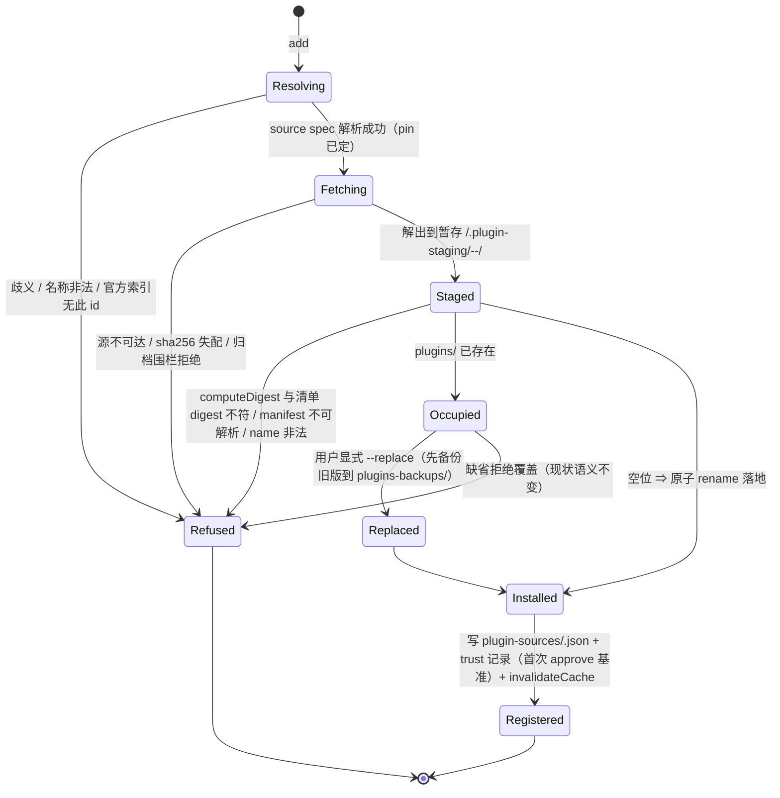
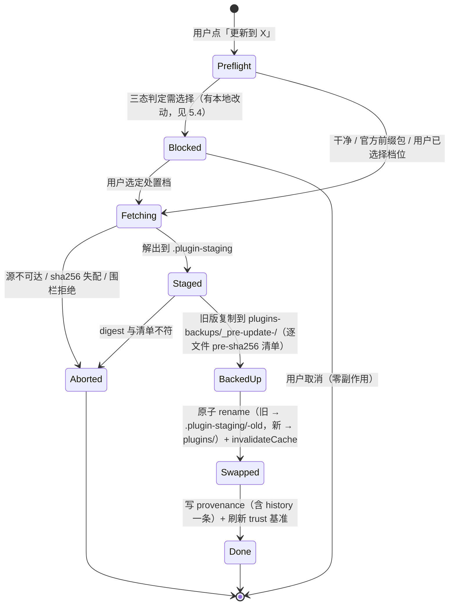

# 插件远程发布源架构设计（源引用 · 拉取式安装 · 用户自选更新）

> **作者原令**（2026-10-29 17:03 逐字）：「我们插件的元数据不是可以填这些吗？我们是否可以就是我们stand以引用 拉取的形式，插件的本体不放我们stand里，而是从这些插件的发布源下载。我们官方的源可以放我们官网这样的oos下载。这样还能方便新版本推送，让用户可以自己选择更新。如何呢？」
>
> **定位**　纯设计（零代码改动）。基线 = 插件协议现状盘点全篇 [[20261029_131610_plugin-protocol-audit__delegate-nebflow-14e75897.zh-CN]]（下称「盘点报告」，本稿把它当唯一现状事实源，逐节回引其锚点；本稿新增的读码只在盘点未覆盖处补锚，见 §1.2）。分支 `delegate/delegate-nebflow-585363ad`。
>
> **一句话**　盘点的结论是「插件协议的所有缺陷都出自一个根：**本体与来源都活在分发载体里**」——`seed` 树是 canonical、digest 允许列表由 jar 现算、更新只能靠 boot 期的种子镜像。本设计把这个根换掉：**包本体搬到发布源（官方 = 官网清单 + OSS 字节），来源 pin 落成引擎侧账本（不入包、不进 digest），信任根从「jar 现算」迁成「发布侧 pin 表 + 本地水位线」**；装载语义（在位即信任）与派发语义（闸 A/B/C/E/D）一个字节不改。
>
> **性质**　§8 的 9 条裁定点必须作者拍板后本稿才可转实施依据；§9 是等裁定后可直接派实施批的切分说明。

目录：

- [0. 目标与现状根因（一页）](#0-目标与现状根因一页)
- [1. 基线锚点（盘点报告 + 今日补锚）](#1-基线锚点盘点报告--今日补锚)
- [2. 源引用模型（source spec 三态）](#2-源引用模型source-spec-三态)
- [3. 官方源发布面（清单 / 字节 / 发布流程）](#3-官方源发布面清单--字节--发布流程)
- [4. 安装流（从源拉取）](#4-安装流从源拉取)
- [5. 更新流（用户自选 + 三态冲突处置）](#5-更新流用户自选--三态冲突处置)
- [6. 信任模型迁移（jar 现算 → 发布侧 pin）](#6-信任模型迁移jar-现算--发布侧-pin)
- [7. seed 退役与过渡（T0-T3 / beta 用户）](#7-seed-退役与过渡t0-t3--beta-用户)
- [8. 裁定点（列报作者）](#8-裁定点列报作者)
- [9. 实施切分建议（依赖序 + 每批验收）](#9-实施切分建议依赖序--每批验收)
- [10. 不做的事与风险登记](#10-不做的事与风险登记)
- [11. 证据锚点表](#11-证据锚点表)

---

## 0. 目标与现状根因（一页）

### 0.1 原令四问 ↔ 本设计落点

| 原令片段 | 本设计落点 | 一句话回答 |
|---|---|---|
| 「插件的元数据不是可以填这些吗」 | §2 | 能填，但**填不进权威层**：manifest 在包内，包内任何字节改动都变目录 digest（盘点报告 §1.3），把 pin 写进 manifest 会让「声明来源」=「内容变更」。故现有 `repository`/`homepage` 只当**广告位**，**权威 pin 落在包外的引擎账本**（v1 对 manifest 零改动） |
| 「以引用拉取的形式，本体不放 stand 里」 | §2/§4 | 是。`seed/plugins/` 由 canonical 源降为**过渡期回落源**，最终只留指针；安装入口从「拷贝路径/clone 后落盘」升级为「按 source spec 解析 → 暂存 → 校验 → 原子切换」 |
| 「官方源放官网这样的 oos 下载」 | §3 | 清单上**官网静态资产**（全热、可读性最好、与统一更新系统的 manifest 同一套发布形态），字节上 **OSS**（`nebflow-releases` 桶，与 jar 同桶同端点同凭据面） |
| 「方便新版本推送，让用户可以自己选择更新」 | §5 | 面板「有新版」徽标 + 一键更新；**不做自动更新**（默认手动确认原则零变化），推送 = 清单更新（声明），不是下发 |

### 0.2 现状根因（盘点报告 §7 九条缝隙的共同上游）

盘点报告 §7 列了 9 条缝隙，其中 1/2/3/4/5 全部是**同一个机制事实**的下游症状：包的 canonical 副本活在 jar 里（`src/main/resources/seed/plugins/`），而唯一能让实例前进的路径是 boot 期 `SeedService.reconcilePlugin` 的 digest 仲裁（SeedService.scala:456-566）。于是：

- 实例被用户直改 ⇒ 仲裁判「用户改过」⇒ **种子永远到不了实例**（盘点 §7.2 的今天实证：visual-report / browser-use / computer-use 三包）；
- 无审批记录的包 ⇒ 仲裁无基准 ⇒ 静默保持（§7.3，实测 16/23 包）；
- 无 update 命令、无版本历史、无回滚面（§7.1）；
- 官方 namespace 只能靠「出厂字节赢」这一条死锁路径维持（SeedService.scala:534-538），因为信任根是 jar 现算的 digest（OfficialPackages.scala:91-116）。

**根因一句话**：*来源与本体同住分发载体*。本设计把二者拆开——**本体在源，来源 pin 在引擎账本，信任根在发布侧清单（随分发载体 pin 一次）**。拆开后 §7.1/7.2/7.3/7.5 的缝隙自然消失，§7.4 的「approve 前移基准」副作用也随之关掉（approve 不再是 seed 仲裁基准，见 §6.4）。

### 0.3 三条设计公理（本稿所有取舍的判据）

1. **provenance 不入包**——来源/版本 pin/digest 基准一律写在包目录**之外**（`<dataRoot>/plugin-sources/`、`nebflow.json → plugins.*`）。写进包内 = 改 digest = 自毁信任面（盘点 §1.3 digest 算法）。
2. **声明与字节分离**——清单（官网 JSON）只发意图，字节（OSS 归档）只发内容，两者用 sha256 + 内容树 digest 双值咬合；清单先不可达就退字节镜像，字节先不可达就什么都不做（与统一更新系统 §5「发布原子性」同款）。
3. **装载面零改动**——「在位即信任」、deny-list 先于默认受信、闸 A/B/C/E/D、fail-open 分配，全部逐字不动（盘点 §0 表 #5/#6/#12/#13）。本设计只改「包怎么来的」与「信任根从哪读」，不改「包怎么被信任和派发」。

---

## 1. 基线锚点（盘点报告 + 今日补锚）

### 1.1 盘点报告逐节回引（本设计依赖的现状事实）

| 用到的现状 | 盘点报告落点 | 本设计对应 |
|---|---|---|
| manifest 未知键宽容告警、可选元数据 string 类型、`extensions` 的「字符串=文件名」形态 | §1.2（PluginRegistry.scala:600-609,670-671,739,793） | §2.1 结论：v1 零新增 manifest 键，来源落包外账本 |
| 版本语义 = 内容 digest 而非版本号 | §1.3（PluginRegistry.scala:422-438） | §2.3 双值（归档 sha256 / 内容树 digest） |
| 双副本与 reconcile 六分支 | §3.3（SeedService.scala:456-566） | §7 seed 退役表 |
| 官方身份 = `nebflow-` 前缀 + digest 允许列表现算 | §0 表 #7（OfficialPackages.scala:51-54,91-116） | §6 双锚迁移 + §6.5 身份闸/内容闸拆闸 |
| 安装三路径、无 update 命令、无卸载入口 | §4 | §4 安装流升级、§5 更新流新建 |
| 漂移 = 非拦截可见性（contentChanged 三出口） | §4（PluginRegistry.scala:67-83,1394-1466） | 保留，增加「来源行/有新版」两行（§5.2） |
| 面板/CLI/REST 现有动词集 | §6.1（PresenceRoutes.scala:1465-1586；PluginCommand.scala:28） | §4.4 新增动词（sources/upstream/update）+ §5.5 新增 rollback |
| 九条缝隙 | §7 | §0.2 根因归并、§10 风险登记 |
| 盘点报告的改进建议（未对齐） | §8 | 本设计的 §5/§6 已覆盖其中 3 条（缝隙 1/2/5），其余（缝隙 6/7/8）**不在本批范围** |

### 1.2 今日补锚（盘点未覆盖、本设计新增读码）

| 事实 | 锚点 |
|---|---|
| 更新系统的既有「清单 → OSS 回落」双跳读序，是本设计官方源读序的现成先例 | `src/main/scala/nebflow/core/hotupdate/VersionCheck.scala:13-20,36-39,64-78` |
| 既有的清单 schema 演进位（`schema` 只认 1、未知字段宽容、缺字段降级不失败） | `VersionCheck.scala:130-171`（`ReleaseManifest`） |
| 既有日历版序比较（`compareVersions`，与 link-server 同构、禁第二套排序） | `VersionCheck.scala:95-127` |
| 清单/指针域名与桶名的单一事实源 | `brand.conf`（`domain = mystand.space`、`cosBucket = nebflow-releases`）；`Branding.scala:93,142` |
| OSS 发布通道现状：ossutil 1.7.19 pin + `OSS_ACCESS_KEY_ID/SECRET` secrets + 逐对象 `cp -f` | `.github/workflows/release.yml:303-322` |
| 既有「发布后自证可用」门实例（deps/ 前缀防烂：checksums.txt 行数下限 + 逐条目 Range-GET 200/206） | `.github/workflows/release.yml:338-364` |
| 安装器的 OSS 端点与 deps/ 前缀常量 | `release/install.sh:32,37,100-115,591` |
| 插件面板的现有轮询节拍与数据源（6s `GET /api/plugins`，仅面板 active 时） | `src/main/resources/web/js/plugins.js:111,160-190,807-821` |
| 安装入口当前的「同名已存在即拒、落盘即生效」 | `PluginRegistry.scala:1223-1300`（installFrom/installFromSync，1274-1281 拒覆盖） |
| 信任记录形态（`{sha256, approvedAt, scope, files}`）与其两个用途 | `PluginRegistry.scala:1159-1210`；实例实证 `~/.stand/nebflow.json → plugins.trust.*` |
| 种子默认集清单（7 包）与种子树全集（18 包） | `src/main/resources/seed/manifest.json:1-13`；`src/main/resources/seed/plugins/` |
| 盘点的关键实证：种子树 18 包 manifest 的 `repository` **无一填值** | 今日现读：`src/main/resources/seed/plugins/*/plugin.json`（18/18 该键缺省）⇒ 原令「元数据不是可以填这些吗」在字节面上**目前是空的**——这是一条**发布侧填写纪律**（§3.4 发布流程的一步），不是 schema 改动 |

---

## 2. 源引用模型（source spec 三态）

### 2.1 两层来源：广告层（包内）与权威层（包外）

| 层 | 位置 | 进 digest？ | 内容 | 谁写 |
|---|---|---|---|---|
| **广告层**（可选） | `plugin.json` 既有 `repository` / `homepage` 两键（v1 **零新增键**） | **是**（包字节，改了即 contentChanged） | 上游仓/主页 URL，给人看 | 包作者 |
| **权威层**（必写） | `<dataRoot>/plugin-sources/<name>.json` | **否**（包目录之外） | `kind` / `url` / `pin` / 解析出的 `version`+`digest` / `installedAt` / `via`（seed\|official\|git\|local） | 引擎（安装/更新时唯一写点） |

> **为什么权威层必须在外**：digest 覆盖包目录全部字节（盘点 §1.3），来源若在包内，则「换一个镜像地址」= 「内容已变更」= 面板红标 + 种子仲裁判「用户改过」——来源元数据与内容完整性被绑死，这是源化设计必须避免的第一个自伤。放包外还有一个额外好处：**来源账本可独立回滚/删除**，不影响包本体可用性（在位即信任照旧）。

**v1 对 manifest 的改动 = 零**。原令问「元数据不是可以填这些吗」，读码后的诚实回答是：能填，但**填不进权威层**——

- `repository` / `homepage` 是既有可选 string 键（`PluginRegistry.scala:670-671,895-898`），够当广告位；
- 官方源的包身份 = manifest `name`（= 官方索引 id），**不需要任何新键**；
- 若确实要「包自述来源」，今天的 `extensions` 是「**字符串 = `org.nebflow/` 内文件名**」约定（`extensions["org.nebflow/tools"]` / `["org.nebflow/viewers"]`，`PluginRegistry.scala:739,793`），不是对象容器；且 `org.nebflow/` 的已知子条目闭合在 `tools.json` + `viewers.json` 两件（`PluginRegistry.scala:600-609`）——塞进去要同时扩 known-set 并沿用「字符串文件名」形态，等于**另立第三种 extension 形态**。

故本稿取舍：v1 **不引入任何 manifest 增量键**（零 schema 漂移、零 unknown-field/unknown-entry 告警、零 known-set 扩张）。可选 v2（**需作者同意**，裁定点 A9）：包根加 `org.nebflow/source.json` + `extensions["org.nebflow/source"] = "source.json"`——完全照抄 tools/viewers 的同款形态（字符串文件名 + 命名空间目录内解析 + 围栏校验），用途是「包自带来源声明 ⇒ 手工搬包到另一台机器时源仍可追溯」；权威层**仍然**是外部账本，包内声明永不参与信任判定。

### 2.2 三态 source spec

```
kind: official            官方源（索引 + 版本清单，见 §3）
kind: git                 git 仓 + tag/commit pin（今天的 `stand plugin add <git-url>` 升级形态）
kind: https               直链归档 + sha256（自建镜像 / 内网分发 / OSS 直连）
```

```jsonc
// A. 官方源 —— 用户侧只需要「包 id」（+ 可选版本）
{ "kind": "official", "index": "https://mystand.space/plugins/index.json", "id": "visual-report" }

// B. git 源 —— pin 必填（禁浮动 HEAD：浮动 pin 让「同一来源两次安装得到不同内容」合法化，直接击穿 digest 信任面）
{ "kind": "git", "url": "https://github.com/<org>/<repo>.git",
  "path": "plugins/visual-report",              // 仓内子目录（缺省 = 仓根）
  "pin": { "tag": "visual-report-v1.6.0", "commit": "<40hex>" } }

// C. 直链 —— 归档 + 双值
{ "kind": "https", "archive": "https://nebflow-releases.oss-cn-hangzhou.aliyuncs.com/plugins/visual-report/1.6.0/visual-report-1.6.0.zip",
  "sha256": "<64hex>", "sizeBytes": 81234, "digest": "<64hex>" }   // sha256=归档字节，digest=内容树
```

**git 源的 pin 语义**：`tag` 必须存在且 `commit` 必须与 tag 解引用结果一致（防 tag 被移动）；只 pin commit 时允许（tag 缺省）。安装时 `git clone --filter=blob:none --no-checkout` + `git checkout <commit>`（比今天的 `--depth 1` 默认分支克隆更进一步：今天 `installFromSync` clone 的是默认分支 HEAD，**同一个 URL 两次安装会得到不同内容**——这是 §7.1「无版本管理」的另一个入口，本设计顺手关掉）。

### 2.3 归档格式与双值校验

| 项 | 取值 | 理由 |
|---|---|---|
| 归档格式 | `.zip`（包根平铺，`skills/` 等子树保留） | JDK `java.util.zip` 原生可读，**零新依赖**（`.tar.zst` 需引入 zstd-jni；`.tar.gz` 需自写 tar 读取器）。格式位由清单声明（`format: "zip"`），后续可加 |
| `sha256` | 归档**字节**摘要 | 传输完整性（与 jar 的 `jarSha256` 同款，`VersionCheck.scala:165-167`） |
| `digest` | 解出后按 `PluginRegistry.computeDigest` 同算法**现算**的内容树摘要 | 装载面信任判据（官方背包要与 pin 表比对）；**装机时现算、与清单声明比对**，不信任声明值直接落库 |

安全围栏（archive 解压侧）：拒绝绝对路径/`..` 段/超出包根的条目/符号链接条目（复用今天的 `containedUnder` 围栏纪律，`PluginRegistry.scala:468-480`），条目数上限与总解压字节上限按 `sizeBytes` 校验（zip bomb 面）。

### 2.4 provenance 账本 schema

`<dataRoot>/plugin-sources/<name>.json`（与 `plugin-data/`、`plugins-backups/` 同级兄弟目录，不进包）：

```jsonc
{
  "schema": 1,
  "name": "visual-report",
  "version": "1.6.0",
  "digest": "<64hex>",                 // 安装时刻内容树 digest（= 信任基准）
  "source": { "kind": "official", "index": "https://mystand.space/plugins/index.json", "id": "visual-report" },
  "resolved": { "url": ".../visual-report-1.6.0.zip", "sha256": "<64hex>" },
  "via": "official",
  "installedAt": 1793264715,
  "history": [ { "version": "1.5.0", "digest": "…", "replacedAt": 1793264715, "backup": "plugins-backups/20261029_174545_pre-update-visual-report" } ]
}
```

`history` 只留最近 N=10 条（滚动裁剪）——**它补的正是盘点 §7.1「实例副本无版本管理」**：有了它，「改成了什么、何时改的」第一次有对账面（与盘点 §8 建议「`.plugin-state.json`」同向，但落在包外不污染 digest）。

---

## 3. 官方源发布面（清单 / 字节 / 发布流程）

### 3.1 选型：清单上官网、字节上 OSS（推荐案，附对照）

| 方案 | 清单 | 字节 | 优点 | 代价 |
|---|---|---|---|---|
| **A（推荐）** | 官网静态资产 `mystand.space/plugins/*.json` | OSS 桶（`nebflow-releases`）+ 官网域名反代/CDN | 与统一更新系统「版本权威上官网、产物留 OSS」同构（`VersionCheck.scala:13-20`）；清单可全热发；国内可达性由 OSS 兜 | 两个发布目标（CI 两跳） |
| B | 全放 OSS | OSS | 单目标、单凭据面 | 清单挂在对象存储上，语义面与 `deps/`、jar 混杂；官网不可展示；一旦桶权限配置漂移清单就跟着漂 |
| C | 全放官网 | 官网静态托管 | 单目标 | 大字节走官网静态托管（19 个包 × N 版本）会撑爆站点，且官网托管形态在本机未检出（统一更新系统 DESIGN 开放问题 #1），风险最大 |

**推荐 A**，且刻意复用两条既有基建**零新增凭据面**：OSS 侧 = `release.yml:303-322` 的 ossutil pin + `OSS_ACCESS_KEY_ID/SECRET`（同一 secrets = 同一发布者身份）；官网侧 = 静态资产发布（形态待作者定，见裁定点 A6）。

### 3.2 清单 schema（三份文件）

**(a) 索引** `https://<domain>/plugins/index.json`（+ beta 通道 `index-beta.json`，与 `manifest-beta.json` 同构命名）：

```jsonc
{
  "schema": 1,
  "sequence": 47,                     // 单调递增发布序号；本地水位线低于它 ⇒ 视为「源前进过」
  "updatedAt": "2026-10-29T17:00:00Z",
  "engine": { "minCompatible": "2026.10.1" },   // 低于此版本的引擎不展示「有新版」徽标（只检不装）
  "plugins": [
    { "id": "visual-report", "latest": "1.6.0", "sequence": 45,
      "manifest": "https://mystand.space/plugins/visual-report/manifest.json" }
  ]
}
```

**(b) 版本清单** `https://<domain>/plugins/<id>/manifest.json`：

```jsonc
{
  "schema": 1,
  "id": "visual-report",
  "sequence": 45,
  "versions": [                                     // 新→旧，装载器只需第一条
    { "version": "1.6.0", "publishedAt": "2026-10-29T16:40:00Z",
      "notesUrl": "https://mystand.space/plugins/visual-report#1.6.0",
      "requires": { "manifestSchema": "1.0.0", "minEngine": "2026.10.1" },
      "artifacts": [ { "format": "zip", "sizeBytes": 81234,
                       "sha256": "<64hex>",                  // 归档字节
                       "digest": "<64hex>",                  // 内容树（官方背包的信任 pin）
                       "url": "https://nebflow-releases.oss-cn-hangzhou.aliyuncs.com/plugins/visual-report/1.6.0/visual-report-1.6.0.zip",
                       "mirror": "https://mystand.space/plugins/visual-report/1.6.0/visual-report-1.6.0.zip" } ] }
  ]
}
```

**(c) pin 表快照**（构建期打进 jar，见 §6.2）`src/main/resources/seed/official-pins.json`：

```jsonc
{ "schema": 1, "generatedFrom": { "indexSequence": 45, "engineVersion": "2026.10.29" },
  "pins": { "visual-report": { "version": "1.6.0", "digest": "<64hex>", "sequence": 45 },
            "nebflow-qa":   { "version": "1.0.1", "digest": "<64hex>", "sequence": 41 } } }
```

**读序（对齐既有双跳先例，禁第二套）**：`官网 index.json`（不可达/解析失败/schema≠1）→ `OSS 镜像 <bucket>/plugins/index.json`（同一文件字节，随发布双写）→ 都失败 ⇒ 「源不可用」惰性态（面板显示 `unknown`，不报错，不拦任何既有功能——同 `VersionCheck` 失败静默语义）。

### 3.3 OSS 布局

```
oss://nebflow-releases/
  latest-version.txt / latest-beta-version.txt        # 既有（引擎自更新，不动）
  <version>/stand-assembly-<version>.jar              # 既有
  deps/…                                             # 既有（安装器第三方依赖）
  plugins/                     # 新增前缀（本设计）
    index.json                 # 官网索引的镜像（双写）
    <id>/<version>/<id>-<version>.zip
    <id>/<version>/SHA256SUMS  # 该版本归档字节 + 逐文件 sha256（人审与带外校验用）
```

**前缀隔离纪律**：`plugins/` 与既有 `deps/`、jar 平级并列，互不覆盖；object key 只允许 `[a-z0-9.-/]`（与插件名约束同域，`PluginRegistry.scala:486-491`），发布脚本前置校验——防 `..`/绝对路径把对象写到前缀外。

### 3.4 发布流程（插件独立仓 release → 清单 → 双写）

依赖裁定点 A2（插件本体是否迁独立仓）。推荐形态：


**发布原子性（照抄 jar 线纪律）**：字节先就位并自证（逐对象 Range-GET 200/206 + 至少 1 字节，同 `release.yml:338-364` 的 deps/ 防烂门）→ 再发版本清单 → 最后推进索引 `sequence`。中途失败的最坏形态 = 清单里出现一个「暂不可达」的版本条目，引擎侧表现为该版本更新失败并保持本地版本（绝不半装），重跑发布即收敛。

**幂等**：同 `(id, version, digest)` 重复发布 = no-op（不推进 sequence）；`(id, version)` 相同但 digest 不同 ⇒ **发布会失败**（版本号不可复用，强制 bump——这是防「静默换内容」的第一道闸）。

**发布侧的元数据纪律**（补今天的空缺）：发布流水线在打包前要求 manifest 的 `repository`（官方源包取插件独立仓地址）与 `homepage` 非空，缺失即发布失败。这不是协议改动（两键早已存在且可选，`PluginRegistry.scala:670-671`），而是把「元数据可填」从可选变成发布侧的必填纪律——**权威来源仍只在引擎账本，这两键只保证人在面板上能点回上游**。

---

## 4. 安装流（从源拉取）

### 4.1 入口动词

| 形态 | 语义 | 现状对照 |
|---|---|---|
| `stand plugin add <name>` | 装官方源 latest（name 命中官方索引） | 新增（今天 `<name>` 会被当成相对路径） |
| `stand plugin add <name>@<version>` | 装官方源指定版本（可装旧版，受 §6.3 降级策略约束） | 新增 |
| `stand plugin add <git-url>[#<tag>]` | git 源，pin 到 tag/commit | 今天的 `add <git-url>`，**去掉浮动 HEAD 语义** |
| `stand plugin add --from <spec.json>` | 三态 source spec 直读（脚本化/内网） | 新增 |
| `stand plugin add <local-path>` | 本地目录（开发态），写 `via: local` 的 provenance | 今天的本地拷贝路径逐字保留 |

**歧义消解（必须写死，否则用户会踩）**：参数含 `://` 或 `git@` 或以 `.git` 结尾 ⇒ git 源；以 `/`、`./`、`~` 开头或路径存在 ⇒ 本地；其余 ⇒ 官方 id（`name[@version]` 形态）。歧义命中两条以上 ⇒ 显式报错列出候选，不猜。

### 4.2 状态机（安装）



**关键点**：

1. **暂存目录在 `plugins/` 之外**（`<dataRoot>/.plugin-staging/`）——半装状态永不出现在注册表扫描面里（`PluginRegistry.pluginsDir` 只扫 `plugins/`，`PluginRegistry.scala:90,521-524`），避免「解压到一半被扫描到 ⇒ 拒载告警 + 面板残卡」。落地用 `os.move` 原子 rename（同分区）。
2. **落地后即生效**（在位即信任不变），但比今天多两个动作：写 provenance 账本（§2.4）、写 trust 记录（`{sha256, approvedAt, files, source}`，扩展一个 `source` 字段——旧记录缺该字段视为 `unknown`，零迁移）。
3. **失败面进现有错误通道**（同官方闸的纪律：只产原因字符串，`OfficialPackages.scala:36-41`）——CLI 打红字、REST 返 `{error}`、不新增日志通道。

### 4.3 「落盘即信任 + 首次 approve 基准」随源化的演进

| 概念 | 今天 | 源化后 |
|---|---|---|
| 装载判据 | 在位 ∧ 未封禁（`PluginRegistry.scala:856-866`） | **逐字不变** |
| approve 记录用途 | 面板变更摘要 + **seed 仲裁基准**（`seed.trustRecordDigest`） | 面板变更摘要 + **provenance 基准**（seed 仲裁随 seed 退役而消亡，§7） |
| 首次基准写入时机 | seed 首装 / 手动 approve | **安装事务的最后一步自动写**（不再需要用户点 approve；`approve` 命令保留为「刷新基准」的显式手势） |
| 官方包免审批 | 因为 digest ∈ jar 现算允许列表 | 因为 digest ∈ pin 表（jar pin ∪ 本地 pin，§6.2）——**用户点一次「更新到新版本」= 该版本的确认手势**（§6.3），此后等同 pin |

> **一句话**：源化把「审批」从「装完再确认」搬到「选择版本那一刻」，手势不增加（点更新 = 确认），但确认对象从「一个目录」变成「一个明确的版本 + digest」，语义更硬。

### 4.4 新增 REST/CLI 面（最小集）

| 端点/动词 | 语义 |
|---|---|
| `GET /api/plugins/sources` | 逐包：`{name, version, digest, source, latestVersion?, hasUpdate, official: bool, engineCompatible}`（面板一次拿全） |
| `GET /api/plugins/:name/upstream` | 该包上游版本清单（含变更摘要/大小/digest）+ 本地改动三态判定（§5.3） |
| `POST /api/plugins/:name/update` | body `{version, confirmDigest}` 或 `{}`（取 latest）；返回相位串流或最终结果 |
| `POST /api/plugins/source/refresh` | 强制重读源清单（面板「刷新」按钮）；缺省读序不变 |
| CLI `stand plugin sources` / `stand plugin update <name> [--version X] [--allow-downgrade]` | 与 REST 同语义（CLI 走 REST，`PluginCommand.scala:20-24` 的「写入单点在引擎」纪律不变） |

`GET /api/plugins` 的返回**不回改形状**（前端每 6s 轮询、`approvalManifest` 是冻结契约 C6，`plugins.js:24,170-190`）；更新相关字段走独立端点，面板在打开时/手动刷新时各拉一次 ⇒ **不含任何远端轮询**（零超时纪律，统一更新系统 DESIGN §8 同源）。

---

## 5. 更新流（用户自选 + 三态冲突处置）

### 5.1 检查（什么时候问源）

| 触发 | 频率 | 说明 |
|---|---|---|
| 打开插件面板 / 点「刷新」 | 用户驱动 | 拉 `index.json`（一次）+ 命中「有新版」的包再拉各自 `manifest.json`（N 次，N = 有更新的包数） |
| 引擎启动 | 一次，异步 | 只读索引，喂「有 N 个插件可更新」徽标；失败静默 |
| 任何定时轮询 | **不做** | 与「零超时设计」（2026-10-19 作者拍板）一致；面板 6s 轮询只打本机 REST，永不外呼 |

**检查实现单点**：新建 `PluginSourceCheck`（与 `VersionCheck` 同族、同读序、同 5s 连接/读超时、同「异常 ⇒ None 静默」），版本比较一律调 `VersionCheck.compareVersions`（`VersionCheck.scala:95-127`）——**禁第二套排序**。

### 5.2 提示与用户自选（不动 auto-update 默认）

- 面板插件卡新增两行：`来源: official · mystand.space/plugins` / `版本: 1.5.0 → 1.6.0 [更新]`（无更新时不画箭头）。
- 顶部统计条加 `可更新 N`（现 `topStatsHtml`，`plugins.js:486-497`）。
- **默认不自动更新**：本设计不引入任何 auto-update 档位。将来若要，按「用户显式开 + 走统一更新系统的准入闸+排空」另行立批（不在 §8 的裁定点范围内，是独立立项）。
- 「推送」的机制含义被定死：**发布方只能改清单，不能触发任何设备动作**——用户设备唯一的行为入口是用户点「更新」。这与原令「让用户可以自己选择更新」逐字一致。

### 5.3 更新事务（暂存 → 校验 → 备份 → 切换）



**Aborted 的保证**：任何校验失败都发生在**旧版仍在位**时（暂存区在 `plugins/` 外），所以「更新失败」= 零变化，没有半装态。这与 `SeedService.refreshFromSeed` 的「覆盖前必备份」纪律同源（SeedService.scala:502-529），但顺序更严：**先备份再切换**（种子镜像路径是「先备份再覆盖」，同构）。

**在飞 MCP server**：更新会在 `invalidateCache` 后触发下一轮扫描；`PluginMcpManager.revalidate`（`PluginMcpManager.scala:171-209`）今天的语义是「digest 漂移不停飞」。更新后是否停飞在飞会话的 MCP server，见裁定点 A5（推荐：**不停飞**，与「装了就是信任」的漂移口径一致；新派发拿新版本）。

### 5.4 三态冲突处置（现状语义在源化后的等价形态）

判据沿用今天 seed 仲裁用的那条：`runtimeDigest == trustRecordDigest`（`SeedService.scala:534-543`）。

| 态 | 判据 | 处置（源化后） | 与今天等价性 |
|---|---|---|---|
| ① 干净 | 本地 digest == trust 基准 | 直接可升；备份 → 切换 | = 今天 seed 刷新「干净 → 镜像覆盖」的等价，但**驱动者从 boot 自动变为用户点击** |
| ② 有本地改动 | 本地 digest ≠ trust 基准（非保留名） | 三选一：**(a) 保留本地版**（不升，面板记「已修改锁定」）/ **(b) 覆盖并保留备份**（先备份到 `plugins-backups/<ts>_pre-update-<name>/`，再切换；备份随时可整目录还原）/ **(c) 只看差异**（逐文件 diff 清单，只读，不做三方合并） | = 今天「用户改过 > 种子」（保留实例）的等价，但**从隐式保留变成显式三选**——这正是盘点 §7.2 那条「作者在 main 上看到的协议与实例在跑的协议已分叉」的关闭点：用户第一次被告知分叉存在 |
| ③ 官方前缀包（`nebflow-`） | 保留名（`OfficialPackages.isReserved`） | **官方 pin 赢**：不提供 (a) 档；面板只给「还原为官方 1.6.0（备份本地改动）」与「保持现状但标记红标（下次更新必须还原）」 | = 今天「出厂字节赢」（SeedService.scala:534-538）的等价形态，把死锁（每轮 boot 反复镜像 + 装载层拒载）换成一次明确的用户动作。**关键收益**：源化后 `nebflow-` 包的本地改动**不再被静默覆盖**，而是可见 + 可备份 + 可一键还原 |

**三方合并明确不做**：包是内容树（提示词/脚本/资产），不是代码补丁；提供「备份 + 缓存 diff 清单 + 一键还原」三件（都可机械化），比退化的自动合并诚实。

### 5.5 版本历史与回滚

`plugin-sources/<name>.json` 的 `history` + `plugins-backups/` 目录 = 回滚材料。新增一条显式动词（`stand plugin rollback <name> [--to <version>]`）在 §9 的 P3 里做，最小语义 = 「把 `plugins-backups/<ts>_pre-update-<name>/` 整目录还原 + 重算 digest + 刷新 provenance」。**不做**「下载历史版本再装」以外的花活——装旧版本本身已经由 `add <name>@<oldver>` 覆盖（受 §6.3 降级策略）。

---

## 6. 信任模型迁移（jar 现算 → 发布侧 pin）

### 6.1 现状信任根（盘点 §0 表 #7 的机制）

今天的官方身份判据是一个纯函数：`admits(name, digest) = !isReserved(name) || allowlist().get(name).contains(digest)`（`OfficialPackages.scala:115-116`），其中 `allowlist()` 对 **jar 内种子树现算**（`:91-116,152-211`）。信任根 = 分发载体（dmg/jar 的签名与公证）+ 现算。fail-closed：目录缺失 ⇒ 空表 ⇒ 保留前缀包一律拒载。

### 6.2 目标形态：pin 表双锚 + 本地水位线

`admits(name, digest)` 的右值从「一张现算表」变成「**三源合一的 pin 集**」：

```
admitted(name, digest) =
    !isReserved(name)
 || jarPins[name]   == digest      // ① 构建期 pin（随 jar 走，替代今天的现算）
 || localPins[name] == digest      // ② 本地水位线（用户确认过的官方版本，装后即 pin）
```

| 锚 | 存储 | 产生 | 生命周期 |
|---|---|---|---|
| ① jar pin | `src/main/resources/seed/official-pins.json`（classpath 资源） | **构建期生成**：从 seed 树现算（= 今天的 allowlist，算法一字不改）∪ 发布清单快照（`index.json` 的 digest 字段） | 随引擎版本前进（每次发版重播，与今天「产品升级重播允许列表」同构） |
| ② 本地水位线 | `<dataRoot>/nebflow.json → plugins.officialPins.<name> = {digest, version, sequence, pinnedAt}` | 以下三种时机写入：官方源安装成功、用户确认更新成功、seed 首装（值来自 jar pin） | 只增不回退（§6.3） |

**为什么这样迁而不引入新机制**：pin 仍**随分发载体走**（jar 里的资源），所以信任根一字不改 = 「分发载体的签名与公证」；变的只是 pin 的**来源**从「现算种子树」变成「构建期算一次 + 源侧清单对齐」。零漂移的性质保留（jar pin 与 jar 内 seed 树同一构建产生，等价性可用今天 `OfficialIdentitySpec` 的同款断言继续守，`OfficialPackages.scala:26-27`）。

### 6.3 防降级（最小方案，不发明密码学）

| 攻击面 | 对策 | 强度 |
|---|---|---|
| **传输劫持/篡改** | HTTPS（官网 + OSS 均 TLS）+ `sha256`（归档字节）+ `digest`（内容树）双值现算比对 | 与 jar 下载同强度 |
| **源侧回滚（重放旧清单）** | 单调 `sequence`：`index.sequence` / `manifest.sequence` 必须 **≥** 本地已见水位（`plugins.officialPins.<name>.sequence` 与全局 `plugins.source.sequence`）。低于 ⇒ 整份清单作废（不报错，面板显示「源清单版本落后于本地已知」） | 阻止「把你降回含漏洞的旧版本」这一最常见降级攻击 |
| **版本降级安装** | `add <name>@<oldver>` 与 `update --version <oldver>` 需显式 `--allow-downgrade`；面板不提供降级按钮（只提供回滚到 `history` 里的**本地备份**） | 显式意图即可，不需要密码学 |
| **官方命名空间冒名** | §6.5 的身份闸（id 必须在官方索引里）+ 内容闸（digest 在 pin 集）双闸 | fail-closed，比今天更严 |
| **官网域名整体被劫持** | **本方案不解决**——攻击者能同时改清单与字节时，唯一防线是清单签名（ed25519 detached sig）。今天同面风险由「jar 分发载体」承担；源化后这一面**扩大**了（可以远程推新内容），故列为裁定点 **A4**，给出最小落地形态：`manifest.json.sig` = 对清单字节的 ed25519 detached 签名，公钥随 jar 走（`official-pins.json → signingKeys`），**引擎侧只增一个验签函数，不建 PKI、不做密钥轮换** | 未落地前登记为**已知残余风险**（§10） |

> **诚实申报**：本设计**确实**把「谁能改变我装什么」从「发版者」扩大到「发版者 + 官网/OSS 的运维凭据持有者」。这是原令「让用户可以自己选择更新」的必然代价，不能靠设计消除，只能靠签名收敛；是否现在付这个代价由裁定点 A4 决定。

### 6.4 迁移期双锚并存（T1 阶段）

```
admits_v2 启用后，allowlist 的构成（P4 落地形态）：
   jarPins  = 构建期 official-pins.json（由 seed 树现算 ∪ 清单快照）
   legacy   = 运行时对 seed 树现算（保留一个版本周期，与 jarPins 取并集）
   ⇒ 双锚并存：即使 official-pins.json 生成逻辑出 bug，存量官方包仍按 legacy 认
```

退役条件：一个完整发布周期内 `official-pins.json` 与 legacy 现算**逐包 digest 相等**（健康摘要打一行 `[pins-parity] OK/N`）⇒ 下一个发布周期删 legacy 分支。回滚路径 = **一个配置开关**：`nebflow.json → plugins.trustRoot = "pins" | "legacy" | "both"`（缺省 `both`），任一档位都是完整可用的判定，热读（同 `PluginsConfig` 的 `enabled` 纪律）。

### 6.5 命名空间规则在源化后的形态（身份闸 / 内容闸拆闸）

今天的 `nebflow-` 前缀一条判据同时承担两件事：**身份**（你声称是官方的）与**内容**（你的字节就是出厂的）。源化后拆成两闸：

| 闸 | 判据 | 失败面 |
|---|---|---|
| **身份闸** | `nebflow-` 前缀 ⇒ 该 id 必须出现在**官方索引**（`index.json` 有该 id）或 jar pin 表里 | `OFFICIAL_IMPERSONATION`（错误码逐字保留，`OfficialPackages.scala:54`） |
| **内容闸** | 已在盘上的包其 `digest` 必须 ∈ pin 集（jar ∪ 本地水位） | 同上拒载（fail-closed），但**拒载文案改指向「面板一键还原为官方 X」**，不再是「去改名」 |

**收益**：第三方包用 `nebflow-` 前缀的存量代价（盘点 §0 表 #7 的硬闸）不变，但官方包被用户改过之后的出路从「绝对死锁」变成「可见 + 一键还原」（§5.4 态③）。

---

## 7. seed 退役与过渡（T0-T3 / beta 用户）

### 7.1 四阶段表（每阶段独立可停）

| 阶段 | seed 树 | 官方包来源 | 更新驱动 | reconcile 行为 | 完成判据 |
|---|---|---|---|---|---|
| **T0（现状）** | 18 包全集，canonical | seed 首装 + 自愈 | boot 期 digest 仲裁 | 六分支全开（SeedService.scala:456-566） | — |
| **T1 双轨** | 全集保留 | seed 首装；`add <name>@ver` 可从官方源装 | 用户点击（§5） | 保留，但**官方前缀包与已源化包跳过**（provenance `via: official` ⇒ reconcile 不碰） | 官方源可装可升；默认集 7 包在全新 home 与存量 home 都能从源装成功 |
| **T2 指针化** | 只留 `seed/manifest.json`（扩为指针形态：name → {version, digest, url}）+ `official-pins.json`；**包本体出树** | 官方源（首装即拉取）；源不可达 ⇒ 惰性态（面板显示「未安装：源不可用」，不回落半截包） | 用户点击 | reconcile 只读指针，**零镜像覆盖**（「出厂字节赢」机制退役） | 联网全新 home 可完成源首装；断网全新 home 的降级文案可见且**不装半截包**（这是 T2 的**已知代价**：官方包不再随 jar 离线可得，作者需在接受这一代价后才准入 T2） |
| **T3 清空** | 只剩 `official-pins.json` | 官方源 | 用户点击 | 删除 reconcile 的 plugin 段（presence 台账保留给「用户定向删除」判定，或一并对齐） | 引擎 jar 体积下降；`SeedService` 的插件腿代码删除 |

**时间表**：本稿不替作者定日期（裁定点 A2）。依赖关系必须写清：**T2 只能在 P4（pin 表信任迁移）落地并观察一个发布周期后开工**，否则 T2 的「源不可达 ⇒ 没有官方包」会变成一次可用性事故。

### 7.2 过渡期的双源一致性纪律

T1/T2 期间同一个包可能有两条来源（seed 里的字节 / 官方源的字节）。规则：

- **来源以 provenance 为准**：`via: seed` 的包不参与源更新（面板显示「随引擎分发」），直到用户显式 `add <name>` 或 T2 首装改 `via: official`；
- **digest 冲突可见**：若源侧 latest digest ≠ 本地（`via: seed`）digest，面板标「引擎内置版本 1.5.0 / 源上 1.6.0」，同一三态处置（§5.4 态①「干净」）；
- **禁混装**：同 id 不会出现两个目录（name 唯一）；「两条来源」只是账本字段，不产生第二份字节。

### 7.3 beta 用户过渡

| 项 | 形态 |
|---|---|
| 通道 | 官方源有 `index.json` / `index-beta.json` 双通道，与 `manifest.json` / `manifest-beta.json`（`VersionCheck.scala:36-39`）同构命名 |
| 存量 beta 用户（今天已在跑 beta 引擎 + seed 插件） | T1 期间零动作：seed 照旧，`via: seed` 不参与源更新；想尝新版本用 `stand plugin add <name>` 显式切换（装机后 `via: official`，从此走用户自选） |
| 通道选择 | 跟随引擎的 beta 开关（不新增第二个 beta 开关）；裁定点 A7 决定是否允许「引擎 stable + 插件 beta」混搭（推荐：不允许，一机一通道，与统一更新系统开放问题 #8 的「网络级一通道」同向） |
| 回滚 | beta 插件装坏了 ⇒ `stand plugin rollback <name>`（用 `plugins-backups/` 本地材料）或 `--allow-downgrade` 装回 stable 版本 |

---

## 8. 裁定点（列报作者）

> 以下 9 条**必须作者拍板**，本稿只给推荐与理由，不代裁。

| # | 裁定点 | 选项 | 推荐 | 影响面 |
|---|---|---|---|---|
| **A1** | **命名空间规则源化后的形态**：`nebflow-` 前缀绑定什么？ | ① 绑「官方索引里的 id」+ 内容闸绑 pin 集（§6.5 拆闸）／② 继续绑 jar pin 表（官方新版本必须随引擎发布，源化只对第三方有效）／③ 前缀退役，改用 manifest 发布者字段 | **①** | 官方包能否「不随引擎发版即可更新」——这是原令「方便新版本推送」的核心；选② 等于源化对官方包失效 |
| **A2** | **seed 本体退役时间表**（T1→T2→T3 的时点 + 是否迁插件独立仓） | ① 先迁独立仓再 T2（推荐顺序）／② 留在 stand 仓内但按 id 子目录化／③ 永不移出（只做 T1） | **①**：插件与引擎解耦是源化的前提；同仓内做也能成立，但每次发插件都要动引擎仓，与「用户自选更新」的节奏相冲 | 发布流水线形态、CI 跨仓凭据 |
| **A3** | **第三方源信任边界**：`add <任意 git/https>` 是否继续默认允许？ | ① 保持（在位即信任 = 任意源都行，风险由用户自担）／② 加「源白名单」（`nebflow.json → plugins.sources.allow`）+ 首次安装需确认／③ 只允许官方源 + 本地路径 | **①（现状不变）**：今天 `add <git-url>` 已经是任意源；收紧是另一件事，别混进本批。但 provenance 账本让「这包哪来的」第一次可见，为将来收紧留了口 | 安全面、用户摩擦 |
| **A4** | **清单签名（ed25519）何时上** | ① 现在上（`manifest.json.sig` + 公钥随 jar）／② 先 sha256/pin，签名留到「多作者 / 第三方源进官方索引 / 商业化」任一触发／③ 永不上 | **②** 但**显式登记残余风险**（§10 R1）：源化确实把「能改我装什么」的人从 1 个扩到 N 个 | 工作量（约 1 个 P 批）、运维（私钥保管） |
| **A5** | **更新后已在飞的 MCP server 停不停** | ① 不停飞（digest 漂移不停飞，与今天 `revalidate` 口径一致，`PluginMcpManager.scala:171-209`）／② 停飞（包内容变了，老会话继续用一个已不存在的包不诚实） | **①**：与「装了就是信任」的既有漂移口径齐平；停飞会让一次插件更新杀掉在飞节点的工作，代价过大。面板标注「已更新，新派发生效」 | 在飞会话行为 |
| **A6** | **官网清单的托管形态**（官网仓本机未检出，统一更新系统 DESIGN 开放问题 #1 未决） | ① 官网静态资产（GitHub Pages/OSS/VPS 任一）+ OSS 镜像双写／② 只 OSS／③ 官网动态端点 | **①**：与既有 manifest 发布链同一条（`VersionCheck.scala:36-39` 已按此假设落地），实施前需先补证托管形态 | P5 阻塞项 |
| **A7** | **通道粒度**：引擎 stable + 插件 beta 允许混搭？ | ① 不允许（一机一通道）／② 允许（插件面板独立 beta 开关） | **①**：与「统一版本」语义自洽（统一更新系统开放问题 #8 同向），少一个状态位 | 面板/清单读序 |
| **A8** | **`add <name>` 缺省装哪一版** | ① latest stable／② latest（通道跟随引擎）／③ 必须显式指定版本 | **②**：跟随引擎通道，用户不用理解「插件版本还在 beta」；`@version` 可精确指定 | CLI 语义 |
| **A9** | **是否给包加「自述来源」声明面（v2）** | ① 不加快（v1 只有 `repository`/`homepage` 广告位，权威来源只在引擎账本）／② 照抄 tools/viewers 形态加 `org.nebflow/source.json` + `extensions["org.nebflow/source"]="source.json"`／③ 用顶层新键 | **① 先行，② 留待「作者要在另一台机器手工搬包且希望源可追溯」这一真实需求出现时再做** | manifest known-set 扩张（每扩一次都要同步 validator 与装载器两处，见 §2.1） |

---

## 9. 实施切分建议（依赖序 + 每批验收）

> 每批独立可交付、独立可回滚；P1-P3 不触信任面（风险最低），P4 触信任面（需作者在 A1/A4 上先裁），P5 触发布链（需 A2/A6）。

| 批 | 内容 | 依赖 | 验收（可机械判定） |
|---|---|---|---|
| **P1 源引用模型 + provenance 账本**（零网络） | source spec 三态解析与校验；`plugin-sources/<name>.json` 读写 + history；`add <local-path>` 与 git 源改为写 provenance（git 源去浮动 HEAD、强制 pin）；`repository`/`homepage` 广告位读取（只展示） | — | 单测：三态 spec 解析 12 例（含歧义/非法 pin/围栏拒绝）；本地安装后账本字段齐全；`computeDigest` 与账本 digest 一致；既有 `installFrom` 行为回归绿（`--replace` 之外逐字不变） |
| **P2 官方源读取 + 从源安装**（本地 `file://` fixture 可全测） | `PluginSourceCheck`（index → manifest 读序 + 失败静默 + 单调 sequence 读）；归档下载/解压/双值校验/暂存/原子切换；`add <name>[@ver]` / `--from`；`GET /api/plugins/sources` + `stand plugin sources` | P1 | 集成测（fixture 源）：happy path 装成功；sha256 失配拒装且零副作用；digest 失配拒装；`..`/绝对路径/符号链接条目拒装；源不可达 ⇒ 惰性态且 `GET /api/plugins` 不变形；`plugins/` 扫描面在解压过程中**零半装目录** |
| **P3 更新流 + 三态冲突处置 + 回滚** | `upstream` / `update` 端点 + CLI；面板「有新版」徽标/箭头/更新按钮/处置三选；`plugins-backups/<ts>_pre-update-*`；`stand plugin rollback` | P2 | Playwright：插件面板徽标与箭头渲染；三态各走一遍（干净直接升 / 有改动出三选 / 官方前缀只给还原）；更新中断（kill 在 Fetching/Staged）后旧版仍在位可派发；rollback 后 digest 与备份一致 |
| **P4 信任迁移（pin 表 + 水位线 + 双锚）** | `official-pins.json` 构建期生成脚本；`admits` 三源合一；`plugins.officialPins.*` 水位线写面；`plugins.trustRoot` 开关；`[pins-parity]` 健康行；身份闸/内容闸拆闸（A1 裁定后按①②条实现） | P1,P2（+ A1/A4 裁定） | `OfficialIdentitySpec` 家族全绿（含 jar 形态逐包断言）；双锚并存下官方包行为与今天逐字一致（正控）；篡改官方包仍拒载（负控）；sequence 回退的清单被整份作废；parity OK/N 行可见 |
| **P5 发布链 + seed 退役 T1/T2** | 插件仓 CI（zip + SHA256SUMS + 双值）→ OSS 上传 + 自证门 → 官网清单/索引推进 → OSS 双写；T1 双轨（reconcile 跳过已源化包）；T2 指针化（A2/A6 裁定后） | P4（+ A2/A6 裁定） | 发布一次即端到端可装（全新 home、断旧缓存）；同 `(id,version)` 异 digest 发布会失败；T1 阶段存量 home 升级后默认集 7 包 `via: seed` 不变、用户显式 `add` 后切 `via: official`；T2 断网全新 home 的降级文案可见且不装半截包 |

**为什么这样切**：P1/P2 是纯增量（新增账本 + 新增读源），零既有语义改动，可以先落、先被真实使用检验；P4 才动信任面（这是唯一「改错了会拒载官方包」的批，必须单独立批 + 单独回归）；P5 的 seed 退役是**不可逆**的动作，必须等 P4 观察一个发布周期，否则「源不可达」会直接变成「没有官方包」（§7.1 依赖注）。

---

## 10. 不做的事与风险登记

### 10.1 明确不做（防范围蔓延）

| 不做 | 理由 |
|---|---|
| 插件自动更新（auto-update 档位） | 原令逐字「让用户可以自己选择更新」；自动档需要与统一更新系统的准入闸/排空语义对齐，另批 |
| 清单/PIN 的 ed25519 签名 | 需 A4 裁定；本稿只留最小落地位 |
| 三方合并（本地改动 + 上游改动合并） | 包是内容树不是代码补丁；提供备份/diff/还原三件更诚实 |
| 插件市场/评分/搜索远程服务 | 与「源」无关，本批不碰 |
| 改 `GET /api/plugins` 形状 | 冻结契约 C6 + 6s 轮询（`plugins.js:24,111`），改动面全走新端点 |
| 改装载/派发/分配语义 | 公理 3（§0.3）；本批零触碰 |
| 依赖注入式「源本地缓存服务端」 | 直接 HTTP 读 + 面板触发即可，不建第二套缓存层（引擎已有 mtime 缓存语义，`PluginRegistry.scala:493-536`） |

### 10.2 风险登记

| # | 风险 | 等级 | 缓解 |
|---|---|---|---|
| **R1** | 源化把「谁能改我装什么」从发版者扩到运维凭据持有者 | 中 | 单调 sequence + 双值校验 + 用户点更新；签名待 A4；本风险**必须写进裁定点材料**，不能靠设计消掉 |
| **R2** | 官方源不可达 ⇒ 新装/更新不可用（T2 后无 seed 回落） | 中 | 官网 → OSS 双跳读序；T2 只在 P4 观察一个发布周期后开工；面板显式「源不可用」而非静默 |
| **R3** | 存量实例 16/23 包无审批记录（盘点 §7.3） | 低 | 首装/首更新时 provenance 自动写基准 ⇒ 无记录包的「已修改」判定从不可知变已知（这是顺带收益，不是本设计目标） |
| **R4** | 面板每 6s 轮询误接远端 ⇒ 违背零超时纪律 | 低 | 远端检查只挂在「面板打开/手动刷新/引擎启动一次」三个用户或生命周期事件上（§5.1） |
| **R5** | zip 解压安全面（zip bomb / 路径逃逸 / symlink） | 中 | §2.3 围栏四条 + `sizeBytes`/条目数上限；与既有 `containedUnder` 同族实现 |
| **R6** | pin 表生成 bug ⇒ 官方包整体拒载（fail-closed 放大） | 中 | 双锚并存 + `trustRoot` 开关 + `[pins-parity]` 健康行（§6.4） |

---

## 11. 证据锚点表

| 主题 | 文件:行 |
|---|---|
| 盘点报告（本稿唯一现状事实源） | [[20261029_131610_plugin-protocol-audit__delegate-nebflow-14e75897.zh-CN]]（§0 规则表 / §1.2 manifest / §1.3 digest / §3.3 双副本 / §4 生命周期 / §6.1 面板动词 / §7 九缝隙） |
| digest 算法与版本语义 | `src/main/scala/nebflow/core/plugin/PluginRegistry.scala:422-438` |
| 装载面入口/包目录/扫描缓存 | `PluginRegistry.scala:90,493-536,521-524` |
| manifest 闭合 schema 键集 + `extensions` | `PluginRegistry.scala:127-146,631-696` |
| 在位即信任 + deny-list 顺序 | `PluginRegistry.scala:856-866`；`PluginBlockPolicy.scala:10-33` |
| 安装入口（同名拒覆盖/落盘即生效） | `PluginRegistry.scala:1215-1300`（尤其 1274-1281） |
| 信任记录与 approve | `PluginRegistry.scala:1159-1210` |
| 官方身份闸 + 允许列表现算 | `src/main/scala/nebflow/core/plugin/OfficialPackages.scala:51-57,91-116,152-211,231-238` |
| 种子 reconcile 六分支 / 备份 / 镜像 | `src/main/scala/nebflow/core/seed/SeedService.scala:456-566,502-529,599` |
| 种子默认集清单 | `src/main/resources/seed/manifest.json:1-13` |
| MCP 引用计数与重验（停飞语义） | `src/main/scala/nebflow/core/plugin/PluginMcpManager.scala:44,128,171-209` |
| 更新系统读序先例 + 清单 schema 演进位 + 版序比较 | `src/main/scala/nebflow/core/hotupdate/VersionCheck.scala:13-20,36-39,64-78,95-127,130-171` |
| 品牌单源（域名/桶名） | `brand.conf`（`domain`/`cosBucket`）；`src/main/scala/nebflow/shared/Branding.scala:93,142` |
| OSS 发布通道（ossutil pin / secrets / 逐对象上传） | `.github/workflows/release.yml:303-322` |
| 发布自证门先例（checksums 下限 + Range-GET） | `.github/workflows/release.yml:338-364` |
| 安装器端点/前缀常量 | `release/install.sh:32,37,100-115,591` |
| 插件 REST 动词集现状 | `src/main/scala/nebflow/gateway/PresenceRoutes.scala:1472-1586` |
| CLI 动词集现状 | `src/main/scala/nebflow/cli/PluginCommand.scala:25-37,90-104` |
| 插件面板轮询与数据源（C6 契约） | `src/main/resources/web/js/plugins.js:24,111,160-190,486-497,807-821` |
| 重启窗口径（编译进 jar 的改动何时生效——本设计的引擎侧改动全部在此窗口内） | [[glossary#^restart-window]] |
| 统一更新系统设计（清单上官网/产物在 OSS、发布原子性、零超时纪律、签名开放问题） | `reports/20261020_unified-update-system-design/DESIGN.md` §4/§5/§8/§10 |

---

*本批纯设计：零代码改动。所有实施建议在 §8 裁定点拍板前不构成实施依据。*
