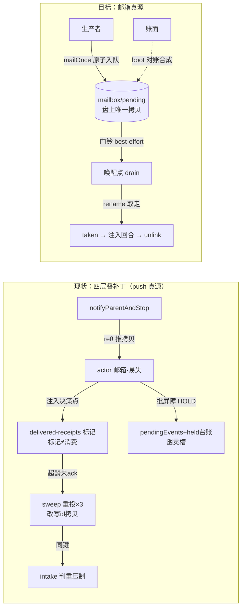

# 终态通知 actor 邮箱化设计（作者 11-01 08:53 裁定，架构级重造，只设计不实施）

批：作者 2026-11-01 08:53 裁定原话要点——「为什么一个事件会重复投递两次？设计逻辑是错的——应该只投递一次，进收件方的 actor 邮箱，由邮箱保证不丢失；现有的投递/重投/判重/watchdog 是治标不治本的叠层」。
基线：[[20261101_083400_delegate-silent-death-analysis__delegate-nebflow-b618531a]]（下称「分析报告」，已合 main）。
追问：作者 11-01 09:01「delegate 为什么分次投递很多类型通知、现在什么情况投什么通知」⇒ 本稿 §2 通知类型全景盘点（拍板依据，求全）。

## 0. 结论一段话

现状是「投递即蒸发」的 push 语义，为了不丢，叠了四层补丁（投递标记、同键判重、watchdog 重投、held 台账），四层的真源互不同步——分析报告实证的断链（标记已投/父未消费/重投被压制）正是层间缝隙。本稿把语义反转：**磁盘邮箱是唯一真源，actor 消息只是门铃**。终态事件一次性写入收件方会话的持久邮箱（每事件一个原子落盘文件，写成功=必达），消费=在唤醒点扫描取走即清；「已投递」不再是标记而是「条目已删除」这个物理事实，标记/判重/重投/watchdog 四层整层退役。分次投递（§2.6）的根源是 delegate 生命周期每个阶段各有一个独立投递口、每口自带一套可靠性机器——邮箱化后归一为「每个事件一次入队、一个拷贝、一个消费口」。

## 1. 作者之问：为什么一个事件会投递两次

先答裁定里的反问（证据均在分析报告，此处只给机制归因）：

1. **投递=推拷贝，且拷贝有多个发射源**。终态事件的首投是 `ref ! ExternalEvent`（`BackoffSupervisor.scala:1080-1082`——mailbox offer，从不失败也从不保证消费）；「没投到」由重投 sweep 再造一个改写 correlationId 的拷贝再推（`DelegateDeliveryReceipts.scala:247-259`，`delivery-redelivery-<id>`）；重启恢复再造一个（`RecoverPersistedQueues` 重放 `CompactionQueueStore.scala` 队列）；mq-recovery/bg-redelivery 各有自己的前缀。**两份拷贝来自两条腿，每条腿都自认是首次投递**——10-29 cancel 双投即此形态（原件滞留忙父队列 + sweep 重投改写 id，两件同入回合，`DeliveredReceiptLedger.scala:146-153` 的判重就是为它打的补丁）。
2. **判重键与拷贝身份不同源**。判重按「归位身份键」（`DelegateDeliveryReceipts.ackableReceiptId`，`DelegateDeliveryReceipts.scala:66-75`），而各腿改写 id、镜像落盘、载荷摘要各自为政——键对不齐则判重失效（重复），键对得太齐则误杀（分析报告实证：重投件被已投标记永久压制，12 次重投 0 次进门）。
3. **邮箱化让问题消解而非解决**：一事件只入队一次（入队幂等），盘上只有一个拷贝，消费取走即清——没有第二条腿可以再造拷贝，也就不需要判重来兜腿间不一致。重复的物理可能性被拆除，而不是被检测。

## 2. 通知类型全景盘点（作者 09:01 追问；拍板依据）

先给一张总览：今天「通知」这个词实际混着**五个不同性质的通道**，delegate 相关通知分散在全部五个里。可靠性语义、缺陷、邮箱化取舍逐通道不同。

| # | 通道 | 载体 | 读者 | 可靠性语义 | 缺陷归属 |
|---|---|---|---|---|---|
| C1 | 聊天注入泡 | `UiMessage.User`（`appendUiMessages`，source 词表 `AgentCommand.scala:161-178`） | 作者（前端渲染） | 随注入发生才落盘——注入丢则泡不出现 | 恰一次断链的**症状面** |
| C2 | 会话转录 system-reminder | LLM 回合内消息（`AgentActor.scala:245-263` buildEventReminder 等） | LLM（间接=作者） | 同上——回合没进就什么都没有 | 同上 |
| C3 | 面板/徽标 WS 帧 | 帧族（见 §2.3） | 作者（面板/任务栏） | fire-and-forget，重启即失 | 误报中间态 |
| C4 | 账面/审计行 | ChainStore 行 / merge-ledger.json / FlowMapEventLog / delegate transcript | 引擎对账 + 人 | **持久、可靠**（落盘即真） | 无投递缺陷；缺的是**没人拿它对账** |
| C5 | 跨设备传输/投影 | NebLink 通道 + `DeviceResultOutbox` + `AgentSessionSync` | 对端引擎 | 传输层 at-least-once + 收端判重 | 传输本身健全（#944 修后） |

C4 永远可靠、C1/C2 全依赖「注入进回合」这唯一危险一步——这就是整个缺陷的形状：**可靠的是账，不可靠的是信，而信丢了账不会喊**。邮箱化的本质是把 C1/C2 的触发权从「push 那一跳」挪到「磁盘邮箱」这个 C4 级的持久物上。

### 2.1 会话转录 system-reminder（C2 细目）

| 通知 | 触发时机 | 目标 | 可靠性 | 已知缺陷 |
|---|---|---|---|---|
| delegate/subtask 批汇聚注入 | 批屏障开且末成员终态（AgentIdle 批次腿 `AgentIdle.scala:529-544`） | 父会话 LLM | 经 pendingEvents 暂存 | 批成员事件被 HOLD 成第二拷贝→幽灵槽（§2.7） |
| 单件直投注入 | 父 idle 且屏障关（`AgentIdle.scala:612-622`） | 父会话 LLM | 注入决策点即标记已投（`AgentIdle.scala:494-497`） | **标记≠消费**：父冻结期标记照写、回合全败——五份回执 ackedAt 全 None 的现场 |
| held 补投 reminder | 催注/先补注入腿（`HeldDeliveryPolicy.scala:237-245`、`AgentIdle.scala:781-820`） | 父会话 LLM | watchdog 催注×5 次退避后 exhausted 置旗 | 补投件同键被判重压制（分析报告 Q2 第 4 步） |
| 合并轮放行 brief | MergeQueue grant（`MergeQueue.scala:861-895`） | **delegate 属主自己**（UserInput 直投） | `childAlive` 判活，不活=Failed→**owner-gone 关账** | 推送判活误判：属主只是暂离即被关账（假死误杀面） |
| 已落地收尾 brief | grant 时账实核对命中（`MergeQueue.scala:902-924`） | delegate 属主 | 通知失败只 WARN（账已关） | 低危（账面兜底） |
| 升级 error-escalated | L1→L5 升级链（`AgentActor.scala:1561-1588`） | 父会话 LLM | **风暴闸滑窗超限静默吞**（§2.5） | 23:32 五批冻结升级被 throttled 全吞（分析报告 Q2 附带发现） |
| 定时任务卡/待办 digest | 到点触发（`ScheduledTaskActor.scala:219-267`） | 所属会话 | routeToAgent 直投+UI 行落盘 | 直投腿无必达（忙时入 pendingEvents 内存，崩溃窗口丢） |

### 2.2 聊天注入泡（C1 细目）

发射点单点：`emitInjectedUserEvent`（源词表见 `AgentCommand.scala:112-178`——mail/task/dispatch/system/node/skill/delegate/subtask/flow/tool/background/deviceMail/schedule/todo）。随注入发生才写 `appendUiMessages`；镜像腿 `InjectedInboxMirror.scala:118-131` 把 mail 族行镜像进子代理会话流。**泡是注入的影子，注入丢=泡丢**——邮箱化后注入必达，泡随之必达（消费呈现不变）。

### 2.3 面板/徽标 WS 帧族（C3 细目）

| 帧 | 发射面 | 语义 | 缺陷 |
|---|---|---|---|
| `delegateWaiting` | `BackoffSupervisor.scala:265/336`（停靠+合并 lane 双腿） | ready-to-merge 停靠态 | 面板行沉降完全依赖父消费通知链（分析报告 Q3：**没人负责终态化**） |
| `delegateBgWait` | `BackoffSupervisor.scala:421` | bg 等待屏障 | c2937ee7 形态：hold 无人复审→9h 假活行 |
| `heldReceipts` | `HeldDeliveryWatchdog.scala:43`+hold/drain 点（`main.js:2347`） | N 条回执待投递徽标 | 数据源=exhausted 旗，判重压制下徽标与真相脱节 |
| `delegateResultUndelivered` | `BackoffSupervisor.scala:1106`（parentRef=None 腿） | 终态无处投 | 该帧自认失败——邮箱化后此形态消亡，帧退役 |
| `errorEscalated`（WS 前端卡） | `AgentActor.scala:1533-1545`（无父→用户级） | 升级卡 | 仅前端，无持久 |
| `remoteAgents`/`session-sync` | `AgentSessionSync.scala:11-49` | 跨设备面板投影 | 推+对账推双腿，摘要级——**纯呈现，健全** |

帧族整体**不迁**（UI 传输），但两处数据源换轴：`heldReceipts` 徽标改读邮箱 pending 深度；面板行终态化补 #713 同款 boot 对账（以 delegates/*.json + merge-ledger 为真源 settle，分析报告修法清单 #5）。

### 2.4 judge verdict 行与 merge-ledger 账面（C4 细目）

- 判定行：ChainStore `terminal-verdict`（completed/blocked/ready-to-merge 三态，`ChainStore.scala:15-20`；判词写点 `DelegateTerminal.onCompleted`）。
- 队列账面行：ChainStore `merge-queue`（enqueued/granted/merge-merged/merge-failed/owner-gone）；merge-ledger.json（state=merged/closeReason）；write-ahead 通道 merge-channel（`MergeQueue.scala:1190` R5 前提面）。
- care-tick 兜底：`MergeQueueCare.tick`（`TaskStuckWatcher.scala:837-839` 搭拍）账实核对关账。
- **账面本身零丢失缺陷**；缺陷是「报告在等合并 vs 账本无此行」无对账（c2937ee7：reportStatus=merge 但 MergeQueue 从未入账，分析报告 §2.3 病灶③）与「账面合了 vs 信没送到」无对账（四批 merged 但父零知）。邮箱化后 boot sweep 以账面为真源**合成缺失邮箱条目**（§4.4），两个对账缺口同拍闭合。

### 2.5 escalation-gate 风暴闸（C2 上的闸）

`EscalationNotifyGate.admit`（`EscalationNotifyGate.scala:41-51`）：按父会话 1h 滑窗最多 6 条，超限**静默吞**（升级链状态照常推进，只在本窗下一条放行件携带「已压制 N 条」摘要）。缺陷：吞掉的是唯一投递机会（与判重压制同构——「为不打扰而丢信」）。邮箱化后闸的存在意义改变：注入不再逐条打断回合（drain 合批一回合），风暴的代价天然被合批吸收；闸退役为**合条政策**——同因升级在窗内合并进同一条目加计数，一条不丢（§4.5）。

### 2.6 delegate 为什么「分次投递很多类型通知」——生命周期通知时间线

delegate 一生向父/面板/账面发出的通知，按时间序（触发时机→投什么→经哪条通道→投给谁）：

| 阶段 | 触发 | 通知 | 通道 | 目标 |
|---|---|---|---|---|
| 派发 | spawn | spawn 行（branch/worktree/cwd） | C4（ChainStore delegate-spawn） | 账面 |
| 干活中 | 事件流 | registry 快照/面板行 live 态 | C3（registry+WS） | 作者面板 |
| 冻结 | error-freeze 升级 L1-L5 | error-escalated（10min/级梯） | C2+闸（§2.5） | 父 LLM |
| 完工申报 | delegate_report(merge) | reportStatus=merge 置位 | 账面（delegates/*.json） | 账面——**与 MergeQueue 入账无对账**（c2937ee7 缺口） |
| 停靠 | ready-to-merge 终判 | **不投父**（10-31 08:38 裁定）+ delegateWaiting 帧 + session-sync 推 | C3+C5 | 面板/对端 |
| 合并窗 | 队列放行（FIFO grant） | merge-turn brief | C2 直投 delegate 自己 | delegate LLM |
| 合并落地 | 合并轮机械验收过 | **唯一一次父可见终态**：completed 回执（correlationId=delegateId） | C1+C2 push | 父会话 |
| 夭折 | failed/cancelled | 回执随投保工作结果全文（`BackoffSupervisor.scala:1003-1012`） | 同上 | 父会话 |
| 异常关账 | owner-gone/合并失败 | merge-queue failed/blocked notice | C2（`SharedResources.scala:550-604`） | 责任方 |
| 重启收殓 | boot sweep | 孤儿 delegate 收殓/复活通报（`SubAgentStartupRecovery.scala:382`、`MergeQueueBootSweep.scala:306`） | C2 | 父会话 |

**分次的原因**：①10-31 裁定「停靠不再投父、每个 delegate 对父恰一次终态投递」把投递压缩到合并落地一拍——但 ready-to-merge 的父可见性只剩帧/投影（作者看得见行、父 LLM 不知道）；②每个阶段各有投递口，每口各带一套可靠性机器（回执/判重/催注/F2 兜底/bg 激活/合并通道前提），五套机器互不知情；③「恰一次」没有承载物——所谓一次，是四层机器共同维护的一个瞬间状态，任何一层失步即断链或重复。邮箱化后：每阶段事件照旧产生（分次的**信息**是合理的），但**投递动作归一**——各口都变成 mailOnce 入队（每事件一个条目、一个拷贝），父侧在唤醒点按序消费；「一次」由「只有一个条目」物理保证。

### 2.7 held-results 幽灵槽（C2 的 HOLD 面）

批屏障把成员终态事件 HOLD 进 `pendingEvents`（内存第二拷贝）+ `HeldReceiptStore` 台账（第三份账）+ barrier 快照槽位（`AgentActor.scala:200-208`，幻影即「槽位永不归还」）。三层失步即幽灵：槽位在、拷贝烂、台账过期。**HOLD 的正当本职是批聚合呈现语义（一批一回合）**，邮箱化后保留本职、拆除实现：扣留=条目留在邮箱 pending（唯一拷贝、盘上可见、计入徽标），drain 谓词按批门禁放行（§3.4）——没有槽位可漏，没有第二拷贝可失步。

## 3. 目标形态：收件方持久邮箱

### 3.1 收件方与真源反转

收件方=会话。根会话、项目 dispatcher、团队 manager 在本仓全是 agent 会话（`AgentRecord.sessionId`），**邮箱按会话建，三类收件方自动同构覆盖**；跨 root 路由沿用 registry `rootSessionId` 反查（`BgNotifyDelivery.resolveRootSessionId`，`BgNotifyDelivery.scala:289-300` 先例）。

反转一句话：**今天 actor 消息是投递、磁盘是兜底；明天磁盘邮箱是投递、actor 消息只是门铃**。门铃（`ref ! MailboxArrived`）尽力而为——投给死会话蒸发也无所谓，因为信已在盘上，会话任何唤醒点都会扫箱。

### 3.2 存储形态（推荐案）

```
<dataRoot>/sessions/<sessionId>/mailbox/
  pending/     000000012345-<identity>.json   ← 未消费条目；文件名=seq-identity，名字序即 FIFO
  taken/       <turn>-000000012345-<identity>.json ← 已取走、注入中/待清（崩溃恢复扫描面）
  quarantine/  000000012345-<identity>.json.bad    ← 坏形条目（人工处置，绝不阻塞）
```

- 每事件一个文件：写入=tmp+原子 rename（AtomicJson 同款），取走=原子 rename 到 taken，消费完成=unlink。无读-改-写临界区、无整文件锁，崩溃窗口最小化（rename 是单原子步）。先例：`DeviceResultOutbox`（`DeviceResultOutbox.scala:60-70` 一条一件 + `enqueuedAt` 前缀有序 + 零墙钟纪律——本仓已验证的 mailbox 形态）。
- 条目载荷：现有 `AgentCommand.ExternalEvent` codec 直用（`CompactionQueueStore.scala:127-149` 的 given 原样复用）+ 信封（seq/identity/enqueuedAt/producer/kind/batchKey/coalesce 计数）。
- identity=现有 `identityKeys` 语义的**收编**：不再是判重键，是入队幂等键——同 identity 条目已在 pending ⇒ no-op（防写重，不防读重）。
- 备选案（单 JSONL 追加文件）否决理由：取走即清必须重写整文件（读-改-写临界区退回 AtomicJson 整写），多写方并发与崩溃窗口都劣化。

### 3.3 写入口：mailOnce（唯一入队口）

```scala
def mailOnce(recipientSid: String, entry: Entry): IO[MailResult]
// Enqueued | AlreadyPresent | Failed(cause)
```

- 生产者职责止于 Enqueued。写失败=生产者腿失败：终态腿就地有限重试+响亮 WARN+任务记录挂 unreported 旗；boot sweep 以账面真源（reportStatus=finish/merged 而邮箱无对应条目）**合成补投条目**——账与信的最终对账。
- 禁默认绕过：新通知面一律走 mailOnce；「直接 ref ! ExternalEvent」在 P3 后于生产代码面清零（spec 钉 grep 闸）。

### 3.4 消费口：五唤醒点 drain（唯一消费口）

| 唤醒点 | 挂点（现有位置） | 动作 |
|---|---|---|
| spawn/恢复 | `RecoverPersistedQueues` 处理器（`AgentIdle.scala:738-760`） | 改造为 MailboxDrain：pending+taken 全扫入回合装配 |
| 回合边界 | 下一输入/事件入回合前（AgentIdle/AgentProcessing 收件口） | drain→并入回合 |
| idle 收口 | AgentIdle 入口 | drain |
| 解冻边界 | AgentFrozen 解冻腿 | drain（**冻结窗不再吞投递**：解冻首拍必扫箱） |
| 门铃/激活 | `ref ! MailboxArrived`；死会话走 BgSessionActivator 激活（`BgNotifyDelivery.scala:77-95` 面保留为门铃件） | 唤醒后走上述任一点 |
| 引擎 boot | boot sweep（新增，#713 同款扩面） | 全会话扫箱注入 + 账面合成缺失条目 + 面板行 settle |

drain 流程：list pending（名字序）→ 过 drain 谓词（批门禁：`batchKey` 未关批的成员条目留箱，其余全取；谓词是**调度**不是重排）→ 逐条 rename 进 `taken/<turn>-` → 按既有注入管线装配回合（system-reminder 呈现形态逐字保留）→ 回合输入集持久化后 unlink taken 条目。坏形条目→quarantine+WARN，扫箱继续（无队头阻塞）。

### 3.5 形状对比



## 4. 拆除清单（逐件：退役路径+兼容窗口）

| # | 拆什么 | 退役路径 | 兼容窗口 |
|---|---|---|---|
| 4.1 | **投递标记先行**（`DeliveredReceiptLedger` markDelivered 六个注入点挂点 + delivered-receipts.json） | 「已投」判定物理化为「条目已 unlink」；P2 起 delegate 终态源零新写标记 | 停读=P3 末（读口仅为迁移期旧队列重放闸保留）；DeviceDelegate.handleResult 宿主 spawnId 判重同拍退役——跨机 at-least-once 的幂等改由 mailOnce 入队幂等承担 |
| 4.2 | **同键判重压制**（`intakeAccepts`/`isDuplicateIdentity`/identityKeys 展开标记） | 单入队口+单拷贝 ⇒ 会话内重复无生成源；判重是多腿时代的补丁 | 先拆写方后拆闸：迁移期（P2-P3）存活旧腿仍受闸保护，P3 写方清零后整件退役；唯一残件=mailbox 入队幂等（性质是防写重） |
| 4.3 | **watchdog 重投机器**（`DelegateDeliveryReceipts` 回执+ack+sweep 重投×3；`HeldDeliveryWatchdog` 催注+exhausted+徽标帧；`f2DeliveryBackstop`；`BgInboxPort` persist-mark） | 回执=投递凭证 ⇒ 邮箱条目本身就是凭证（在盘可见直到消费）；「无可催」⇒ 催注件无对象；F2 兜底=邮箱本底；BgNotifyDelivery 四态路由收敛为「mailOnce+门铃激活」两态 | P2 当拍：notifyParentAndStop 停 record 回执、watchdog fiber 拆除；sweep 转**只读排空**模式处理升级时刻在飞的旧回执（按旧法直至 acked/上限，不产新回执），一个发布周期后整件删除；`delegateResultUndelivered` 帧随 F2 兜底退役 |
| 4.4 | **held-results 幽灵槽**（pendingEvents HOLD 拷贝 + `HeldReceiptStore` 台账 + `touchBarrierSnapshot` 幽灵读数 + `DrainHeldReceipts` 催注件） | HOLD 降级为 drain 谓词（§2.7/§3.4）；徽标=`pending` 目录深度（无状态现算，独占写权/watchdog/台账三件全废） | P2：delegate/subtask 源切邮箱；P3：background 等余源切换后 `injection-queues.json` 停产——boot import 一次（旧队列条目→mailOnce→删文件，幂等）后销案 |
| 4.5 | **风暴闸 drop 语义**（`EscalationNotifyGate.admit` 静默吞） | drop→**合条**：同因（父×源×原因类）窗内更新既有条目计数位，放行条目携带「已压制 N 条」；合批 drain 已吸收风暴的打断代价 | 闸对象保留、语义换轴；delegate 终态类**永不合条**（每终态独立事件） |

## 5. 迁移面盘点（每类事件→邮箱条目→消费呈现）

| 现有通知面 | 触发/发射点 | 条目 kind | 迁移 | 消费呈现（不变面） |
|---|---|---|---|---|
| delegate/subtask 终态回执 | `BackoffSupervisor.scala:996-1130`；收殓 `SubAgentStartupRecovery.scala:382`；boot `MergeQueueBootSweep.scala:306`；`NodeRecovery.scala:268`；`BgLifecycleReconciler.scala:393` | `terminal` | **迁（P2 主目标）** | 批汇聚/直投 system-reminder+注入泡，逐字现状 |
| 合并轮放行/已落地 brief（投 delegate 属主） | `MergeQueue.scala:861-924` | `merge-turn`/`merge-landed` | **迁（P3）**——`childAlive` 判活失败=owner-gone 误杀形态消失（条目在盘，属主复活即达；owner-gone 仅剩「会话真删」） | system-reminder brief 原文 |
| merge-queue 账面通知 | `SharedResources.scala:550-604` | `merge-ledger-notice` | 迁（P3） | 注入泡+reminder |
| bg 任务完成/取消 | `BgNotifyDelivery.scala:153-259`；`WsSystemHandlers.scala:254`；`BgTaskCancel.scala:81` | `bg-task` | 迁（P3）；Revive/Persist 腿收编为门铃激活标准件 | background 注入泡+reminder |
| 升级通知 error-escalated | `AgentActor.scala:1561-1588` | `escalation`（可合条） | 迁（P3）+闸换轴（§4.5） | reminder（风暴窗合条+压制摘要） |
| team 成员 fatal/loop | `AgentProcessing.scala:487/888` | `team-escalation` | 迁（P3） | 同上 |
| 节点完成/调度通报 | `NodeDelivery.scala:707-735`（打包窗）；DispatchNotify/FeedbackRouter escalate 通道 | `node-notify` | 迁（P3）；打包窗二选一：保留生产侧合条写单条 vs 改 drain 侧合条（开放决策 §8） | node 专用卡泡 |
| 定时任务/待办 digest | `ScheduledTaskActor.scala:219-267` | `schedule`/`todo` | 迁（P3）；UI 行落盘保留 | 定时任务专属卡/通用注入泡 |
| Mail（agent↔agent） | `MailTool.scala:2112-2176,2387`（激活腿→UserInput 直投） | `mail` | 迁（P3）——mail 是最接近邮箱的现存件，统一后门铃/扫箱/徽标全共享；mail-queue legacy 已退役不涉 | mail 注入泡+镜像腿照旧 |
| 跨机 device 通道（DeviceResultOutbox 出站/收件点/DeviceMailInbox/AgentSessionSync 投影） | `DeviceResultOutbox.scala`；`AgentSessionSync.scala` | —（**不迁**） | 传输层=纯传输（at-least-once 越网是传输契约）；投影=纯呈现；仅宿主收件点判重换 mailbox 入队幂等 | 对端气泡/面板投影照旧 |
| 用户域注入（bridge user-message `WebSocketRoutes.scala:1001`；API inject `WsAskHandlers.scala:239`；AskUser 答复桥） | 用户在场同步 UX | —（**不迁**，例外） | 各自有 appendUiMessages 持久与前端可见态；是否后续批另议（§8） | 现状 |
| 面板/徽标 WS 帧族 | §2.3 表 | —（**不迁**） | UI 传输；`heldReceipts` 徽标换数据源=邮箱深度；`delegateResultUndelivered` 退役 | 帧协议不变 |
| 账面/审计行（ChainStore/merge-ledger/FlowMapEventLog/transcript） | §2.4 | —（**不迁**） | 账本非投递；boot sweep 以其为真源合成缺失条目 | 账面形态不变 |
| 转录 system-reminder 呈现族 | `AgentActor.scala:245-263` 等 | —（不迁，是**消费呈现**） | drain 后进回合的形态逐字保留 | 即本体 |

## 6. 一致性边界

**不变式**
- I1 必达：`mailOnce` 返回 Enqueued ⇔ 条目在盘 ⇔ 任何唤醒点必被扫出（直到被消费）。写成功=事件必达，无第三态。
- I2 恰一次（进程正常期）：一事件一拷贝一消费口；条目离开 pending 的唯一路径是 drain 的原子 rename。
- I3 崩溃残差：任意点 kill -9 ⇒ **至多一次重复、零丢失、永不放大**（重达件身份不变——「重投改写 correlationId」时代终结）。
- I4 顺序：同箱严格 FIFO（seq 名字序）；批门禁是调度不是重排（放行时仍按 seq）；quarantine 件不占 FIFO。**建议：要 FIFO**——同 delegate 的 completed→failed 序、合并账面序都依赖到达序，实现零成本（排序键即文件名），无理由放弃。
- I5 无 ack：生产者职责止于入队；「已投递未确认」「delivered-but-unacked」「ackedAt=None」整个状态类物理不存在（分析报告 §6① 的失配悬案随 ack 面整体消亡，无需再查）。

**崩溃窗口与恢复规则（逐窗）**

| 窗口 | 现象 | 恢复规则 |
|---|---|---|
| 入队半写（tmp 写完未 rename） | 条目不可见 | tmp 残片=垃圾，boot sweep 清理；生产者重试同 identity 重入队（幂等） |
| 取走前崩（rename 前） | 条目在 pending | 下个唤醒点照常扫出——零损失零重复 |
| 取走后注入前崩（rename 后） | 条目在 taken | 恢复扫 taken 重注——零损失零重复（pending 已无） |
| 注入后清前崩（unlink 前） | 条目在 taken 且已进过回合 | 恢复重注一次=恰一次重复（I3 上限）；红线表态：**宁一重复不丢一件**，与裁定「邮箱保证不丢失」一致；正常生命周期内此窗不存在 |
| 磁盘整体故障 | mailOnce Failed | 生产者腿显式失败（响亮 WARN+unreported 旗），**绝不静默继续**；boot 对账以账面合成补投 |

- 恰一次与 at-least-once 的分界写明：**入队恰一次（幂等键保证），消费在崩溃窗内 at-least-once（≤1）**。作者裁定「只投递一次」的成立域=进程存活期；跨崩溃的重复是诚实可见的物理下界（除非把「LLM 回合已消费」做成持久 ack——那正是本次拆除的 ack 机器，回炉即复病）。

## 7. 分期与验收口径

**P1 邮箱底座**（纯增量，旧机器不动）：SessionMailbox 存储+mailOnce+五唤醒点 drain+门铃+boot 扫 taken/quarantine+对账合成腿。
验收：①kill -9 矩阵四窗全绿（§6 表逐窗可注入崩溃）；②同 identity 二次 mailOnce=AlreadyPresent（100 件并发入队零重）；③同箱 100 条 FIFO 注入序=入队序；④坏形条目入 quarantine 不阻塞后件；⑤既有全量测试零回退。

**P2 delegate 终态迁入**（分析报告主病灶当拍闭合）：notifyParentAndStop/收殓/boot 报父全改 mailOnce；HOLD→批门禁谓词；回执/催注停新启旧（排空模式）。
验收红线（b618531a 判红锚重放）：①父会话 error-freeze 覆盖投递窗→解冻首拍终态**必注入**（对照今日：12 次重投 0 次进门）；②delivered-receipts.json / *.receipt.json 零新写；③批聚合语义保持：批未关成员条目留箱、批关一回合注入、徽标=邮箱深度逐拍一致；④任意点 kill -9 终态零丢失；⑤面板行终态化不依赖父消费（boot sweep 账面 settle，#713 同款）；⑥reportStatus=merge 而队列无账>N 分钟→对账告警（c2937ee7 缺口闭合）。

**P3 全通知面迁移+旧机器退役**：§5 表余面迁入；§4 拆除清单逐件落地；`injection-queues.json` import 销案。
验收：①生产代码面 grep 零命中：`DeliveredReceiptLedger`/`DelegateDeliveryReceipts`/`HeldDeliveryWatchdog`/`HeldReceiptStore`/`f2DeliveryBackstop`/`delivery-redelivery-`/`delivered-receipts`/`held-receipts`；②ref ! ExternalEvent 生产面清零（spec grep 闸钉死）；③10-31 事故剧本重放全绿（freeze 窗吞投递/hold 9h 假活/合并账缺位三形态全闭合）；④徽标帧与邮箱深度一致性巡检。

## 8. 交作者拍板的开放决策

1. **存储形态**：per-entry 文件（推荐，§3.2 理由）vs 单 JSONL。
2. **风暴闸换轴**：drop→合条（推荐）vs 保留 drop 仅 delegate 终态豁免。
3. **节点打包窗归属**：生产侧合条（改动力最小）vs drain 侧合条（架构更纯，多一次迁移）。
4. **用户域注入**（bridge/ask）本批不迁（推荐）——是否立后续批。
5. **邮箱积压**：零墙钟不设 TTL（纪律一致）；积压可见性=深度徽标即告警，**不设自动丢弃**——是否有异议。

## 9. 关联文档

- [[20261101_083400_delegate-silent-death-analysis__delegate-nebflow-b618531a]]（基线缺陷分析——本稿全部病灶实证）
- [[held-receipt-drain-silence-spec.zh-CN]]（held 补投静默前案；其 §3 红线对照=本稿 §2.7 谓词化的直接动因）
- [[20261029_200944_merge-queue-write-ahead-channel-spec__delegate-nebflow-3ad3478e.zh-CN]]（合并队列 write-ahead 通道——本仓已验证的「先落盘再动」同族，条目文件形态先例）
- [[20261030_merge-lane-state-machine.zh-CN]]（合并 lane 状态机——merge-turn/owner-gone 迁移面）
- [[turn-liveness-spec.zh-CN]]（零超时/活性监测纪律——I3/批门禁兜底的合规依据）
- [[delegate-supervision-revival-design.zh-CN]]（监督链复活——门铃激活件复用面）
- [[20261030_background-task-lifecycle.zh-CN]]（bg 生命周期——bg-task 通知面迁移细节）
- [[20261031_112344_delegate-standby-semantics-audit__delegate-nebflow-c0a2b939]]（停靠语义盘点——§2.6 时间线的账面依据）
