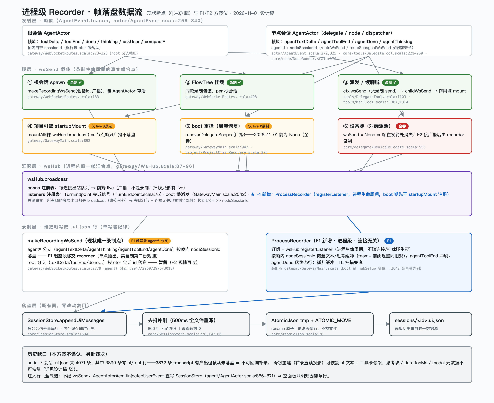

# 进程级 Recorder 设计稿（作者令 2026-11-01 19:00「先出进程级 recorder 设计稿」——只设计不实施）

批令：作者 2026-11-01，kernel 单会话，零代码改动。上游取证：[[20261101_183000_crash-recovery-ws-send__delegate-nebflow-7f75c4c6]]（下称「取证批」，开放项 F1/F2 出处）与 [[20261101_180000_continuation-panel-blank-rca__delegate-nebflow-d86b41ad]]（下称「续聊 RCA」，判别变量与面板渲染证据）；架构面参照 [[20261101_174600_delegate-status-audit__kernel]]。图谱：[[index]] · 词表 [[glossary]]。

## 0. 人话概要（作者可读，先读这段就够）

**病根**：面板正文的唯一数据源是 `.ui.json` 的 ai/tool/thinking 行，而这些行今天只有一条写入路径——「派活的腿手里恰好攥着录制 send（`makeRecordingWsSend`）」。六条腿里三条有录制（根会话 spawn、FlowTree、派发/续聊），三条没有：项目引擎启动挂载只接了裸广播、崩溃恢复重挂同款、设备腿干脆 `None`。实盘后果：node-* 会话 `.ui.json` 4071 条里 3899 条零正文行，其中 3872 条 transcript 证明真干过活——帧在发射处就没了人接。

**方案一句话**：把录制从「腿的行李」升格为「进程的基础设施」——新增 **ProcessRecorder**，挂在 `wsHub.registerListener` 监听者位（所有腿的帧无论谁派出、有没有连接，最后都汇聚在这一次广播），按帧内 `nodeSessionId` 懒建缓冲、按既有行规则落盘；既有录制点的 agent\* 分支**整体移交** recorder（单写者，不双写），boot 期注册、进程生命周期，与连接、挂载腿的生灭彻底解耦。

**分期**：F1 = recorder 上线 + agent\* 分支移交（治腿④⑤，磁盘增量约 2-7MB/天）；F2 = 设备腿接广播一并入录（治腿⑥，需一条贯通 GatewayMain→DeviceDelegate 的窄广播面）；F3（可选，作者裁）= 历史 3872 条从 transcript 降级重建——ai 文本与工具卡骨架可恢复，思考块/时值/模型元数据不可恢复。

**防复活**：源码钉三枚（agent\* 分支禁回潮、注册点禁晚于 startupMount、设备腿注释禁「已修却仍写未修判据」），验收仪表 = 取证批 census 脚本复算（修后新会话零命中）。

---

## 1. 现状写路盘点（谁写、何时写、按什么键）

### 1.1 `.ui.json` 行写者总表

`.ui.json` 按**文件名 = 会话 id** 落盘（`sessions/<id>.ui.json`，`core/SessionStore.scala:1486`）。全部磁盘写入收口在 `SessionStore` 三个方法（追加 `appendUiMessages` :1594、回填 `updateLastAiMeta` :1628、段感知终态 `markRoundTerminal` :1672），写入 = 内存缓存即时可见 + 500ms 去抖全文件重写（`flushDelayMs` :278、`scheduleFlush` :1730），落盘 = `AtomicJson.write` tmp+`ATOMIC_MOVE`（`SessionStore.scala:1532-1533`、`core/AtomicJson.scala:26`）。**语义内容的来源只有两条：**

| 行类 | 唯一来源 | 归属键 | 锚点 |
|---|---|---|---|
| ai / tool / thinking（正文三类） | 录制层 `makeRecordingWsSend` | 根行 = ctor `sessionId`；agent\* 行 = 帧内 `nodeSessionId`（`team-` 前缀规整 ：2789-2790） | `gateway/WebSocketRoutes.scala:2779`；agent\* 分支 ：2947 / 2960 / 2976 / 3018；root 分支 textDelta :2804、toolStart :2813、roundComplete :2845、done :2874、toolEnd :2924；askUser :3072、askPermission :3086、system :3106、compact\* :3112-3142 |
| user 注入行（蓝气泡/归因徽章） | `AgentActor#emitInjectedUserEvent` **直写** SessionStore（不经 wsSend——连接与录制双无关） | 发射者自身会话 id | `agent/AgentActor.scala:866-871`（bluebubble 批收口注释 ：830-845） |
| user 普通行（聊天输入/附件/引用） | WS message handler 单独落盘（不经录制层） | 会话 id | `gateway/WebSocketRoutes.scala:2434`（正文）、:973（附件）、:2568（引用快照）；录制层 user 分支已收口为 no-op（:3097-3104） |

录制层 `makeRecordingWsSend` 全仓**只有两个实例化点**：根会话 AgentActor spawn（`WebSocketRoutes.scala:183`，`doSpawnRootAgent`）与 FlowTree 挂载（:498，`initFlowTree`）。它是包装函数：先按分支落盘（record），再透传 underlying（广播），错误双双吞掉只留 WARN（:3146-3150）——**录制权 = 谁被塞进了这条包装链**。

### 1.2 帧族与归属键（录制语义的输入面）

`actor/AgentEvent.scala:256-340` 的 `toJson` 是帧形单点：

- **根会话帧**（`isSubagent=false`）：`textDelta / toolStart / toolEnd / done / thinking / retryStatus …`，帧内自带 `sessionId`（:273、:296、:326）。
- **节点会话帧**（`isSubagent=true`）：`agentTextDelta / agentToolStart / agentToolEnd / agentThinking / agentDone / agentStart / agentEnd …`，帧内带 `agentId`，`nodeSessionId` 由 toJson 注入（:259-268）或由路由包装补盖：delegate 腿 `DelegateTool.routeWsSend`（`core/tools/DelegateTool.scala:221-260`，缺省底座退化行为空函数在 ：229）；项目节点腿 `NodeRunner.routeSubagentWsSend`（`core/node/NodeRunner.scala:170-208`，补 `rootSessionId/sessionId/nodeSessionId` 归桶键），装配于 `core/project/NodeStarter.scala:731`。

**归属三键** = `nodeSessionId`（子会话自身，落盘键）/ `sessionId`（路由目标视图）/ `rootSessionId`（前端归桶）——录制层判归属读第一键，这就是「按 nodeSessionId 归档」的既有契约。

### 1.3 六条腿的 wsSend 载体谱系（录制生命周期的真实耦合点）

| # | 腿 | wsSend 实参 | 后果 | 锚点 |
|---|---|---|---|---|
| ① | 根会话 AgentActor spawn | `makeRecordingWsSend(sessionId, broadcast)` | 录制+广播，随 AgentActor 存活（`removeRootAgent` :520 才灭） | `WebSocketRoutes.scala:183,229-234` |
| ② | FlowTree 挂载 | 同款录制包装 | 录制+广播 | `WebSocketRoutes.scala:498` |
| ③ | 派发（spawnKernel）/ 续聊（内置+外置执行器） | `ctx.wsSend`（调用方的录制 send）→ `childWsSend`（盖 nodeSessionId）→ 作用域 mount `Some(childWsSend)` | 录制+广播——今天 172 条有正文的 node 会话全走这条族 | `DelegateTool.scala:548,709,825,1103`；`MailTool.scala:1387`（续聊腿 2026-11-01 修）、:1314（外置续聊） |
| ④ | 项目引擎 startupMount | **裸 `wsHub.broadcast`** | 只 live 不落盘——项目引擎 node 会话结构性无录制 | `GatewayMain.scala:892`（`ProjectRuntimeRegistry.mountAll`） |
| ⑤ | boot 重挂（delegate 作用域崩溃恢复） | 2026-11-01 前恒 `None`（帧全吞）；现传裸广播 | 修复前全吞；修复后仍只 live 不落盘（取证批诚实边界） | `GatewayMain.scala:942` → `ProjectCrashRecovery.scala:287,375` → `DelegateFlowHosts.mount` `wsSendFn = wsSend.getOrElse(no-op)`（`DelegateFlowHosts.scala:165`；`emitScopeEvent` fold 同源 ：396-409） |
| ⑥ | 设备腿（对端派活 spawnLocalDelegate） | **`None`**（三判据不修注释在位） | 帧在发射处消失，live 也没有 | `DeviceDelegate.scala:555`（判据注释 ：531-554） |

### 1.4 连接生命周期 × 录制生命周期耦合点逐条

- **连接注册/注销**：每条 WS 连接只向 `WsHub.register` 挂一个**字节出站回调**（有界队列+溢出策略+takeover 内容闸，`WebSocketRoutes.scala:1149-1186`），finalizer 统一注销（:1236-1241）。连接**从不**参与录制——录制不是按连接挂的，是按「谁在 spawn 链上被塞了录制包装」挂的。
- **耦合点 C1（腿谱系）**：录制权来自 spawn 时的实参传递链（§1.3）——新增一条腿忘传录制 send = 新一族空白会话（③vs④⑤⑥ 的差异即历史）。这是结构性缺口本体。
- **耦合点 C2（根 AgentActor 生命周期）**：① 的录制 send 随根 AgentActor 存灭；子会话持有的 `childWsSend` 是闭包（捕获 sessionStore+广播），父 actor 灭后闭包仍可落盘——但**若根会话从未被 spawn 过**（headless 场景先有子腿），整条链不存在。
- **耦合点 C3（boot 窗口）**：boot 期无控制台连接、无 `ctx.wsSend` 可桥 ⇒ 腿⑤只能拿广播（取证批 §2 的「正确出口」注释）——**只要录制还长在腿上，boot 窗口就永远修不干净**。
- **耦合点 C4（作用域事件旁路）**：`emitScopeEvent`（flow-map 事件，非 ui 行）与 `wsSendFn` 同源同参（`DelegateFlowHosts.scala:165,400`）——腿⑤修复只接活了 live，本设计不动它，但 F1 后其注释钉需同步改写（§4 验收项）。
- **与录制无关的旁证**：注入行直写（§1.1 第二行）⇒ 空面板「只剩徽章行」的物理形态；`WsHub.broadcast` 对 listeners 内联派发（`WsHub.scala:94-96`），对 conns 只发序列化文本（:87-93）——**hub 是进程内唯一帧汇合点**。

### 1.5 数据流总图

---

## 2. 方案：连接无关的进程级 ProcessRecorder

### 2.1 事件从哪一层取——三案对比与取舍

| 案 | 取事件层 | 优点 | 代价/风险 | 判定 |
|---|---|---|---|---|
| **A. wsHub 监听者** | `wsHub.registerListener`（`WsHub.scala:58-60`） | ① 全部腿的底层出口都是 broadcast（§1.3，唯⑥例外且 F2 补上）⇒ **订阅一次=看到全部帧**，天然连接无关；② 帧到 hub 已带 `nodeSessionId`（盖章先于汇聚）⇒ 归档键现成；③ 零新机制——TurnEndpoint（`TurnEndpoint.scala:75`）与 boot 桥（`GatewayMain.scala:2042`）两个监听者先例在册；④ agent\* 录制规则可**单点抽出搬入**，满足「禁复制第二份规则」 | 设备腿在 F2 前仍不可见（其帧根本不进 hub）；录制失败必须吞（不得反噬广播，既有同律 ：3146） | **取 A** |
| B. 路由层埋点 | `routeWsSend` / `routeSubagentWsSend` 内加录制 | 帧更早拿到（盖章同点） | 录制仍长在腿上——每条新腿都要记得接，**就是今天这个病**；埋点点位随腿数增长 | 否 |
| C. actor 事件总线 | AgentActor 事件（AgentEvent）订阅 | 比 wsSend 更深的源，`wsSend=None` 的腿也能看到 | 事件→帧的映射要在 hub 之外**再抄一份 toJson 规则**（明令禁止的第二份）；事件侧拿不到路由包装盖的 `nodeSessionId`（归档键残缺）；core 层新增订阅面动架构 | 否（仅作 F2 后的远景备选，本稿不展开） |

### 2.2 recorder 结构与归档

- **身份**：`ProcessRecorder`，gateway 层单实例，构造入参 = `SessionStore`；`apply(json: Json): IO[Unit]` 签名与 `registerListener` 对齐。
- **分流**：`type ∈ {agentTextDelta, agentThinking, agentToolEnd, agentDone}` 才处理（**含 `nodeSessionId` 判据 + `team-` 前缀规整**，语义逐字从 `makeRecordingWsSend` :2947-3070 抽出——**单点搬移，不是第二份实现**）；root 帧族（textDelta/done/…）F1 不接（仍由既有包装按 ctor 键落盘，§2.3）；无 `nodeSessionId` 的控制/面板帧一律忽略。
- **归档**：按规整后 `nodeSessionId` 懒建缓冲（文本/思考/轮起点三条，语义同 ：2955-2957 的既有缓冲），`agentToolEnd` 前冲刷正文（Ai 行在上、Tool 行在下，:2986-3012 同序），`agentDone` 落终态 Ai 行（`terminal=true` + durationMs/model，:3038-3044）或段感知 `markRoundTerminal` 回填（:3059-3064）——**落盘全走 `SessionStore.appendUiMessages` 既有面，零新写者**。
- **会话注册/注销时机**：recorder 本体于 GatewayMain boot 链注册（`hubSetup` 邻位、**先于 `startupMount`**——:1107 链序恰好保证 boot 重挂帧从恢复第一帧起就有录制，正是取证批 §4.2 实证窗口的修复）；进程生命周期，**永不注销**。per-会话缓冲：首帧懒建、终态帧清除；崩溃/断流残留由孤儿扫描兜底（24h idle 冲刷+清除，挂 `projectTtlScanner` 邻位或 recorder 内部周期）——顺手补掉现状 wrapper 的 `sessionTextBuffers` 只增不清的小泄漏面（:2768-2777）。

### 2.3 与既有「按会话录制」的关系：单写者移交，不共存

**判定：agent\* 分支从 `makeRecordingWsSend` 整体迁除（同一提交），录制唯一写者 = recorder；root 分支暂留 wrapper。**

理由：共存必然双写——同一条 agent 帧，包装链里落一次（③ 腿场景）、hub 监听者再落一次 ⇒ `.ui.json` 行重复、面板双气泡；行级去重要比内容（成本高、易漏、漂移源）。而**移交给 recorder 后行为是严格超集**：③ 腿的帧本就经 underlying 进 hub（包装在 underlying 前处理），recorder 在 hub 端接住同一帧、同规则、同键 ⇒ 有录制腿零损失，无录制腿（④⑤）开始有录制。root 分支不动是 F1 缩爆炸半径：根会话录制今天健康（root 会话不在 3872 族），不陪跑。

**F2 后的远景收口**（本稿给方向不给排期）：root 帧自带 `sessionId`（§1.2），技术上 root 录制也可迁 hub、wrapper 退役为纯广播、六条腿全部只拿 `wsHub.broadcast`——届时长在腿上的录制语义彻底清零。是否做、何时做，视 F1 上线后的观察面再裁。

### 2.4 崩溃安全（落盘原子性/追加语义）

- **复用既有保证，不新造介质**：写路径 = `appendUiMessages` → 500ms 去抖 → `AtomicJson.write`（tmp + `ATOMIC_MOVE` rename，`AtomicJson.scala:26-59`）。rename 原子 ⇒ **崩溃可丢尾批行、绝不损文件**；丢尾窗 ≤ 去抖窗（500ms+排队），与 root 会话现状完全同窗——录制是重放面不是台账，接受。
- **不引入 per-frame fsync**：`appendSyncDurable`（`AtomicJson.scala:332`）是链台账（perf-481 A3）的纪律，每行一次 `FileChannel.force` 对逐 token 累积的流式 ui 行是数量级倒挂；且 recorder 缓冲本身在内存，崩溃窗口由「去抖落盘」与「缓冲丢失」两段组成，后者与现状 wrapper 同窗——fsync 只能消除前一段的小头，不值。
- **durable 点继承**：会话删除/关机已有 `flushPendingUiWrites` 冲刷（`SessionStore.scala:923,1793`），recorder 零额外动作即被覆盖。

### 2.5 背压

- **执行位**：listener 在 `broadcast` 内联执行（`WsHub.scala:94-96`）⇒ 录制路径必须保持「JSON 嗅探 + 内存 Ref 更新」微秒级；`appendUiMessages` 只动缓存+调度去抖（磁盘在 `IO.blocking` 线程），**不产生同步磁盘 IO**。
- **落行粒度天然节流**：逐 token 的 `agentTextDelta/agentThinking` 只累积不落行，落行只发生在 `agentToolEnd`（前冲刷）与 `agentDone`（终态）——写盘频率 ∝ 工具调用轮数，不 ∝ token 数。
- **失败纪律**：录制全程 `handleErrorWith` 收口只 WARN（照 wrapper :3146 同律），**绝不反噬广播**；recorder 自带耗时计数（建议挂 `/api/health/conn` 邻位读数，警戒 p99 > 1ms，§6 R1）。
- **不吃出站容量**：录制不进 conns 出站队列，与既有溢出策略（丢流式帧/断控制帧，`WsHub.scala:118-155`）零交集。

### 2.6 磁盘量级估算（2026-11-01 19:15 实盘读数）

| 读数 | 值 | 口径 |
|---|---|---|
| `sessions/` 总量 | 7.5 GB / 6904 个 `.ui.json` | 全历史 |
| node-\* `.ui.json` | 4071 个 / 271 MB | 均值 66KB，样本 p50 56KB / p90 100KB |
| 近 24h 新写 node-\* | 39 个 / 10.9 MB | mtime 窗口（含重写） |
| 近 7 天节奏 | 11-01：30 个/10.4MB；10-31：20 个/2.3MB；10-30：5 个/1.1MB | delegate 派发量主导 |
| 对照：LLM transcript 24h | 124 MB | recorder 不碰 `<id>.json` |

**结论**：recorder 的增量 = 「今天会丢的那部分会话」开始落盘。按当前节奏 30-100 个 node 会话/天 × 均值 66KB ≈ **2-7 MB/天**，爆发日（批量派发）< 20MB/天——量级上是 transcript 的零头，不是磁盘大头。**写放大**是真正要盯的面：`appendUiMessages` 是全文件重写，每会话每活动窗一次重写、规模随会话长大——既有双帽封顶（800 行 `MaxStoredUiMessages` :107、512KB 启动收缩迁移 `ShrinkThresholdBytes` :80-93）对 recorder 一视同仁，无需新护栏。

### 2.7 多进程边界结论

**引擎单进程（每数据根一个 gateway JVM）**：帧的唯一发射源是进程内 AgentActor（`actor/AgentEvent.scala:256-340`）；子进程只有工具执行体（`core/tools/shell.scala:537`、`RgHelper.scala:185`）与 RestartHelper 重启自身（`RestartHelper.scala:45`），**均不发帧**；`WsHub` 由 GatewayMain 局部构造（:720），core 层禁 import gateway（`check-scala-layers.mjs` 门禁）。设备腿对端 = 另一实例另一数据根（Neblink 跨设备），**各自录各自的盘，无跨进程合并面**——recorder 天然按进程自洽。同数据根双实例互踩由既有 pid 面（`.pid.meta`/StaleProcessGuard）防，recorder 不改变该模型。⇒ **F2 给 DeviceDelegate 通广播时传函数值（`Json => IO[Unit]` 窄端口或 initialize 增参），禁传 WsHub 本体**（层门禁不破）。

### 2.8 设备腿无上下文会话要不要录——建议：要（随 F2）

取证批不修的三判据（无连接上下文 / 无全局 sink / 实盘零样本）针对的是「半修只给 live」；recorder 落地后接广播即全修，三判据前两条同时消失。建议随 F2 接入：成本 ~零（同 sink 同规则）、设备侧会话面板与取证面一致、且 `delegatedBy` 样本从 0 开始积累后才有数据面可裁。保留一条诚实边界：设备侧结果面经 `resultProxyBehavior` 折回 host，host 面板渲染的是父会话——设备侧录制改善的是**本机会话详情面板与排障取证**，不是 host 面板。

---

## 3. 历史 3872 条：结论与降级方案取舍

### 3.1 结论（不可回溯部分）

**帧从未落盘 ⇒ 正文本体不可回溯补录。** ai/tool/thinking 三类行唯一写者是录制层（§1.1），④⑤⑥ 腿的帧在发射处就无接盘者，盘上零字节；没有任何旁路介质记录过这些帧（flow-map-events.jsonl 是作用域事件族、不是 ui 行；stand.log 无帧体）。3899 条零正文会话中 27 条 transcript 亦无产出（spawn 即死）——彻底无物可重建。

### 3.2 降级重建的诚实评估（能重建几成）

数据源 = `sessions/<id>.json` LLM transcript（3872 条**按定义**都有助手产出）。续聊 RCA 已实证可行：场景 B 把真实 transcript 按录制层规则重投影 305 条 ai/tool 行喂给真实渲染器，正文全量恢复（[[20261101_180000_continuation-panel-blank-rca__delegate-nebflow-d86b41ad]] §证伪与排除）。分项成色：

| 内容 | 可恢复度 | 说明 |
|---|---|---|
| ai 正文文本 | **~100%** | transcript assistant 消息即正文源；轮切分按工具调用边界近似 |
| 工具卡（label/summary/content/isError/input） | **~90%** | toolCall/toolResult 在 transcript 内；`input` 结构可还原，截断帽（`MaxStoredToolContentChars`）外的全文在 `~/.nebflow/tool-results/` 有独立副本（`SessionStore.scala:69-73` 注释） |
| thinking 块 | **~0%** | transcript 不存思考文本 |
| durationMs / model / terminal 终态徽章 | **~0%**（terminal 可全量补 `true`） | 时值与模型只在帧里 |

**综合 ≈ 结构行九成、元数据近零**。渲染形态上是一次可用的历史正文，不是逐字节复原。

### 3.3 面板取舍：一次性重建 vs 常驻降级渲染

| 方案 | 优 | 劣 | 判定 |
|---|---|---|---|
| **一次性离线重建脚本**（扫 3872 条 → 按录制层行规则投影 → `appendUiMessages` 落盘，行打重建标记；幂等守卫 = 仅零 ai/tool 行会话） | 修完即走，面板读路径零改动；重建规则可与 recorder 共用同一投影函数（单一来源） | 元数据永久缺失（须标记诚实呈现）；一次性写 ~150-250MB（271MB × 3899/4071 × 可恢复占比） | **建议（F3，作者裁）** |
| 常驻降级渲染（面板发现「有 transcript 无 ui 行」时直读转录投影） | 不写盘 | 读路径永久多一条转录耦合分支（transcript 格式一变即脆）；投影逻辑在渲染层重执行；受益人群随 recorder 上线只减不增 | 否——为递减人群常驻复杂度不划算 |

---

## 4. 分期落地（每期验收/风险/回滚）

### F1 —— ProcessRecorder 上线 + agent\* 单写者移交

- **内容**：① 抽出 `makeRecordingWsSend` 的 agent\* 四分支为共享实现（同提交从 wrapper 迁除）；② `ProcessRecorder`（gateway 层）+ `wsHub.registerListener` 装配，注册点先于 `startupMount`；③ 孤儿缓冲 TTL 扫；④ 三处「广播≠录制」注释钉（`GatewayMain.scala:928-937`、`ProjectCrashRecovery.scala:282-285`、`DeviceDelegate.scala:552-554`）改写为「录制已由 recorder 接管」收口注记。
- **验收**：四腿端到端（③④⑤+续聊）新会话 `.ui.json` 均有 ai/tool 行；同帧零重复行；root 会话回放逐字节零漂移；census 复算修后新会话零命中。
- **风险**：agent\* 分支搬运的行为微差（冲刷时点/字段）——以「逐字搬运 + S1/S5 对拍 spec」控制；注册时点回归——源码钉（§5 P2）。
- **回滚**：单 commit revert 即回现状（wrapper 分支恢复，recorder 摘除）。

### F2 —— 设备腿接广播入录

- **内容**：GatewayMain → `DeviceDelegate.initialize` 贯通一条广播面（窄端口/增参，缺省 `None` = 旧形态）；`wsSend = None` 改 `Some(broadcast)`；⑥ 腿判据注释改写。
- **验收**：spec 直调 `spawnLocalDelegate`（或 Neblink 数据通道注入 `delegate-spawn` 载荷）⇒ 本机 `.ui.json` 有行、live 有帧；层门禁（core 禁 import gateway）机械校验过。
- **风险**：动 `AgentRuntimePort`/initialize 装配缝——最小改法为增可选参，spec 桩零改动；无实盘消费者（零样本），风险纯在代码面。
- **回滚**：参数回缺省 `None`（逐字旧形态）。

### F3 —— 历史 3872 条一次性重建（可选，作者裁）

- **内容/验收/风险**：§3.3 方案；幂等守卫 + 重建行标记 + 抽样实拍（面板渲染）；风险 = 一次性写盘量（<250MB）与投影规则的保真度声明（元数据缺失写进脚本输出）。
- **回滚**：脚本按标记行可逆向清除重建行。

### 依赖关系（S3 / D1 / 状态矩阵批）

- **S3（判词诚实化）/ D1（链生命周期与会话解耦）**：与 F1/F2 **正交不互卡**。recorder 的归档键 = `nodeSessionId`，与链/会话生命周期解耦天然成立；D1 设计批落地时建议把「recorder 孤儿缓冲清理时机」纳入其注销面清单（一行注记级）。
- **状态矩阵批（在飞）**：零语义依赖；**文件交集面 = `GatewayMain.scala`（boot 链多批共同热点）与 `WebSocketRoutes.scala`**——F1 动工前核对该批合并状态，排其后再落地可少解冲突；本稿与其工作区零触碰。
- **崩溃恢复批（已落 main）**：F1 直接消费其三处注释钉（改写即 F1 验收项④），语义上是该批开放项 F1/F2 的执行批。

---

## 5. 测试与验收策略（含防复活钉）

**行为 spec（`ProcessRecorderSpec`，参照 `DelegateContinuationWsSendSpec` 同族写法）**：

- S1 帧→行：fake hub 三帧序列（agentTextDelta→agentToolEnd→agentDone）⇒ `.ui.json` 得 Ai+Tool+terminal Ai 行，键 = `nodeSessionId`；
- S2 归属键：`team-` 前缀 nodeSessionId 规整后落队会话文件（规整语义搬家不丢，:2789 同判）；
- S3 单写者：同帧仅落一行（行为级），wrapper 处 agent\* 分支不存在（源码级，P1 同源）；
- S4 写路径契约：recorder 落盘走 `SessionStore.appendUiMessages`（复用去抖/原子/封顶，不绕行）；
- S5 root 零漂移：root 帧序列经既有包装的落盘输出与改前逐字节一致；
- S6 孤儿缓冲：注入残留缓冲 → TTL 扫冲刷落盘后清除。

**面板端到端**：复用 `tests/continuation-panel-blank.spec.mjs` 场景 B（真实渲染器+重投影载荷已实证）；补一条「boot 重挂会话重开面板有正文」实拍（取证批 §4.2 标本形态）。

**验红仪表**：取证批 `evidence/20261101_crash-recovery-ws-send/census.py` 复跑——修前 3899/4071 零正文，修后**新产生会话零命中**（判别变量转负即验收）。

**防复活钉（源码钉，`DelegateScopeRecoveryWsSendSpec` S4/S6 先例）**：

- P1 `makeRecordingWsSend` 源码内不得再现 `case "agentTextDelta"` 等四个 agent\* 分支（迁除后回潮 = 双写复活）；
- P2 `GatewayMain` 必须含 `registerListener` + recorder 装配，且注册在 `startupMount` 之前（链序 :1107 为证）；
- P3 `DeviceDelegate` 的 `wsSend = None` 三段判据注释与代码状态必须同步：F2 前注释在、F2 后注释改写——禁「代码已修、注释仍说未修」或反向漂移；
- P4 腿④⑤ 的「广播≠录制」诚实边界注释随 F1 改写为收口注记（同 P3 纪律）。

---

## 6. 风险清单

| # | 风险 | 成因面 | 护栏 |
|---|---|---|---|
| R1 | 性能：listener 内联拖慢 broadcast | 录制路径变重 | 嗅探+Ref 微秒级；落行粒度=工具轮非 token；耗时计数读数化（p99>1ms 警戒）；失败吞掉只 WARN |
| R2 | 双写不一致 | wrapper 与 recorder 并存期 | **单写者移交**（同提交迁除 agent\* 分支）+ P1 源码钉；禁任何「临时共存加去重」方案 |
| R3 | 磁盘增长与清理 | 覆盖面从 ~4% node 会话到 100% | 增量 2-7MB/天（§2.6）；写放大由 800 行/512KB 双帽+收缩迁移封顶；**不新增删除面**——`.ui.json` 本体无自动清理（7.5GB/6904 个现状），「sessions 目录 TTL/归档」建议并入既有 O9 清场批议题（连同 worktree 73G、链台账冷归档、TaskLedger 30d TTL 等既有回收面统一盘），不另起炉灶 |
| R4 | 行为漂移（分支搬运微差） | agent\* 规则换宿主 | 逐字搬运禁改写 + S1/S5 对拍；投影函数单一来源（F3 复用同一函数，禁第三份） |
| R5 | 注册时点回归（晚于首帧丢录制） | boot 链重排 | P2 源码钉；链序 :1107 结构性保证 |
| R6 | 层门禁 | F2 广播面贯通 gateway→core | 传函数值/窄端口，禁传 `WsHub` 本体；`check-scala-layers.mjs` 机械校验 |
| R7 | hub 单点放大 | recorder 故障影响全部帧路径 | 错误全吞（同 ：3146 纪律）；recorder 无状态外溢（缓冲丢失=丢当前轮未落行，与现状 wrapper 同窗，§2.4） |

## 7. 开放项（本稿不裁，留作者）

1. F3 做不做、一次性重建的行标记与「降级」徽章呈现形态；
2. root 录制是否在 F2 后二期迁 hub、wrapper 全面退役（§2.3 远景）；
3. recorder 孤儿缓冲 TTL 值（本稿建议 24h）与耗时读数挂载点（`/api/health/conn` 邻位）；
4. sessions 目录长期清理策略并入 O9 议题的时机。
