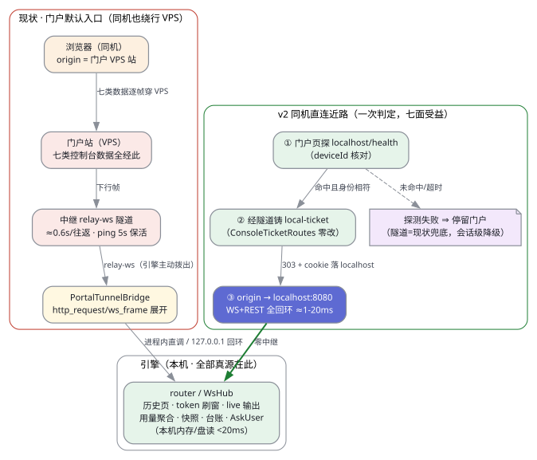

# 全中继面本地加速 · v2 补充章（全中继面盘点矩阵 + 按类分流 + 同机直连近路）

- 批次：20261020_162217 · 前序：`20261020_154500_全数据面本地加速通道设计__delegate-nebflow-109c9e35.md`（v1，本设计不重写之）· 状态：draft（设计稿，候作者裁）
- 作者令 v2 逐字：「比如后台agent，消息，token面板，所有需要通过中继的数据都要盘点一遍，然后做区分和加速」
- 分节：§1 范围与结论（v2sec01）· §2 全中继面盘点矩阵（v2sec02）· §3 按类分流设计（v2sec03）· §4 量级估算（v2sec04）· §5 开放问题追加（v2sec05）· 图 v2topology.svg

（图源 `v2topology.dot`，graphviz 14.1.5 渲染 + 暗色适配注入，复现法同 v1 §A.3）

## 执行摘要（TL;DR）

1. **绕行不是逐面缺陷，是入口拓扑问题。** 新盘点七类控制台数据面（聊天消息流、后台 agent 面板、token 用量面板、portal 轮询面、日志/证据、AskUser 问答对、任务台账）在引擎侧全部是本机内存/盘读（<20ms 量级），但默认门户入口下，浏览器 origin = VPS 门户站，WS 连 `location.host`（`web/js/ws.js:626`）——**整站控制台数据（不只文件）同机查看时也绕 VPS 隧道一圈，每往返 ≈0.6s（#538 实测口径）**。
2. **主杠杆 = 同机直连近路（§3.3）**：门户页探测 localhost 网关 + deviceId 核对 → 经既有隧道铸一次性 local-ticket（`ConsoleTicketRoutes` 全套已并 main 零改）→ origin 换 localhost → 七类数据面**一次判定、全部受益**，零逐面改造；探测失败停留门户，现状即兜底。
3. **按类分流**：静态/半静态面（历史页、用量聚合、快照、归档、台账）= 套 v1 管线 + 补 ETag/304 与 immutable 缓存语义（六端点各一小刀，§3.1）；实时流面（token 帧、live 输出、AskUser 帧、节点事件）= 不可缓存，近路 + 协议增强（刷窗自适应、3s 轮询变推送、round/block 序键健康面，§3.4）。
4. **量级**：同机场景逐面提速 ≈12×-300×（§4.2 逐面表，全部以 #538 分段法与既有实测锚推得）；跨设备场景实时流保持中继（付恒定税零新工程），打洞边界登记 Q14 候裁。
5. **开放问题 +7**（Q14-Q20，§5）：打洞 vs 中继边界、近路判定权威（门户自动探测 vs 引擎侧一键入口）、实时流降级粒度、多窗口一致性、历史页本地先行契约、推送订阅管理、门户域划界。

---

## 1. 范围与结论（v2sec01 全文）

（本节为分节文件 `v2sec01-scope.md` 的收编，内容一致）

- 定位：v1 补充章。v1 已盘点九行文件字节面（行 A-I）并给统一取数管线；v2 推平到文件之外的七类控制台数据面，补两类设计：静态/半静态面套 v1 管线，实时流面设计近路与取舍。
- 结论先行：**绕行是入口拓扑问题**——门户入口（默认，`brand.conf:16`）+ WS 连 location.host（`ws.js:626`）+ 引擎拨 `wss://<relay>/api/device/relay-ws`（`NeblinkRelayTunnel.scala:1340-1346`）+ PortalTunnelBridge 本机展开（`PortalTunnelBridge.scala:15-56`）构成「浏览器→VPS→隧道→本机」的固定路径；同机用户默认付全量隧道税。localhost 近路产品链（票证换会话）**已并 main**（`LocalConsoleUrl.scala:15-37`、`ConsoleTicketRoutes.scala:52-100`），缺的只是自动判定。
- 与 v1 关系：locality 位/账本/进度契约/测量法/分期骨架全部引用复用（v2sec01 §1.6 对照表）。

## 2. 全中继面盘点矩阵（v2sec02 全文）

（分节文件 `v2sec02-matrix.md` 收编；此处保留其结论表，逐行明细见分节文件）

### 2.A 路径本体基准行（行 R）

| 维度 | 现状 | 锚点 |
|---|---|---|
| 门户入口 | 默认入口 = 门户站；`NEBFLOW_OPEN_UI=local`/显式空 = localhost 逃生口 | `brand.conf:16`；`gateway/PortalUrl.scala:27-45` |
| WS 归宿 | 一律 `location.host/ws`——origin 是谁数据过谁 | `web/js/ws.js:626` |
| 隧道 | 引擎拨 `wss://<relay>/api/device/relay-ws`；桥把下行帧展开为进程内直调/回环 WS | `NeblinkRelayTunnel.scala:1340-1346`；`PortalTunnelBridge.scala:15-56,47-49` |
| 本机近路半成品 | local-ticket 原子核销 → 303 + cookie 落 localhost → 整站回环零隧道 | `LocalConsoleUrl.scala:15-37`；`ConsoleTicketRoutes.scala:52-100` |

### 2.B 七行结论表（明细锚点见 `v2sec02-matrix.md`）

| 行 | 类 | 引擎侧成本（事实） | 同机绕行判定 | v2 落点 |
|---|---|---|---|---|
| J 消息流·历史 | 静态/半静态 | 本机盘 append-only 读 | ❌ 必穿隧道（开会话/翻页/重连全量） | §3.1 本地权威先行 + 页指纹 |
| J 消息流·token 帧 | **实时流** | 50 字符/50ms 刷窗内存帧 | ❌ 逐窗穿隧道 | §3.3 近路 + §3.4 增强 |
| K agent 面板·live 输出 | **实时流** | 内存/文件增量读（<20ms） | ❌ 3s/2s REST 轮询穿隧道 | §3.4 轮询变推送 + 近路 |
| K agent 面板·快照/台账 | 静态/半静态 | 内存装配 | ❌ 必穿隧道 | §3.1 ETag/304 + immutable |
| L token 用量面板 | 静态/半静态 | 小时粒度增量聚合缓存 | ❌ 裸 200 无缓存语义 | §3.1 ETag（已完结小时不可变） |
| M portal 轮询面 | 通道税/门户域 | — | 心跳必要（设备发现本体）；隧道保活可消；portal_status 属门户域 | §3.3（近路消隧道）；划界 Q20 |
| N 日志/证据 | 静态 | 本机盘读 | v1 行 H 已覆盖 | 引用 v1，无新设计 |
| O AskUser 问答对 | 实时流（帧）+静态（附件） | 内存 pending 表 | ❌ 来回各穿隧道 | §3.3 近路；附件套 v1 |
| P 任务台账 | 静态/半静态 | 本机 JSON 读 | ❌ 搭车穿隧道（无专属面） | §3.1 ETag/304 |

（行 J/K/L/M/N/O/P 的逐子面 file:line 明细、本地层现状、缺口 —— 全部在 `v2sec02-matrix.md`）

## 3. 按类分流设计（v2sec03 全文要点）

（分节文件 `v2sec03-routing.md` 收编；要点转录）

- **判据一句话**：可否「先给旧值、后台对账」——可 = 静态/半静态；否 = 实时流。
- **类一（静态/半静态）**：loc 恒 `local`，套 v1 位+账本管线；v2 增量 = ①六端点缓存语义补齐（`historyPage` 页指纹、`/usage/aggregate` ETag、flow-map 快照/archive ETag+immutable、`/delegates/:id` 台账 ETag、`/chains` gen ETag——全 `private`，同 #538 规）；②账本键族扩展 `hist:`/`usage:`（字节账本不用于小载荷快照——防过度设计，决策记录在案）。
- **类二（实时流）**：缓存禁用；杠杆只有路径短路（§3.3 近路）与协议增强（§3.4：FlushWindowMs 隧道腿自适应 100-150ms、delegate/bg-task 输出 3s/2s REST 轮询→WsHub 增量尾帧推送、round/block 序键停滞健康面）。跨设备实时流保持中继（恒定税 vs 打洞 60-80% 成功率+新协议工程，**解读**标注），分派哲学可搬、传输面须新造——Q14 候裁。
- **同机直连近路五步**（§3.3 表）：门户页探 `localhost/health`（CORS 一小刀）→ deviceId 核对 → 经隧道铸 local-ticket（复用 `ConsoleTicketRoutes` 零改）→ origin 迁 localhost（ws.js:626 自动跟随，七面零逐面改造）→ 失败停留门户（现状兜底）。降级方案 = 引擎侧「本机近路」一键入口（`nebflow open` 能力 UI 化，纯本库）——双轨建议 Q15。
- **判定纪律**：v2 把 `loc=local` 扩展为双主体判定（数据在本机 + **查看端**在本机）；近路状态属会话/标签页维度，不逐载荷携带——与 v1 §5.2「写入时判定一次」同哲学。

## 4. 量级估算（v2sec04 全文要点）

（分节文件 `v2sec04-latency.md` 收编；测量基准七锚 + 逐面表 13 行在该文件，此处摘核心行）

| 面 | 现状（同机+门户入口） | 设计后（近路/缓存） | × |
|---|---|---|---|
| 会话历史页 | ≈0.6-0.9s/页 | 0ms 感知 + 304 对账 ≈2ms | ≈15-30× |
| token 流式帧 | 单向 ≈0.3s 滞后；首字多付 ≈0.6s | 回环 ≈1-5ms | ≈60-300×（首字） |
| delegate live 输出 | 0.6s/轮 ×N 代理/3s | 推送 ≈2-5ms | ≈30-300×（N 放大） |
| flow-map 快照/结果 | ≈0.6s / <20ms 本机 | 304 ≈2ms / <20ms | ≈20-300× |
| token 用量面板 | ≈0.6s | 304 ≈2ms | ≈12-300× |
| AskUser 问答全程 | ≈0.9s（下行 0.3 + 上行 0.6） | ≈5-10ms | ≈90-180× |
| 日志/证据文件 | ≈2.79s（#538 实测） | ≈45ms（v1 三档） | ≈62×（实测） |

边界申报：倍率口径 = 同机+门户入口（作者令靶心）；跨设备另计（协议增强降 ~50% 实时流税）；0.6s 为活窗中位只升不降；「设计后」读数 = 既有锚代入非新测量，M1 落实测 spec（近路全链 p95<50ms、304 p95<10ms，补 Q6 同族）。

## 5. 开放问题追加（v2sec05 全文）

（分节文件 `v2sec05-open-questions.md` 收编；编号接 v1 Q13）

| # | 问题 | 建议 |
|---|---|---|
| Q14 | 跨设备实时流打洞 vs 中继边界 | M 期保中继+协议增强；打洞独立立项候裁 |
| Q15 | 同机近路判定权威（门户自动探测 vs 引擎一键入口） | 双轨：B（引擎侧 UI）M1 先行，A（门户探测）随门户节奏 |
| Q16 | 实时流降级粒度 | 会话级——现状重连对账已是完整降级语义，零新增 |
| Q17 | 多窗口一致性（近路窗+隧道窗并存） | round/block 序键去重 + 快照对账（meta.updatedAt/链 gen） |
| Q18 | 历史页本地先行 vs「后端唯一真源」契约 | 候裁：「不可变历史本地先行 + 尾页流维护」口径 |
| Q19 | 轮询变推送的订阅管理 | M2 落；断线即全退订、重连重订阅，从简 |
| Q20 | portal_status 门户域划界 | 本设计域 = 引擎+本库 web；门户域列移交清单 |

分期并轨：M1 = 近路（Q15-B）+ 页指纹 + ETag 三小刀 + 近路性能预算 spec；M2 = 轮询变推送 + 归档 immutable + 刷窗自适应；M3 = 门户自动探测 + 近路命中读数面板 + Q14 立项（候裁后）。v1 Q1-Q13 判定全部维持。

---

## 附录 B · v2 证据与复现

- 测量基准全部引用 v1 §A.1 已存证据（`evidence/20261019_082500_imgslow538-segmented-timing.md`、`evidence/20261019_imgslow538-timing/local-timings.json`）+ `web/js/nodeData.js:127-130` fmresult 批 <20ms 自注——v2 **零新测量**，全部量级为既有锚代入（§4.3 边界申报）。
- 图复现：`cd reports/20261020_154500_data-plane-local-accel-design && dot -Tsvg -o v2topology.svg v2topology.dot`（graphviz 14.1.5），暗色适配注入法同 v1 §A.3。
- 本章分节文件：`v2sec01-scope.md` / `v2sec02-matrix.md` / `v2sec03-routing.md` / `v2sec04-latency.md` / `v2sec05-open-questions.md` / `v2topology.dot` / `v2topology.svg`。
