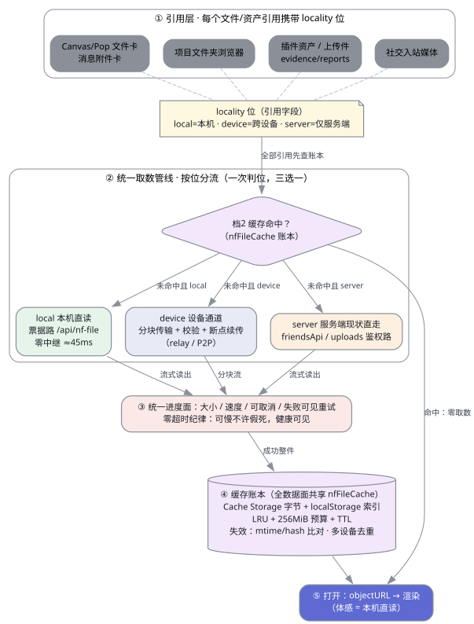

## 4. 统一取数管线（目标态）

（图源 `pipeline.dot`，graphviz 14.1.5 渲染，SVG 内嵌暗色适配；复现：`dot -Tsvg -o pipeline.svg pipeline.dot` 后注入 media query）

五段管线，**关键决策 = 判位在缓存查询之后**：

1. **引用层**：一切文件/资产引用（Canvas/Pop 文件卡、消息附件卡、文件夹浏览器、插件资产、上传件、社交入站媒体、evidence/reports）统一携带 locality 位（§5）。位由**写入时判定一次**，不靠读取端逐次猜测。
2. **判序 = 先账本后分流**：任何取数先问 nfFileCache 账本（跨设备件入账后即成为「本机体感」，第二改备 #542 作者令「已点击下载过的文件应该也打开很快」的正解——账本命中与 locality 位无关，`nf:<path>` 与 `attach:<id>` 与未来 `dev:<device>:<path>` 同表）。
3. **三条字节腿**：
   - `local` → 既有票据路 `/api/nf-file`（零中继，全链 ≈45ms，§2.1/§2.2），现状即达标，不重做；
   - `device` → 设备通道分块传输（§2.4 底盘），**新增**统一进度语义（§4.4）；
   - `server` → 现状鉴权路直走（friendsApi/uploads 等），只接统一进度与账本，不动路由。
4. **统一进度面**（零超时纪律的落点，见 §4.4）。
5. **账本入账 → 打开**：整件成功即入账（含 version 读数），`objectURL` 渲染；打开路径全数据面同一条。

### 4.4 统一进度面契约（G4 零超时纪律）

现状档3 的进度环语义（`attachmentPreview.js` 进度面板 + `nfFileCache.js:261-291` 流式读出）推广到三条腿，契约五条：

| 项 | 契约 | 现状差距 |
|---|---|---|
| 定界 | Content-Length/件大小可得 → 百分比；缺席 → 不定态转圈（禁假进度） | 档3 已有；设备分块腿需把分块 offset 映射为 loaded |
| 速度 | 环形下方一行 `x.x MB / y.y MB · z MB/s`（滑动窗口均值，1s 刷新） | 无，新增（三腿共用一组件） |
| 可取消 | 进行中面板常驻「取消」键；取消 ⇒ AbortController 逐层断流，设备腿补 cancel 消息（对端停发） | 前端无取消；设备通道无取消信令 |
| 失败 | 就地可见错误态（HTTP status / 分块校验失败位置）+ 重试键；重试从**续传点**继续而非归零 | 档3 失败可见已有；续传重试仅设备腿有（分块账），HTTP 腿归零重下 |
| 健康可见 | 卡死判定：>10s 无字节推进 ⇒ 进度面板转「停滞」态（黄）并提示可取消，永不静默挂死 | 无，新增（纯前端计时器） |
