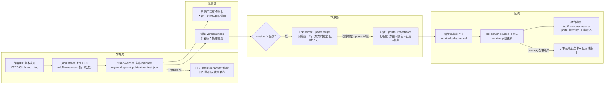
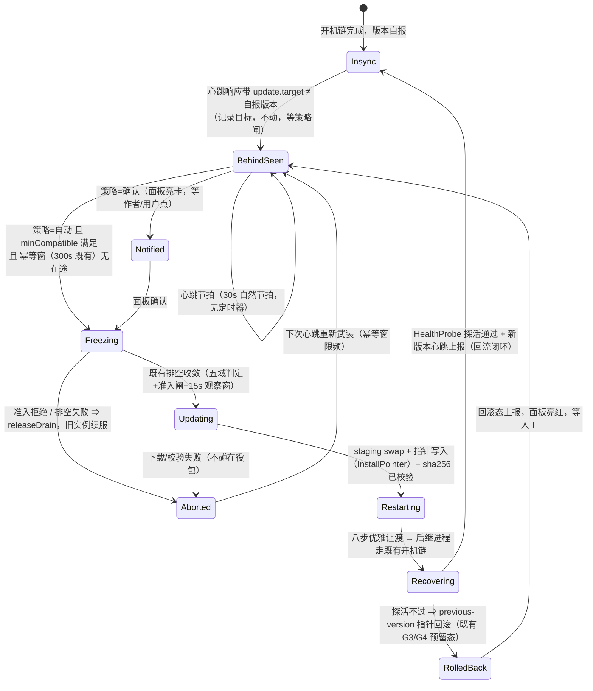

# 统一更新系统 · 设计（只设计不实施）

> 批次：统一更新系统设计批（2026-10-20）· 作者原令见 §1 · 交付物=本设计文档，**零代码改动**。
> 状态：完稿（11 节全落盘）。开放问题 11 条待作者拍板（§10）。

## 0. TL;DR

**一句话**：把「版本权威」从今天的 OSS 裸指针（`latest-version.txt`）上移到官网 manifest（`mystand.space/updates/manifest.json`），引擎单设备更新链**原封复用**（既有 hotupdate 七相位编排器只换「检查」相位的读源），link-server 设备注册表补版本字段并把「目标版本」搭心跳的便车下发，落后设备在线即自动收敛——离线不丢，上线首心跳补齐；不一致全程可见（引擎面板更新卡 + portal 版本矩阵），正确性靠状态与探活表达，零新增定时器。

三个新机制，一个复用主体，零平行系统：

| 新增 | 落点 | 复用 |
|---|---|---|
| 版本清单 manifest（官网发布） | stand-website | `VersionCheck` 单一实现换读源；OSS 镜像过渡期保留 |
| 设备版本字段 + 目标版本下发 | link-server | 心跳已带 `version`（引擎侧现成）；serde 新旧互宽容已验证 |
| 更新可见面（面板卡 + portal 矩阵） | 引擎 web / portal / link-server | 既有 WS 广播通道（复用点 #11）+ `HealthProbe` |

## 1. 范围与作者原令映射

作者原令（逐字）：「我们先在控制台进行退出登陆，切换账号的功能[去掉]…改为从官网里进行统一检测和更新…热更新…不在线的设备等待其在线了再推送…保证所有设备是统一的版本」。

| 原令片段 | 本设计落点 | 说明 |
|---|---|---|
| 从官网里进行统一检测 | §3/§4/§5 | 官网 manifest = 版本权威源 + 下载页/检测入口；引擎与 portal 同源读 |
| 热更新 | §6 | 分档表：哪些面能热、哪些必须走重启窗；引擎 jar 走既有编排器（排空→换包→让渡），非字面意义不停机 |
| 不在线的设备等待其在线了再推送 | §7 | 推送语义 = 目标版本挂在 link-server，设备上线首心跳即拉取收敛（pull-on-online，NAT 下 push 不可达） |
| 保证所有设备是统一的版本 | §3/§4/§7/§8 | 版本上报（心跳）→ 注册表字段 → 收敛态聚合 → portal 矩阵可见 |
| 健康可见 / 零超时纪律 | §8 | 状态机推进靠心跳节拍与探活，不新增 wall-clock 定时器（🔴 零超时 2026-10-19 作者拍板的对齐） |

**范围外**：控制台去退出/切换账号（另批在做）；移动端 HTML 样张的视觉实现；CI/发布管线的具体编排（只定义产物契约）。

## 2. 现状盘点（三仓现形态 · 证据锚点）

### 2.1 stand 引擎（本仓，Scala/sbt）

| 现状 | 锚点 |
|---|---|
| 版本身份 = `VERSION` 文件（当前 `2026.9.20`，日历版本）；`Version.string` 读 classpath 内 VERSION，回退文件系统，再回退 `"dev"` | `VERSION:1`、`src/main/scala/nebflow/Version.scala:5-19` |
| 构建版本取 VERSION 文件，VERSION 打进 JAR | `build.sbt:15,17` |
| 产物 = `stand-assembly-<version>.jar`（brand.conf `lowerName` 派生）；`make install` 装到 `~/.local/bin/stand.jar` + 启动器 | `Makefile:30-38`、`brand.conf:7` |
| 安装布局 = 指针制：`<installDir>/current-version` / `previous-version` / `versions/<version>/*.jar`（每版一目录不可变）；installDir 缺省 `~/.nebflow/bin` | `core/hotrestart/InstallPointer.scala:12-25,42-47` |
| 版本权威源**今天** = 阿里云 OSS 裸指针 `https://<cosBucket>.oss-cn-hangzhou.aliyuncs.com/latest-version.txt`（+ `latest-beta-version.txt` beta 通道）；桶名走 brand.conf `cosBucket`（历史键名，2026-09-14 COS→OSS 切仓） | `core/hotupdate/VersionCheck.scala:16-18`、`release/install.sh:30,94-112`、`brand.conf:23` |
| 走 OSS 不走 GH API 的原因：仓库 private 后 GH API 未认证不可用，读发布镜像同语义 | `gateway/WsSystemHandlers.scala:372-375` |
| 更新编排器**已存在**（hotupdate 批 1）：检查→准备→冻结（五域判定+准入闸+15s 观察窗排空）→更新（`runInstallScript`）→重启（八步让渡）→恢复（后继开机链）→中止（`releaseDrain` 旧实例续服）→已回滚（批 2 建态）；幂等键窗 300s；排他无队列 | `core/hotupdate/UpdateOrchestrator.scala:12-37` |
| 远端触发口：`POST /neblink/update`（可信对端 IP 校验，beta 开关）→ 安装脚本 → `RestartHelper.spawnRestart` → exit(0) | `gateway/NeblinkRoutes.scala:968-993` |
| 设置页检查：WS 帧 `updateCheckResult` {currentVersion, latestVersion, hasUpdate, releaseName}，与编排器同源 `VersionCheck` | `gateway/WsSystemHandlers.scala:364-399` |
| 心跳**已带** `version`（+ `uiPort`）；注释钉死「server 旧版 serde 宽容忽略未知字段，新旧互兼容」 | `neblink/NeblinkClient.scala:450-466` |
| 对端列表 `NeblinkPeerInfo` **不带** version（deviceId/deviceName/platform/endpoints/online 五字段） | `neblink/NeblinkClient.scala:48-54` |
| 热重启件族齐备：`HotRestart` / `SuccessorGate` / `HealthProbe`（JDK 内置 HttpServer 门口位，读 `/api/health` 版本） | `core/hotrestart/` 四件 |
| 零超时纪律：2026-10-19 作者拍板「stand 设计不要有任何超时控制」——分配链已拆 wall-clock 预算，正确性靠监测表达 | `shared/config.scala:200`、`llm/decision/LlmAllocator.scala:140` |

### 2.2 link-server（neblink-server，Rust，独立仓）

| 现状 | 锚点 |
|---|---|
| 部署 = Vultr VPS Docker（neblink-server + caddy），SQLite 持久化；升级 = `git pull && docker compose up -d --build` | `NEBLINK_HANDOVER.md` §1/§8 |
| `devices` 表 = id, network_id, device_name, platform, last_seen——**无版本字段** | 同上 §5 |
| 在线判定 = 纯内存（DashMap session token，90s 超时，30s 心跳刷新）；重启清空，设备心跳自动重登 | 同上 §4/§5 |
| 心跳请求体里的 `version`/`uiPort` 服务端宽容收下（serde 未知字段忽略）——**收了但没存没回传** | 引擎侧 `NeblinkClient.scala:460-464` + §5 表结构反证 |
| 对端列表响应只回 deviceId/deviceName/platform/endpoints/online | `NeblinkPeerInfo` 五字段 |
| 自带 Web 控制台 SPA（`static/index.html`），P2P remote-exec/update 端点仅 IP 校验（HMAC 签名在 §12 待办） | 同上 §6/§12 |

### 2.3 stand-website（mystand.space）

| 现状 | 锚点 |
|---|---|
| 门户 = `https://mystand.space/portal`（浏览器入口，跨设备控制台）；登录 = `auth.mystand.space`（Logto，旧域回调保留） | `REBRAND.md:3,51` |
| 设备中继 = `https://link.mystand.space`（brand.conf `serverUrl` 当前真值；REBRAND.md 里 `neblink.nebflow.space` 是旧值，以 brand.conf 为准） | `brand.conf:17` |
| 安装桥 = `https://nebflow.space/install.sh`（`installUrl`，既有发布桥） | `brand.conf:15` |
| 官网仓**本机未检出**（`~/Claude code/` 下无 stand-website 目录），托管形态未证实——设计按「静态站 + 可发布 JSON」假设，正式实施前需补证 → 开放问题 #1 | 本批探索范围收敛结论 |

### 2.4 现状缺口（本设计要补的四件事）

1. **权威源错位**：版本权威在 OSS 裸 txt，官网只是展示面——与作者「官网统一检测」相逆。
2. **版本上报断链**：引擎心跳带了 version，link-server 收而不存，portal/对端列表不可见。
3. **更新只到单机**：`POST /neblink/update` 要对端在线且可达；离线设备无补推语义，网络级「统一版本」无机制。
4. **构建身份含混**：`main@<sha>` 只存在于证据文档的行文（如 `evidence/20261019_161500_plugin-graph-audit/raw/ancestry.txt:3`），不是机器可读字段；日历版本 + 不逐提交 bump 时无法区分两台设备装的jar 是否同 build → 开放问题 #2。

## 3. 目标架构：三仓职责划分

**一句话**：官网管「哪个版本是对的」（权威源+检测入口），link-server 管「每台设备现在是什么、该到什么」（注册表+目标下发+在线判定），引擎管「把自己变成对的」（自报+拉取校验+编排安装+状态可见）——判Version的、记账的、干活的，三权分立。

| 仓 | 职责（只做这些） | 明确不做 | 本批触面 |
|---|---|---|---|
| **stand-website** | ① manifest 发布与展示（版本权威源）；② 统一检测入口（下载页读同一 manifest 展示 latest/通道/说明）；③ 发布时双写 OSS 镜像（`latest-version.txt` 过渡期保留）；④ portal 版本矩阵页消费 link-server 聚合端点 | 不做更新执行、不存设备状态、不碰 artifact 二进制（jar 继续走 OSS 存储/分发） | 新增 `/updates/manifest.json`（+beta）与下载页检测卡；portal 增版本面板 |
| **stand 引擎** | ① 版本身份自报（心跳带 version/build/channel）；② manifest 拉取+校验（sha256、通道）；③ 编排安装（**全复用**既有 `UpdateOrchestrator` 七相位 / `HotRestart` 八步 / `InstallPointer` / `Rollback`）；④ 更新状态广播（既有 WS 通道）与面板更新卡 | 不自建第二套比对/安装/重启（🔴 既有纪律：禁双实现）；不定时轮询（借心跳节拍） | `VersionCheck` 读源换 manifest + 心跳体加 `build`/`channel` + 面板卡 |
| **link-server** | ① 设备注册表增版本字段（存心跳上报）；② update target 存储（网络级一行）+ 搭心跳响应下发；③ 在线判定（**既有 session/心跳语义零改动**）；④ 收敛态聚合端点（portal 用） | 不执行安装、不下发二进制（设备自己拉）、不新增推送长连接 | `devices` 表加列 + 心跳响应加 `update` 对象 + 一个聚合 GET |

**为什么这样切**：官网只发「意图」（manifest 是声明，无状态可丢），link-server 只记「账」（谁落后、谁在线，可重建——注册表丢了心跳几拍就补齐），引擎握「执行权」（安装是本机动作，他方不可替代）——任一仓单点重置都不产生不可恢复状态。代价：收敛可见性依赖心跳节拍（30s 级），比 push 快不了——本设计接受（设备更新本来就是分钟级动作）。

## 4. 数据流（发布 / 检测 / 下发 / 回流）



四条流各自独立可断：

| 流 | 载体 | 断了会怎样 | 恢复方式 |
|---|---|---|---|
| 发布流 | CI→OSS→官网 manifest | 旧版本继续服役；官网显示陈旧 latest | 重新发布 manifest（纯声明，无状态丢失） |
| 检测流 | HTTP GET manifest | 引擎读不到 ⇒ `None`（**既有语义：失败静默**，`VersionCheck.scala:22-33`）；官网页面显示「无法检测」 | 下次心跳节拍/手动检查重试 |
| 下发流 | 心跳**响应**捎带 target（复用 30s 心跳，零新连接） | 设备收不到 target ⇒ 维持现状，无半装状态 | 上线/心跳恢复即收敛（§7） |
| 回流流 | 心跳**请求**带 version；peers/聚合端点带 version | portal 显示「未知/陈旧」而非报错（staleness 可见，§8） | 心跳自动补 |

**关键取舍——下发走心跳响应而不是服务器主动 push**：设备多在 NAT/防火墙后（笔记本换 Wi-Fi 场景引擎自己都在重报 endpoints，`NeblinkClient.scala:442-448`），服务器发起的 push 不可达性是常态；心跳响应是**唯一保证设备可达的下行信道**且已存在。代价：收敛延迟 = 心跳周期（30s）级，且 link-server 挂了期间下发停摆——后者正确（不该在记账服务失明时推更新）。

## 5. 版本清单 schema 草案

单一权威文档：`https://mystand.space/updates/manifest.json`（stable）；beta 通道同构文件 `manifest-beta.json`（与既有 `latest-version.txt` / `latest-beta-version.txt` 双通道对齐，`install.sh:94-112`）。

```jsonc
{
  "schema": 1,                          // 清单自身演进位；引擎见不认识的 schema ⇒ 按「不可用」静默（同既有失败静默语义）
  "channel": "stable",
  "version": "2026.10.20",              // 权威比较键（日历版本，剥前导 v 后与 Version.string 同域比对）
  "build": "71452cd2",                  // git short sha——同 version 不同 build 的鉴别位（现状缺口 #4）
  "publishedAt": "2026-10-20T12:00:00Z",
  "releaseNotesUrl": "https://mystand.space/updates/2026.10.20",
  "artifacts": {
    "jar": {
      "url": "https://nebflow-releases.oss-cn-hangzhou.aliyuncs.com/2026.10.20/stand-assembly-2026.10.20.jar",
      "sha256": "…64hex…",
      "sizeBytes": 123456789
    },
    "installSh": { "url": "https://nebflow.space/install.sh", "sha256": null },  // 引导件；sha 可空=不校验
    "installPs1": { "url": "…", "sha256": null },
    "msi": { "url": "…", "sha256": "…" }                                        // Windows 形态（既有 msi 拒装路径的对账面）
  },
  "minCompatibleEngine": "2026.9.1",    // 低于此版本的引擎不自动装，面板显示「需先手动跨版」
  "mirror": { "pointerTxt": "https://nebflow-releases.oss-cn-hangzhou.aliyuncs.com/latest-version.txt" }
}
```

| 字段 | 必填 | 消费方 | 说明 |
|---|---|---|---|
| `schema` | ✓ | 引擎 | 清单演进位；只增不改语义 |
| `channel` | ✓ | 引擎/link-server | `stable` / `beta`；与 link-server `update_target` 通道一致才下发 |
| `version` | ✓ | 全部 | **唯一比较键**；比对逻辑继续走 `VersionCheck.hasUpdate`（异值即有更新，既有口径不变） |
| `build` | ✓ | 引擎心跳/注册表/portal | 展示与鉴别用，**不参与** hasUpdate 判定（防止 VERSION 未 bump 时全员永远「有更新」——那是发布纪律问题，开放问题 #2） |
| `artifacts.jar.sha256` | ✓ | 引擎 | 装前校验，不符 ⇒ Aborted（既有相位），绝不入 staging swap |
| `minCompatibleEngine` | – | 引擎/面板 | 防呆：跨版本直接装失败时的可见解释 |
| `mirror.pointerTxt` | – | 引擎（读序第二跳） | manifest 不可达时回落 OSS txt（只回版本号，sha 校验不可用 ⇒ 该回落路径**不自动装**，只提示） |

**兼容序（引擎读序，`VersionCheck` 单一实现内改，禁第二套比对）**：
`manifest.json` →（不可达/解析失败）→ OSS `latest-version.txt`（只检不装）→（都失败）`None` 静默。
过渡期后 `mirror` 与 OSS txt 退役时点 → 开放问题 #3。

**发布原子性**：jar 先入 OSS → manifest 后上官网（顺序发布，manifest 是「宣告开关」；jar 在 manifest 之前就位 ⇒ 不存在「宣告了却下不到」窗）。

## 6. 热更分档表

先说结论：**stand 引擎没有真正的 in-place 热更档**——web 控制台资产是 jar 内 classpath 资源（`src/main/resources/web/**`），运行中 JVM 换 jar 文件不影响已加载类、资源句柄还握在旧 jar 上，强行「只换资产不重启」需要另起磁盘资产目录层，本批**不设计**（防范围蔓延，开放问题 #7 关联）。所以引擎侧的「热更新」= 既有编排器定义的**低扰动重启窗**（排空五域→换包→优雅让渡→后继恢复，全程旧实例兜底服务，`UpdateOrchestrator.scala:20-24`）。

| 档 | 面 | 内容 | 能否热更 | 机制 | 更新后生效时机 |
|---|---|---|---|---|---|
| H1 | 官网静态资产 + manifest | stand-website 页面、`/updates/*.json`、portal SPA | ✅ **全热**（静态部署零停机） | 发布管线直接推 | 即时 |
| H2 | link-server（Rust） | API 服务器 + 自带控制台 SPA | ⚠️ **滚动重启**（秒级停机，非热更） | `docker compose up -d --build`（既有）；SQLite 加列迁移幂等 | 重启完成即 |
| H3 | 引擎 web 控制台资产 | `src/main/resources/web/**`（面板 JS/HTML、neblink.js） | ❌ 随 jar（见上） | 与 H4 同窗（同 jar 内资源） | 重启窗后刷新页面 |
| H4 | 引擎 dist jar | `stand-assembly-<version>.jar`（引擎全部逻辑） | ❌ **必须重启**（低扰动重启窗） | 既有七相位：冻结→`runInstallScript`→八步让渡→`HealthProbe` 探活 | 后继进程开机链 |
| H5 | 引擎数据/配置/身份 | `~/.nebflow/`（device.json、nebflow.json、会话） | — **永不随更新动** | 指针制安装天然不触碰数据区；品牌键稳定性已钉（`brand.conf:20-22` homeDirName/envPrefix/configFileName） | 跨版本连续 |
| H6 | 安装器/启动器 | `release/install.sh|.ps1`、`~/.local/bin/stand` 启动器 | ❌ 自举件 | 只能经 H4 窗内 `install.sh` 重跑或用户手动；manifest 提供新 installer URL | 下次安装 |

| 档位 | 判据 | 落窗要求 |
|---|---|---|
| ✅ 全热 | 无进程、无状态 | 随时可发 |
| ⚠️ 滚动重启 | 有进程、**无设备侧状态依赖**（注册表丢了心跳补齐，内存 session 丢了自动重登——`NEBLINK_HANDOVER.md` §4/§5 既有语义兜底） | 低峰执行；版本字段迁移先行 |
| ❌ 重启窗 | 有进程、有在途会话/任务 | 必须走准入闸+排空（既有五域判定），禁裸 kill——与零超时纪律同源：不杀，让在飞者收敛 |

## 7. 离线补推状态机

原令「不在线的设备等待其在线了再推送」的机制化：**link-server 挂账（per-network 目标 + per-device 收敛态），设备上线首心跳领账**。没有服务器主动 push——下发信道就是心跳响应（§4 取舍）。

### 7.1 link-server 侧（记账）

| 记账项 | 位置 | 写入时机 | 说明 |
|---|---|---|---|
| `update_target` | 新表或 settings 行（**SQLite 持久化**，不进内存——内存态重启即失，内存失账=离线设备永久漏更） | 引擎/portal「发布通告」时写入（version, build, channel, manifestUrl, publishedAt）；或首台设备心跳上报新版本时自动采纳（策略 → 开放问题 #6） | 网络级一行；新 target 覆盖旧 target |
| `devices.version/build/channel/reported_at` | `devices` 表加列（幂等 `ALTER TABLE`） | 每次心跳（引擎已在上报，存量字段收下即可） | `reported_at` 为 staleness 可见性服务（§8） |
| 派生态 | **不落库**，查询时现算：`version == target ⇒ current`；`≠ target 且 reported_at 新鲜 ⇒ behind`；`无上报 ⇒ unknown` | — | 零冗余态，无对账问题 |

### 7.2 设备侧（执行，复用既有七相位）

设备**不新增状态机**——落后检测挂到心跳响应，执行挂到既有 `UpdateOrchestrator` 相位；「离线补推」在设备侧只是：心跳恢复 ⇒ 看见 target ⇒ 进入既有链条。



**离线时序（原令场景逐步走一遍）**：设备 A 离线（合盖/断网）→ 网络内发布新版本 → link-server `update_target` 更新，A 的派生态 = `unknown`（账挂着）→ A 上线，首心跳上报旧 version + 领到响应里的 target → `BehindSeen` → 自动/确认 → 既有链条 → 新 version 心跳回流 → 派生态 `current`，portal 收敛态亮绿。**全程零丢失：账在 link-server 磁上，不在任何内存。**

**为什么设备离线时什么都不用做**：设备侧没有「待更新」持久态——target 永远在 link-server 那里，设备任何时刻上线都能从心跳重推演出完整状态。设备侧唯一持久写入是 InstallPointer（换包时），天然崩溃一致（staging swap + 指针原子切换）。

**策略闸（自动 vs 确认）**：原令「保证所有设备是统一的版本」倾向自动；但静默重启对在忙实例（任务在飞）必须先过既有准入闸/排空——排不过就 Abort 续服，绝不硬来。自动策略 = 「准入闸通过即装」，不是「无条件装」。两档策略选择 → 开放问题 #4。

## 8. 健康可见（监测表达，不用定时器杀）

对齐 2026-10-19 作者拍板「stand 设计不要有任何超时控制——正确性通过监测表达」（`shared/config.scala:200`、`LlmAllocator.scala:140` 同源纪律）：

| 可见面 | 内容 | 机制（零新增定时器） |
|---|---|---|
| 引擎面板·更新卡 | 相位（Checking…Insync）、目标版本、来源（官网检测/对端触发/心跳补推）、各相位时间戳、失败原因 | 既有编排器 WS 广播（复用点 #11，`GatewayMain.scala:689-694` 构造通道）；面板纯订阅，无轮询 |
| 引擎面板·设备卡 | 对端版本/build/在线（peers 列表加版本字段后） | 既有 30s 心跳响应捎带 |
| 引擎面板·自检 | 「我落后了吗」：当前 version vs manifest | 挂心跳节拍顺手比（或既有设置页手动按钮），**不起后台轮询循环** |
| portal·版本矩阵 | 设备 × {version, build, channel, reported_at, 收敛态}；落后行高亮 | link-server 聚合 GET `/api/network/versions`，portal 打开时拉一次+手动刷新（portal 侧也不做常驻轮询） |
| link-server·收敛态 | `current / behind / unknown` 计数 | 查询时现算（7.1），无后台 job |
| 更新后探活 | 后继进程健康 + 版本对上 target | 既有 `HealthProbe`（门口位 HttpServer 读 `/api/health` 版本），**探不过走回滚，不靠超时杀** |

**staleness 即信号**：不在线设备不显示「错误」，显示 `unknown + 最后上报时间`——「离线」本身是合法状态，监测表达的是**账目清晰**（谁落后、多久没报），不是用定时器去惩罚谁。全链路零新增 wall-clock 预算；唯一时限是既有网络传输语义（manifest 拉取 5s 连接/读取，`VersionCheck.scala:28-29`，既有不动）与幂等窗 300s（既有），均为传输/去重语义而非「杀进程的定时器」。

## 9. 迁移路径（三步走，每步独立可停）

| 步 | 内容 | 仓 | 完成判据 | 依赖 |
|---|---|---|---|---|
| **M1 权威源上官网** | stand-website 发布 manifest（schema §5）+ 下载页检测卡读同一 manifest；引擎 `VersionCheck.pointerUrl` 换 manifest URL + 解析（读序兼容 §5）；发布管线双写 OSS txt 镜像 | website + stand | 官网可查 latest；引擎设置页检查走 manifest；旧引擎/旧安装器不受影响 | 开放问题 #1（官网托管形态）先行 |
| **M2 版本上报入册** | 引擎心跳体加 `build`/`channel`；link-server `devices` 加列并入库心跳上报；peers 列表回传版本字段 | stand + link-server | 两台不同版本设备在任一台设备卡上可见版本差异 | 无（可与 M1 并行） |
| **M3 统一收敛闭环** | link-server `update_target` 表 + 心跳响应下发 + 聚合端点；设备落后检测接线既有编排器；portal 版本矩阵 + 引擎面板更新卡 | 三仓 | 离线设备上线后自动补齐并在 portal 可见收敛（§7 时序走通） | M1+M2 |

顺序理由：M1 先立权威（没有「哪个版本是对的」，收敛无从谈起）；M2 先让账本可见（即使 M3 缓行，版本差异已透明）；M3 只是把前两步的产出接进既有执行链——**执行链本身（七相位/八步/回滚）一个字节不用改**，本设计对引擎的改动面收敛在：读源、心跳体、面板卡三处。

## 10. 开放问题清单（留作者拍板）

| # | 问题 | 选项与倾向 | 影响 |
|---|---|---|---|
| 1 | **官网托管形态与仓位置**：mystand.space 静态托管在哪（GitHub Pages / OSS / VPS）？stand-website 仓本机未检出——manifest 国内可达性决定引擎读序里 OSS 镜像是否必须常驻 | 需作者给出仓址/托管商 | M1 阻塞项 |
| 2 | **版本身份纪律**：VERSION 日历版本是否钉死「逐发布必 bump」？`build` sha 是否进展示串（`2026.10.20+71452cd2`）？不 bump 则两台同 VERSION 异 build 设备在 hasUpdate 口径下永远「无更新」 | 倾向：VERSION 逐发布 bump + build 仅展示不参与比对 | 比较口径 / portal 展示 |
| 3 | **OSS 镜像退役时点**：`latest-version.txt` 双写保留多久？存量引擎（读 txt）全部升到读 manifest 的版本后退役？ | 倾向：保留至 M3 落地 + 一个发布周期 | 发布管线复杂度 |
| 4 | **收敛策略默认档**：落后设备自动装（准入闸通过即装，原令「保证统一」直读）vs 面板确认（每台点一下）？自动档下「用户在忙」仅由既有准入闸/排空表达，不再叠加询问 | 倾向：自动（原令字面），确认档做成面板开关 | §7 策略闸 / 面板交互 |
| 5 | **不一致设备的服务边界**：版本落后的设备是否允许继续正常收发/执行？倾向**只可见不隔离**（收发协议本就新旧互宽容）；隔离（拒绝旧版本入网）是重手，需要专门理由 | 倾向：不隔离 | §8 portal 呈现 |
| 6 | **update_target 的写入人**：引擎检测到新版本时自动采纳上报（首见即记账），还是仅 portal/官网人工触发？自动 = 全自动收敛但作者失去「按」的机会；人工 = 官网发布即需 portal 点一次 | 倾向：自动采纳 + portal 可改（含回拨 target） | link-server 表设计 / §7.1 |
| 7 | **移动端 Web 客户端宿主**：96KB 样张将来由引擎 jar serve（随 H4 窗更新）还是官网 serve（H1 全热独立更新）？决定移动端 UI 迭代是否被引擎发版节拍绑死 | 需结合移动端批次定 | §6 分档表 / 发版独立性 |
| 8 | **beta 通道粒度**：通道跟网络（一网一通道，全员同通道才谈「统一版本」）还是跟设备？混通道网络的 portal 矩阵如何呈现 | 倾向：网络级（与「统一版本」语义自洽），设备级 beta 只做面板灰度入口 | manifest/link-server 字段 |
| 9 | **manifest 签名**：是否上 ed25519 签名（官网私钥签名、引擎内置公钥验签）？sha256 已防传输出错，签名防的是「官网域名被劫持推恶意包」——单作者自用场景可能过度设计 | 倾向：M1 先 sha256，签名留待多用户化时再加 | §5 schema / 引擎验签件 |
| 10 | **link-server 升级顺序**：M2/M3 要求 server 先行（旧 server 不认识新字段但 serde 宽容、新 server 面向旧引擎必须全兼容）——是否把「server 先升、引擎后升」钉进发布手册？ | 倾向：是（兼容矩阵：server 新 ⇔ 引擎新旧皆可） | 发布顺序 / 兼容矩阵文档 |
| 11 | **更新卡落位**：引擎面板更新卡放设置页（既有检查按钮旁）还是设备/互联页（与对端版本卡同屏）？与「控制台去退出/切换」批的面板改版撞面，需两批对齐落位 | 需与另批协调 | 面板信息架构 |

## 11. 证据锚点汇总

| 主题 | 文件:行 |
|---|---|
| 版本身份读取 | `src/main/scala/nebflow/Version.scala:5-19`；`VERSION:1`；`build.sbt:15,17` |
| OSS 版本指针（现权威源） | `src/main/scala/nebflow/core/hotupdate/VersionCheck.scala:16-18`；`release/install.sh:30,94-112`；`brand.conf:23` |
| 更新编排器七相位/幂等窗 | `src/main/scala/nebflow/core/hotupdate/UpdateOrchestrator.scala:12-37,59-60` |
| 远端更新口 | `src/main/scala/nebflow/gateway/NeblinkRoutes.scala:968-993` |
| 设置页检查帧 | `src/main/scala/nebflow/gateway/WsSystemHandlers.scala:364-399` |
| 安装指针布局 | `src/main/scala/nebflow/core/hotrestart/InstallPointer.scala:12-25,42-47` |
| 心跳带版本/serde 宽容 | `src/main/scala/nebflow/neblink/NeblinkClient.scala:450-466` |
| peers 无版本字段 | `src/main/scala/nebflow/neblink/NeblinkClient.scala:48-54` |
| 零超时纪律拍板 | `src/main/scala/nebflow/shared/config.scala:200`；`src/main/scala/nebflow/llm/decision/LlmAllocator.scala:140` |
| link-server 部署/表结构/在线判定 | `NEBLINK_HANDOVER.md` §1/§4/§5/§6/§8/§12（gitignore 内文档，勿外传） |
| 官网/portal/品牌单源 | `brand.conf:6-24`；`REBRAND.md:3,51` |
| 安装布局/启动器 | `Makefile:30-38`；`release/install.sh`（指针写入/staging swap） |

---
*本批只设计不实施：零代码改动，主仓 main 工作树保持干净。文档落盘于设计批工作分支。*
