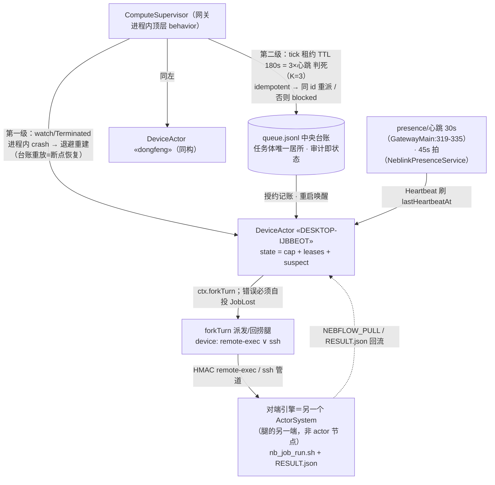

# §7 Actor 模型与调度器实现 · 设计补充

> 定位：对 `MULTI_DEVICE_ARCH_SPEC.md`（`reports/20261022_194019_multi-device-compute-design__delegate-nebflow-1c1590ea/`）的补充章节，拟并入为该稿 **§7**（现稿止于 §6，追加零重编号）。只设计不实施，零代码改动。
> 触发：作者令 2026-10-22 20:36「因为我们使用的语言是scala，而且我们也用了很多actor的抽象，看看actor在这里有没有用呢？」
> 上游结论呼应：triple-star 批 `reports/20261022_201856_triplestar-feasibility/REPORT.md` §1.2（不采 actor 一等机制）、§4-不采纳#3（「主线 ActorSystem 留在进程内，多设备并发由 delegate/租约面承担，无需新范式」）——本节把该裁定的「进程内」半边写实，不推翻其任何结论。
> 证据标注：全部锚点为本批亲验（Grep/Read 直读行号，基于本批 worktree HEAD）；triple-star 侧锚点转引自其 REPORT（该批已亲验）。

---

## 7.0 结论（TL;DR）

**用既有原语表达 actor 风格，不引新框架。** 引擎的 actor 抽象不是借来的——`nebflow.actor` 是一套**自建、在产、经生产事故加固**的本地 actor 框架（cats-effect `Queue+Fiber+Ref+Deferred` 实装，信箱/死亡观察/TTL/注册表俱全）；Akka/Pekko 级依赖在仓内只有「定义未接线」的死配置（`project/Dependencies.scala:48-50`，build.sbt 未引用、src/tests 全仓零 import）和一次「从 Pekko actor 迁回 IO 循环」的迁移史（`neblink/NeblinkService.scala:38`）。C2 调度器的实现形态＝**网关进程内 actor 拓扑**：每设备一枚 DeviceActor（信箱=申领/心跳/回执控制消息，状态=能力档案+租约），由既有框架承载；**跨设备不组 actor 树**（对端引擎是另一个 ActorSystem，本设计不打通远程 actor 解析）——设备是「腿」不是「对端 actor」。actor 模型在 C2 买到三件语义（串行化/监督/消息序，§7.3），买不到三件事（跨设备事务、跨腿幂等、结果对账，§7.4）——后者由 SPEC 既有机制兜底，逐条有主。

---

## 7.1 引擎 actor 面盘点（问题三的现状事实）

### 7.1.1 自建框架（`src/main/scala/nebflow/actor/`，12 文件）

| 件 | 锚点 | 语义 | C2 复用 |
|---|---|---|---|
| ActorSystem | `nebflow/actor/ActorSystem.scala:18-33`（trait）；`:48`（LocalActorSystem） | 注册表+路由+death watch；spawn＝无界 Queue＋fiber 循环（`:62-84`） | ✅ 直接用 |
| ActorRef | `ActorRef.scala:16-32` | tell `!`（queue.offer，不阻塞）；ask `?`（Deferred 应答，默认 30s 超时，`:30`） | ✅ |
| Behavior | `Behavior.scala:33-55` | `receive` 返回 `IO[Behavior[Msg]]`——`:30` 自注「与 Pekko 的关键差异」；onStart/onSignal/onStop/onError 四钩子；`Behaviors.setup/receiveMessage/stopped`（`:57-86`） | ✅ |
| SystemSignal.Terminated | `Behavior.scala:13-21`；投递链路 `ActorSystem.scala:134-148` | 死亡通知走**独立 system queue**（不排在普通消息后，双队列 `ActorSystem.scala:70-71`） | ✅（仅限进程内，§7.3.2） |
| ActorContext | `ActorContext.scala:19-66` | `forkTurn` 追踪式分叉（`:48,77-86`）；`cancelCurrentTurn` 甩手取消（`:51,102-106`，2026-09-07 生产加固：cancel 不等完成，防信箱楔死）；子 actor 生命周期绑定（`:54,108-109`）；watch/unwatch（`:61-64`） | ✅ |
| ActorPath | `ActorPath.scala:12-21` | `nebflow://device/segments`——路径**天然带设备段** | ⚠️ 本设计不消费（§7.2-4） |
| liveness/TTL | `ActorSystem.scala:106`（isAlive，#22 僵尸条目探活）；`:166-173`（消息/信号/TTL 三路 race） | loop 退出 `guarantee` 自注销注册表+子树+watchers（`:204-222`，「loop 是唯一知道自己退出了的所在」） | 已内建 |

实例化单点：`gateway/GatewayMain.scala:582` `nebflow.actor.ActorSystem("local")`——每网关进程一个系统，设备名硬编码 `"local"`；非 local 路径 `resolve` 直接 `NotImplementedError`（`ActorSystem.scala:94-96`）。

### 7.1.2 Pekko：定义未接线＋一次迁出史（问题 A 的直接证据）

- `project/Dependencies.scala:48-50` 定义 `pekko-actor-typed` 1.1.3＋typed testkit；`build.sbt` 未引用、`src/`/`tests/` 全仓**零 import**（本批 grep 亲验，其余命中全为注释）——死配置。
- `Behavior.scala:30` 显式自述与 Pekko 的取舍；`agent/BackoffSupervisor.scala:14`「**Mirrors Pekko's BackoffSupervisor pattern but built on Nebflow's self-contained Actor framework**」——同名模式、自建承载，是本仓的既定姿势。
- `neblink/NeblinkService.scala:38`「**IO-based sync loop replaces the old Pekko actor**」＋信箱协议 `SyncCommand`（`:18-31`：StopSync/SyncTick/PeerDiscovered，裸 `Queue[IO, SyncCommand]`）——neblink 栈曾用 Pekko、迁回 IO 循环，且**保留了 actor 风格**（命令信箱＋循环）。这是框架外的 actor 风格第二先例。

⇒ 引依赖是**逆着仓库自己的轨迹走**。「actor 在这里有没有用」的正解：actor 风格已经在产，问题只是把 C2 的设备面写成它的第 N 个驻民。

### 7.1.3 驻民清单（谁住在 ActorSystem 里）

| 驻民 | 锚点 | 形态 |
|---|---|---|
| AgentActor ×N（**每会话一枚**） | spawn 单点 `agent/SharedResources.scala:269-308`；本体 `agent/AgentActor.scala`（1811 行） | Nebula 根会话/分发器/flow 节点/delegate/subtask/team 全是它（AgentKind 枚举 `actor/AgentState.scala:14-15`）；setup 期自投先于任何外部投递（信箱序保证，`AgentActor.scala:928-936`） |
| ProjectActor（每项目一枚，常驻） | `core/project/ProjectActor.scala:16-35` | 分发器单例化（TriggerDispatcher：项目有活跃分发器会话→注入，无→spawn）/TTL 归档定时器/CancelNode 转发；自身无 Mail 身份 |
| BackoffSupervisor（监督壳） | 装配单点 `SharedResources.scala:314-344`；本体 `agent/BackoffSupervisor.scala` | watch 子会话→Terminated 时指数退避重启（min 5s/max 60s/maxRestarts 2/窗口 5min，`:68-71`；延迟纯函数 `:855-868` 复用 `shared/Retry.delayAfter`）＋**断点续跑**（sessionStore 回放 `:640-644`＋continue 注入 `:672-674`）＋预算耗尽放弃＝诚实 failed 终态（`:494-519`） |
| FlowTreeActor | `core/flow/FlowTreeActor.scala:14-21` | team 挂载/会话生命周期/热载/崩溃恢复 |
| NeblinkService 同步循环 | `neblink/NeblinkService.scala:18-31,38` | 裸 Queue 信箱＋IO 循环（§7.1.2） |
| InteractionHub | `actor/InteractionHubCommand.scala` | ask 卡片枢纽（respawn/终态清槽的调用点，`BackoffSupervisor.scala:835-841`） |
| ScheduledTaskService | `core/scheduler/ScheduledTaskActor.scala:18-21` | ⚠️ 文件名叫 Actor、实体是 10s 轮询 fiber——盘点纪律：勿按文件名断言形态 |

**信箱与背压的真实现状**（问题 B-3 的前提事实）：
- 框架信箱**无界**：`Queue.unbounded`（`ActorSystem.scala:70`）——框架层无背压。
- 背压全在应用层：MailIdleGate「目标 agent 自身连同其子树全空闲才投递」（`core/flow/MailIdleGate.scala:44-60`，#407/2026-08-28 裁定）；`Queue.bounded` 只出现在 I/O 汇（`core/ToolsLogWriter.scala:171`、`gateway/WebSocketRoutes.scala:986`、`neblink/PortalTunnelBridge.scala:1084`）。
- 「死」与「卡死」双机制互补：BackoffSupervisor 只管 Terminated（崩溃），「活着但不动」归 TaskStuckWatcher（无进展判据：`core/processor/TaskStuckWatcher.scala:17-18` 自述缺口来源、`:25` 防误杀铁律、`:35-46` 判据换轴 agent 侧/进程侧信号拆分）——这个双机制结构 C2 原样继承（§7.3.2）。

---

## 7.2 问题 A：设备节点 actor 化——自然表达，且就是本仓的母语

**裁定：C2 调度器用既有 `nebflow.actor` 框架实现 actor 风格，零新依赖；不引 Akka/ActorFoundry/Pekko 级框架。** 四条依据＋一个边界：

1. **语义对表**：C2 需要的三件 actor 语义（§7.3）全部落在框架已有能力内——串行化＝Behavior 单线程 receive；监督＝watch/Terminated＋BackoffSupervisor 习语；状态＝behavior 闭包携带。引 Akka/Pekko 得到的只是同一批语义的第二个拼写，代价是双运行时、双监督模型、双消息语义（禁双实现 upd:86 同族纪律）。
2. **仓库轨迹**（§7.1.2）：Pekko 死配置＋迁出史＋「Mirrors Pekko's pattern but self-contained」三重证据方向一致——自建框架是**既成事实的官方答案**。
3. **上游裁定一致**：triple-star 批不采纳#3 已裁「主线 ActorSystem 留在进程内，多设备并发由 delegate/租约面承担，无需新范式」（REPORT.md:174）；其 §1.2 亦证 triple-star 侧不采 actor 一等机制（REPORT.md:44）。本节不引入跨设备 actor 新范式，只是把调度器**模块内部**用既有 actor 原语组织。
4. **边界（不做什么）**：ActorPath 的 device 段（`ActorPath.scala:12-21`）**不在本设计消费范围**——打通远程 actor 解析（`ActorSystem.scala:94-96` 目前 NotImplementedError）等于新建跨设备消息通道，违反 ADR-1（复用 `device:` 双腿）与禁双实现。设备侧永远是「腿的另一端」，不是 actor 节点；对端引擎自己的 ActorSystem 与网关互不相知——DeviceDelegate 即先例：对端建**自己的**本地 delegate 会话、终态经回投代理折回（`core/delegate/DeviceDelegate.scala:33-40`）。
   （若未来真要远程 actor 面，那是独立大课题：寻址/生命周期/序列化/故障域全要重做，且与 NebLink 数据通道功能重叠——本设计**不预留接缝**，防半吊子打通。）

---

## 7.3 问题 B：actor 买到的语义 × C2 接口逐条映射

### 7.3.1 串行化：设备互斥＝信箱串行

SPEC §3.3 要求「同设备并发 ≤ maxConcurrentJobsPerDevice（§1 初值 1；DESKTOP-IJBBEOT 可到 2），FIFO」。DeviceActor 实现下这不是要加锁维护的**不变量**，而是模型的**定理**：同一设备的一切决策（claim/heartbeat/finish/lost/probe）进同一信箱、单线程 receive、逐条裁决——两条 Claim 物理上不可能同时获批。互斥的正确位置是**租约授予判定**（`leases.size < cap` 且谓词过闸），不是信号量。

- 与既有机制对表：语义等价于 agentRegistry「status 单一事实」读法（`actor/AgentState.scala:25-45`，AgentRecord.status 逐 turn 快照）＋信箱串行的合取；**可直接复用**的是 `Behaviors.receiveMessage`（`Behavior.scala:71-76`）＋ask（`ActorRef.scala:26-38`）——网关内调用方 `deviceRef ? (DeviceMsg.Claim(job, _))` 拿当拍裁决，30s 默认超时正好兜住。
- 澄清（诚实）：cats-effect `Ref`+`Semaphore` 同样能做互斥。actor 多买的是 (a) 决策 FIFO 全序＝裁决序＝可审计序，(b) 状态迁移集中在 behavior（无锁推理），(c) 与 watch/forkTurn 的组合免费。收益真实但非压倒性——**本节结论是「自然」而非「必须」**；实现批若评估 Ref 版更省可降级（开放项 O2）。

### 7.3.2 监督：两级拆开——「设备死」不是「actor 死」

最容易犯的映射错误是把「设备掉线」映射成 DeviceActor 的 `Terminated`。**不成立**：死亡观察只覆盖本进程 fiber 的终止（`Behavior.scala:20`、`ActorSystem.scala:134-148`）；设备离线时 DeviceActor 活得好好的。正确结构是**两级监督**，各用各的既有机制：



（同构图定稿：本目录 `topology-actor.svg`，源 `topology-actor.dot`。）

- **第一级（进程内 crash）**：ComputeSupervisor watch 每枚 DeviceActor；Terminated → 指数退避重建。复用 BackoffSupervisor **习语**：退避纯函数（`BackoffSupervisor.scala:855-868`）、断点恢复＝从 queue.jsonl 重放重建 DeviceState（同「recoveredMessages 回放→续跑」思路 `:640-644`）、maxRestarts 放弃＝告警+停该设备派发（诚实失败，`:505-518` 同构）。不装 BackoffSupervisor 本体——它绑定 AgentEvent/AgentCommand 协议（`:75`），提取通用监督器登记为 O4 不在 C2 做。
- **第二级（设备逻辑死亡，本设计主路径）**：设备掉线 ≠ 任何 actor 死亡；DeviceActor 迁移 suspect/offline 状态、停接 Claim。判死权威＝租约 TTL：180s＝3×心跳 30s（SPEC §1；K=3 与 triple-star「K 拍判死」同构互注，REPORT.md:78——主线自有先例＝NeblinkPresenceService 45s 拍 3 拍剔除，`neblink/NeblinkPresenceService.scala:163`）。tick 无新常驻定时器——由派发/回执/presence 事件与既有 sweep 节拍驱动（SPEC §3.3 自述）；判死后动作＝`onLeaseExpired`（idempotent→同 id 重派下一合格设备；否则 blocked+通知）。
- 与既有治理面对表（全部可直复用，零新机制）：
  - 「失联判死」与「零超时」的分工先例：TaskStuckWatcher（无进展判据，防误杀铁律 `TaskStuckWatcher.scala:25`）与 BackoffSupervisor（Terminated）互补——C2 同构：TTL 判死＝判定失联，**永不 kill 远端进程**（ADR-6 零超时纪律；>1h 作业拆段 ADR-1）。
  - 派发腿的活性/门参数是**腿的**参数，不因 actor 化改变：同步 120s/后台 3600s（`core/tools/RemoteExecutor.scala:210-213`）、远程前台 30s 心跳（`actor/AgentState.scala:57` 注释）、离线显式报错（`RemoteExecutor.scala:1471-1483`）。
  - 作业腿若挂在 flow 节点会话下，节点完成闸语义原样生效：BgTaskRegistry.waitingFor（`core/tools/BgTaskRegistry.scala:18-27`）；C2 的 JobFinished 回执走 RESULT.json/NEBFLOW_PULL，与完成闸并行不冲突。

### 7.3.3 信箱背压：C2 不靠信箱背压，靠「租约准入」

框架信箱无界（§7.1.3）——若把任务本体塞进 DeviceActor 信箱，慢设备＝信箱堆积＝任务滞留黑箱。**设计决定：任务体永不进信箱。** 信箱只载控制消息（Claim/Heartbeat/Finished/Lost/Probe，每条微小且幂等）；任务体始终住在中央 queue.jsonl（SPEC §2/§4「审计即状态」），DeviceActor 授了租约才 forkTurn 派发。于是「慢设备不吞任务」由**结构**保证：

1. 任务在中央队列可见、可重派、可面板化——设备信箱里永远没有积压的任务体；
2. 派发前置闸＝nb_job_run 契约（SPEC §3.1）：`.lock` 存活 exit 97（进行中）、RESULT.json+同 inputManifestHash 幂等短路——重派与慢放绝不双跑；
3. 需要更硬背压时的**既有习语**（C2 不启用，登记 O3）：spawn 增 `capacity: Option[Int]` 走 `Queue.bounded`（仓内三处先例：`ToolsLogWriter.scala:171`/`WebSocketRoutes.scala:986`/`PortalTunnelBridge.scala:1084`）——一行框架扩展。

### 7.3.4 复用表（actor 语义 × 既有机制 × C2 落点）

| # | 需要的语义 | 既有机制（锚点） | C2 落点 | 改动量 |
|---|---|---|---|---|
| 1 | 信箱串行 | `Behaviors.receiveMessage`（`Behavior.scala:71-76`） | DeviceActor 逐条裁决 Claim/Finished | 0（框架） |
| 2 | ask 回执 | `ActorRef.?` Deferred+30s 超时（`ActorRef.scala:26-38`） | 网关内 `deviceRef ? Claim(job, _)` | 0 |
| 3 | 进程内崩溃重启 | watch/Terminated（`ActorContext.scala:61-64`、`ActorSystem.scala:120-148`）＋BackoffSupervisor 退避/放弃习语（`:68-71,494-519,855-868`） | ComputeSupervisor watch DeviceActor | 0（复用习语，不装本体） |
| 4 | 断点恢复 | sessionStore 回放→续跑（`BackoffSupervisor.scala:640-674`） | queue.jsonl 重放重建 DeviceState | 0（思路同构） |
| 5 | 逻辑失联判死 | 租约 TTL（SPEC §1）＋K 拍先例（`NeblinkPresenceService.scala:163`）＋TaskStuckWatcher「活着不动」轴（`TaskStuckWatcher.scala:17-25`） | tick × onLeaseExpired | 0（SPEC 既有设计） |
| 6 | 长作业不占信箱 | forkTurn 追踪分叉（`ActorContext.scala:48,77-86`） | 派发腿+回捞腿 forkTurn，错误自投 JobLost | 0（⚠️ forkTurn 纪律见 §7.5-注2） |
| 7 | 慢消费者治理 | MailIdleGate 应用层闸（`MailIdleGate.scala:44-60`）；Queue.bounded 习语（§7.3.3） | C2 不启用；中央队列+租约准入替代 | 0 |
| 8 | 幂等 spawn 先例 | DeviceDelegate spawnId 去重（`DeviceDelegate.scala:57-61`，进程内诚实边界） | 作业 id 幂等键（SPEC §2 ComputeJob.id） | 0 |
| 9 | 设备在线/心跳 | 30s 心跳 loop（`GatewayMain.scala:319-335`）＋45s presence 拍 | Heartbeat 消息源 | 0 |
| 10 | spawn 工厂单点 | `SharedResources.spawnAgentActor`（`:269-308`） | `compute/DeviceActor` spawn 工厂同构 | 新文件 |

---

## 7.4 问题 C：actor 买不到的，SPEC 靠什么补

| # | actor 不解决 | 真实风险形态 | SPEC 的补法（编号呼应） |
|---|---|---|---|
| 1 | 跨设备事务 | 派发后设备收了包没跑／跑一半断 | 没有 2PC，只有**可补偿性**：幂等作业 id＋同 id 重派先清场（ComputeJob.idempotent＋nb_job_run 清理重建，SPEC §2/§3.1）；非幂等作业一律 blocked 等人（ADR-6）。「事务」被降格为「幂等重试＋人工兜底」——诚实且够用 |
| 2 | 跨腿 exactly-once | relay 重发/presence 半开重投让同一作业消息到两次 | DeviceDelegate spawnId 去重只覆盖进程内、跨重启失效（`DeviceDelegate.scala:57-61` 自述诚实边界）——**不得依赖消息层幂等**；作业层幂等才是权威（RESULT.json 首字段回带 inputManifestHash、网关比对不符即拒收，SPEC §3.1/§6.2-⑥）。actor 信箱的 once-only 只在单进程内成立，跨腿不外推 |
| 3 | 结果对账/可信 | 设备「说」做完了，环境其实不对 | actor 模型对结果真假零发言权；可信度三件套兜底（ADR-7）：输入清单哈希回执＋探针快照（计算 TTL 10min）＋工具链 pin 比对；漂移→suspect 停派→金丝雀过闸（SPEC §3.3 onProbeDrift）。产物对账＝artifacts[] sha256 MANIFEST（SPEC §2 JobResult） |
| 4 | 脑裂/双调度 | 网关重启时旧租约悬空、新进程重复派发 | 监督树**不跨进程**——网关重启后由 queue.jsonl 重放重建（§7.3.2-第一级），租约自带 claimedAt+ttlSec（SPEC §2 Lease）：旧租约按 TTL 自然作废；活着的设备凭 `.lock`/幂等短路挡双跑（SPEC §3.1） |
| 5 | 全局有序性 | 两台设备同时完成，谁先入账 | 信箱只给**单设备**全序；跨设备入账序＝queue.jsonl 追加序（单写者＝调度器顶层 behavior）。台账是真相，actor 只是写手 |

---

## 7.5 类型草图（C2 目标态；SPEC §4 目录 `nebflow/compute/` 增 `DeviceActor.scala`）

```scala
// src/main/scala/nebflow/compute/DeviceActor.scala —— C2 新增单文件（实施目标态，非交付代码）
package nebflow.compute

import nebflow.actor.*

/** 设备信箱协议——只载控制消息，任务体永不进信箱（§7.3.3）。 */
enum DeviceMsg:
  case Claim(job: ComputeJob, replyTo: ActorRef[Either[Lease, Blocked]]) // ask 腿（§7.3.1）
  case Heartbeat(jobId: String, at: Instant)   // presence 事件折算 → 刷 lease.lastHeartbeatAt
  case JobFinished(result: JobResult)          // RESULT.json / NEBFLOW_PULL 回流 → 释放租约+入账
  case JobLost(jobId: String, reason: String)  // 腿报错（3600s 门/离线/命令失败）→ 上报调度器
  case ProbeRefresh(cap: DeviceCapability)     // 探针刷新（计算 TTL 10min，ADR-7）
  case SetSuspect(reason: String)              // onProbeDrift → 停派；金丝雀过闸解除

/** behavior 闭包携带的设备状态（信箱串行 ⇒ 无锁推理）。 */
final case class DeviceState(
  cap: DeviceCapability,             // 状态 = 能力档案
  leases: Map[String, Lease],        // 状态 = 租约集；不变量 leases.size <= maxConcurrentJobsPerDevice
  suspectSince: Option[Instant])     // suspect 停派闸

/**
 * 每设备一枚、常驻、不离线——掉线是状态迁移不是死亡（§7.3.2 第二级）。
 * 派发/回捞走 ctx.forkTurn（不占信箱）。
 */
def deviceActor(
  deviceId: String,
  cap: Int,                          // = ComputeConfig.maxConcurrentJobsPerDevice
  queue: ComputeQueue,               // 中央台账句柄（queue.jsonl 追加/读）
  notify: ComputeScheduler           // onLeaseExpired / onProbeDrift 全局裁决回调（SPEC §3.3）
): Behavior[DeviceMsg] =
  Behaviors.setup { ctx =>
    def running(s: DeviceState): Behavior[DeviceMsg] =
      Behaviors.receiveMessage {
        case DeviceMsg.Claim(job, replyTo) =>
          if s.leases.size < cap && s.suspectSince.isEmpty && MayDispatch(job, s.cap) then
            val lease = Lease(job.id, deviceId, claimedAt = now,
              ttlSec = ComputeConfig.leaseTtlSec, lastHeartbeatAt = now)
            // forkTurn 纪律：腿上一切错误必须自带 handleErrorWith 自投 JobLost（见注 2）
            ctx.forkTurn(dispatchLeg(job, lease).handleErrorWith(e =>
              ctx.self ! DeviceMsg.JobLost(job.id, e.getMessage)).void)
            replyTo ! Right(lease); running(s.copy(leases = s.leases.updated(job.id, lease)))
          else
            replyTo ! Left(Blocked(s"device $deviceId busy/suspect/predicate-fail")); running(s)
        case DeviceMsg.Heartbeat(jobId, at) if s.leases.contains(jobId) =>
          running(s.copy(leases = s.leases.updated(jobId, s.leases(jobId).copy(lastHeartbeatAt = at))))
        case DeviceMsg.JobFinished(result) if s.leases.contains(result.jobId) =>
          queue.appendDone(result); running(s.copy(leases = s.leases.removed(result.jobId)))
        case DeviceMsg.JobLost(jobId, why) if s.leases.contains(jobId) =>
          // 失联裁决不在此处：orphan 判定+重派是全局决策（SPEC §3.3 onLeaseExpired）
          notify.onLeaseExpired(s.leases(jobId)) *> running(s.copy(leases = s.leases.removed(jobId)))
        case DeviceMsg.ProbeRefresh(cap)            => running(s.copy(cap = cap))
        case DeviceMsg.SetSuspect(reason)           =>
          notify.onProbeDrift(s.cap, reason) *> running(s.copy(suspectSince = Some(now)))
        case _ => running(s)  // 迟到心跳/旧作业回执——幂等丢弃（消息可迟到，不可致错）
      }
    Behaviors.receiveMessage(m => running(DeviceState.empty(deviceId)).receive(ctx, m))
  }
```

**与 SPEC §3.3 `ComputeScheduler` trait 的关系**：trait 不废——它是对外门面，DeviceActor 拓扑是**实现载体**：`enqueue`＝台账追加＋调度器唤醒；`tick`＝台账扫描＋租约判死（与心跳同拍）；`claimEligible`＝纯谓词，DeviceActor.Claim 与调度器打分共用一份（triple-star 准入预演模式，REPORT.md:76）；`onLeaseExpired`/`onProbeDrift`＝DeviceActor 上报的全局裁决回调。**trait 签名零改动。**

**实施纪律三条**：
1. **不装 BackoffSupervisor 本体**——它绑定 AgentEvent/AgentCommand 协议（`BackoffSupervisor.scala:75`）；C2 复用的是它的习语（watch→Terminated→退避→重建→放弃即诚实告警），ComputeSupervisor 数十行可写。通用监督器提取＝O4，不在 C2 做。
2. **forkTurn 错误纪律**（`ActorContext.scala:41-43` 自述：forkTurn 的 IO 失败只记日志、不上抛、不自动通知）——派发腿必须自带 `handleErrorWith(ctx.self ! JobLost)`，否则腿死＝静默失联，只能等 TTL 兜底才被发现。
3. **名字空间与生命周期**：DeviceActor 注册名 `compute-device-<deviceId>`，住进既有 ActorSystem（`GatewayMain.scala:582` 的 `"local"` 系统）——与 AgentActor/ProjectActor 同居，共享 stopAll 关停路径与 `isAlive` 探活（`ActorSystem.scala:106`）。

---

## 7.6 风险与开放项

| # | 项 | 说明 |
|---|---|---|
| R-A | 「actor 化」被误读为「跨设备 actor 化」 | 本节最重申：actor 树只在网关进程内；设备是腿。任何「打通 resolve 远程路径」的提议都违反 ADR-1/禁双实现 |
| R-B | 无界信箱被误用为任务队列 | 结构性禁令：任务体只住 queue.jsonl（§7.3.3）；列为 C2 实施 review 检查点 |
| R-C | DeviceActor crash 静默丢租约 | 第一级监督重建后从 queue.jsonl 重放：存活租约原样恢复、过期租约走 orphan 重派——恢复语义与正常 tick 完全同路（无新代码路径） |
| O2 | Ref 版实现取舍 | 若实现批评估 `Ref`+`Semaphore` 更省（设备数小、消息率低），允许降级为 Ref 实现——actor 拓扑是**推荐形态**不是硬约束；裁决记入实施批报告 |
| O3 | spawn 容量参数 | 框架增 `capacity: Option[Int]`（Queue.bounded，先例三处）——仅当 C2 观测到控制消息风暴才启用 |
| O4 | 通用监督器提取 | 把 BackoffSupervisor 的 watch/退避/放弃骨架提取为协议无关 supervisor——跨批重构，C2 不做 |

---

## 7.7 并入点摘要（逐条操作见同目录 MERGE_NOTES.md）

- SPEC §3.3 `ComputeScheduler` trait 增一行注释：「实现形态＝网关进程内 actor 拓扑（每设备一枚 DeviceActor，见 §7）」——签名零改动。
- SPEC §4 目录清单 `src/main/scala/nebflow/compute/` 增 `DeviceActor.scala`（第 5 个文件）。
- SPEC §5-C2 任务清单增一条：「DeviceActor 拓扑落地（类型草图 §7.5＋实施纪律三条）」。
- SUMMARY §9 边界表增一行：「nebflow.actor 自建 actor 框架＝复用（调度器实现基底）；边界：进程内，不打通远程 actor」。
- **不并入**：任何 pekko/akka 依赖；任何 ActorSystem.resolve 远程化；任何信箱改有界（O3 登记即可）。
