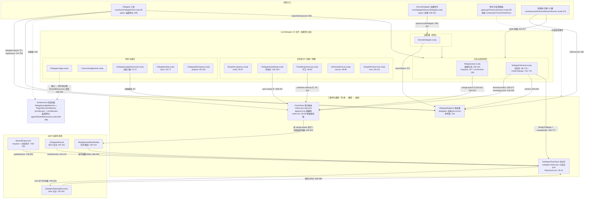
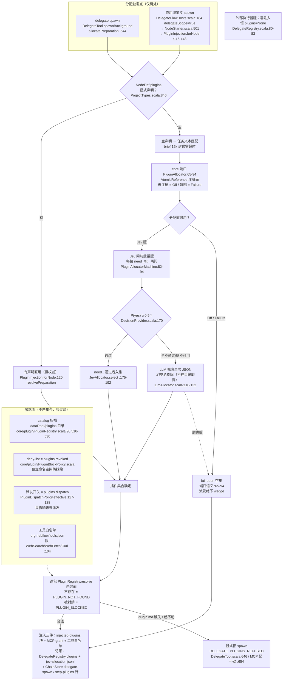
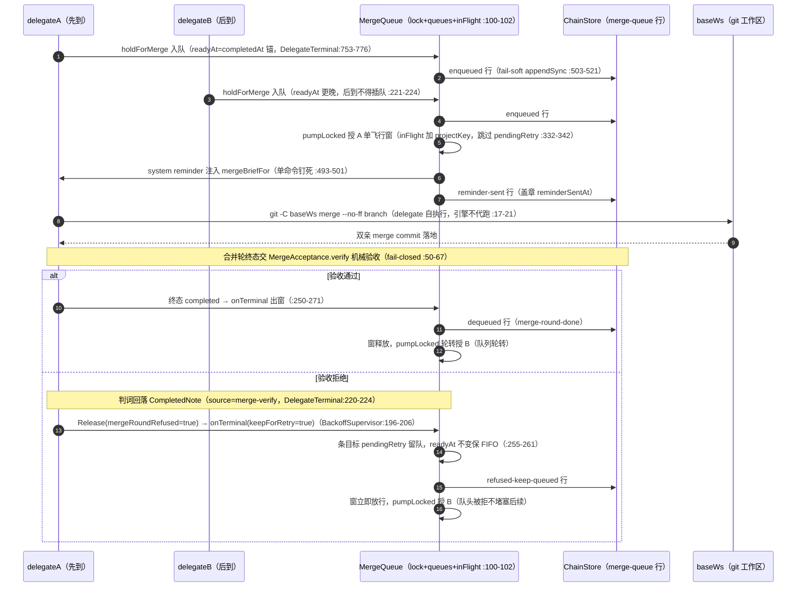
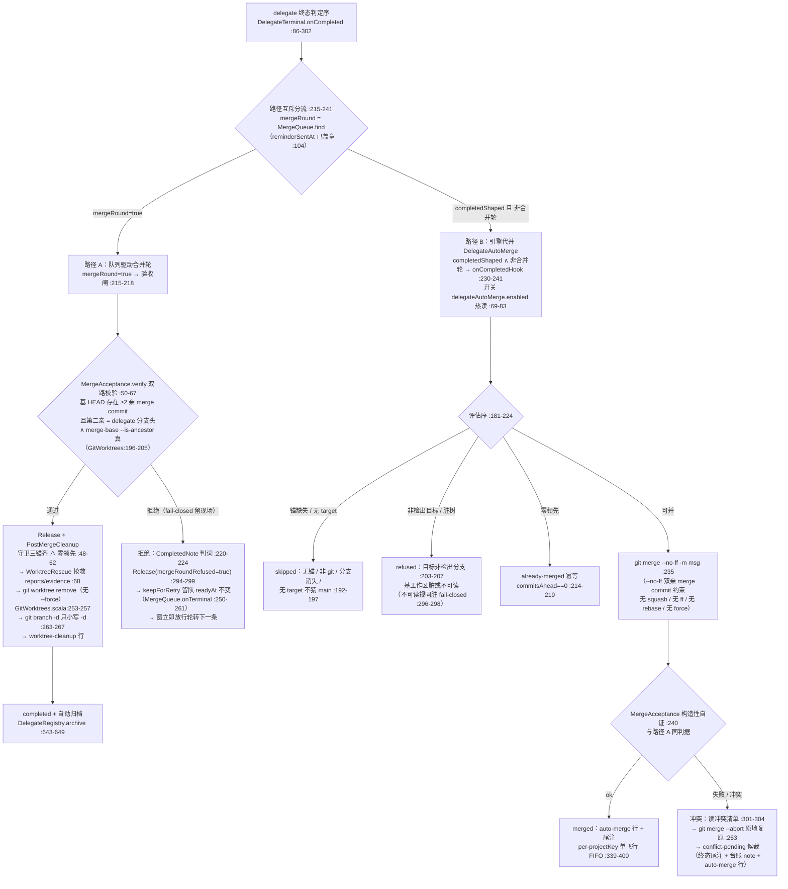
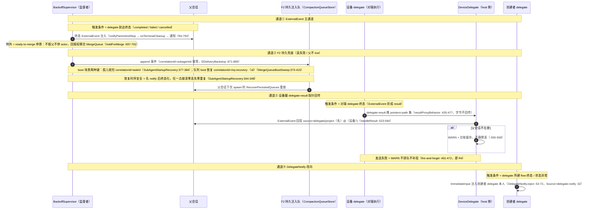
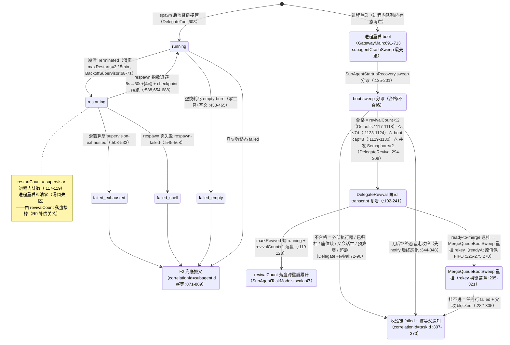
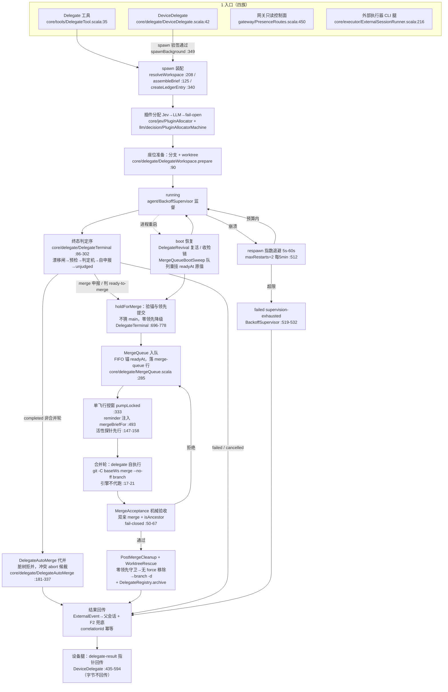
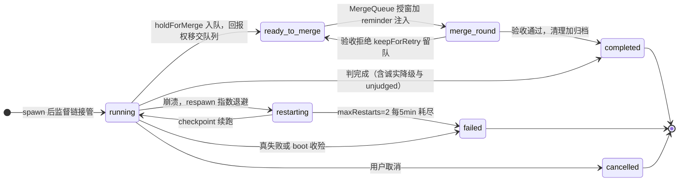
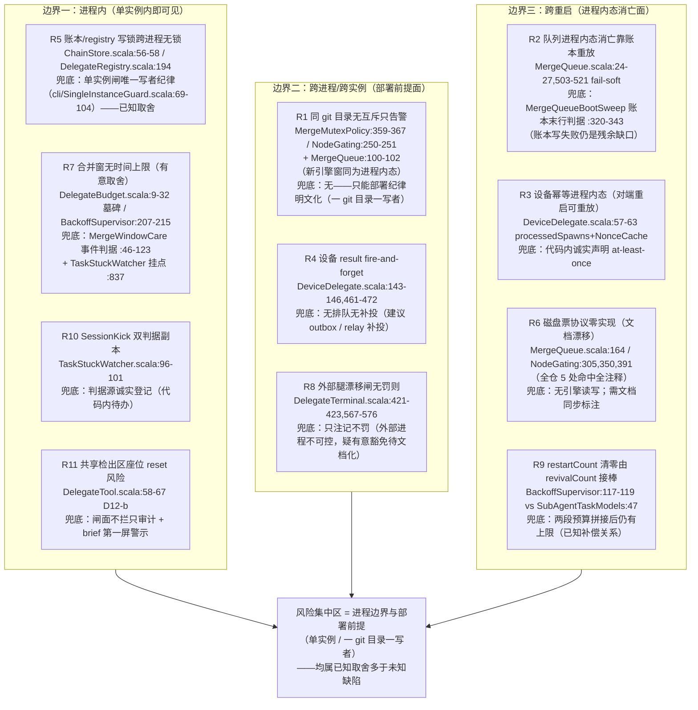

# Stand 主仓 delegate 全流程审计报告

口径：仓库 `/Users/kaiyu/Claude code/Stand`（sbt 单模块 Scala 3.5.2，`build.sbt:3`）。全部 path 相对 `src/main/scala/nebflow/`（另有 `web/` 前端），行号取自当前工作区。只读审计，本文为唯一产出件。

## 1. 执行摘要

1. delegate 链路核心在 `core/delegate/`（15 文件），向外辐射 tools（派发）、executor（外部执行腿）、agent（监督/复活/队列 boot sweep）、gateway（只读控制面）、llm/decision（判定机）、jev（插件分配）、device（设备信令）七个面；旧引擎 per-project merge 节点（`core/project/MergeMutexPolicy` / `NodeGating`）是另一套面，与新引擎零引用。
2. 四族入口：会话内 `Delegate` 工具（模型可见唯一派发口）、DeviceDelegate 设备信令（配对 + HMAC + spawnId 去重）、网关只读控制面（`/api/chains`、`/api/delegates`、`/api/executors`）、外部执行器 CLI 间接腿（executor 选择 + Mail 续聊/CLI resume）。
3. 持久数据三套分域：DelegateRegistry（地址簿，状态绝不落此表）、SubAgentTaskStore（任务行，含 retryCount/revivalCount）、ChainStore（append-only 审计账本，零删除零归档）。
4. 生命周期六态 `running / restarting / ready-to-merge / completed / failed / cancelled`（`shared/SubAgentTaskModels.scala:25`）；骨架四件 = BackoffSupervisor（监督 respawn）+ DelegateTerminal（终态判定）+ MergeQueue（排队）+ DelegateRevival / MergeQueueBootSweep（重启恢复）。
5. 插件分配：core 端口 + llm 判定机（Jev 问句优先 → LLM 兜底 → fail-open 空集），触发点仅 delegate spawn 与 delegate 作用域链步 spawn；分配失败不 wedge 派发，注入失败显式拒 spawn。
6. 排队：per-projectKey 单飞行窗（进程内 monitor + inFlight 集合），FIFO 锚 = readyAt（ready-to-merge 完成时间），每次迁移同步落 ChainStore `merge-queue` 审计行；磁盘票层 `.nebflow/locks/main-merge.*` 在引擎代码中零读写（仅注释）。
7. 合并两条互不相干路径：合并轮（delegate 自执行 `git merge --no-ff`，引擎不代跑；MergeAcceptance 双路机械验收，fail-closed）与 DelegateAutoMerge 引擎代并（脏树/非检出目标拒并，冲突 `merge --abort` 原地复原候裁）。
8. 结果回传：ExternalEvent 主通道 + F2 持久兜底（correlationId 幂等）+ 设备腿产物指针回传（字节不回传）+ DelegateNotify 改向（flow 终态通知投创建者 delegate 本人）。
9. 并发与失败：无跨进程锁（单实例架构前提）；互斥 = actor mailbox 串行 + 进程内 monitor/状态派生；预算哲学 = wall-clock 预算整体拆除（墓碑壳），只治「真卡死/真死亡」（事件判据）；重试 = maxRestarts 2/5min + revivalCount<2 落盘接棒。
10. 风险集中四处：跨进程同 git 目录互斥缺口（只告警）、进程内队列跨重启消亡（靠账本行重放恢复）、设备腿幂等进程内态（对端重启可重放）、设备 result fire-and-forget（不排队不补投）。

## 2. 仓库结构与模块地图

### 2.1 分层

sbt 单模块工程（596 主代码文件 ≈217k 行），运行时分层自下而上：

| 层 | 位置 | 职责 |
|---|---|---|
| actor 运行时 | `actor/` | 自研 actor：unbounded 队列 + 单 Fiber 逐条消费（`actor/LocalActorRef.scala:24`、`actor/ActorSystem.scala:186-202`），death watch（`ActorSystem.scala:120-149`）、spawn TTL（`:20,166-191`） |
| agent actor 层 | `agent/` | BackoffSupervisor、SubAgentTaskStore、SubAgentStartupRecovery、DelegateRevival、MergeQueueBootSweep、SharedResources（装配点）、AgentFrozen |
| 领域核心 | `core/` | 30 个子包；最大两块 `core/project`（45 文件）与 `core/tools`（70 文件）；delegate 域核心 `core/delegate/`（15 文件） |
| 网关 | `gateway/` | http4s + WS：PresenceRoutes、WebSocketRoutes、ConfigRoutes、GatewayMain（boot 链）、HttpCache |
| 前端 | `web/` | Vanilla JS：delegate*.js 族、mergeQueueView.js、flowMap/badges.js、fmNodeCard.js |

### 2.2 delegate 专项坐标

| 面 | 位置 | 构件 |
|---|---|---|
| 核心 | `core/delegate/`（15 文件） | MergeQueue、DelegateTerminal、DelegateRegistry、ChainStore、MergeAcceptance、DelegateAutoMerge、PostMergeCleanup、WorktreeRescue、MergeWindowCare、DelegateJudge、ExternalJudgeHook、DelegateLedgerReconcile、DelegateNotify、DelegateWorkspace、DeviceDelegate |
| 派发入口 | `core/tools/DelegateTool.scala` | 模型可见 `Delegate` 工具（spawn 装配 + workspace 解析 + 台账开条） |
| 执行腿 | `core/executor/ExternalSessionRunner.scala` | 外部执行器 CLI 通道（适配流、resume、settle） |
| 宿主与账本 | `core/project/` | DelegateFlowHosts（一 delegate 一图）、FlowMapStore、TaskLedgerStore、ChainsReadFace（只读投影） |
| 监督与恢复 | `agent/` | BackoffSupervisor（respawn/终态钩子）、SubAgentStartupRecovery（boot 收殓/复活分诊）、DelegateRevival、MergeQueueBootSweep、SubAgentTaskStore |
| 判定机 | `llm/decision/` | DelegateJudgeMachine（终态判词）、PluginAllocatorMachine / JevAllocator / LlmAllocator（插件分配） |
| 插件面 | `core/jev/` | PluginAllocator（端口）、PluginRegistry（catalog 扫描）、PluginInjection（链步注入）、PluginBlockPolicy、PluginDispatchPolicy |
| 设备腿 | `core/device/` | DeviceHmac、DeviceRegistry、NonceCache |
| 旧引擎面 | `core/project/` | MergeMutexPolicy、NodeGating、NodeDelivery、NodeCompletion、NodeStarter（per-project merge 节点互斥/队列，与 MergeQueue 零引用，`MergeQueue.scala:29-31`） |
| 断言面 | spec/E2E | 18 个 Scala spec + 6 个 E2E 覆盖本链路 |

模块地图（图 1）：core/delegate 15 文件按职责分组，四族入口与三套持久模型的「谁写谁读」边（写者 → 模型 → 读者，写读关系均从调用点核实）：

## 3. delegate 全流程逐环节审计

### 3.1 入口与数据模型（状态机）

#### 3.1.1 四族入口

**① 会话内工具（模型可见唯一派发口）** — `core/tools/DelegateTool.scala`：object 定义 `:35`；工具名 `Delegate` `:69`；schema 三参 `task`（必填）/`project`/`executor` `:90-109`（executor 不可用显式失败、无静默回落 `:80,104`）；深度上限 `MaxDepth=5` `:45`；brief 装配单点 `assembleBrief` `:125-138`（布局：工作座行 → reset 警示行 `:66-67` → `delegate_report` 纪律行 `:55-56` → 等待纪律铁律 → 任务全文 → 插件注入块）；workspace 解析 `resolveWorkspace` `:208`（本地 `Local` / 设备路由 `RemoteRoute` `:201-204`）；台账开条 `createLedgerEntry` `:340`；后台 spawn 单点 `spawnBackground` `:608`。续聊地址 = `delegate:<id>`，续聊经 `Mail`（描述文案 `:82`）。

**② DeviceDelegate 设备信令** — `core/delegate/DeviceDelegate.scala`：presence WS 数据通道单点 + relay 兜底（头注 `:13-41`）；三种 kind `delegate-spawn` / `delegate-accept` / `delegate-result` `:49-51`；host 派发 `dispatch` `:147-185`（未配对显式拒绝 `:169-177`；payload HMAC 签名 `:117-120`）；发送单点 `sendToDevice` `:191-207`（presence `sendData` 优先，失败 relay `relayNotify` 兜底，双腿全败显式 Left）；收端 boot 装配 `initialize` `:216-241`；kind 分派 `handlePayload` `:244-249`；spawn 处理 `handleSpawn` `:256-341`：畸形载荷拒 `:288` → spawnId 去重 `:290` → 配对/allowSpawn 检查 `:293-299` → HMAC 验签（ts ±90s + nonce 首见 + 常数时间比对）`:305-310` → 本地 spawn `spawnLocalDelegate` `:349-427`（复用 `DelegateTool.spawnBackground` 单点；对端 registry 记 `delegatedBy=<hostDeviceId>` `:423`；`judgeWorkspace=false` —— 远端腿不做 worktree/合并窗语义 `:345`）。任何失败显式拒绝留痕、绝不静默 `:282-286`。

**③ 网关只读控制面** — `gateway/PresenceRoutes.scala:450`（`GET /api/chains` 行投影）、`:481`（`GET /api/chains/:key` 链视图）、`:591-599`（delegates 行投影，`ChainsReadFace.delegatesJson` 单点，投影逻辑在 `core/project/ChainsReadFace.scala`）；`/api/delegates/:id`（`gateway/HttpCache.scala:15` 内容寻址 ETag 共用面之一）；`GET /api/executors` 执行器快照（`gateway/ConfigRoutes.scala:140`）。只读 + ETag，无状态改写面；delegate/SubTask 显示名解析 `delegateDisplayTitle`（`gateway/WebSocketRoutes.scala:2954`，registry title 主源 `:2937-2948`）。

**④ 外部执行器 CLI 间接腿** — `core/executor/ExternalSessionRunner.scala`：executor 动态选择进入 Delegate 工具 schema（①）；Mail 续聊腿 `:216`（live ⇒ mailbox 排队；终态 ⇒ CLI resume 续起）；`startResumeTurn` `:288-330`（`cliSessionId` 锚 `:295`，无锚退化带前文续聊 brief `:296-307`）；boot 恢复侧同 id resume 由 `agent/MergeQueueBootSweep.internalRevival:77-126` 走同一通道。

#### 3.1.2 三套持久数据模型

| 模型 | 存储路径 | 关键字段/纪律 |
|---|---|---|
| **DelegateRegistry**（地址簿） | `<dataRoot>/delegates/<id>.json`，每 delegate 一文件（`core/delegate/DelegateRegistry.scala:14`） | Record `:42-118`：id/executor/cwd/project/taskId/parentSessionId/title/createdAt/branch/worktree/baseBranch/projectWorkspace + 状态槽 reportStatus/reportDetail/reportSuggestion `:64-69` + cliSessionId `:77` + plugins `:85` + orchestrationMode `:97` + worktreeJudged `:104` + archivedAt `:111`（零删除，归档只加旗）+ delegatedBy `:118`。**状态不落本表**：live 查内存 agentRegistry、终态查任务行 `:24-26`；手写 Decoder 容忍缺键 `:37-41`；单写锁 `writeLock:194` |
| **SubAgentTaskStore**（任务行） | `<dataRoot>/subagent-tasks/<parentSessionId>.json`，每父会话一文件（`agent/SubAgentTaskStore.scala:20-22`） | ReentrantLock 整体串行 load→modify→save（并发 spawn 重放实证后加锁 `:28-41`）；模型 `SubAgentTask`（`shared/SubAgentTaskModels.scala:19-50`）：status 六态 `:25`、retryCount `:26`、completedAt `:28`、statusAt `:39`（#692 watchdog 判据）、revivalCount `:47`（boot 复活已用次数，跨重启累计）、revivedAt `:49`；手写 Decoder 防旧盘整文件解析失败 `:61` 起 |
| **ChainStore**（审计账本） | `<dataRoot>/chains/<taskId>.json`，每 task 一文件、时间序事件行 `Entry(kind, at, payload)`（`core/delegate/ChainStore.scala:14-19`） | 键归一 = 台账号优先、回落 delegateId `:48-55`；读热读、写进程内 writeLock 串行原子落盘，**跨进程无锁** `:56-58`；fail-soft `:60-63`；**零删除零归档 API** `:64-100`。行族：`merge-queue` / `terminal-verdict`（五源）/ `auto-merge` / `unmerged-work` / `worktree-cleanup` / `step-plugins` / `delegate-spawn` / `delegate-revival` |

三套的分工纪律：**live 与否 = 内存注册表单点真源**（重启后一律视为不 live，`DelegateRegistry.scala:22-24`）；**终态状态 = 任务行**；**元数据/地址 = registry**；**审计与恢复判据 = ChainStore**。任何一处都不做第二份可漂移的状态机（`DelegateRegistry.scala:24-26`）。

#### 3.1.3 生命周期状态机（迁移 × 触发者）

六态（`shared/SubAgentTaskModels.scala:25`）：`running / restarting / ready-to-merge / completed / failed / cancelled`。

| 迁移 | 触发者 | 证据 |
|---|---|---|
| spawn → running | DelegateTool/DeviceDelegate spawn + BackoffSupervisor 接管 | `DelegateTool.scala:608`；`DeviceDelegate.scala:349-427` |
| running → restarting → running | 崩溃 respawn：指数退避 5s→60s+抖动，transcript checkpoint 续跑 | `agent/BackoffSupervisor.scala:68-71,917-930,654-688` |
| restarting → failed | maxRestarts=2 / withinTimeRange=5min 滑动窗耗尽（`supervision-exhausted`）；respawn 壳自身失败（`respawn-failed`） | `BackoffSupervisor.scala:70-71,512,519-532,545-568` |
| running → ready-to-merge | 终态判定序产出 ReadyToMerge（自申报 `merge` 或判定机）→ `holdForMerge` 校验锚与领先提交（不猜 main、零领先降级）→ 任务行翻 ready-to-merge（completedAt=FIFO 锚）→ MergeQueue 入队；**不报父、父回报权移交队列** | `DelegateTerminal.scala:86-176`（判定序）、`:731-752`（缺锚）、`:753-776`（Entry 构造 + updateStatus + enqueueIO）、`:696-776`（holdForMerge）；`ExternalSessionRunner.scala:631-677`（外部腿同面）、`:612-616,688-691`（回报权移交） |
| ready-to-merge → 合并轮 | MergeQueue 授窗 + system reminder 注入（`reminderSentAt` 章识别合并轮） | `DelegateTerminal.scala:104`；`MergeQueue.scala:474-484`（盖章） |
| 合并轮 → completed | MergeAcceptance 机械验收通过 → Release + PostMergeCleanup + 自动归档 | `DelegateTerminal.scala:211-224,275-288,632-649`；`MergeAcceptance.scala:50-67` |
| 合并轮 → 留队待重试 | 验收拒绝：CompletedNote + keepForRetry（readyAt 不变保 FIFO），窗立即轮转 | `DelegateTerminal.scala:289-299`；`BackoffSupervisor.scala:196-206`；`MergeQueue.scala:255-261,76-84` |
| running → completed/failed/cancelled | 终态竞态消解（mailbox 串行，首个终态胜出）→ onTerminalCleanup 统一清理（fail-soft 全链）→ F2 通知父 | `BackoffSupervisor.scala:489-491,784-793`；`DelegateTerminal.scala:590-661` |
| 任意在飞 →（进程重启）复活 | boot sweep 分诊：合格同 id 复活（revivalCount<2、≤7d）｜不合格收殓链（failed + 幂等父通知） | `agent/SubAgentStartupRecovery.scala:135-201,307-370`；`agent/DelegateRevival.scala:72-96,102-241` |
| ready-to-merge 悬挂 →（进程重启）队列重挂 | MergeQueueBootSweep：已并→收残留+父收 completed；无可并→诚实收口；可重挂→resume/续起 + rekey（readyAt 原值保 FIFO）；挂不进→failed+父收 blocked | `agent/MergeQueueBootSweep.scala:129-143,161-305,320-343` |

补充状态面（delegate 域内次级状态机）：插件编排模式 `orchestrationMode`（single→subagent-star→agentflow 单向升级，`DelegateRegistry.scala:87-97`）；归档旗 `archivedAt`（自动挂点 = 任意终态清理最后一环，`DelegateTerminal.scala:632-649`；ready-to-merge 停靠不经清理面，`DelegateTerminal.scala:617-624`）。

### 3.2 插件分配

- **决策内核**：`core/jev/PluginAllocator.scala:65-94` = core 侧端口（结果类型 + AtomicReference 注册面；未注册 = Off、判定机缺陷 = Failure fail-open）；执行体 `llm/decision/PluginAllocatorMachine.scala:52-94`（Jev 优先 → LLM 兜底 → fail-open）；注册点 = `agent/SharedResources.scala:482-487`（已核：生产 boot 与测试装配共用）。
- **触发点全集**：delegate spawn（`DelegateTool.scala:644`）+ delegate 作用域引擎链步 spawn（`core/project/DelegateFlowHosts.scala:184` → `NodeStarter.scala:501` → `PluginInjection.forNode`）；per-project 引擎与分发器轨不触发。
- **匹配规则**：节点显式声明（`NodeDef.plugins`，`core/project/ProjectTypes.scala:840`）恒权威；agent 定义层无 plugins 字段（`core/entity/EntityTypes.scala:15-31`，converged 角色声明已退役）；空声明才走任务文本匹配 —— Jev 腿批量 need_/fit_ 问句（P(yes)≥0.5，`JevAllocator.scala:175-192`）或 LLM 兜底单次 JSON（幻觉名剔除，`LlmAllocator.scala:118-132`）；brief 12k 封顶、零超时。
- **注册与来源**：catalog = `~/.nebflow/plugins/` 扫描（`PluginRegistry.scala:90,510-530`），装载校验含 canonical schema、digest、官方 `nebflow-` 前缀允许列表（`OfficialPackages.scala:115-116`）；deny-list = `plugins.revoked`（PluginBlockPolicy，独立命名空间防自动 approve 抹除）；派发开关 = `plugins.dispatch`（`PluginDispatchPolicy.effective:127-128`，只影响未来派发）；工具授权 = `org.nebflow/tools.json` 限白名单 {WebSearch, WebFetch, Curl}（`:104,754-760`）。
- **注入三件**：`<injected-plugins>` 块（包根 Plugin.md 全文）追加 brief/首条消息尾部；MCP grant（PluginMcpManager 引用计数）；`buildAllowedToolSet` 追加 `mcp__plugin_*__*` 与白名单 builtin 工具（`AgentSessionExecution.scala:2186-2202,2247-2248`）。记账落 `jev-allocation.jsonl` + `DelegateRegistry.plugins`（spawn 时分配发生即记，`Some(Nil)`=显式空分配，`DelegateRegistry.scala:78-85`）+ ChainStore `delegate-spawn`/`step-plugins` 行。
- **失败分层**：分配失败 = fail-open 空集、派发绝不 wedge；解析/注入失败（封禁选中、Plugin.md 缺失、MCP 起不动）= 显式拒 spawn（DELEGATE_PLUGINS_REFUSED / failNode）；未声明 = NODE_PLUGINS_UNDECLARED（项目节点）/触发分配（delegate 腿）；未知 = PLUGIN_NOT_FOUND；被禁 = PLUGIN_BLOCKED 四面拒绝。外部执行器腿零注入（恒 `plugins=None`，`DelegateRegistry.scala:80-83`）。

插件分配决策（图 2）：从 delegate 请求进来到插件集合确定的完整判定流程（触发点 → 显式声明权威 → Jev/LLM 分配链 → 注入/拒 spawn 失败分层），右侧为不过集合只过滤的旁路面：

### 3.3 排队（MergeQueue）

- **真源 = 进程内运行态**：`lock` + `queues: Map[projectKey, List[Entry]]` + `inFlight: Set[projectKey]`（`MergeQueue.scala:100-102`，已核）；每次状态迁移同步落 ChainStore `merge-queue` 行（fail-soft 追加，`:503-521`）；`queueViewOf` 判据纪律逐字禁读 ChainStore 历史行、禁读文件票层、禁事件流回放（`:160-171`）。**磁盘票层 `.nebflow/locks/main-merge.lock/queue` 在引擎代码中零读写**——全仓仅注释/断言/唤醒文案（`MergeQueue.scala:164`、`core/project/NodeGating.scala:305,350,391`、`core/project/BootDispatcherWake.scala:593`；本次合成已重新全仓检索核实，5 处命中全为注释）。
- **条目字段**（`MergeQueue.Entry`，`:48-84`）：delegateId、branch、baseWs（合并执行工作区——worktree 腿必为基工作区，方向纪律 `:44-46`）、baseBranch、worktree、projectKey、taskId、parentSessionId（父回报权锚）、readyAt（唯一排序键）、childRef/supervisorRef、reminderSentAt；三扩展腿：`external`（外部执行器续聊闭包 `:62-91`）、`recovered`（boot 复活 `:93-97`）、`pendingRetry`（留队标记 `:76-84`）；通道条目用 NoopChild/NoopSupervisor 占位（`:104-121`）。
- **入队三触发**：内部腿 `holdForMerge`（`DelegateTerminal.scala:753-776`，已核）；外部腿 `ExternalSessionRunner.settle`（`:631-666`，锚缺失诚实降级 `:667-677`）；重启恢复重挂 `MergeQueueBootSweep.mountable`（`:225-275`，readyAt 原值回挂 `:270`，挂不进 = 任务行 failed + 父收 failed `:282-305`）。
- **调度顺序**：`sortByReadyAt` = `(readyAt, delegateId)` 升序（`:284-286`）；排序键 = ready-to-merge 完成时间、非创建时间（头注 `:13-15`，已核）；后到不得插队（`:221-224`）。无 rank/优先级键——旧引擎 merge 节点的 `rank=(readyAt, createdAt, id)` 是另一套面（`core/project/MergeMutexPolicy.scala:143-150`）。
- **单飞行窗**：`pumpLocked` 取队首非 pendingRetry 条目置 inFlight（`:332-342`）；`onTerminal` 出队释放窗并轮转（`:250-271`）。**消费者是 delegate 自己**：执行下沉（S12）——轮到合并经 system reminder 注入 brief（单命令钉死 `git -C <baseWs> merge --no-ff <branch>`，遇拒即停 verbatim 上报，`mergeBriefFor:493-501`），**引擎不代跑任何 git merge**（`:17-21`，已核）。
- **注入通道与活性**：actor 注入前活性探针 `childAlive`（fail-open，`:147-158`；装配 `SharedResources.scala:498`，已核）——死 ref 不盲投，`deferUndeliverable` 留队待重试 + 窗释放（`:384-404`）；通道注入失败 = 出队 + 放窗 `dropFailedInject`（`:457-468`）；respawn 换绑 `reattach`（`:414-431`）；复活换键 `rekey`（`:295-321`）；尸窗自愈 `releaseGhostWindowLocked`（`:279-282`）；窗活性看护 `MergeWindowCare`（合并轮在飞 ∧ 监督者已死 ⇒ 留队+放窗+升级上报；pre-injection 孤儿出队，`core/delegate/MergeWindowCare.scala:46-123`；挂 `TaskStuckWatcher.scan` 尾拍 `core/processor/TaskStuckWatcher.scala:837`，已核）。
- **旧引擎对照**（零耦合，`MergeQueue.scala:29-31`）：merge 节点互斥窗 = 状态派生（持有者 = running ∧ 队列 rank 最小，`MergeMutexPolicy.scala:252-261`；`NodeGating.scala:227-251`），无锁文件无 TTL，终态自动释放、`settleRunnableSweep` 30s 拉起下一持有者；闸只挡「fork startNode」不改 deliveredTo 记账（`core/project/NodeDelivery.scala:610-613`、`NodeCompletion.scala:462,655`、`NodeStarter.scala:181`）。

排队时序（图 3）：两个 delegate（A、B，A.readyAt 早于 B.readyAt）竞争同一 projectKey 单飞行窗的时间线，含「A 验收拒绝 ⇒ 留队放行」支线：

### 3.4 合并

- **两路径互不相干**（`core/delegate/DelegateAutoMerge.scala:36-38`；入口互斥 `DelegateTerminal.scala:215-241`）。
- **路径 A：合并轮（队列驱动，delegate 自执行）**——验收 = 机械闸、LLM 不参与放行：`MergeAcceptance.verify` 双路确定性校验（基分支 HEAD 存在 ≥2 亲 merge commit 且第二亲 = delegate 分支头；`merge-base --is-ancestor` 真），不可读 = **fail-closed**（`MergeAcceptance.scala:50-67`；头注「零 LLM、零自申报信任」`:8-26`）。判官（DelegateJudge = Jev+SmallJudge 兜底，`DelegateJudge.scala:8-17,129-174`；注册 `SharedResources.scala:459-461`，已核）只产判词；合并轮回 ready-to-merge = 越权、交验收闸定夺且绝不回灌队列（`ExternalSessionRunner.scala:539-544`）；外部判定缝 `ExternalJudgeHook` 缺省接同一判定机（`:85-105`；装配 `SharedResources.scala:467`，已核）。拒绝处置：内部腿 completed + 验收不过 ⇒ CompletedNote ⇒ `Release(mergeRoundRefused=true)` ⇒ keepForRetry 留队、窗放行（`DelegateTerminal.scala:289-299`；`BackoffSupervisor.scala:196-206`；`MergeQueue.scala:255-261`）；外部腿不过 ⇒ Outcome.Failed(验收证据) + 终态出队（`ExternalSessionRunner.scala:559-578,685-687`）。
- **路径 B：DelegateAutoMerge（引擎原生代并）**——触发：completed 判词 × 分支锚 × 非合并轮（`DelegateTerminal.scala:230-241`；外部腿同闸 `ExternalSessionRunner.scala:579-594`）；开关 `delegateAutoMerge.enabled` 热读（`DelegateAutoMerge.scala:56-84`）。评估序（`:181-224`）：无锚/非 git/分支消失 ⇒ skipped；目标非检出分支 ⇒ refused（`:203-207`）；基工作区脏（不可读视同脏，fail-closed）⇒ refused（`:208-213,296-298`）；commitsAhead==0 ⇒ already-merged 幂等（`:214-219`）；无 target ⇒ 不猜 main（`:192-197`）。执行：`git merge --no-ff -m <msg>`（`:227-235`），成功后 MergeAcceptance 同判据构造性自证（`:236-257`）；冲突 = 读冲突清单后 `git merge --abort` 原地复原（绝不强推），清单进终态尾注 + 台账 note + `auto-merge` 行候裁（`:258-284,300-304,324-337`）。调度：per-projectKey 进程内单飞行 FIFO（`:339-400`）。
- **git 形态**：一律 `--no-ff` 双亲 merge commit（`MergeQueue.scala:497`；`DelegateAutoMerge.scala:235,249`）；无 squash、无 fast-forward、无 rebase、无 force-push（brief 明令 `MergeQueue.scala:498`）；删分支只用小写 `-d`（`GitWorktrees.scala:259-267`）。
- **合并后清理**：座位 spawn 时由 `DelegateWorkspace.prepare` 建（判定机裁「会否改文件」，是/否一律建分支 `delegate/<id>` + worktree；baseBranch/baseSha 此刻绑定，`DelegateWorkspace.scala:90-146`）。清理守卫 = worktree+branch+baseBranch 三锚齐 ∧ 零领先（commitsAhead==0 ∧ isAncestor，领先 >0 绝不删；`PostMergeCleanup.scala:48-62`；`GitWorktrees.scala:162-166,196-205`）。动作全 guarded：先 `WorktreeRescue.rescue` 抢救 `reports/`、`evidence/` 回主区（已存在跳过绝不覆盖，fail-soft 幂等，`WorktreeRescue.scala:46-80`；消费点唯一 = PostMergeCleanup `:64-68`）→ `git worktree remove`（无 `--force`，被拒则 WARN 保留现场）→ `git branch -d` → `worktree-cleanup` 行（`PostMergeCleanup.scala:63-80,91-102`）。消费点三处：合并轮 completed+验收通过（`DelegateTerminal.scala:278-288`）、boot sweep 已并成员（`MergeQueueBootSweep.scala:179-197`）、外部腿 settle 验收通过（`ExternalSessionRunner.scala:567`）。

合并双路径决策（图 4）：入口互斥分流（合并轮 vs DelegateAutoMerge，`DelegateTerminal.scala:215-241`）之后两条路径各自的分支与出口。路径 A 显式标注 `--no-ff` 双亲约束与删分支只用小写 `-d` 约束：

### 3.5 结果回传

- **内部腿主通道**：终态 `ExternalEvent` 注入父会话（`BackoffSupervisor.notifyParentAndStop` → 统一清理 → 通知，`BackoffSupervisor.scala:784-793`；`DelegateTerminal.scala:590-661`）；真失败另有 F2 持久兜底投递（`f2DeliveryBackstop:871-889`，correlationId=subagentId 幂等）。
- **ready-to-merge 停靠 = 回报权移交**：入队不报父、不停 actor，父在合并轮终态后才收到结果（`DelegateTerminal.scala:696-776`；`ExternalSessionRunner.scala:612-616,688-691`）。
- **F2 持久注入队 + correlationId 幂等**：孤儿收殓（correlationId=taskId，`SubAgentStartupRecovery.notifyOnce:377-384`）、队列 boot 恢复（correlationId=`mq-recovery-<id>`，`MergeQueueBootSweep.notifyParent:373-415`）；恢复时序安全：先 notify 后终态化，任一点崩溃零丢失零重复（`SubAgentStartupRecovery.scala:345-365`）。
- **设备指针回传**：对端终态 ExternalEvent 折成 `delegate-result` 发回 host（`resultProxyBehavior:435-477`）；产物 = metadata fileChanges 的 path 集 → `pointers:[{device, path, changeType}]`，**指针不回传字节**；host 侧 `handleResult:523-594` 回投父会话（`source="delegate(project:<名> @ <设备名>)"`）+ `artifactPointers` metadata + TaskLedger 注记 + 任务面终态；父不在册 ⇒ WARN + 台账留存（不静默丢，`:556-558`）。
- **DelegateNotify 改向**：delegate 所建 flow 的终态/状态异常通知投递对象 = 创建者 delegate 本人，通道 = ImmediateInput 注入（与合并 reminder 同通道族；live 判据 = 统一注册表有行，投递失败 = false 由调用方走兜底；状态面另经 delegate_report 双通道并存）（`core/delegate/DelegateNotify.scala:27-72`，Source=`delegate-notify` `:32`）。
- **回传防重**：Mail 投递指纹去重 SHA-256(sender|recipient|content) 30min 窗（`core/flow/MailDeliveryDedup.scala:38-43`；`shared/Defaults.scala:735`），V13 replay 窗收窄为收件会话激活后 60s（`Defaults.scala:748`；判据 `agent/AgentActor.scala:538-542`）；flow-map 面 `deliveredTo` 原子记账即去重（`NodeDelivery.scala:574-581`）+ Nebula 腿持久锚 `nebulaDeliveredAt`（`:524-531`）。

回传通道时序（图 5）：四条通道各带触发条件——① ExternalEvent 主通道；② F2 持久兜底（correlationId 幂等的三种键形态）；③ 设备腿 delegate-result 指针回传（字节不回传）；④ DelegateNotify 改向（flow 终态通知投创建者 delegate 本人）：

### 3.6 并发与失败处理（锁/重试/超时/幂等）

**锁面盘点**：

| 机制 | 位置 | 保护的临界区 |
|---|---|---|
| pid 文件 + `.pid.meta` | `cli/ProcessManager.scala:10-28`、`cli/PidMeta.scala:55` | 实例身份；四步停机链 `:109` |
| 端口单实例闸 | `cli/SingleInstanceGuard.scala:69-104`（strictBind reuse-off `:110-123`，排水 65s `:44`） | 防双网关 boot；`gateway/StaleProcessGuard.scala:44-56` 杀前必验命令行 |
| actor mailbox 串行 | `actor/LocalActorRef.scala:24`；`actor/ActorSystem.scala:186-202` | 全部会话级串行化本体；终态竞态消解依赖它（`BackoffSupervisor.scala:489-491`） |
| MergeQueue monitor + inFlight | `MergeQueue.scala:100-102`（已核）；临界区分层：锁内只做队列状态机、注入在锁外（`:222-226,227-236`） | per-projectKey 单飞行合并轮 |
| 旧引擎状态派生闸 | `MergeMutexPolicy.scala:22-31,252-261`；`NodeGating.scala:227-262` | merge 节点互斥：无锁文件、无 TTL、终态自动释放 |
| DelegateRegistry.writeLock | `DelegateRegistry.scala:194` | 记录读-改-写五个单写点 |
| ChainStore.writeLock | `ChainStore.scala:56-58`（已核口径） | 链账本 append；跨进程无锁 |
| SubAgentTaskStore ReentrantLock | `agent/SubAgentTaskStore.scala:35-41`（已核） | 任务文件 load→modify→save |
| 其余进程内锁 | FileLockManager（`core/tools/FileLockManager.scala:17-37`）、SessionStore 追加信号量（`core/SessionStore.scala:1462-1468`）、ConfigService 写锁（`service/ConfigService.scala:24-27`）、PendingAskLedger（`agent/PendingAskLedger.scala:59-75`） | 各自写面 |
| 注册器型 AtomicReference | DelegateJudgePort（`DelegateJudge.scala:153-157`）、MergeQueue 活性探针（`MergeQueue.scala:147-151`）、ExternalJudgeHook.classify（`ExternalJudgeHook.scala:76`） | 判定机/探针/判定缝单点装配 |

**重试/重跑策略**：

| 失败形态 | 策略 | 上限 | 预算持有者 |
|---|---|---|---|
| 子 actor 崩溃 | respawn 指数退避 5s→60s+抖动 + checkpoint 续跑（`BackoffSupervisor.scala:68-71,654-688,917-930`） | maxRestarts=2 / 5min 滑窗，超限 failed(`supervision-exhausted`)（`:512,519-532`） | supervisor 进程内计数（`:117-119`）——重启清零，由 revivalCount 落盘接棒 |
| 空烧完成（零工具+空文） | respawn 续推腿（trigger=empty-completion） | 共用 maxRestarts；耗尽 ⇒ 预检判注记 / failed(`empty-burn`)（`:438-465,578`） | 同上 |
| respawn 链中途失败 | `respawnSafely` 崩溃安全壳 ⇒ failed(`respawn-failed`)，绝不留无主 restarting 行（`:545-568`） | — | — |
| 进程重启后在飞 delegate | boot 复活：同 id transcript checkpoint 续跑（`DelegateRevival.scala:102-241`） | revivalCount<2（默认）、年龄≤7d（`:81-93`）、boot 级 cap=8（`SubAgentStartupRecovery.scala:170-175`）、并发 Semaphore=2（`DelegateRevival.scala:294-308`） | 盘上任务行 revivalCount（`shared/SubAgentTaskModels.scala:47`）——跨重启累计 |
| 合并轮被拒/提醒不可投/司机死 | 条目 pendingRetry 留队、窗立即放行；资格恢复 = 事件驱动（reattach / boot sweep 重挂） | **无次数上限**（readyAt 不变保 FIFO，`MergeQueue.scala:76-84,255-261`） | MergeQueue 进程内队列 |
| LLM 瞬时失败 | 错误冻结退避（`agent/AgentFrozen.scala:30-70`）+ FreezeScheduler 周期续跑（`GatewayMain.scala:1824-1830`） | 冻结升级链在 AgentActor | registry frozenReason 槽 |
| 真失败 | failed 终态 + F2 持久兜底，父可 re-delegate（`BackoffSupervisor.scala:871-889`） | — | — |

并发/失败处理状态图（图 6）：进程内 respawn 段与跨重启 boot 复活段两段拼接，图上可见 supervisor restartCount（进程内计数、重启清零）由 revivalCount（落盘、跨重启累计）接棒的补偿关系（对应 R9）：

**超时与僵尸（预算哲学：wall-clock 预算整体拆除）**：`DelegateBudget` 是原 3600s 预算的墓碑壳 no-op（`agent/DelegateBudget.scala:9-68`；裁定原文 `BackoffSupervisor.scala:79-93`）；合并窗**无时间上限**（重挂调用点保留但永不触发，`:207-215`）。治理全部换成事件判据：

| 机制 | 判据 | 动作 | 位置 |
|---|---|---|---|
| TaskStuckWatcher | 只扫 Processing 态；事件流停滞 >600s ∨ 单工具相位 >600s（零 CPU 读数红线） | 四类分流；L2 硬取消在飞 LLM（Stop×2）→ 仍卡 ⇒ Cancelled 终态收殓；cwd 消失 = env-lost 快速失败 | `core/processor/TaskStuckWatcher.scala:14-70,686-841` |
| SessionKick | 独立副本阈值 150s，不复用 assess（判据源诚实登记 `:96-101`） | WS 面踢静默会话 | `gateway/WebSocketRoutes.scala` |
| RestartingWatchdog | 任务行在飞 ∧ registry 无活体 ∧ statusAt 无进展 ≥600s | 强制诚实终态化（failed + partial-salvage）+ F2 幂等通知父 | `agent/SubAgentStartupRecovery.scala:257-299` |
| bgWaitCap | 回合结束仍有未结后台任务 ⇒ hold；每等待期重臂 2h 兜底 | 到点强制终判（fail-open 交付） | `BackoffSupervisor.scala:285-391` |
| HeldDeliveryWatchdog | idle 会话到期未注入回执，指数退避催注 | 只催注绝不杀会话 | `core/processor/HeldDeliveryWatchdog.scala:14-80` |
| MergeWindowCare | **零时间判据**：合并轮在飞 ∧ 监督者 actor 已死；pre-injection ∧ 会话不在注册表 | 留队+放窗+升级投递；孤儿出队 | `core/delegate/MergeWindowCare.scala:46-123` |
| StaleProcessGuard | 端口占用者身份验证（命令行标记匹配才可杀） | 外来占用者 = 拒绝启动、杀零进程 | `gateway/StaleProcessGuard.scala:37-100` |

**终态判定序**（`DelegateTerminal.scala:86-302`）：①确定性漂移闸（零 LLM；不可确证 = Warn **fail-open 不罚**，禁假阻塞 `:513-515`；合并轮豁免 `:431,462`）→ ②确定性预检（空烧 stub 判注记，不耗 LLM `:339-352`）→ ③判定机（None = 不可用；fail-open，`DelegateJudge.scala:24-26,159-173`）→ ④自申报回落（finish→Completed / merge→ReadyToMerge `:164-175`）→ ⑤全缺席 = 诚实未判 completed（判词行标 `unjudged` `:155-157`）。合并轮 Release 前置闸 = MergeAcceptance（**fail-closed**，方向与漂移闸相反且注释明文对照，`MergeAcceptance.scala:22-25`）。

**幂等面**：MailDeliveryDedup 指纹去重（§3.5）；correlationId 持久注入队（§3.5）；`deliveredTo`/`nebulaDeliveredAt` 记账（`NodeDelivery.scala:524-531,574-581`；三闸不改记账 `:592-604`；自动重跑拒并发保账本 `core/tools/NodeTools.scala:963,1094`）；外部腿 settle 单飞（`settled` Ref，`ExternalSessionRunner.scala:82,498`）；设备腿 spawnId 去重 + HMAC ts ±90s + nonce LRU（`DeviceDelegate.scala:57-63`；`core/device/DeviceHmac.scala:39,114-124`）；MergeQueue onTerminal/rekey/registry 单写均幂等（`MergeQueue.scala:244-249,295-296`；`DelegateRegistry.scala:246,289`）。

**boot 恢复顺序**（`gateway/GatewayMain.scala`，server listen 前同步段 → 后台 fiber 段）：subagentCrashSweep（`:691-713`，**最先跑的 delegate 恢复面**：复活分诊 → 收殓 → 打断回溯 + 台账裁定）→ pendingAskBootSweep（`:729-742`）→ startupMount → projectCrashSweep（`:802-811`）→ delegateScopeCrashSweep（`:819-829`）→ projectBootWake（`:845-852`）→ mergeQueueBootSweep（`:861-879`，排在父会话注册表就绪后）→ 后台 watchdog 族（TaskStuckWatcher/FreezeScheduler/RestartingWatchdog/HeldDeliveryWatchdog，`:1803-1856`）。

**台账对账三腿**（`core/delegate/DelegateLedgerReconcile.scala`）：分工红线 `:21-27`（归档写点唯一、旗写点唯一、复活行不碰）；腿1 任务终态关联对账（`:62-84`，在飞行含 ready-to-merge 不收尸）、腿2 终态交付自动记账（`:102-130`）、腿3 假中断候选逐条裁定（`:135-197`；`mergeEvidence` 分支已并 ⇒ 归档，无证据 ⇒ 旗保留保守 `:200-206`）。

#### 3.7 五份审计交叉核对（矛盾裁决）

合成时对五份结果的可交叉论断做了源码复核：①磁盘票层零运行时实现（全仓检索 5 处命中全为注释/文案，与本节 §3.3 断言一致）；②MergeQueue 进程内态 `:100-102`、FIFO 锚 `:285`、`mergeBriefFor:493`、enqueueIO `:524` 逐一对上；③插件分配注册 `SharedResources.scala:482-487`、判定机注册 `:459-461`、活性探针 `:498` 逐一对上；④`holdForMerge` 入队路径 `DelegateTerminal.scala:753-776` 逐行对上；⑤`scalaVersion = 3.5.2`（`build.sbt:3`）对上。**未发现实质矛盾**；唯一差异是 MergeWindowCare 挂点行号粒度（一份写 `TaskStuckWatcher.scala:832-840`、一份写 `:837-840`，经核实际调用在 `:837`，取后者）。另：delegate 域与旧引擎 merge 节点两套互斥面在多份结果中口径一致（零引用、互不感知），已并入 §3.3 表述。

## 4. delegate 全流程图

环节图（节点 = 环节，标注关键类/文件）：

生命周期状态图（任务行六态）：

## 5. 设计要点（亮点/取舍）

1. **队列真源双面制**：实时状态 = 进程内运行态，审计与恢复 = ChainStore append-only 行；并以判据纪律（`queueViewOf:160-171`）禁止从账本/文件票/事件流读实时状态——杜绝「以账本为真源」的漂移类 bug，代价是跨重启队列消亡需专门 boot sweep 补偿（见 §6-R2）。
2. **执行下沉（S12）**：引擎不代跑任何 git merge，delegate 自行合并——引擎面零 git 写、责任可归因、权限面最小；以 MergeAcceptance 机械验收（fail-closed）对冲「执行者不可信」。
3. **fail 方向纪律化**：漂移闸 fail-open（禁假阻塞）vs 合并验收 fail-closed（宁可拒绝留现场）——按「两类错误的代价不对称」显式定向，注释明文对照（`MergeAcceptance.scala:22-25` vs `DelegateTerminal.scala:513-515`）。
4. **仓库级互斥的极简实现**：projectKey = `realpath(git-common-dir)`（worktree 与主仓同键），单飞行窗即天然串行化同仓合并；旧引擎用状态派生闸同效。取舍：均为进程内态，跨进程不设防（见 §6-R1）。
5. **预算哲学**：wall-clock 预算整体拆除（墓碑壳留痕），只治「真卡死/真死亡」——事件判据（actor 死活、registry 活体、无进展时长）替代总时长判据，长任务不被误杀；配套 watchdog 家族各管一轴且判据源诚实登记（如 SessionKick 独立副本 `TaskStuckWatcher.scala:96-101`）。
6. **状态分域 + 单点真源**：live=内存注册表、终态=任务行、地址/元数据=DelegateRegistry（绝无第二状态机）、审计/恢复判据=ChainStore——每类问题只查一处；重启后「一律视为不 live」是刻意保守（`DelegateRegistry.scala:22-24`）。
7. **幂等多层纵深**：指纹去重（Mail 30min 窗 + V13 replay 窗收窄到 60s）→ correlationId 持久注入队 → deliveredTo/nebulaDeliveredAt 记账 → settled 单飞 → spawnId+HMAC；「先 notify 后终态化」的恢复时序设计使任一点崩溃都收敛（零丢失零重复，`SubAgentStartupRecovery.scala:345-365`）。
8. **插件分配的失败分层**：分配 fail-open（不 wedge 派发）与注入 fail-closed（显式拒 spawn）分轴；deny-list 独立命名空间防自动 approve 抹除；外部执行器腿零注入恒 None——边界显式而非隐式。
9. **诚实化语义贯穿**：unjudged 判词行、supervision-exhausted/respawn-failed/empty-burn failureType、缺锚不猜 main、锚缺失诚实降级、P2-3 反向翻转（判否但分支确有领先 ⇒ 自动入队，交付不静默丢失，`DelegateTerminal.scala:202-206`）、auto-merge 冲突 abort 候裁——系统的默认答案是「如实记录」，不是「假装成功」。
10. **跨域解耦的装配纪律**：core 只见端口（DelegateJudgePort/PluginAllocator/livenessProbe），执行体在 llm/decision，装配单点在 SharedResources（分层纪律同族三先例）；新增能力 = 端口 + 注册器 + boot 装配行，测试与生产同构。

## 6. 潜在问题与风险清单

| # | 证据（path:line） | 问题 | 影响 | 建议 |
|---|---|---|---|---|
| R1 | `core/project/MergeMutexPolicy.scala:359-367`、`core/project/NodeGating.scala:250-251,459-491`；delegate 域 `core/delegate/MergeQueue.scala:100-102`、`DelegateAutoMerge.scala:346-348` | 跨进程/跨宿主同 git 目录无互斥（O-1 缺口，只告警；新引擎单飞行窗同为进程内态） | 两实例（绕过端口单实例闸）写同一仓库时可能并发合并/竞态写历史 | 部署纪律明文化（一 git 目录至多一实例）；如需根治，互斥下沉到 git 外部文件票据并由引擎统一持有 |
| R2 | `core/delegate/MergeQueue.scala:24-27`（已知限制自述）、`:503-521`（record fail-soft）；恢复判据 `agent/MergeQueueBootSweep.scala:320-343` | 队列进程内态跨重启消亡，恢复完全依赖 ChainStore `merge-queue` 末行；而账本写是 fail-soft | 账本写失败的迁移不可恢复 ⇒ ready-to-merge 条目悬空（有 `unmerged-work` WARN 兜底 `DelegateTerminal.scala:305-331`，但合并轮不再发生） | 关键迁移（enqueued/dequeued）考虑同步硬写或重试队列；至少监控 merge-queue 行写失败告警 |
| R3 | `core/delegate/DeviceDelegate.scala:57-63`（进程内 processedSpawns + NonceCache） | 设备腿幂等是进程内态：对端重启后同 spawnId 重投会再执行一次（代码内已诚实声明） | 重复 spawn 重复执行（结果正确但浪费；at-least-once 边界） | spawnId 查重落盘（host 侧 DelegateRegistry 已有 dispatch 记录可承载），或接受并文档化 at-least-once |
| R4 | `core/delegate/DeviceDelegate.scala:143-146,461-472` | 设备 result 投递 fire-and-forget：设备中途离线终态不再送达，不排队不重投 | host 侧结果静默丢失（仅设备侧日志；父会话收不到） | 持久 outbox 或复用 relay 通道做补投（`sendToDevice:191-207` 已有双腿基建） |
| R5 | `core/delegate/ChainStore.scala:56-58`、`DelegateRegistry.scala:194`；闸 `cli/SingleInstanceGuard.scala:69-104` | 账本/registry 写锁均进程内，跨进程无锁；正确性依赖「单实例」这一部署前提 | 同 home 第二进程直启（绕过端口闸的形态）会交错写账本 | 维持单实例闸唯一写者纪律并写入运维文档；不建议为此上文件锁（成本/复杂度高） |
| R6 | `core/delegate/MergeQueue.scala:164`、`core/project/NodeGating.scala:305,350,391`、`core/project/BootDispatcherWake.scala:593`（本次合成复核：全仓 5 处命中全为注释/文案） | `.nebflow/locks/main-merge.*` 磁盘票协议仅存注释与唤醒文案，引擎零实现零读写 | 任何按旧协议部署的外部脚本/运维预期会静默失效（文档-实现漂移） | 清理注释或显著标注「本仓无此层实现」；对外协议文档同步 |
| R7 | `agent/DelegateBudget.scala:9-32`（墓碑）、`agent/BackoffSupervisor.scala:207-215`；看护 `core/delegate/MergeWindowCare.scala:46-123`、`core/processor/TaskStuckWatcher.scala:722-751,853` | 合并窗无时间上限（有意取舍）；兜底全是事件判据 | 极端形态（活体但不产出终态且不在 Processing 面）窗占用时间无上界——careWaitingDock 有出路但依赖扫描周期 | 维持现状；对 `merge-queue` 行 reminder-sent 长滞留加观测读数 |
| R8 | `core/delegate/DelegateTerminal.scala:421-423,567-576` | 漂移闸罚则不覆盖外部执行器腿（只注记不罚） | 外部腿共享检出区漂移无治理牙齿（外部进程不可控，可能是有意豁免） | 确认豁免意图并文档化；否则补对等注记面（罚则需先解决外部进程归因） |
| R9 | `agent/BackoffSupervisor.scala:117-119`（进程内计数）vs `shared/SubAgentTaskModels.scala:47`、`agent/DelegateRevival.scala:81-93` | supervisor restartCount 重启清零（滑窗失忆）；已由落盘 revivalCount 接棒封顶 | 低——两段预算拼接后重启-崩溃循环仍有上限 | 无需动作，登记为已知补偿关系 |
| R10 | `core/processor/TaskStuckWatcher.scala:96-101` | SessionKick 卡死判据是独立第二副本（阈值 150s 未复用 assess） | 判据双源漂移风险（代码内已登记待办） | 合并为单一判据源 + 阈值参数化 |
| R11 | `core/tools/DelegateTool.scala:58-67`（D12-b） | 就地腿 delegate 与根会话/人共享检出区座位：reset 系命令闸面不拦，只审计 + brief 第一屏警示 | 任一会话一条 `git reset --hard`/`clean -f` 即清掉他方未持久化工作 | 维持 D12-b 治理；可选加固：reset 系命令前自动 stash 备份（成本与侵入度需权衡） |

风险边界图（图 7）：11 条风险按「进程内 / 跨进程跨实例 / 跨重启」三维边界落位，每条标注核心锚点与已知取舍/兜底状态——风险集中区一眼可见 = 进程边界与部署前提：

### 总评

delegate 全流程（入口 → 插件分配 → 排队 → 合并 → 回传 → 并发/失败治理）实现完整、判据可机械复核、失败语义诚实化程度高；核心风险不在单点逻辑而在**部署前提**（单实例、一 git 目录一写者）与**进程边界**（队列/幂等的进程内态）。上述风险均有代码内显式登记或兜底路径，属「已知取舍」多于「未知缺陷」。
