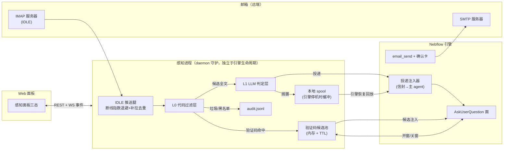

# 邮件自动化「感知」面 · 设计规格书

- 批次：设计批（作者令 2026-10-25 10:25）——纯设计不实施，零生产代码、零 schema 迁移
- 状态：draft（交作者评审，批了才排实施批）
- 样张：同目录 `panel-perception.html`（面板三态 + 配置卡片）、`card-send-confirm.html`（发送确认卡片）、`card-otp-ask.html`(验证码候选注入)；各态渲染证据见同目录 `shot-*.png`（Playwright 实截：面板 setup/run/config/config-tested/error、发送确认 v1/v2、验证码候选已选中）
- 评审人：作者

---

## §0 一句话目标

把「心跳进程」升级更名为**感知（Perception）**：在 daemon 守护的长连接面之上落地邮件自动化——代码层先滤、LLM 一锤定音、新邮件 IDLE 推送不轮询、验证码走时间窗免 LLM、发信走确认卡片、配置走交互卡片，第一个验收场景是作者的个人账单自动化。

## §1 作者构想（逐字保真）

1. 新邮件先用代码级自动过滤，过滤掉垃圾邮件；然后一次 LLM 调用判断这封邮件是否需要投递给主 agent；需要则主 agent 收到邮件全文。
2. 检测邮件不要用轮询，要像 hook 那样新邮件自动推送。
3. 验证码类邮件由代码检测，不经过 LLM。agent 弹 AskUserQuestion 问验证码时，能像苹果那样在问题下方显示邮件里的验证码，用户点击一下即填入。时间窗算法：只有 agent 提问的这段时间窗内进来的验证码才算候选。
4. agent 帮用户发邮件时弹卡片确认：卡片含发件人/收件人/主题/附件/正文等基本信息，确认了才发送；用户也可像 AskUserQuestion 那样给修改意见（改完再发）。
5. 邮件功能的配置也要交互式卡片（如问 IMAP 授权码）。
6. 把心跳进程和邮件功能结合，重新更名为「感知」（perception）。
7. 心跳（感知）面板优化：未配置态放一个复制按钮——复制提示词让 agent 帮你配置邮件自动化；配置好之后是 toggle 负责启停 + 配置按钮修改配置。

## §2 现状盘点与命名裁定（设计前置事实）

| 事实 | 出处 | 对本设计的影响 |
|---|---|---|
| 「心跳进程」= daemon 进程守护面板：顶栏 `#daemon-btn` → sapphire 玻璃弹层 `#daemon-panel`（400px），每 5s 轮询服务端口，进程掉线约 10s 自动拉起；手机面 `mobile/daemonFace.js` 脚注同源文案 | `web/js/daemons.js:1-9`、`web/js/mobile/daemonFace.js`、`web/index.html:261` | 「结合心跳」= 感知进程作为 daemon 守护下的一个受管进程；面板改造在现有弹层结构上做 |
| daemon 配置纪律「声明内联、值外置」：非密值 `~/.nebflow/daemon-config/<id>.json`（0600），密值 `~/.nebflow/secrets/<name>`（目录 0700/值 0600）；读面掩码 `***`，写回 `***` 保持原值，空串=不改 | `DaemonPanelStore.scala:12-30` | 感知邮件配置直接复用该纪律，不发明新存储 |
| secrets 统一库两条硬规则：零值暴露（任何诊断不落值）+ F1 写序（首字节即 0600、先收窄后写入、原地 TRUNCATE 保 inode） | `SecretsStore.scala:12-30` | IMAP/SMTP 授权码必须走此库，见 §11 |
| 平台已有 `MailTool` = **agent 间通信**（`delegate:`/`kernel:` 地址面），与邮箱邮件毫无关系但**同名** | `core/tools/MailTool.scala:1-80` | 命名碰撞裁定见下 |
| AskUserQuestion 面已有能力：options / secret 问题（密码框+服务端 owner-only 存储+TTL+一次性消费）/ canvas / attachments / dependsOn | 平台 ask 工具面 + `web/js/chat.js:1988+`（askCardRegistry）、`web/js/askAttachments.js` | 验证码注入与发送确认卡尽量复用此面，见 §6/§7 |

**命名裁定**：
- UI 层一律叫**「感知」**（英文 Perception），不再出现「心跳进程」字样（i18n 迁移见 §8）。
- 内部代码标识符用 **`perception`** 前缀（`perception-mail` daemon id 等）。
- **「邮件」一词在本设计内单指邮箱邮件**；平台 agent 间 Mail 不动、不改名。新增 agent 工具不占用 `Mail` 名（P1 发信工具暂名 `email_send`，见 §13）。

## §3 总体架构



**关键架构裁定：感知进程是独立进程，不是引擎内 actor。**

- 理由：引擎重启/升级不应丢信（作者构想 6「和心跳结合」的价值正在于此——daemon 守护让感知进程常驻，引擎停机期间邮件落入本地 spool，恢复后回放投递）。
- 感知进程由现有 daemon 声明机制托管（`daemons.json` 加一条 `perception-mail` 声明），掉线约 10s 自动拉起——即心跳机制原样复用。
- 感知进程与引擎通过本机 REST + WS 事件通信；引擎不在时感知进程独立完成 L0/OTP/spool，L1 判定可延后（见 §5 降级）。

## §4 推送落地（IMAP IDLE 主推）

### 4.1 主推：IDLE 长连接

- 连接建立后发 `IDLE`；按 RFC 2177 惯例**每 25 分钟主动终止并重发 IDLE**（多数服务器 29 分钟强制断），重发间隙顺手 `NOOP` 保活。
- 服务器 `EXISTS`/`RECENT` 未读通知 → 立即 `FETCH` 该 UID 区间新邮件元数据+正文 → 进过滤管线。端到端目标延迟 < 5s（服务器推送即时性决定）。
- 每邮箱会话保存 `UIDVALIDITY` + `lastSeenUID`：
  - `UIDVALIDITY` 不变：重连后只补拉 `lastSeenUID+1..*`，与本地已知 UID 集做**去重**（Message-ID 双保险，防服务器 UID 跳变）。
  - `UIDVALIDITY` 变化（文件夹重建等）：全量拉取最近 N=200 封元数据，按 Message-ID 对已知集去重后按过滤管线正常处理（已投递过的不再投）。

### 4.2 断线重连：指数退避

- 退避序列 `1s → 2s → 4s → 8s → … → 上限 5min`，每次乘 2，带 ±20% 随机抖动防惊群；重试成功即归零。
- 每次断连/重连/退避写入 audit（事件、原因、第几次），面板异常态显示「第 N 次重试 · Xs 后」（样张 `panel-perception.html` 异常态）。

### 4.3 退化为短轮询的条件（白名单式列举，其余一律 IDLE）

| 条件 | 退化形态 | 升级回 IDLE |
|---|---|---|
| 服务器 CAPABILITY 无 `IDLE` | 轮询 60s | 不可升级（面板状态标注「轮询 · 服务器不支持推送」） |
| IDLE 连接在 25min 周期内被静默掐断连续 ≥3 次（NAT/防火墙特征） | 轮询 120s | 每 10 轮询周期静默试拉一次 IDLE，成功即切回 |
| 配置显式 `mode: "poll"` | 轮询（用户指定周期，默认 60s，下限 30s） | 用户改回 |

短轮询判定依据与切换同样入 audit——**不允许静默降级**（面板状态行永远如实显示当前形态，见 §9）。

### 4.4 会话生命周期与引擎启停

| 引擎状态 | 感知进程行为 |
|---|---|
| 引擎运行 | 全管线：L0→L1→投递注入；OTP 窗与 ask 卡联动 |
| 引擎停机/重启中 | L0 照常；L1 调用失败→按 §5 降级规则；非垃圾邮件落 spool（`~/.nebflow/perception/spool/`，0600）；引擎 WS 重连成功后按时间序回放投递 |
| 感知进程被 toggle 暂停 | 断开 IMAP；不收信不落 spool；恢复时按 4.1 补拉去重（停收期间的新邮件**照常走管线**——暂停是停止推送，不是丢弃） |
| 感知进程掉线 | daemon 守护 ~10s 自动拉起 → 走 4.1 重连补拉 |

### 4.5 邮箱会话状态机

```
unconfigured ──配置+授权──▶ authenticating ──成功──▶ idle(IDLE 已连接)
     ▲                          │失败×3                  │  │
     │                          ▼                       │  └─断线─▶ backoff(指数退避)──成功──▶ idle
     └──删除授权─────── auth_failed ←──授权码失效/改密──┘            │连续3次静默掐断
                                    │                              ▼
                                    └─重新授权──▶ authenticating   degraded(轮询) ──IDLE 可用──▶ idle

idle/backoff/degraded ──toggle off──▶ paused ──toggle on──▶ authenticating
```

状态全集：`unconfigured / authenticating / idle / backoff / degraded / auth_failed / paused / error`。面板三态是本状态机的投影（§9 映射表）。

## §5 过滤管线分层

### 5.1 L0 代码层（零 LLM 成本，毫秒级）

按序判定，命中即短路：

| # | 判定 | 数据 | 动作 |
|---|---|---|---|
| 0.1 | 发件人黑名单/垃圾域信誉表（用户可编辑 + 内置常见垃圾域） | `perception/blacklist.json` | 丢弃，audit 记「blocked」 |
| 0.2 | 发件人白名单直通（用户点名域/地址，如账单发件域） | `whitelist.json` | **旁路 L1 直接投递**（含账单类，见 §12），audit 记「whitelist」 |
| 0.3 | 验证码正则命中（`^\s*\d{4,8}\s*$` 类 + 关键词 co-occur：验证码/校验码/code/OTP/一次性） | — | 进 OTP 候选池（§6），**不进 L1、不投递主 agent 全文** |
| 0.4 | 账单正则命中（微信支付/支付宝/银行发件域 + 关键词：账单/对账单/交易明细/excel/csv 附件特征） | — | 旁路 L1 直接投递（账单是验收场景的正当噪声源，用户不要它被 LLM 拦） |
| 0.5 | 关键词垃圾粗滤（可配置） | — | 丢弃，audit 记「spam-kw」 |
| 0.6 | 其余 | — | 进 L1 |

**旁路开关**：`perception.codeFilter.bypass: true` 时 L0 只做 0.1 黑名单与 0.3 验证码识别，其余全进 L1（作者排障用；开关切换入 audit）。

### 5.2 L1 LLM 层（一次调用定生死）

- **一次调用**：输入 = 头部（from/subject/date/to）+ 正文截断 **4KB**（超长附件型正文只发摘要提示「含 N 个附件：…」）+ 用户可选的个性化判定提示词（如「账单类、家人邮件永远投递」）。
- 输出三值：`deliver-full`（投递全文）/ `drop`（丢弃）/ `deliver-digest`（投递摘要——为 P3 预留，P0 只实现前两值）。
- **预算与缓存**：
  - Message-ID 已判过的不再判（重发/线程内重复）；同 Message-ID 前缀线程（`Re:`/`Fwd:` 归一化后同 subject 同参与者）在 24h 内已有 `deliver-full` 判定的后续邮件降采样为 `deliver-digest`（P0 可简化为仍走 L1，此条列为 P3 演进）。
  - 并发预算：同一时刻最多 1 个在途 LLM 判定，积压排队（不丢，慢就慢）。
- **降级**：LLM 不可用（无 key/网络失败/超时 30s）→ 白名单与账单类照投（L0 已旁路），其余**搁置 spool 待恢复**，不臆测投递也不臆测丢弃；恢复后按序补判。
- **旁路开关**：`perception.llm.enabled: false` 时 L1 整层跳过——行为等同 LLM 持续不可用（白名单/账单照投，其余搁置并面板提示）。纯代码过滤模式，audit 记 `llm=off`。

### 5.3 L2 投递层（主 agent 收全文的信封）

信封格式（注入主 agent 会话的 turn 前缀）：

```
[感知 · 邮件] from: 银行账单 <billing@bank.com> · 10:21
主题: 您的 10 月对账单
分类: 账单 (白名单直通)          ← L0/L1 判定与理由一行
优先级: normal                   ← otp > billing > normal
——— 正文全文（≤64KB，超出截断并注明）———
```

- **优先级**：`otp`（验证码窗内即时打断，走 ask 候选通道，不走本信封）> `billing`（可配置立即投递或攒批）> `normal`。
- **注入方式**：主 agent 空闲→立即作为新 turn 注入；忙碌→排当前 turn 队列，turn 边界合并注入（一 turn 至多合并 5 封，超出分批），不中断现行 turn（与平台 Mail 注入语义同源）。
- 审计：每次投递 audit 记 Message-ID + 判定层 + 优先级 + 延迟（到达→投递）；**不落全文**。

### 5.4 审计日志

- `~/.nebflow/perception/audit.jsonl`（0600）：每行 `{ts, stage: L0|L1|deliver|otp|conn, msgId, decision, reason, latencyMs?}`。全链路可回放，是验收场景断言（§12）的证据面。

## §6 验证码时间窗算法（构想 3）

### 6.1 窗口定义

- **起点 T0 = AskUserQuestion 弹出时刻**：引擎发出 ask 请求（问句含验证码意图，或 agent 显式声明 `otpWindow: true`）时，引擎同步调用感知进程 `POST /window/open`。
- **窗宽默认 10 分钟**（可配 `perception.otp.windowSec`）；到期自动关窗，候选转 `expired`（灰显，不再可点，见样张第三态）。
- 关窗时机任一：用户提交答案 / ask 卡被取消 / TTL 到期。

### 6.2 候选资格与去重排序

窗内（`arrival ∈ (T0-预检窗口, T0+窗宽]`，预检窗口=0：**只有窗开之后到达的才算**——作者原文「只有 agent 提问的这段时间窗内进来的验证码才算候选」逐字执行；窗开前到达的验证码邮件已落候选池但标 `pre-window`，**不自动显示**，仅以「窗开前有 1 封疑似验证码」弱提示供用户主动展开）：

| 规则 | 内容 |
|---|---|
| 去重 | 同发件人 60s 内重发→只留最新（旧候选标 superseded）；同验证码值不同邮件→归一为一个候选，来源合并显示 |
| 排序 | 可信度降序 → 时间新者优先。可信度：发件域白名单 100 / 与用户有 ≥2 次历史往来的域 80 / 未知域 60 / 黑名单关联域 0（不显示，仅 audit） |
| 时效 | 候选自身 TTL = 窗 TTL；候选提取失败（正则命中但无码值）不进池 |

### 6.3 注入面评估（平台现有 ask 能力复用度）

| 平台现有面 | 复用评估 |
|---|---|
| **options** | ✅ 方案 A：每个候选一个 option（label「824193 · QQ 邮箱 · 刚刚」），点击即选即填。零新机制，历史回放天然支持。**推荐 P0 落此** |
| **secret 问题** | ✅ 验证码值走 password box → 服务端 owner-only 存储 + TTL + 一次性消费——平台机制与「验证码是短时敏感值、不应进会话明文」高度契合（作者令点名契合）。候选项点击即以 secret 提交 |
| **canvas / attachments** | ➖ 不复用注入；可选把原邮件 eml 路径挂 attachments 供人工核对来源（P1 可选） |
| **问题下方内联候选条 + 一键填入** | 方案 B（「像苹果那样」的字面形态）：候选渲染在问句下方（样张 `card-otp-ask.html` 即此形态），点击填入输入框再提交。需要 ask 卡新渲染分支（`web/js/chat.js` ask 面加 `otpCandidates` 展示段）。**列为 P1 演进，作者裁决 A 起步还是直接 B** |

**联动细节**：窗开期间新验证码邮件到达 → 感知进程推 `perception.otp.candidate` WS 事件 → ask 卡实时追加候选（无需用户刷新）；用户点选后引擎 `POST /window/close(reason=answered)`。

### 6.4 安全

- 候选值只进内存池（进程重启丢失可重收，无落盘）；audit 中掩码（`824***`）；以 secret 提交后走一次性消费，会话与日志均无明文。

## §7 发送确认卡片（构想 4）

### 7.1 本质与字段

确认卡 = **AskUserQuestion 特化卡**（复用 ask 面的渲染、回答、历史回放与 secret 语义），字段布局自上而下（样张 `card-send-confirm.html`）：

1. 标题行「发送邮件确认」+ 目标邮箱身份（发件账号）。
2. 收件人 chips（to / cc / bcc 分行）。
3. 主题（单行，完整展示不截断）。
4. 附件行：`名称 · 大小 · [预览]`（预览走 Canvas 打开本机文件，复用 ask attachments 面；**不内嵌 base64、不上传任何远端**）。
5. 正文预览（可滚动，纯文本渲染；HTML 邮件以文本化预览，真实 HTML 构造在发送侧完成）。

### 7.2 交互语义（回流裁定）

| 用户动作 | 语义 |
|---|---|
| 点「发送」 | 立即 SMTP 发送；成功→回执卡（时间+Message-ID）；失败→失败卡（§7.4） |
| 点「提出修改意见」 | 展开自由文本框（同 ask 自由输入面）→ 提交后意见作为消息回流给 agent，**agent 修订后重新弹一张确认卡 v2（二次确认）** |
| 修改意见中明说「改完直接发」 | 该次修订后**自动发送**并回执（用户显式授权的一次到位；该授权仅限本次，不记忆） |

**二次确认的理由**：发送是不可逆外部副作用；一次到位只在用户逐字授权时成立，默认路径永远多一跳。此为设计裁定，作者可否决。

### 7.3 附件引用

agent 侧传本机绝对路径数组；卡片仅显示 basename + 字节数（人读单位）；路径不存在时该附件行标红「文件不存在」，发送按钮禁用。

### 7.4 发送失败回执

失败卡分类呈现：认证失败（授权码失效→引导重配）/ 网络失败（附指数退避自动重试状态）/ 收件方拒收（SMTP 5xx 原文一行）。每张失败卡带 `[重试]` 与 `[放弃并告知 agent]`。

## §8 「感知」更名影响面（构想 6）

| 层 | 现状 | 迁移动作 | 兼容期 |
|---|---|---|---|
| UI 文案 | zh「心跳进程」/ en "Daemons"（i18n 键 `daemons.*`） | zh →「感知」、en → "Perception"；新增邮件区块文案键 `perception.*` | `daemons.*` 旧键保留 2 个发布周期（进程守护子区块仍需「进程守护」文案，自然延续使用） |
| DOM/组件 | `#daemon-btn` / `#daemon-panel` / `daemons.js` / `daemonPanel.js` | **id 不改**（DOM 稳定性优先），文件不改名；面板内部新增「邮件推送」区块 | 永久（仅文案更名，代码更名不进本批） |
| 后端 | `DaemonPanelStore.scala` / `daemons.json` | 新增 `perception-mail` daemon 声明；存储纪律原样复用 | 永久 |
| 手机面 | `mobile/daemonFace.js` 脚注 | 文案键跟随 i18n 更名 | 同 i18n |
| 文档/术语 | GLOSSARY「心跳」条目 | 增「感知（Perception）」条目，旧名作 alias | 1 版本后收敛 |

**迁移原则：更名只动「用户可见层」**，代码标识符的大改名单独立项（P3 可选，收益低不做默认）。

## §9 面板三态（构想 7；样张 `panel-perception.html`）

状态机 → 面板投影：

| 面板态 | 覆盖状态机 | 面板内容 |
|---|---|---|
| **未配置** | `unconfigured` | 图标+一句话说明 + **[复制配置提示词]** 主按钮（提示词全文见 §10）+ 脚注「复制后粘贴到对话，代理将引导完成配置」 |
| **运行中** | `idle / degraded / paused` | 状态行（IMAP IDLE · 已连接 · IDLE 重续倒计时 / 轮询 60s / 已暂停）+ 今日统计（投递 N · 拦截 N · 验证码 N）+ 事件迷你日志（最近 5 条）+ **toggle 启停** + **[配置]** 按钮 |
| **异常** | `auth_failed / backoff / error` | 显式 banner：授权失效→[重新授权]（重开配置卡定位到授权码字段）；连接断→「第 N 次重试 · Xs 后」倒计时；toggle 与配置按钮仍可用（异常态不禁用操作，只突出事实） |

三态常量：panel 宽 400px sapphire 玻璃弹层（现有 `#daemon-panel` 结构内改造）；所有数字可解释（统计口径 = 当日本地时区，audit 同源）。

## §10 未配置态「复制配置提示词」全文（复制按钮载荷）

```text
请帮我配置 Nebflow「感知」的邮件自动化，按以下步骤：

1. 向我要齐配置要素：邮箱地址、IMAP 服务器与端口、SMTP 服务器与端口
   （我说不全时，按 QQ / 163 / Gmail 的常见默认值给出让我确认）、发件显示名。
2. SMTP 与 IMAP 授权码不要让我贴在对话里：用 AskUserQuestion 的 secret
   问题（密码框）向我收集，存入 secrets（文件名 perception-imap-auth /
   perception-smtp-auth，owner-only），之后一切引用只用名字。
3. 把非密配置写入 ~/.nebflow/daemon-config/perception-mail.json；
   密字段只写 secrets 引用名，绝不写值。
4. 自检并报告结果：IMAP 登录成功、服务器支持 IDLE（不支持则说明将退化为
   60 秒轮询）、SMTP 发一封标题为「感知配置自检」的测试邮件到我邮箱。
5. 打开感知面板确认为「运行中」；失败则给出具体修复建议，不要猜。

全程纪律：授权码与邮件全文不进对话、不进日志、不进任何报告。
```

## §11 安全边界

| 边界 | 裁定 |
|---|---|
| 授权码 | 只进 `~/.nebflow/secrets/<name>`（dir 0700 / file 0600，复用 SecretsStore F1 写序与零值暴露纪律）；UI 配置卡掩码 `***`，写回 `***` 保持原值、空串不改（DaemonPanelStore 同款语义） |
| 邮件全文 | 全文仅存本机（spool 0600、投递进本机会话）；**LLM 调用数据面声明**：默认只发「头部+截断 4KB 正文」给 LLM 供应商；配置可切 `llm.dataPlane: full`（发全文）但面板显示数据面徽标提示；`local-only` 模式（仅本地 LLM 可用全文）列 P3 |
| 验证码 | 内存候选池 + TTL；audit 掩码；secret 一次性消费（§6.4） |
| 发送 | 一切出站发送必须过确认卡（无静默发送路径）；`email_send` 工具在未确认时拒绝执行 |
| 删除授权后的残留清理 | 删除邮箱授权 = 一次性执行：① 删 secrets 值（`perception-imap-auth`/`perception-smtp-auth`）② 删 `daemon-config/perception-mail.json` ③ 清 `~/.nebflow/perception/`（spool/state/audit/黑名单白名单按用户选择保留）④ 清内存池与重连任务。清理结果出回执清单；清理后 `grep -r` 授权码在 `~/.nebflow` 无命中（验收断言 §12.5） |
| 进程 | 感知进程与引擎同用户运行；spool/audit 全 0600；面板只暴露元数据不暴露值 |

## §12 第一个落地场景（验收）：个人账单自动化

**流**：微信支付/支付宝/银行账单邮件到达 → L0 账单正则命中（发件域+关键词+附件特征）→ **旁路 LLM 直接投递** → 信封（优先级 `billing`）注入主 agent → agent 解析邮件/附件（CSV/Excel）→ 追加统一账本（`~/Documents/ledger.csv` 或用户指定）→ 按需出月度汇总。

**验收断言（二值，全部可自动化取证）**：

1. 一封白名单账单域样例邮件投递后 60s 内，统一账本新增一条对应记录，且 audit 显示 `stage=L0 reason=whitelist`（**LLM 未参与**——audit 无该 Message-ID 的 L1 行）。
2. 一封黑名单域样例邮件：agent 会话无投递记录，audit 有 `stage=L0 decision=blocked` 行。
3. agent 弹验证码 ask 后 2 分钟内到达的验证码出现在候选列表；窗开前 5 分钟到达的同款验证码不出现在候选（仅弱提示）。
4. 引擎停机期间到达的一封白名单邮件，引擎恢复后 60s 内完成投递（spool 回放生效）。
5. 删除邮箱授权后，对 `~/.nebflow` 全目录 `grep -r <授权码明文>` 零命中。
6. 人为断网 2 分钟：audit 退避序列符合 1s/2s/4s…（±抖动）；恢复后同一封邮件不重复投递（UID/Message-ID 去重）。

## §13 接口面汇总（草案，实施批定稿）

**文件布局**
```
~/.nebflow/perception/
  state.json          # 邮箱会话：UIDVALIDITY/lastSeenUID/统计（0600）
  audit.jsonl         # 全链路审计（0600，不落全文/明码）
  spool/              # 引擎停机缓冲（0600，投递成功即删）
  whitelist.json / blacklist.json   # 用户可编辑
（密值在既有 ~/.nebflow/secrets/，非密配置在既有 ~/.nebflow/daemon-config/）
```

**REST（感知进程本地端口，经网关代理）**
- `GET  /api/perception/status` → 状态机当前态 + 统计 + 最近事件
- `POST /api/perception/toggle` `{enabled}` → paused/idle 切换
- `GET|PUT /api/perception/config` → 密字段掩码 `***`（写回语义同 DaemonPanelStore）
- `POST /api/perception/config/test` → 连接自检（IMAP 登录 + IDLE 能力 + SMTP 试发）
- `POST /api/perception/otp/window/open|close` → 引擎↔感知（ask 联动）
- `DELETE /api/perception/mailbox` → 删除授权 + 残留清理（§11），回执清单

**WS 事件（web 面板订阅）**：`perception.state.changed` / `perception.mail.delivered` / `perception.otp.candidate` / `perception.otp.expired`

**agent 侧工具面**：P1 新增 `email_send`（收件人/主题/正文/附件路径数组；未确认卡不执行）；读信不设工具（投递信封已含全文，避免第二个旁路读面）。

## §14 实施分期建议（批了才排）

| 期 | 内容 | 验收 |
|---|---|---|
| **P0 感知核心** | 感知进程 + daemon 声明 + IMAP IDLE/退避/补拉去重 + L0/L1 管线 + OTP 时间窗（方案 A：options 注入）+ spool 回放 + audit + 账单场景（§12 断言 1/2/4/5/6） | §12 断言 |
| **P1 确认与配置面** | 发送确认卡 + `email_send` + 失败回执 + 配置卡片（REST config/test）+ OTP 注入方案 B（问句下方内联，作者若直接点名 B 则并入 P0） | 样张对应交互可走通 |
| **P2 面板与更名** | 面板三态落地（现 `#daemon-panel` 内改造）+ i18n 更名 + 手机面文案 | §9 三态投影 + GLOSSARY |
| **P3 演进（默认不做）** | 多邮箱（配置结构已预留 mailboxes[]）/ 本地 LLM 全文模式 / 线程降采样 / deliver-digest / daemon→perception 代码大改名 | 另立批 |

## §15 复用清单与开放问题

**复用（零新机制）**：daemon 守护与自启、`daemon-config` 值外置纪律、secrets 库（授权码 + secret 问题一次性消费）、ask 卡渲染/历史回放/attachments/Canvas 预览、WS 事件管线、audit 惯例。

**开放问题（请作者裁决）**：
1. OTP 候选注入形态：P0 先 A（options，零改动）还是直接 B（问句下方内联，改 ask 卡）？样张按 B 形态画，语义两者一致。
2. 「改完直接发」一次到位授权（§7.2）是否认可，还是无论何种表述一律二次确认？
3. LLM 数据面默认值：云端最小化（4KB 截断）是否作为默认锁定？
4. 感知进程形态：独立 daemon 进程（本稿推荐，引擎停机不丢信）是否认可？
5. 账单类是否需要「攒批发投递」（如每日 9 点汇总）还是逐封即时投递（本稿默认）？
