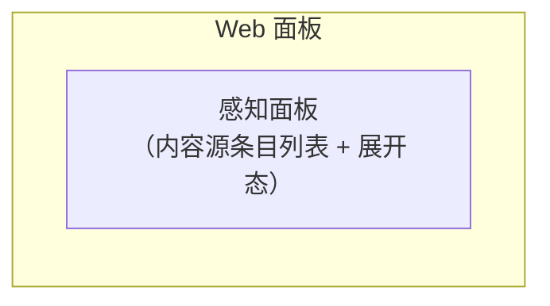

# 邮件自动化「感知」面 · 设计规格书（r2）

- 批次：设计批 **r2**（作者评审意见 2026-10-25 11:36 逐字要点+修订要求）——纯设计不实施，零生产代码、零 schema 迁移
- 前版：`reports/20261025_102642_mail-perception-design/`（r1，已合并）；本版按评审意见重写 §6/§7/§9、新增 §16 设计语言对齐与裁决记录，其余章节沿用 r1 并做一致性小改
- 状态：draft-r2（**等作者看样张**，批了才排实施批）
- 样张：同目录 `panel-perception.html`（**条目化感知面板**：内容源条目列表 + 展开态 + 预留条目位）、`card-otp-ask.html`（**验证码单码展开**：输入框下方展开一个数字，点击收缩并填入）、`card-send-confirm.html`（**只读快照卡 + Canvas 编辑发送**）；渲染证据 `shot-*.png`（Playwright 实截 ×14，亮暗双主题，零 console 错误；`shots.mjs` 可复跑）
- 评审人：作者

---

## 裁决记录（作者评审 2026-10-25 11:36，五点全部落定）

| # | 裁决 | 逐字依据（要点） | 设计落点 | r1 方案处置 |
|---|---|---|---|---|
| 1 | **验证码 = 单码展开点击即填** | 「不需要有候选验证码，就只显示一个。收到才展开……系统监测到邮件有相关的验证码，就在下方展开一个数字，点击就收缩并且填入」 | §6 全文重写：无候选列表；输入框下方检测条，窗内检测到→展开唯一数字；点击→收缩并填入；无「已填入」常驻态；时间窗算法保留 | 方案 A（options）/方案 B（内联候选列表）**均废** |
| 2 | **发送 = 对话卡只读快照 + Canvas 编辑后直接发送** | 「对话框就是一个快照。供查看，用户需要修改就在 canvas 打开，canvas 大一点方便用户修改和编辑，然后用户编辑完之后可以直接发送」 | §7 全文重写：快照卡=预览+「在 Canvas 打开编辑」；Canvas 编辑态全字段可改+发送按钮；复用平台 Canvas face | 卡内「提出修改意见」自由文本框**废**；「改完直接发」一次到位授权**废**（一切发送都经用户手动点击：快照卡「照此发送」或画布「发送」） |
| 3 | **LLM 数据面默认锁定最小化 + 白名单放行** | 「其余三项按我方推荐执行」 | §11：`llm.dataPlane` 默认且固定 = 头部+截断 4KB；白名单域旁路 L1 直接投递；配置卡该行只读徽标「最小化 · 固定」 | 按 r1 推荐执行，已裁决 |
| 4 | **感知 = 独立守护进程** | 同上 | §3：感知进程独立于引擎生命周期，daemon 声明托管，引擎停机不丢信（spool 回放） | 按 r1 推荐执行，已裁决 |
| 5 | **账单 = 日结攒批** | 同上 | §5.1/§12：账单类 L0 直通但**不逐封投递**——入当日账单缓冲，每日 HH:mm（默认 09:00，可配）汇总一封注入主代理 | r1 默认「逐封即时投递」**改为日结攒批**（裁决值） |

> 裁决 1/2 为作者逐字指定形态；裁决 3/4/5 采纳 r1 §15 开放问题的推荐项。r1 §15 五个开放问题**全部关闭**，无遗留待裁决项。

## §0 一句话目标

把「心跳进程」升级更名为**感知（Perception）**：在 daemon 守护的长连接面之上落地邮件自动化——代码层先滤、LLM 一锤定音、新邮件 IDLE 推送不轮询、验证码走时间窗单码点击即填、发信走「快照卡 → Canvas 编辑 → 画布直接发送」、配置走交互卡片；**感知面板是内容源条目列表（邮件 = 首个条目，为未来内容源预留条目抽象）**；第一个验收场景是作者的个人账单自动化（日结攒批）。

## §1 作者构想（逐字保真）

r1 构想 1-7 见前版 REPORT（过滤推送/IDLE/验证码时间窗/发信确认/配置卡片/更名/面板复制提示词，全部继续有效）。r2 增录评审逐字要点：

8. 「感知不只是会挂载邮件，以后还会挂载其他内容」→ 面板架构**条目化**：感知面板是内容源条目列表，邮件 = 首个条目；点击条目才展开细节（配置/状态/操作都在展开区内）；为文件系统变动、日历、webhook 等未来内容源预留条目抽象（§9）。
9. 「关于邮件，可能对话框就是一个快照。供查看，用户需要修改就在 canvas 打开，canvas 大一点方便用户修改和编辑，然后用户编辑完之后可以直接发送」→ §7。
10. 「不需要有候选验证码，就只显示一个。收到才展开，类似于手机收验证码的时候那种交互。不需要有已填入，就直接点击就填入。具体是，需要我填验证码，就是验证码的输入框，然后系统监测到邮件有相关的验证码，就在下方展开一个数字，点击就收缩并且填入」→ §6。
11. 「整体的风格一定要符合我们官网 stand 的设计语言」→ 全部样张按 mystand.space 设计语言重制，token 表见 §16。

## §2 现状盘点与命名裁定（设计前置事实）

r1 表格全部继续有效（心跳=daemon 守护面板、daemon-config 值外置纪律、secrets 库、MailTool 同名辨析、ask 面能力）。r2 补充两条本版依赖的平台事实：

| 事实 | 出处 | 对本设计的影响 |
|---|---|---|
| 平台 Canvas face：文件卡打开 → `openWorkspaceItem` → `#canvas-panel`（radius 20 玻璃 + frost-shadow + `.canvas-header` 玻璃胶囊浮层） | `web/js/canvas.js:1098`、`web/css/split.css:536-553,660+`、`web/js/chat.js:2763+`（ask 卡 canvas 腿） | §7 发送编辑复用此 face：草稿=本机文件，打开/编辑/预览零新机制；仅新增草稿专有工具胶囊 |
| ask 卡已有 canvas 字段打开对比页的成熟链路（`openAskCanvas`，失败不阻塞卡面） | `web/js/chat.js:2820-3034` | §7 「在 Canvas 打开编辑」按钮走同构链路（动态 import + 失败提示不阻塞） |

命名裁定沿用 r1：UI 层「感知」（Perception）；代码标识 `perception-*`；「邮件」单指邮箱邮件，agent 间 Mail 工具不动。

## §3 总体架构

架构图与「感知进程 = 独立进程」裁定**沿用 r1**（裁决 4 落定，图不变）。唯 UI 子图节点更名：



## §4 推送落地（IMAP IDLE 主推）

**沿用 r1 全文**（IDLE 25min 重续 / 指数退避 / 白名单式退化条件 / 会话生命周期 / 状态机）。关联更新：§4.2 提到的「面板异常态」在 r2 中是**邮件条目**的异常展开态（§9.3），状态机→面板投影按条目模型重述（§9.3）。

## §5 过滤管线分层

### 5.1 L0 代码层 —— r2 变更一处（裁决 5）

r1 表格 0.1-0.6 判定序不变；**0.4 账单行动作改为**：

| # | 判定 | 动作（r2，裁决 5） |
|---|---|---|
| 0.4 | 账单正则命中（微信支付/支付宝/银行发件域 + 关键词/附件特征） | 旁路 L1，**入当日账单缓冲**（`~/.nebflow/perception/billing-buffer/<date>.jsonl`，0600），**不逐封投递**；每日 HH:mm（默认 09:00，`perception.billing.digestHour` 可配）汇总一封注入主代理（优先级 `billing`）。缓冲行含 Message-ID/发件域/附件路径/金额正则摘要；汇总信封 = 当日条目清单 + 附件路径列表 |

- 日结时刻到达时缓冲为空 → 不注入（零空报）。跨日缓冲归属按**邮件到达日**（本地时区）。
- 账单缓冲是 spool 的同类物（0600、注入成功即清、引擎停机不影响——感知进程自行计时注入，引擎不在则注入动作走 spool 回放路径）。
- 白名单域但非账单正则（0.2 直通）**保持逐封即时投递**——攒批仅适用于账单类（账单是批量噪声源，白名单是人名点的信）。

### 5.2 L1 LLM 层 / 5.3 L2 投递层 / 5.4 审计

沿用 r1，两处一致性小改：

- 5.3 优先级说明中 billing 语义改为「日结攒批（§5.1）；otp > billing > normal 顺序不变」。
- 5.3 信封示例后的审计行注明账单类在日结注入时记 `stage=deliver reason=billing-digest`（当日 N 封合并一行，附 Message-ID 列表）。

## §6 验证码单码展开（构想 3 + 裁决 1；r2 全文重写；样张 `card-otp-ask.html`）

### 6.1 模型：单码槽，无候选列表

- **整个提问周期只显示一个验证码**。没有候选列表、没有多候选排序、没有「已填入」常驻态（r1 方案 A/B 均废）。
- 交互三步（作者逐字形态）：
  1. **等待**：ask 卡（secret 问题密码框）下方有一条**检测条**（弱存在：脉冲点 + 「感知正在监听邮箱中的验证码」+ 窗口剩余倒计时）。
  2. **展开**：感知进程在时间窗内检测到相关验证码 → WS 推送 → 检测条**展开为一个数字**（大号等宽字）+ 来源一行（发件域名 · 时间）+「点击填入」提示。
  3. **填入**：点击该条 → 检测条**收缩并撤出卡片**，码值填入上方输入框，提交按钮解禁。检测条不残留任何「已填入」状态。
- 手机收验证码的同款心智：码到了才出现，点一下就走。

### 6.2 时间窗算法（保留 r1，裁决明示）

- **起点 T0** = ask 弹出（问句含验证码意图或 agent 显式 `otpWindow: true`）→ 引擎同步 `POST /window/open`；**窗宽默认 10 分钟**（`perception.otp.windowSec`）；关窗时机 = 提交 / 取消 / TTL 到期。
- **窗内到达才展开**（预检窗口 = 0，作者原文逐字）；**窗开前到达的验证码完全不展示**（r1 的「弱提示一行」一并废除——单码模型下没有列表位）。
- 检测与去重规则沿用 r1 §6.2 的 L0 识别（0.3）与 60s 同发件人重发去重；可信度排序规则**删除**（无列表不需要排序）。

### 6.3 单码槽的边界规则

| 情形 | 行为 |
|---|---|
| 窗内第二个验证码到达（用户同时在等两件事） | **新码覆盖显示**（旧码大概率已失效）；audit 各记一行 |
| 展开后用户没点，窗口到期 | 检测条收起为「监听窗口已过期」灰态，**码值即刻清出内存**（不残留、不可再点）；用户点「让代理重发」开新窗 |
| 用户手动在输入框打字 | 照常（等价既有路径）；与检测条互不干扰——点条即覆盖输入框值 |
| 提交 | 走 secret 一次性消费（owner-only + TTL + 用后即焚）；窗口关闭 reason=answered；对话与日志只留掩码 `824***` |
| 引擎/感知进程重启 | 码值只在内存，重启即失（可重收，见 r1 §6.4 安全，全部沿用） |

### 6.4 实现面（P0）

- ask 卡新增渲染分支 `otpStrip`（`web/js/chat.js` ask 面）：rest/hit/expired 三态 + 点击回填；事件源 `perception.otp.code` / `perception.otp.expired`（§13）。
- 码值传输沿用 secret 通道：WS 事件只带「已检测到」信号与来源元数据，**码值随点击后由引擎向感知进程拉取一次性令牌填充**（或经 secret 提交路径直送——实施批二选一，倾向后者：值全程不过前端 JS 明文变量之外的面）。

## §7 发送：快照卡 + Canvas 编辑发送（构想 4 + 裁决 2；r2 全文重写；样张 `card-send-confirm.html`）

### 7.1 语义总览

```
agent 拟稿 → 草稿文件落盘 → 对话弹【只读快照卡】（供查看）
                                 │
                 ┌───────────────┼────────────────┐
          「照此发送」（快照原文）  「在 Canvas 打开编辑」   直接在对话回复意见
                 │               │                │
             SMTP 发送      Canvas 编辑态（大画布）    agent 改稿后重新出快照卡
                 │           全部字段可改               （回到本图起点）
                 │               │
                 │        画布「发送」（发送画布当前文本）
                 │               │
                 └───────→ 对话内回执（成功 / 失败卡 §7.5）
```

- **对话卡 = 快照**：只读展示（发件人/收件人/抄送/主题/附件/正文），供查看与快速确认。卡片操作两个：**[照此发送]**（快照原文直接发）与**[在 Canvas 打开编辑]**（要改内容走画布）。
- **Canvas = 编辑态**：大画布，全部字段可改；编辑完**在画布里直接发送**。r1 的卡内「提出修改意见」文本框废除；让代理改稿 = 用户直接在对话里回复（普通消息流，无专用控件——回复后 agent 修订并重新出快照卡）。r1 的「改完直接发」一次到位授权随二次确认语义一并废除：**一切发送都由用户手动点击**（快照卡或画布），无 agent 侧自动发送路径。

### 7.2 草稿文件（Canvas 复用的载体）

- agent 拟稿落盘：`~/.nebflow/perception/drafts/draft-<ts>-<rand>.md`（0600），front-matter + 正文：

```
---
draft: perception-mail-send
to: billing@vendor.com
cc: finance@kaiyu.me
subject: 10 月服务对账与发票申请
attach: ~/Documents/invoice/2026-10-invoice-draft.pdf
attach: ~/Documents/ledger/ledger-oct.xlsx
---
<正文纯文本，HTML 邮件在发送侧由该文本构造>
```

- **Canvas 复用方式（零新编辑机制）**：快照卡「在 Canvas 打开编辑」⇒ `openWorkspaceItem(草稿文件)`（`canvas.js:1098`，与文件卡打开同 face）⇒ 画布呈现可编辑文本（样张 contenteditable 即此形态）。文件带 `draft: perception-mail-send` 标记时，画布头部出现**草稿工具胶囊**（`[放弃] [发送]`，玻璃胶囊材质与 `.canvas-header` 同源）——这是本设计唯一的新画布 UI，仅对感知草稿文件出现。
- 附件以路径行存在，同样可编辑；发送时按行解析，路径不存在 → 发送按钮禁用并逐行标红（沿用 r1 §7.3 校验，位置从确认卡移到画布发送前校验 + 快照卡静态展示）。

### 7.3 快照卡与画布的一致性守则（防旧稿覆盖新稿）

- 快照卡记录其快照时刻；画布一旦发生编辑（草稿文件 mtime > 快照时刻），快照卡「照此发送」**自动停用**并显示「草稿已在 Canvas 修改，请在画布中发送最新内容」提示条（样张 `shot-send-stale-light.png`）。
- 画布「发送」永远发送**画布当前文本**（含未「保存」的编辑——草稿文件在画布编辑即实时写盘，沿用平台文件编辑写盘语义）。
- 画布「放弃」→ 草稿文件删除 + 快照卡撤回 + agent 收到「用户放弃发送」通知；无静默丢弃。
- 用户不点发送直接关画布 → 什么也不发生；快照卡保持待处理（可再进画布）。ask 卡 TTL 到期 → 快照卡转「已过期」，agent 收到超时事件。

### 7.4 附件

沿用 r1 §7.3：agent 侧传本机绝对路径数组；卡/画布仅显示 basename + 人读字节数；预览走 Canvas 打开本机文件（复用 ask attachments 预览链路）；不内嵌 base64、不上传远端。

### 7.5 发送回执（沿用 r1 §7.4，落点改为对话内）

成功回执（时间 + Message-ID + 「内容以发送时刻画布文本为准」注记）；失败卡分类（认证失效→引导重配 / 网络失败→退避自动重试状态 / 收件方拒收→SMTP 5xx 原文一行），均带 `[重试]` 与 `[放弃并告知 agent]`。

## §8 「感知」更名影响面

**沿用 r1 全文**（UI 文案更名、DOM id 不改、后端声明新增、手机面跟随、GLOSSARY alias）。

## §9 感知面板：内容源条目列表 + 展开态（构想 7+8 + 裁决；r2 全文重写；样张 `panel-perception.html`）

### 9.1 面板模型

感知面板**不再是「三态面板」，而是条目列表**：

- 面板 = 400px sapphire 玻璃弹层（现 `#daemon-panel` 结构内改造，壳样式逐字沿用：radius 16 + `--sapphire-edge` 描边 + 折射线 + 阴影栈）。
- 面板体 = **内容源条目列表**。每个内容源一个条目；**邮件 = 首个条目**。
- **点击条目才展开细节**：配置入口 / 状态 / 统计 / 操作全部在展开区内（collapsed 态只保留一行摘要）。单展开手风琴（同时至多一条展开；点击已展开条目头收起）。
- 面板头 = 「感知」标题 + 派生状态点 + 派生状态词（= 各条目状态的最坏投影：任一异常 > 任一未配置 > 全部运行/暂停）；页脚 = 「内容源 N/M 已接入」+ 「本地处理 · 全文不出本机」。

### 9.2 条目抽象（为未来内容源预留的契约）

每个条目实现同一契约，面板对条目内容零感知：

| 契约字段 | 说明 | 邮件条目的现值 |
|---|---|---|
| `id` / `icon` / `name` | 标识 | `mail` / 信封图标 / 邮件 |
| `state` | 条目自己的状态机（各内容源自定义，面板只认四色投影：ok / warn / bad / dim） | §4.5 八态 → 四色映射 |
| `summary` | collapsed 态一行摘要 | 「i@kaiyu.me · 已连接 · 今日投递 3」 |
| `detail` | 展开区 DOM（配置/状态/操作自组织） | §9.3 三展开态 |
| `actions` | 展开区内按钮组 | 配置 / 审计日志 |

**预留条目位**（本批只留位不设计细节，样张以「规划中」虚线徽标展示抽象形态）：

| 未来内容源 | 一句话定位 |
|---|---|
| 文件系统变动 | 监控目录变化 → 事件投递主代理 |
| 日历 | 日程临近提醒 / 当日议程摘要 |
| Webhook | 接收外部系统推送事件 |

新内容源接入 = 注册一个契约实现 + 一条 daemon/进程托管声明，面板自动成行；不改面板结构。

### 9.3 邮件条目的三种展开态（状态机投影）

r1 的「面板三态」下沉为**邮件条目的展开态**；映射表（状态机八态沿用 r1 §4.5）：

| 条目展开态 | 覆盖状态机 | collapsed 摘要行 | 展开区内容 |
|---|---|---|---|
| **未配置** | `unconfigured` | 「未配置 · 复制提示词开始」（dim 点） | 图标+一句话说明 + **[复制配置提示词]** 主按钮（载荷 §10 全文不变，仅第 5 步措辞改为「确认『邮件』条目转为运行中」）+ 三步引导 |
| **运行中** | `idle / degraded / paused` | 「i@kaiyu.me · 已连接 · 今日投递 N」/ 暂停时「已暂停」（ok/dim 点） | 状态行（IMAP IDLE chip + 重续倒计时 / 轮询 60s / 已暂停 banner）+ 今日统计三格（投递/拦截/验证码，当日本地时区，audit 同源）+ 事件迷你日志（最近 5 条）+ 邮箱身份行 + **toggle 启停** + **[配置] [审计日志]** |
| **异常** | `auth_failed / backoff / error` | 「授权失效 · 需重新授权」（bad 点）/「连接中断 · 第 N 次重试」（warn 点） | 显式 banner：授权失效→**[重新授权]**（重开配置卡定位授权码字段）+ [删除此邮箱]；连接断→「第 N 次重试 · Xs 后」倒计时 + [立即重试] [转轮询模式]；其下仍保留身份行 + toggle + [配置]（异常态不禁用操作，只突出事实） |

语义色纪律（§16 铁律）：banner/日志的彩色只上载体（点/描边/底纹/图标），状态词一律中性 `--status-word`。

### 9.4 交互规则汇总

- 条目头点击 = 展开/收起切换；`aria-expanded` 同步。
- 配置卡片（overlay，§10 场景入口）从邮件条目展开区「配置」/「重新授权」打开——配置卡**属于条目**，不属于面板。
- toggle 暂停的是**该条目**（邮件推送），不是感知进程整体；多内容源时代每条目各自 toggle（进程级总开关列 P3，多源真实存在时再议）。
- 数字全部可解释（统计口径当日本地时区，audit 同源，沿用 r1）。

## §10 未配置态「复制配置提示词」全文

**沿用 r1 全文**（唯一措辞改动：第 5 步「打开感知面板确认为『运行中』」→「打开感知面板，确认**『邮件』条目**转为『运行中』」，与 §9 条目化一致）。

## §11 安全边界

沿用 r1 全表，三处一致性修订：

| 边界 | r2 修订 |
|---|---|
| 验证码 | 单码槽：码值仅存感知进程内存（单槽变量 + TTL），点击后经 secret 一次性消费；无候选池数组（§6.1-6.3）；audit 掩码不变 |
| 账单缓冲 | `billing-buffer/<date>.jsonl` 0600，不落正文全文（元数据+附件路径），日结注入成功即清（§5.1） |
| LLM 数据面 | **裁决 3 落定**：`llm.dataPlane` 默认且固定 = 头部 + 截断 4KB，配置卡只读徽标「最小化 · 固定」，无用户可改开关；白名单域旁路 LLM |

其余（授权码 secrets、发送过确认、删除授权残留清理、进程 0600）逐字沿用 r1。

## §12 第一个落地场景（验收）：个人账单自动化

**流（r2 按裁决 5 修订）**：账单邮件到达 → L0 账单正则命中 → 旁路 LLM 入**当日账单缓冲** → 每日 09:00（可配）日结汇总一封信封（优先级 `billing`）注入主代理 → agent 解析附件（CSV/Excel）→ 追加统一账本 → 按需出月度汇总。

**验收断言（二值，全部可自动化取证；r2 修订 #1/#3，新增 #7）**：

1. 账单样例邮件到达后进入当日缓冲（audit `stage=L0 reason=whitelist`，**LLM 未参与**）；日结时刻汇总注入一封（信封含该 Message-ID），**当日其余时段无逐封投递记录**。
2. 黑名单域样例邮件：agent 会话无投递记录，audit 有 `stage=L0 decision=blocked` 行。（r1 #2 不变）
3. agent 弹验证码 ask 后窗内到达的验证码在输入框下方**展开为一个数字**；点击后码值进输入框且检测条撤出（无「已填入」残留）；**窗开前到达的同款验证码不展示**（r1 #3 的候选列表表述按单码模型改写）。
4. 引擎停机期间到达的白名单邮件，引擎恢复后 60s 内完成投递（spool 回放生效）。（r1 #4 不变）
5. 删除邮箱授权后，对 `~/.nebflow` 全目录 `grep -r <授权码明文>` 零命中。（r1 #5 不变）
6. 人为断网 2 分钟：audit 退避序列符合 1s/2s/4s…（±抖动）；恢复后同一封邮件不重复投递。（r1 #6 不变）
7. （新增，裁决 2）快照卡弹出后用户在 Canvas 修改主题字段并点画布「发送」：实际发出的邮件主题 = 画布修改值（非快照值），且快照卡「照此发送」在修改发生后处于停用态。

## §13 接口面汇总（草案，实施批定稿）

r1 基础上增量（⭐ 为 r2 新增/改名）：

**文件布局**
```
~/.nebflow/perception/
  state.json          # 邮箱会话：UIDVALIDITY/lastSeenUID/统计（0600）
  audit.jsonl         # 全链路审计（0600，不落全文/明码）
  spool/              # 引擎停机缓冲（0600，投递成功即删）
  billing-buffer/     # ⭐ 当日账单缓冲 <date>.jsonl（0600，日结注入成功即清）
  drafts/             # ⭐ 发送草稿 draft-<ts>-<rand>.md（0600，front-matter 见 §7.2）
  whitelist.json / blacklist.json   # 用户可编辑
```

**REST**（r1 六条沿用）⭐新增：
- `GET /api/perception/mail/drafts/:id` → 草稿内容 + 快照一致性信息（mtime）
- `POST /api/perception/mail/send` `{draftId}` → 按**当前草稿文件**发送（画布「发送」与快照卡「照此发送」同一端点，`snapshot: true` 参数表示按快照原文发送；草稿被改后快照发送被 409 拒绝——§7.3 服务端兜底）

**WS 事件**：`perception.state.changed` / `perception.mail.delivered` / ⭐`perception.otp.code`（单码检测信号 + 来源元数据，不含码值）/ ⭐`perception.otp.expired`（取代 r1 的 `perception.otp.candidate`）

**agent 侧工具面**：`email_send`（P1）语义修订——工具只负责**落草稿 + 弹快照卡**，发送动作永远由用户在卡片/画布触发（§7.1 无 agent 侧自动发送）；工具参数即草稿字段。

## §14 实施分期建议（批了才排）

| 期 | 内容 | 变化点 vs r1 |
|---|---|---|
| **P0 感知核心** | 感知进程 + daemon 声明 + IMAP IDLE/退避/补拉去重 + L0/L1 管线 + **OTP 单码展开（ask 卡 `otpStrip` 分支）** + 账单日结攒批 + spool 回放 + audit | OTP 从「方案 A options」改为单码条（原方案 B 的卡面改动并入 P0，形态已裁）；账单从直投改为日结 |
| **P1 确认与配置面** | 快照卡 + **Canvas 编辑发送（草稿文件 + 工具胶囊 + 一致性守则）** + `email_send` + 失败回执 + 配置卡片 | Canvas 发送为本期主体（r1 的卡内修改意见框废除） |
| **P2 面板与更名** | **条目化面板**（条目契约 + 邮件三展开态 + 预留条目位）+ i18n 更名 + 手机面文案 | 三态面板改为条目列表模型 |
| **P3 演进（默认不做）** | 多邮箱 / 更多内容源（文件系统变动/日历/Webhook 逐个立项）/ 本地 LLM 全文模式 / 线程降采样 / deliver-digest / 进程级总开关 | 内容源扩展走 §9.2 契约，逐源另立批 |

## §15 复用清单与开放问题

**复用（零新机制）**：daemon 守护与自启、`daemon-config` 值外置纪律、secrets 库（授权码 + secret 问题一次性消费）、ask 卡渲染/历史回放/attachments/**Canvas 文件打开 face（`openWorkspaceItem`）**、WS 事件管线、audit 惯例、sapphire/base 设计 token（§16）。

**开放问题**：r1 五项已全部由作者裁决关闭（见裁决记录）。当前无阻塞实施的开放问题；实施批需要落定的只剩实现层二选一（§6.4 码值传输通道），不属设计裁决。

## §16 设计语言对齐（r2 新增；构想 11）

> 作者令：「整体的风格一定要符合我们官网 stand 的设计语言」。本章列样张所用 token 的**单源清单**：值逐字取自产品客户端样式（与官网 mystand.space 同源同值），三张样张的类名/变量与 token 对齐，并附 r1→r2 修正清单。

### 16.1 token 单源

设计语言唯一事实源 = 产品客户端 `src/main/resources/web/css/`；官网 mystand.space 的 `.nfd-*` 变量集与产品端**同值异名**（官网展示壳对产品 token 的镜像）。样张消费产品端命名。

### 16.2 token 表（亮 / 暗）

| token | 亮值 | 暗值 | 来源（单源） | 样张消费 |
|---|---|---|---|---|
| `--color-bg` | `#f5f6f8` | `#13161c` | `base.css:44,92`（官网 `--nfd-bg` 同值） | 页面底色（**平涂**，r1 的自拟渐变废除） |
| `--color-surface` | `#ffffff` | `#1c1f27` | `base.css:45,93` | toggle 滑块、输入底 |
| `--color-text` / `-muted` / `-dim` | `#1b1e26` / `#8b8e96` / `#6b6e76` | `#e8eaed` / `#7b7e88` / `#9ba0aa` | `base.css:47-49,95-97`（官网 `--nfd-text` 族同值） | 全部正文层级 |
| `--color-frame-text(-bright/-muted/-dim)` | `#3a3d45` / `#1b1e26` / `#717379` / `#aaacb3` | `#c8cad0` / `#e8eaed` / `#81838a` / `#7b7e88` | `base.css:53-56,107-110` | 控件字、次级标签 |
| `--color-border` | `#ddd` | `#2a2d35` | `base.css:50,98`（官网 `--nfd-border` 同值） | 中性描边 |
| `--glass-bg` / `--glass-blur` | `rgba(255,255,255,.55)` / `24px` | `rgba(24,28,38,.68)` / 同 | `sapphire.css:37-38,97-98`（官网 `--nfd-glass-bg`/`--nfd-glass-blur:24px` 同值） | 面板/画布/overlay 玻璃材质 + `saturate(1.15)` |
| `--glass-border` | `rgba(255,255,255,.35)` | `rgba(255,255,255,.06)` | `sapphire.css:41-42,99` | 玻璃描边 |
| `--sapphire` | `91 127 191`（triplet） | 同（不随主题变） | `sapphire.css:7`（官网 `--nfd-sapphire` 同值） | 图标 tile、重点 chip、focus 色；**只作 tint/描边不作实色按钮** |
| `--sapphire-edge` | `rgba(91,127,191,.08)` | `(.06)` | `sapphire.css:9-10,96` | `#daemon-panel` 同款面板描边 |
| `--sapphire-refraction` | `rgba(255,255,255,.45)` | `rgba(91,127,191,.06)` | `sapphire.css:11,99` | 面板/画布顶缘折射线（`.glass::before` 同构） |
| `--sapphire-tint-15/-10` | `rgba(91,127,191,.15/.10)` | 同 | `sapphire.css:85-87` | hover 底、front-matter 高亮 |
| `--frost-shadow` | `inset 0 1px 0 0 rgba(255,255,255,.25), 0 2px 8px rgba(0,0,0,.04), 0 8px 24px rgba(0,0,0,.06)` | `inset …rgba(255,255,255,.04), 0 2px 8px rgba(0,0,0,.20), 0 8px 24px rgba(0,0,0,.35)` | `sapphire.css:50-56,102-108`（2026-10-22 作者令「全站一套毛玻璃」） | 画布/overlay 投影 |
| 面板阴影栈 | r1 样张自拟 → 现改 `#daemon-panel` 逐字栈 | 同左暗档 | `web/js/daemons.js:44-63` | 感知面板本体 |
| `--glass-control-*` 族（bg/hover/border/highlight/underedge/glow/shadow/blur） | `rgba(255,255,255,.45/.65/.40/.50/.08/.06/.04/10px)` | `rgba(255,255,255,.05/.10/.08/.08/.25/.20/.15/同)` | `sapphire.css:153-183`（官网 `--nfd-control-*` 同值） | 全部按钮/胶囊/工具条材质 |
| `--glass-etched-bg/-border/-focus` | `rgba(0,0,0,.025)` / `rgba(91,127,191,.10)` / `(.35)` | `rgba(255,255,255,.04)` / `(.08)` / `(.30)` | `sapphire.css:69-74,110-115` | 输入框、统计格、事件日志、检测条 |
| `--color-primary` | `#07c160`（hover `#06ad56`） | 同（品牌色不随主题变） | `base.css:2-3`；`sapphire.css:27` triplet 形态（官网 `--nfd-primary:#07c160` 同值） | 主按钮、toggle on 态（2026-09-06 客户端修整批 author-ruled「toggle accent=brand green」） |
| `--color-success/-warning/-error` | `#4caf50` / `#ff9800` / `#f44336` | 同 | `base.css:4,18-19`（官网 `--nfd-success/warning/error` 同值） | 语义底色（只上载体） |
| `--status-error-icon / -warn-icon / -success-icon` | `#d64545` / `#b45309` / `#2e7d32` | 暗档沿用 | `base.css:31-34` | 状态点/图标（对比度已裁版） |
| `--status-word` | `= --color-frame-text-muted` | 同 | `base.css:35` | **一切 11px+ 状态词**（铁律见 16.3） |
| ask 卡面 | 渐变 `#ffffff→#f5f7fa` + 边 `rgba(20,26,40,.08)` + 阴影 `0 1px 2px rgba(16,24,40,.05), 0 12px 32px rgba(16,24,40,.10)` + 高光 `inset 0 1px 0 rgba(255,255,255,.85)` | `#272c3a→#1f232d` + `rgba(255,255,255,.09)` | `chat.css:1725-1747`（`.ask-card` radius 16） | OTP 卡、快照卡、回执卡（对话内卡片一律此面） |
| 画布面 | radius **20** 玻璃 + frost-shadow + `.canvas-header` 胶囊（999px，玻璃 control 材质） | 同 | `split.css:536-553,660+` | Canvas 编辑态（§7.2） |
| 圆角阶梯 | 面板/对话卡 16 · 画布 20 · 条目 tile/展开容器 12 · 输入 10 · 按钮 8 · chip 6-7 · 胶囊 999 | 同 | 各源现值归纳 | 全部样张 |
| 字体栈 | `-apple-system, BlinkMacSystemFont, 'Segoe UI', Roboto, sans-serif`（官网无衬线主字同族；等宽 `ui-monospace, SFMono-Regular, Menlo, monospace`） | 同 | `base.css:78`（官网 `--font-sans` 同族） | 全部样张；数字 `font-variant-numeric:tabular-nums` |
| 字号阶梯 | 正文 13 · 卡题 13/600 · 次级 12-12.5 · 说明 11.5 · 弱注 11 · meta 10.5-11/字距 1.2 | 同 | `base.css`/`chat.css` ask-meta 惯例 | 全部样张 |
| 动效 | 入场 `cubic-bezier(.16,1,.3,1)` 200-250ms；控件过渡 .15s；官网 `--default-transition-duration:.15s` 同族 | 同 | `daemons.js` 面板动画 / 官网 token | 样张动效 |

### 16.3 沿用的设计铁律（样张已逐条执行）

1. **语义色只上载体，不上正文**：红/黄/绿仅出现在点/描边/底纹/图标；11px+ 状态词一律 `--status-word` 中性字（`base.css` ui-status-redesign 批铁律）。r1 样张的彩色状态词标签已改为「色点 + 中性词」。
2. **全站一套毛玻璃**：玻璃材质与阴影只用 `--frost-shadow` / `#daemon-panel` 栈，禁各画各的（2026-10-22 作者令）。
3. **品牌绿 = 交互主色**：主按钮/toggle 用 `#07c160`；sapphire 只做 tint/描边/焦点，**不作实色按钮**（r1 把 sapphire 当按钮色是走样）。
4. **主题机制随官网**：`html[data-theme="dark"]`（官网机制）；样张 init 脚本随 `prefers-color-scheme` 置位并支持手动切换——与产品端 `@media` 自动档双轨兼容。

### 16.4 r1 → r2 样张修正清单（走样归因：缺参考——r1 未先对 token 表）

| r1 自拟值 | r2 修正（单源） |
|---|---|
| 页面底 `linear-gradient(#e9edf4,#dde3ee)` | 平涂 `--color-bg` `#f5f6f8` / 暗 `#13161c` |
| 玻璃 `rgba(255,255,255,.72)` / blur `28px` | `rgba(255,255,255,.55)` / `24px`（暗 `rgba(24,28,38,.68)`） |
| 按钮/强调实色 `#5b7fbf`（sapphire 当按钮色） | 主按钮/toggle = `#07c160`；sapphire 只 tint/描边 |
| `--accent-deep:#47694f`（无源值） | 删除 |
| 状态色 `#2e9e5b/#b97a24/#bf4a4a` | `#4caf50/#ff9800/#f44336` + 图标档 `#2e7d32/#b45309/#d64545`；状态词中性化 |
| 阴影自拟两档 | `--frost-shadow` + `#daemon-panel` 逐字栈 |
| 彩色状态词标签（红字「拦截」等） | 色点 + `--status-word` |
| 字体栈混入 `"SF Pro Text","PingFang SC"` | `base.css` body 栈逐字 |
| 主题仅 `prefers-color-scheme` | 增加 `html[data-theme="dark"]`（官网机制）双轨 |

### 16.5 与官网 mystand.space 的核对记录

抓取 https://mystand.space 首页与其 CSS chunk（`/_next/static/chunks/0dvp.36~fzr0~.css` 等）核对：官网 `.nfd` 块 `--nfd-sapphire:91 127 191`、`--nfd-primary:#07c160`、`--nfd-glass-blur:24px`、`--nfd-refraction:rgb(var(--nfd-sapphire)/.45)`（暗 .22）、面板 radius 16、gutter 14——与产品端 `sapphire.css`/样张用值**同源同值**；官网营销壳另有自身灰阶（GitHub 系 `#0d1117` 族）与像素画 hero，属官网展示层特有，**不进产品面板样张**。结论：按产品端 token 出样张 = 符合官网设计语言（同一套 sapphire glass 体系）。
