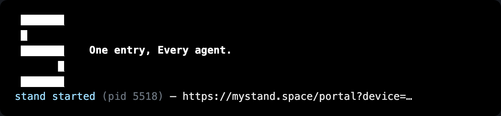
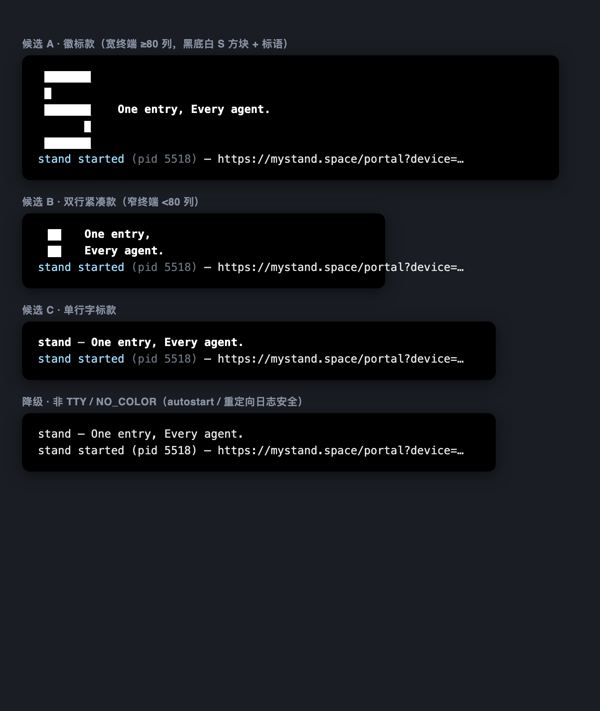

# 修复批 · stand CLI 生命周期双病（start 双启动 / pinned JDK 缺失路径）

- 批次: 2026-10-25 13:28 · 分支: `delegate/delegate-nebflow-085207c5`
- 病历: 作者 2026-10-25 13:0x 实测（终端日志在案）：`stand start` 连跑两次 →
  双 daemon（pid 86244/86479），第二个在 `SessionStore.loadFromIndex` strictBoot
  崩溃（`src/main/scala/nebflow/core/SessionStore.scala:376` →
  `src/main/scala/nebflow/Main.scala:237`）；随后 `stand stop` 报
  「stand is not running」—— pid 记账失配，真 daemon 没停掉。
- 本批只修**脚本侧**（launcher / ops 入库 / 自愈 installer），不动 Scala 侧。

## 修法

### 病1 · start 双启动守卫 + stop 双探针（`ops/bin/stand` LIFECYCLE-GUARD v1）

- `start`：进 JVM 前探端口（`lsof -ti tcp:$PORT -sTCP:LISTEN`，与
  `nebflow-autostart.sh` v2 同源守卫，端口权威——与应用侧
  `Main.scala` startGatewayLegacy「listening port is authoritative」同原则）：
  - 已有 stand listener → `stand is already running (pid X)` **exit 0**，
    不再起第二个 JVM（双 daemon + strictBoot 崩溃断根）；
  - 端口被外姓进程占 → 拒启 exit 1（镜像应用侧 `SingleInstanceGuard.ForeignOccupant`）。
- 端口一致性补丁：守卫把探的端口钉进子进程 env（`STAND_GATEWAY_PORT` +
  `NEBFLOW_GATEWAY_PORT`）。旧 launcher 不设 env，jar 默认 8080 而部署合同是
  6138——探 6138 起 8080 的守卫形同虚设。优先级与 `GatewayConfig` /
  `shared/paths.scala` 对齐：`--port` > `STAND_GATEWAY_PORT` > `NEBFLOW_GATEWAY_PORT` > 6138。
- `stop`：**双探针**（lsof listener + `$STAND_HOME/.pid` 并集去重）→ 身份门
  （cmdline 须含 `stand-assembly` / `nebflow` / `sbt`；`--force` 跳过，与
  `ProcessManager.StopOptions.force` 同语义）→ TERM → ≤10s 宽限 → KILL →
  清陈年 pid 记账（`.pid` / `.pid.meta`，仅当记录 pid 已死）。
  - 病历失配态（pid 记账丢/错，但 daemon 活着）由端口腿兜住 —— stop 真能停；
  - pid 腿兜反态（端口已丢但 pid 活着 = wedged）；
  - 双空 → `stand is not running` exit 0（幂等，同应用侧 `StopOutcome.NotRunning`）；
  - `stop --tree`（sbt 链止损）仍透传应用侧 `ProcessManager`，脚本不越权。
- 非 start/stop 子命令（version/status/…）零改动直透；WINSORT jar 选择、
  pointer-version 回滚选择、Java≥21 版本门（exit 11）原样保留。

### 病2 · pinned JDK 缺失 → 可执行自愈（`ops/bin/stand-jdk`）

- 旧 WARN「re-run the stand installer」不可执行（installer 不在仓）。
  现 WARN 指向两条真实可跑的路：部署副本 `~/.stand/bin/stand-jdk install` /
  仓内 `ops/bin/stand-jdk install`。
- 降级仍**非静默**（作者令 2026-09-21）：WARN 后回落 PATH java，且仍受
  Java≥21 版本门约束。
- `stand-jdk install|check|path`：brew `openjdk@21`（macOS，keg home symlink，
  无 sudo）→ Linux 包管理器 → Adoptium Temurin 21 tarball 兜底，全落
  `$STAND_HOME/jdk-21`。
- 路径全部 `STAND_HOME` 感知（`STAND_HOME` > `NEBFLOW_HOME` > `~/.stand`，
  同 dataRoot 优先级）；`STAND_JAVA_BIN` env 为测试沙箱 / ops 逃生门。

### ops 入库纪律（交付本体）

| 文件 | 说明 |
|---|---|
| `ops/bin/stand` | launcher 权威副本（本批修复版） |
| `ops/bin/stand-jdk` | pinned JDK 自愈 installer（新） |
| `ops/nebflow-autostart.sh` | 自启入口 v2 权威副本（入库时路径参数化 `STAND_REPO`，守卫不变） |
| `ops/nebflow-restart.sh` | v4.2 verbatim 入库（改动仍走其自身版本纪律） |
| `ops/README.md` | 部署说明（cp + chmod + `.bak-时间戳` 备份惯例 + 版本纪律） |
| `ops/test/stand-lifecycle.test.sh` | 守卫断言测试（纯 bash，无 bats 依赖） |

## 测试证据

1. **断言套件** `bash ops/test/stand-lifecycle.test.sh` → **41 PASS / 0 FAIL**（连跑两遍稳定）。
   沙箱化：假 java（`STAND_JAVA_BIN`）+ 假 jar + 随机空闲端口；零真实 daemon。
   覆盖 12 case：start 命中（零 JVM）/外姓拒启/未命中放行（子命令与端口 env 钉一致）、
   stop 端口命中/pid 腿（病历失配态）/双空幂等/身份门拒杀/`--force`/版本门 rc=11/
   passthrough/`--port` 覆写/stand-jdk check。
   测试基建坑（已记入测试头注释）：macOS `ps command=` 显示真实二进制路径 +
   argv[1:]，`exec -a` 假 argv[0] 对 .app 二进制无效；Apple 系二进制复制即被 SIP
   击杀（Killed:9）—— marker 监听器用现编 10 行 C（adhoc 签名落标记路径）。
2. **真机 E2E**（真 jar `~/.stand/bin/versions/…`，沙箱数据根
   `STAND_HOME=/tmp/stand-e2e.txlwQm`，端口 21871，headless）：
   - 第一次 `start` → daemon pid 5518，rc 0；
   - 部署修复版 launcher（备份 `~/.stand/bin/stand.bak-20261025-132752`）后
     第二次 `start` → `stand is already running (pid 5518) on port 21871` rc 0
     —— **病1 命中路径实证，无第二 daemon、无 strictBoot 崩溃**；
   - `stop` → `stopping stand (port 21871, pids:5518)` → 端口释放、pid 死、
     pid 记账清；再 `stop` → `stand is not running` rc 0（幂等）；
   - 沙箱（无 jdk-21）下 WARN 文案实拍：指引指向 `stand-jdk install`，可执行。
3. **静态**：`bash -n` ×4 脚本 + shellcheck（stand launcher）全绿。

## 部署状态

- `~/.stand/bin/stand`：已部署修复版（旧版备份 `stand.bak-20261025-132752`）。
- `~/.stand/bin/stand-jdk`：已部署（check 对本机 jdk-21 = OK）。
- `~/.stand/bin/nebflow-autostart.sh` / `nebflow-restart.sh`：live 未动（工作正常），
  权威副本已入库；下次变更按 `ops/README.md` 纪律走。
- pinned JDK：本批读盘时 `~/.stand/jdk-21 → /opt/homebrew/opt/openjdk@21`
  （21.0.13，主会话安装）已就位，WARN 路径不再触发；`stand-jdk` 供他机/灾备。

## 品牌横幅（作者追加 2026-10-25 13:10 逐字:「然后我们 stand start 的时候，也可以放一些我们的 logo，以及标语，One entry, Every agent.」）

`ops/bin/stand` BRAND-BANNER v1：仅 **start 且守卫放行**（真的要起 daemon）时打印；
already-running / 外姓拒启 / stop / 非 start 子命令一律不印。

- **三候选**（作者挑一款定稿，旋钮 `STAND_BANNER=A|B|C` 可即时切换试戴，缺省 A；
  `STAND_BANNER_COLS` 覆宽探测供测试/ops）：
  - **A 徽标款**（宽终端 ≥80 列缺省）：黑底白 S 方块（favicon 同构，5 行块字符）+ 标语同行
    
  - **B 双行紧凑款**（窄终端 <80 列缺省）：块字符立柱 + 两行标语
    
  - **C 单行字标款**：`stand — One entry, Every agent.`
    
  - 四态合览（含降级款）：
- **分寸**：URL 行紧随横幅之后且是终端最后一行（最显眼，不被艺术字埋掉）；
  非 TTY / `NO_COLOR` / `TERM=dumb` → 单行纯文本 `stand — One entry, Every agent.`
  （autostart / 重定向日志不刷艺术字，实截：shots/fallback-plain-nontty.png）。
  真机 E2E 序列（沙箱数据根 + 端口 21873，pty 实抓，ANSI 已剥）：
  ```text
   ███████
   █
   ███████    One entry, Every agent.
         █
   ███████
  stand started (pid 14307) — https://mystand.space/portal?device=cb89d132-…
  ```
- **顺带结构强化**：守卫面提到 JDK 门**之前**——already-running / stop /
  not-running 面零 JVM 依赖（`stand stop` 在 java 全坏时也能真停、已启动识别
  也不再先吃 JDK WARN 噪声；真机复验：stop 面输出干净）。
- 断言套件新增 case 13–17（非 TTY 降级 / pty 宽版 A / NO_COLOR 恒胜 / 窄版 B /
  STAND_BANNER=C 覆写），套件 **58/58 绿**。
  测试基建坑二则（记入测试头注释）：`script -q` 捕获带 `^D\b\b` 前缀属正常；
  候选渲染初版 `[97mOne` 丢失系 bash `$var` 后接字字符未加花括号（`$_wOne`
  被解析为变量 `_wOne`）——已全部 `${_w}` 花括号化。

## 未做 / 开放项

- **横幅候选 A/B/C 待作者定稿**（当前缺省 A；定稿后可把缺省旋钮改死并删备选）。
- Scala 侧双启动防线（strictBoot 本身）未动——脚本守卫已把双启动挡在 JVM 外；
  应用侧是否还要 boot 内幂等（第二个实例直接 no-op 而非崩溃），留给后续批。
- `stand status` 未加脚本面（应用侧已探 port+pid，A5 注释在案）。
- `stand-jdk` 的 Linux 路线（apt/dnf/apk + Temurin）未在真机验证（本机 macOS）。
- 测试套件依赖 `lsof` / `cc` / `python3`（本机皆有）；缺 cc 的机器 marker 类
  用例会显式 skip 并报原因（不静默）。
