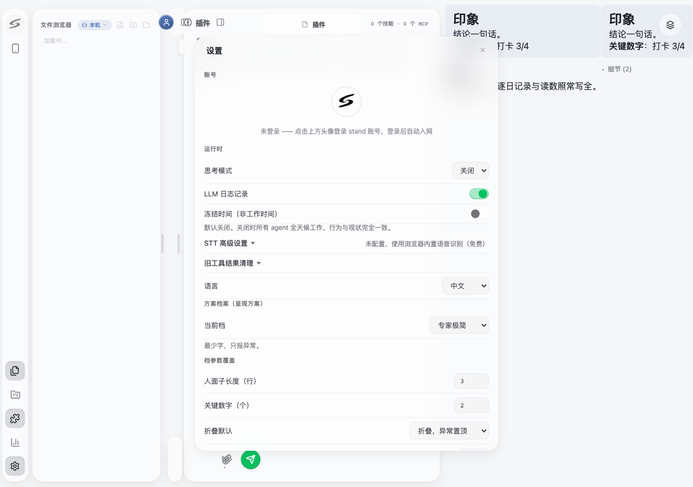

# 认知二期产品四件 · 批报告（2026-10-30）

```human
## 印象
认知方案二期裁决四件全部落地：选档器（五档+参数覆盖）、角标只报可行动量、打卡 UI（留痕销账+缺卡建议）、周报生成器（引擎生成，打卡热力图一图一结论）。全部测试通过，无需作者动手；遗留一项：周报浮出面用的是通知横幅（待办收件箱 #1128 落地后回填）。

**关键数字**：改 15 文件 + 新 10 件 · Scala 77/77 + 前端 19/19 断言绿 · checkJs 259<260 基线

```

## 发现

### ① 多方案档案选档器（§6.2/§6.3 五档照单）

- 引擎：`core/profile/PresentationProfile.scala`（五档内置定义 = §6.2 表逐项产品化，唯一枚举源）+ `PresentationProfileStore.scala`（作者裁定 §9-11：落 `~/.stand/presentation-profiles.json` 独立 JSON；`current` + 逐项 `overrides`；缺文件/损坏文件回默认档专家极简，不炸面）。
- WS 三路由：`getPresentationProfile`（档集+当前+覆盖全量下发）/ `setPresentationProfile`（选档校验）/ `setProfileParamOverride`（先校验后入账，value 缺省 = 复位）。
- 前端：`js/presentationProfile.js` 设置面板区块（五档选择 + 7 个可覆盖参数输入 + 复位钮 + 校准尾注）；`js/profileState.js` 零依赖运行态面（杜绝 utils↔ws 导入环）；`utils.js` human 过滤层折叠默认消费档参数——**备考冲刺档 Findings 默认展开（唯一不折档），其余四档折叠**；`profileGeneration` 掺入 markdown LRU 缓存键 ⇒ 切档即时生效（缓存面），五面同管线天然同收。
- 匹配主路 = 显式选档 + 校准尾注（行为推断永不做，§6.3 裁定）；`profile:` brief 变量沿用一期 prompt 纪律（派发面，本批不动）。

### ② 角标/通知只报可行动量（§5 P6）

- 判据 = 闭合相关性：新件 `js/actionable.js` 可行动计数聚合面（提供者注册 + 变更广播）。
- 提醒徽标（scheduled-task.js）：只报**待办（待销账）+ 已超时定时任务**；未来时间的定时任务 = 「有更新」不上徽标（e2e 钉死：1 待办 + 1 未来任务 ⇒ 徽标 = 1）。
- messages 徽标（messages.js）：从 Σ未读 改为可行动聚合 = 会话内点名行动（pendingAsk/mention 标记）+ 待批准胶囊 + 待销账待办 + 未读回执（heldReceipts，main.js 注册提供者）；纯未读不上徽标。文案「{n} 项待你处理」（反悬念）。
- 待办收件箱（#1128 在飞）浮出/聚合节奏沿用既有 todo digest 面，未新造催促通道。

### ③ 打卡 UI（§6.5 第 4 段产品面）

- 引擎：新件 `DoneRecordStore`（`~/.stand/checkin-records/done-records.jsonl` 只增 JSONL——此前 done 即删行零留痕，周报无从聚合，本批补数据源）；`ScheduledTask.missCount` 缺卡计数（withDefaults 零迁移）；`surfaceTodos` 每浮出 +1，达 3 次浮出文案附**调整建议**（降频或拆小，呈作者确认——不擅自改计划）；新 WS 路由 `completeTodo`（留痕销账，广播沿用 scheduledTaskDeleted 帧型）；ScheduleTool `done` 同写 done 痕（via=tool）。
- 前端：提醒面板待办组恒置顶（打卡签），圆钮 = 打卡销账（completeTodo），行尾 × = 取消（不留痕），missCount≥3 行内附调整建议（不指责口吻）；定时任务行零改动（delete 照旧）。

### ④ 周报生成器（§6.5 第 5 段 + §9-12 裁定）

- 引擎：新件 `WeeklyReport.scala` = 纯函数（ISO 周界/聚合/markdown 附录 C 实例化/热力图 SVG）+ `WeeklyReportGenerator`（挂 ScheduledTaskService 循环尾，一周一应谓词；**零超时设计：正确性全靠 marker 状态表达**——停机错过周一 ⇒ 下次 tick 补生成，marker 持久化防重；无可写工作区 ⇒ 跳过+日志，不静默写别处）。
- 产物：`<workspace>/reports/<yyyyMMdd>_weekly-checkin/REPORT.md`（Impression 围栏+关键数字+发现+下周计划）+ `docs/attachments/checkin-heatmap-<weekKey>.svg`（GitHub 形态热力图，零依赖矢量，图注=趋势结论句）。工作区 = 第一个本机非归档项目（deviceOrigin 排除）。
- 浮出面：广播 `weeklyReportReady` → 前端反悬念横幅（结论句：打卡数/趋势/落点）。**收件箱浮出待 #1128 落地后回填（裁定 §9-13 授权接合面）**。
- 趋势对比上周 done 数（↑/→/↓）；打卡率分母 = done + 未销账（无计划不报假红）。

## 验证

- Scala：`PresentationProfileStoreSpec`(6) + `DoneRecordStoreSpec`(3) + `WeeklyReportSpec`(9) + `TodoMissCountSpec`(5) + 存量回归 `TodoScheduleSpec`/`ScheduleActionsSpec`/`ScheduleToolSpec` —— **77/77 PASS**。
- 前端：`tests/cognition-phase2.spec.mjs` —— **19/19 PASS**（真实引导链 + WS 替身；零 pageerror/零 console 错误；截图 evidence/20261030_cognition-phase2/shots/）。
- checkJs：总 259 < 基线 260（本批 -1）；本批触文件零新增。**存量失败挂账**：bgMergedPanel.js/plugins.js/sidebar.js(65>62) 经 HEAD 对照证实 main 已红，与本批无关。
- scalafmtCheck：perception 两件（PerceptionService.scala:1084 / PerceptionDaemonLifecycleSpec.scala:62）解析失败为 main 存量，检查中止，本批文件未获全量格式核对（风格照仓内先例手写）。

## 遗留与边界

1. 周报浮出面 = 通知横幅；待办收件箱（#1128）落地后按 §6.4 接合面回填（裁定 §9-13 已授权）。
2. 周报工作区解析 = 第一个本机非归档项目（排序 by name）；多项目跟踪的按项目分报再议。
3. 热力图输出 SVG（零依赖、vault 可索引）；社交桥若需位图，后续可加 PNG 渲染腿（matplotlib 脚本 precedent 在 visual-report）。
4. `profile:` 键校验器规则、档参数扩项（配色/字号）按 §9-4/§9-11 维持另议。
5. 选档暂未按 agent 分档（全局当前档）；派发 brief 按档变量下发是一期 prompt 纪律面。
